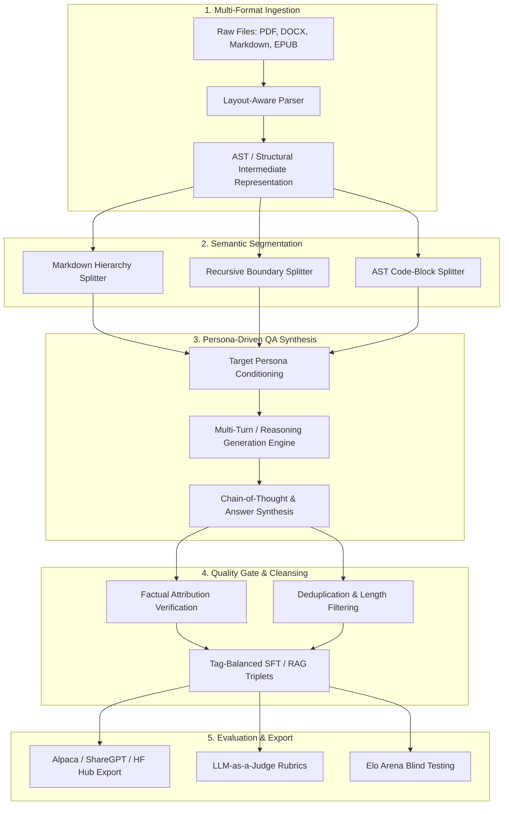
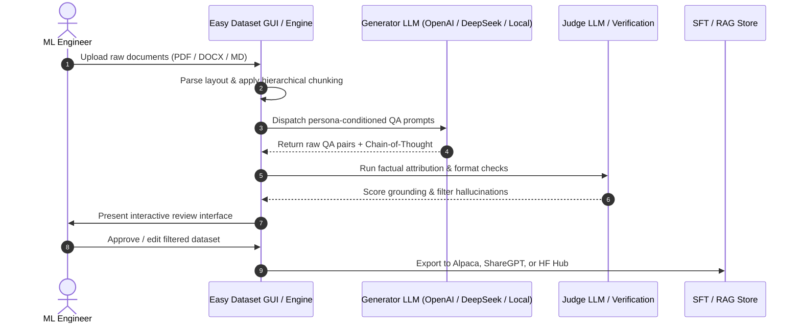

## Why Fine-Tuning and RAG Pipelines Stall on Synthetic Data Quality

Adapting frontier models or specialized base models to enterprise verticals—ranging from legal compliance and clinical protocols to internal infrastructure documentation—rarely fails due to model capacity. Instead, deployments stall because raw domain documentation cannot be fed directly into supervised fine-tuning (SFT) loops or retrieval-augmented generation (RAG) benchmarks without extensive pre-processing.

Engineering teams routinely build brittle, bespoke extraction scripts: a PDF parser coupled to an ad-hoc token splitter, piped to a prompting script that asks an instruction model to "generate five questions and answers from this paragraph." This workflow suffers from systemic failure modes:
1. **Context Fragmentation**: Naive character- or token-count chunking cuts across semantic boundaries, producing questions whose answers require missing context from adjacent paragraphs.
2. **Homogeneous Prompt Framing**: Single-prompt question generators produce repetitive queries with identical syntactic patterns and flat difficulty distributions.
3. **Unchecked CoT Hallucination**: Generative reasoning steps in synthetic answers frequently hallucinate intermediate factual claims not present in the reference passage.
4. **Disconnected Evaluation Loops**: Data generation occurs in isolation from downstream evaluation, leaving teams without immediate visibility into whether the generated dataset actually improves domain benchmark accuracy.

To address this friction, Miao et al. (Beihang University and State Key Laboratory of Software Development Environment) introduced **Easy Dataset** (arXiv:2507.04009, presented at EMNLP 2025 System Demonstrations). The framework unifies document ingestion, layout-aware segmentation, persona-conditioned question-answer synthesis, and multi-format evaluation into a single extensible platform.

---

## The Five-Stage Architecture of Easy Dataset

The core architecture of Easy Dataset organizes synthetic data generation into five decoupled stages: Ingestion, Chunking, Persona-Driven Synthesis, Quality Filtering, and Downstream Evaluation.

### 1. Multi-Format Parsing and Structural Representation

Unstructured enterprise corpora span heterogeneous formats: scanned or native PDFs, internal engineering Markdown, Microsoft Word documents, and technical manuals in EPUB. Standard text extraction tools (like basic `pypdf` extraction) discard typographical hierarchies, tables, and code snippets, collapsing structured headings into flat text runs.

Easy Dataset decouples ingestion into format-specific extractors that emit a unified structural representation. For markdown and technical manuals, header hierarchies (`H1` through `H4`) are preserved as tree nodes. For tabular data, HTML or Markdown table syntax is retained intact to prevent column transposition during subsequent chunking steps.

### 2. Layout-Aware and Semantic Chunking

Chunking strategy directly dictates downstream question validity. Easy Dataset implements three distinct segmentation engines rather than enforcing fixed-window sliding strides:

* **Markdown Hierarchical Splitter**: Traverses the document heading tree. It guarantees that subsections remain grouped under their governing parent topics, appending section breadcrumbs to chunk metadata.
* **Recursive Delimiter Splitter**: Hierarchically attempts splits along paragraph boundaries (`\n\n`), sentence boundaries (`.\n`), and phrase boundaries before resorting to whitespace splits, preserving grammatical coherence.
* **Code-Aware Splitter**: Identifies programming language fences and syntax blocks, preventing methods, class signatures, or configuration blocks from being severed across chunk boundaries.

As we analyzed in our survey of [LightRAG](/posts/lightrag/), graph- and document-based retrieval mechanisms degrade when chunk boundaries divide interdependent assertions. Providing structural metadata alongside raw chunk tokens ensures that the synthesis model receives self-contained context units.

---

## Persona-Driven Question Formulation and CoT Generation

The most significant theoretical contribution of Miao et al. is replacing monolithic question-generation templates with **persona-driven prompting**. 

Standard naive prompts—such as *"Generate three questions based on this text"*—suffer from mode collapse: the generator model defaults to surface-level lexical extraction, asking questions that merely invert the leading sentence of the chunk. In production retrieval systems, real users do not query documents using the exact lexical phrasing of the source text; queries vary widely by domain familiarity, role intent, and cognitive complexity.

Easy Dataset addresses this by injecting explicitly parameterized persona definitions into the synthesis prompt:

| Persona Dimension | Configuration Scope | Impact on Generated Query |
| :--- | :--- | :--- |
| **User Role** | Novice Student, Compliance Auditor, Senior Architect | Dictates technical vocabulary and implicit background assumptions |
| **Inquiry Intent** | Factual Lookup, Root-Cause Analysis, Cross-System Comparison | Determines whether questions require single-hop retrieval or multi-hop synthesis |
| **Cognitive Depth** | Bloom's Taxonomy: Recall, Application, Evaluation | Forces the model to generate analytical problem-solving prompts |
| **Response Style** | Direct Terse Answer, Step-by-Step Proof, Annotated Code | Governs the presence and depth of Chain-of-Thought (CoT) reasoning |

When generating answers, the framework enforces explicit reasoning traces prior to the final answer payload:

$$\text{Prompt}(C, P) \longrightarrow \langle\text{Thought}\rangle \tau_1, \tau_2, \dots, \tau_m \langle/\text{Thought}\rangle \longrightarrow \text{Answer } y$$

Where $C$ represents the input context chunk and $P$ represents the persona tuple $\langle\text{Role}, \text{Depth}, \text{Intent}\rangle$. The generated thought chain $\tau$ forces the synthesis model to cross-reference each claim against the context tokens $C$ before emitting the final text $y$.

---

## Grounded Verification and Built-In Model Evaluation

A chronic pitfall in synthetic data generation is downstream feedback blindness: datasets are generated in bulk and fed into fine-tuning without prior validation, leading to wasted compute when corrupted data degrades model checkpoints.

Easy Dataset integrates quality verification and comparative evaluation directly into the generation pipeline:

### 1. Factual Attribution Filtering
Before a generated pair is committed to the export queue, a secondary judge model or verification prompt evaluates the pair against the source chunk across three criteria:
* **Faithfulness**: Are all factual entities mentioned in the answer explicitly supported by the reference chunk?
* **Completeness**: Does the answer resolve all constraints posed by the question?
* **Negative Mining**: For RAG triplet exports, Easy Dataset samples non-relevant chunks from the same document corpus to construct hard-negative pairs $(\text{Query}, \text{Positive Chunk}, \text{Negative Chunk})$, essential for training dense bi-encoders and cross-encoders.

### 2. Dual-Track Model Evaluation: Automated Judge and Arena Blind Tests
Once fine-tuning datasets are constructed, Easy Dataset provides a unified testing environment:
* **Automated LLM-as-a-Judge**: Evaluates candidate model responses against ground-truth references using multi-dimensional rubrics (accuracy, conciseness, instruction adherence, reasoning depth).
* **Elo Arena Human Blind Testing**: Presents human evaluators with anonymous, side-by-side outputs from the baseline model and the fine-tuned model on identical prompts, calculating dynamic Elo ratings to eliminate presentation bias.

This closed-loop evaluation workflow echoes the harness discipline discussed in our examination of [Evaluating Deep Agents CLI on Terminal Bench 2.0](/posts/evaluating-deepagents-cli-on-terminal-bench-2-0/), where benchmark verification is baked directly into the development cycle rather than treated as an afterthought.

---

## What Changed Since Early 2026: From Static QA Generation to Multi-Modal Dynamic Synthesis

When Easy Dataset was initially released and demonstrated at EMNLP 2025, the primary state-of-the-art challenge was converting unstructured PDF/DOCX text into reliable text-only SFT datasets (Alpaca/ShareGPT formats) using closed API models like GPT-4o.

Across 2026, the landscape of synthetic data generation and fine-tuning underwent three major architectural shifts:

### 1. Transition to Vision-Based Layout Ingestion
Traditional regex and text-layer extraction struggle with complex multi-column scientific layouts, interleaved figures, and nested financial spreadsheets. In 2026, data synthesis pipelines increasingly replace OCR/text extraction layers with vision-native layout foundation models (such as Docling, MinerU, and multimodal VLMs). Instead of feeding raw parsed strings, the framework processes high-resolution page crops, allowing the synthesis engine to generate questions that synthesize visual charts, architectural diagrams, and textual annotations simultaneously.

### 2. Reinforcement Learning Verifier Loops (RLVR)
In early 2026, dataset synthesis moved beyond single-pass LLM generation. Frontier models are increasingly trained on reasoning datasets verified by deterministic execution environments (compilers, math provers, sandboxed unit tests). Where Easy Dataset originally relied on prompting an LLM judge to verify CoT reasoning, modern data pipelines integrate deterministic test runners: code blocks are executed against sandbox runtimes, and arithmetic derivations are verified via symbolic solvers before inclusion into training corpora.

### 3. Direct Preference Optimization (DPO/KTO) Pair Mining
Fine-tuning strategies have largely shifted from pure Supervised Fine-Tuning (SFT) to preference alignment. Modern dataset tools must produce paired preference tuples:

$$\mathcal{D}_{\text{pref}} = \left\{ \left(x, y_w, y_l\right) \right\}$$

Where $y_w$ represents the grounded, verified completion and $y_l$ represents a subtle, plausible hallucination or uncalibrated reasoning step. Easy Dataset's persona and judge framework provides the natural foundation for this, allowing the generator to intentionally simulate plausible failure modes to create robust preference datasets.

---

## Practical Engineering Tradeoffs

Deploying an end-to-end dataset synthesis engine involves acute operational tradeoffs that infrastructure teams must navigate:

| Operational Dimension | Primary Bottleneck | Architectural Mitigation |
| :--- | :--- | :--- |
| **API Cost and Rate Limits** | Synthesizing CoT pairs across 10,000 document chunks consumes hundreds of millions of tokens | Deploy distilled local inference models (e.g., DeepSeek-R1-Distill-Qwen) for draft generation and reserved API models for high-tier judge verification |
| **Chunk Window Boundary Bleed** | Answering cross-chapter or summary questions requires global document context | Complement local chunk QA with whole-document abstractive summaries and global entity-relationship graphs |
| **Judge Self-Preference Bias** | When the same LLM family generates and evaluates answers, scores artificially inflate by 10–15% | Decouple the generator model family from the judge model family (e.g., generate with Qwen/DeepSeek, judge with Claude/GPT) |
| **Label Drift Over Document Versions** | Internal documentation updates render historical synthetic datasets stale | Maintain cryptographic hash bindings between source document chunks and generated QA pairs for incremental invalidation |

---

## Key Takeaways

| Architectural Layer | Core Mechanism | Production Implementation Rule |
| :--- | :--- | :--- |
| **Document Ingestion** | Format-specific layout and AST parsing | Never use flat text splitters on structured documents; preserve headers and tables as first-class tokens |
| **Question Synthesis** | Persona-driven prompt conditioning | Parameterize user roles, inquiry intents, and cognitive depth levels to prevent lexical mode collapse |
| **Reasoning Grounding** | Explicit Chain-of-Thought attribution | Force intermediate reasoning tokens before emitting final answers, checking attribution against the source context |
| **Evaluation Integration** | Dual-track LLM-as-a-judge and Elo Arena | Bind synthetic data directly to measurable benchmark gains before committing checkpoints to production fine-tuning |

## New Questions

- **Automated Sandbox Verification**: How can synthetic data engines integrate programmatic sandbox execution (unit testing, SQL query verification) directly into the chunking pipeline without incurring excessive latency?
- **Graph-Augmented QA Synthesis**: Can entity-relationship graphs extracted via LightRAG or GraphRAG architectures systematically guide persona models to generate multi-hop queries across distant chapters?
- **Dataset Decontamination**: As synthetic datasets are publicly exported to Hugging Face Hub, what automated watermarking or statistical checks are required to prevent recursive model collapse in future foundation model pre-training?

---

## References

- Miao, Z., Sun, Q., Wang, J., Gong, Y., Zheng, Y., Li, S., & Zhang, R. (2025). *Easy Dataset: A Unified and Extensible Framework for Synthesizing LLM Fine-Tuning Data from Unstructured Documents*. arXiv:2507.04009 [cs.CL]. [https://arxiv.org/abs/2507.04009](https://arxiv.org/abs/2507.04009) (accessed 2026-10-18).
- ConardLi. (2025). *Easy Dataset: Document-to-Dataset Pipeline for LLM Fine-Tuning and Evaluation*. GitHub Repository. [https://github.com/ConardLi/easy-dataset](https://github.com/ConardLi/easy-dataset) (accessed 2026-10-18).
- Easy Dataset Documentation Team. (2025). *Easy Dataset Official Documentation & Architecture Guide*. [https://docs.easy-dataset.com/ed/en](https://docs.easy-dataset.com/ed/en) (accessed 2026-10-18).
- Association for Computational Linguistics. (2025). *Proceedings of the 2025 Conference on Empirical Methods in Natural Language Processing: System Demonstrations*. [https://aclanthology.org/events/emnlp-2025/](https://aclanthology.org/events/emnlp-2025/) (accessed 2026-10-18).
