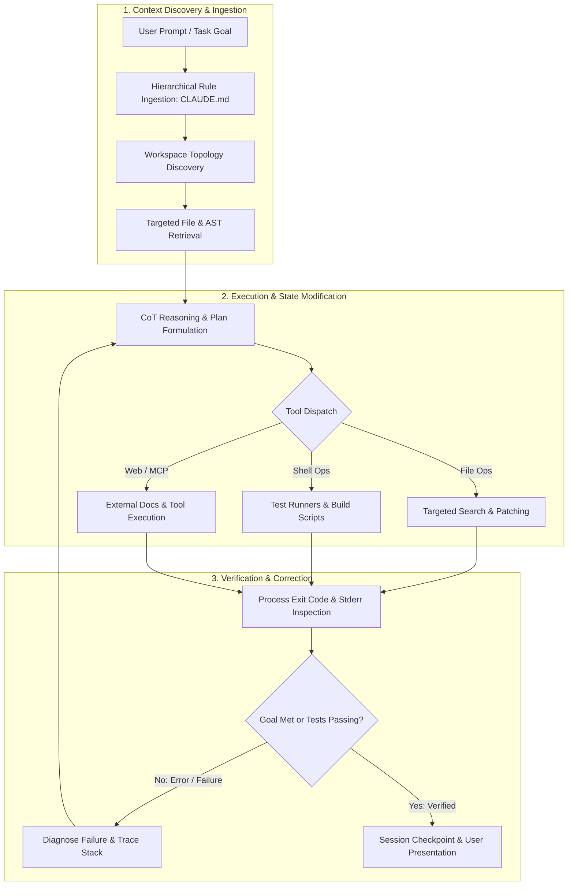
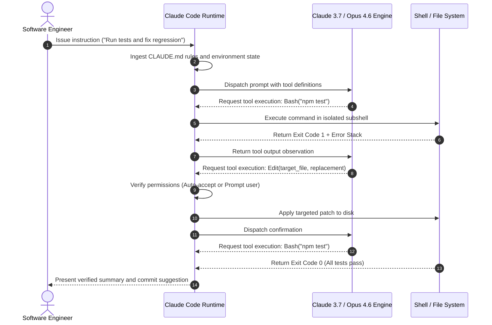
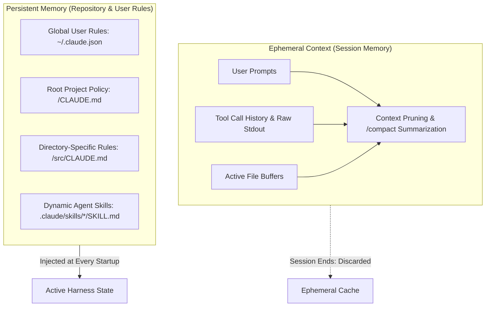

## Why Terminal-Native Coding Agents Outperform Passive Chat Assistants

Traditional IDE chat plugins operate as passive text autocomplete engines: they receive a prompt, inject an open file buffer into context, and emit code snippets that developers must manually copy, paste, and test. When compilation fails or tests break, the feedback loop requires human intervention to copy the terminal stack trace back into the chat window.

Claude Code fundamentally departs from this pattern by implementing an autonomous, **terminal-native agent loop**. Operating directly inside the developer's shell environment, the harness possesses first-class execution capabilities: it discovers codebase architecture through recursive search, modifies source files in place, runs test suites, inspects compiler diagnostics, and iterates autonomously until acceptance criteria are satisfied.

The transition from a passive assistant to an active agent runtime requires rigorous systems engineering. Without strict boundaries, an autonomous terminal agent risks executing destructive commands (`rm -rf`, unexpected git resets, or unverified database drops). Understanding how Claude Code orchestrates its reasoning loop, schedules tool invocations, and enforces permission gates is essential for building robust software with agentic harnesses.

---

## The Three-Phase ReAct Loop: Context, Execution, and Verification

At the core of Claude Code is an iterative ReAct (Reason + Act) loop designed around stateful tool observation and goal satisfaction. Rather than generating monolithic diffs in a single pass, the runtime alternates between token-budgeted reasoning and granular environment interactions.

### 1. Context Gathering and Dynamic Exploration
Rather than dumping thousands of source lines into the prompt context, Claude Code operates via targeted exploration. It queries workspace structure using dedicated exploration tools:
* `GlobTool`: Discovers directory trees, configuration files, and package manifests without reading file contents.
* `GrepTool`: Performs regex and literal pattern matching across files to isolate exact symbol declarations and call sites.
* `View`: Reads line-bounded slices of files to minimize prompt token burn.

This separation of discovery and deep inspection mirrors the modular patterns documented in our survey of [CLI Harness Coding Agents](/posts/cli-harness-coding-agents/), where token density determines harness efficiency.

### 2. Execution and In-Place Patching
When modifying code, Claude Code avoids full-file overwrites whenever possible. It utilizes string replacement and AST-aware diffing primitives:
* **Targeted Chunk Replacement**: Matches exact character sequences (including whitespace and indentation) with surrounding context lines, ensuring changes remain localized.
* **Non-Destructive File Creation**: Validates file paths, creates missing parent directories automatically, and prevents accidental overwrite of uncommitted user work.

### 3. Verification and Iterative Diagnosis
Execution does not terminate upon writing code. Claude Code treats local verification as the definitive signal of task completion:
* Shell commands run with output buffering; exit codes (`0` vs. non-zero) dictate agent state transitions.
* If a test suite fails, stdout/stderr logs are fed back into the context window as environment observations, allowing the model to diagnose errors and issue corrective edits.

---

## Tool Boundaries and Runtime Primitives

The harness decouples the reasoning engine (the Claude foundation model) from operating system primitives through a strictly typed tool interface:

| Tool Primitive | Execution Boundary | Security & Isolation Contract |
| :--- | :--- | :--- |
| **`View` / `Read`** | File System (Read-Only) | Enforces line-range bounds; prevents buffer overflows on binary or multi-gigabyte assets |
| **`Edit` / `Write`** | File System (Mutating) | Creates automatic file checkpoints; validates target existence before destructive writes |
| **`Bash`** | Subshell Execution | Subject to user permission modes; traps destructive shell patterns; streams background outputs |
| **`WebSearch` / `Fetch`** | HTTP / Headless Scraper | Strips client-side JavaScript execution; parses HTML into clean markdown to preserve context budget |
| **`MCP` Connectors** | Stdio / SSE Transport | Dynamically negotiates capabilities with external database engines, browser harnesses, and dev tools |

---

## Context Architecture and Durable Memory: Ephemeral vs. Persistent

A central challenge in agent runtime design is context exhaustion. Large language models maintain strict token budgets; accumulating long conversation logs, tool outputs, and compiler dumps quickly triggers performance degradation.

Claude Code divides memory into two distinct tiers:

### 1. Ephemeral Session State
Conversation turns, raw tool results, and compiler logs are ephemeral. When the context window approaches its budget limit, Claude Code executes semantic compacting (`/compact`), summarizing earlier tool steps into concise state transitions while preserving critical architectural decisions.

### 2. Persistent Repository Memory (`CLAUDE.md`)
Unlike conversational memory, repository guidelines must remain immutable across developer sessions. Claude Code addresses this through hierarchical `CLAUDE.md` files:
* **Global Rules** (`~/.claude.json`): User preferences, preferred editor shortcuts, and baseline environment variables.
* **Repository Root** (`./CLAUDE.md`): Canonical build commands, architectural invariants, code style conventions, and testing protocols.
* **Subdirectory Rules** (`./packages/sub/CLAUDE.md`): Scoped guidelines that activate only when the agent operates within specific modules.

As detailed in our analysis of [Claude Code Insights](/posts/claude-code-insights/), storing structural rules in repository markdown files rather than prompt conversation history ensures that institutional knowledge compounds across runs.

---

## Safety Architecture: Checkpoints, Permission Modes, and Pre-Tool Hooks

Autonomous agent execution introduces real operational risk. Claude Code mitigates this through a three-layer defense-in-depth safety architecture:

### 1. The Four Autonomy Permission Modes
Developers configure agent autonomy according to operational risk profiles:
* **Default Mode**: Explicit human confirmation required before any mutating file edit or shell execution.
* **Auto-Accept Edits**: Code file modifications are executed immediately; shell commands and package installations still trigger interactive prompts.
* **Plan Mode**: Strict read-only mode. All mutating tools (`Write`, `Edit`, mutating `Bash` calls) are disabled, forcing the agent to output architectural proposals and step-by-step plans without touching disk state.
* **Delegate Mode**: Configures Claude Code as a coordinator that delegates subtasks to specialized subagents while reserving commit and push authority for the human operator.

### 2. File Checkpoints and Rollback Mechanics
Before executing any file modification, Claude Code establishes an internal checkpoint. If an edit results in syntax errors or breaks unintended files, the agent or developer can revert state instantly using session history navigation (`/undo`), eliminating the risk of unrecoverable source corruption.

### 3. Hook-Based Guardrails
Claude Code exposes lifecycle hooks (`PreToolUse` and `PostToolUse`) that evaluate commands prior to execution. Custom hooks can intercept commands like `git push`, `git reset --hard`, or `rm -rf`, blocking them deterministically before they reach the shell process, as outlined in our evaluation of [Awesome Claude Skills](/posts/awesome-claude-skills/).

---

## What Changed Since Early 2026: From Single Loops to Multi-Agent Teams and Adaptive Reasoning

When Claude Code debuted in early 2026, the CLI operated strictly as a single-threaded ReAct loop. Across 2026, terminal-native agent engineering evolved through three major paradigms:

### 1. Multi-Agent Team Orchestration
Single-agent loops struggle when tasks require wide refactors across disparate microservices or simultaneous documentation and testing. Modern Claude Code harnesses incorporate agent teams—such as the subagent coordination explored in [Claude Opus 4.6 Agent Teams](/posts/claude-opus-46-agent-teams/). The primary coordinator spawns lightweight, ephemeral subagents equipped with isolated workspaces and scoped tool access, merging results through explicit synchronization barriers.

### 2. Dynamic Thinking Budgets and Adaptive Effort
Early implementations treated every instruction with uniform model effort. Modern harnesses dynamically adjust the internal reasoning token budget (`thinking_budget`): simple file reads bypass deep reasoning chains, while intricate algorithmic refactors allocate thousands of internal reasoning tokens to evaluate edge cases before emitting file patches.

### 3. Standardized Cross-Runtime Harness Contracts
The separation between runtime memory (`CLAUDE.md`), agent skills (`SKILL.md`), and multi-agent directives (`AGENTS.md`) has coalesced into unified industry standards. Whether deploying Claude Code, Codex, or Gemini-based CLI tools, projects utilize shared markdown-driven policy files, ensuring that agent governance remains portable across foundation model providers.

---

## Practical Engineering Tradeoffs

Integrating terminal-native agents into production workflows requires balancing velocity against operational guardrails:

| Architectural Dimension | Core Tradeoff | Mitigation Strategy |
| :--- | :--- | :--- |
| **Autonomy vs. Safety** | Full autonomy maximizes speed but risks running unvetted mutations | Keep Plan Mode active during requirement analysis; shift to Auto-Accept Edits only when bounded by comprehensive test suites |
| **Context Overhead vs. Token Cost** | Reading full files ensures complete context but rapidly burns token budgets | Enforce line-bounded reads (`View`) and AST search (`GrepTool`) instead of loading entire modules |
| **Session Isolation vs. Knowledge Retention** | Ephemeral sessions prevent hallucination carryover but lose iterative discoveries | Persist lessons and invariant rules directly into `CLAUDE.md` and dedicated `SKILL.md` documents |
| **Local Shell vs. Containerized Sandbox** | Running on host OS enables access to local dev tools but exposes user files | Run untrusted scripts or legacy migrations inside containerized Docker dev environments or restricted subshells |

---

## Key Takeaways

| Component | Architecture Role | Best Practice for Teams |
| :--- | :--- | :--- |
| **Agent ReAct Loop** | Continuous cycle of context discovery, execution, and verification | Always provide verifiable acceptance criteria (unit tests, linters) so the loop knows when work is done |
| **Persistent Memory** | Repository-level `CLAUDE.md` rules | Commit project conventions, test commands, and architectural boundaries to git version control |
| **Permission Modes** | Graduated autonomy gates | Leverage Plan Mode for design stress-testing and Auto-Accept Edits for bounded implementation tickets |
| **Progressive Tool Dispatch** | Selective discovery via Grep/Glob before reading | Teach agents to survey workspace topology before loading large file buffers into active context |

## New Questions

- **Deterministic Sandbox Boundaries**: How can CLI agent harnesses provide lightweight micro-virtualization (e.g., Apple sandbox-exec or Linux namespaces) by default without requiring complex Docker daemon setups?
- **Automated Memory Distillation**: Can post-session analyzers automatically detect recurring failure patterns and submit pull requests to update `CLAUDE.md` without human prompt engineering?
- **Agent Interoperability**: How will standardized Agent-to-Agent (A2A) protocols govern task handoffs between terminal-native CLI agents and remote cloud background workers?

---

## References

- Anthropic. (2026). *How Claude Code Works: Architecture, Agent Loops, and Tool Execution*. Claude Code Official Documentation. [https://code.claude.com/docs/en/how-claude-code-works](https://code.claude.com/docs/en/how-claude-code-works) (accessed 2026-10-18).
- Anthropic. (2026). *Common Workflows and Best Practices for Terminal-Native Coding Agents*. Claude Code Guides. [https://code.claude.com/docs/en/common-workflows](https://code.claude.com/docs/en/common-workflows) (accessed 2026-10-18).
- Anthropic. (2026). *Claude Code Security, Permissions, and Checkpoint Architecture*. Claude Code Security Documentation. [https://code.claude.com/docs/en/features-overview](https://code.claude.com/docs/en/features-overview) (accessed 2026-10-18).
- Yao, S., Zhao, J., Yu, D., Du, N., Shafran, I., Narasimhan, K., & Cao, Y. (2023). *ReAct: Synergizing Reasoning and Acting in Language Models*. International Conference on Learning Representations (ICLR). [https://arxiv.org/abs/2210.03629](https://arxiv.org/abs/2210.03629) (accessed 2026-10-18).
