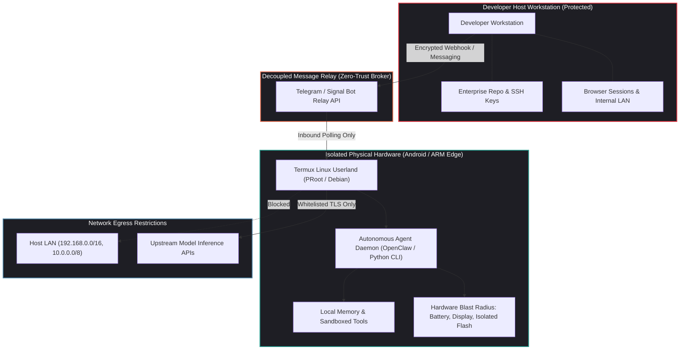
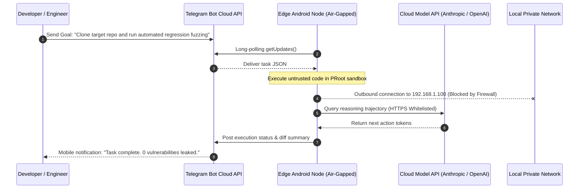

## Why Does Physical Hardware Isolation Solve the Autonomous Agent Security Dilemma?

As autonomous AI agents acquire terminal execution capabilities, browser automation tools, and file system manipulation rights, software engineers face a critical dilemma: **how do you allow an agent to execute arbitrary, unverified code without risking your primary workstation or enterprise network?**

Software-level sandboxing (such as Docker containers, virtual machines, and chroot jails) is the standard defense in cloud infrastructure. However, deploying autonomous agents on a developer's primary laptop introduces severe security vulnerabilities:

1. **Shared Kernel and Container Breakout Risks**: Container isolation relies on Linux namespaces and cgroups. A privileged agent running untrusted scripts or interacting with malicious web pages can exploit local kernel vulnerabilities to escape containers and access host memory.
2. **Local Network Ingress and Lateral Movement**: An agent executing inside an unsegmented home or corporate Wi-Fi network has direct access to internal subnets (`192.168.1.0/24`), private NAS storage, router administration panels, and unauthenticated local developer servers (`localhost:3000`, `localhost:8080`).
3. **Sensitive Host Artifact Exfiltration**: A developer's workstation contains high-value cryptographic credentials: SSH private keys (`~/.ssh/id_ed25519`), AWS credentials (`~/.aws/credentials`), browser cookie vaults, and active git tokens. Indirect prompt injection attacks can trick an agent into encoding these secrets into outbound requests.

To eliminate this blast radius without provisioning expensive dedicated cloud virtual machines, engineering practitioners pioneered **physical edge sandboxing**—repurposing decommissioned Android smartphones and ARM single-board computers (SBCs) into air-gapped agent execution nodes. By constraining an autonomous agent to a physically separate, sacrificial piece of hardware, developers achieve absolute security boundaries with zero risk to primary development environments.



---

## Architectural Mechanics: Running Autonomous Agent Userlands on Mobile Silicon

Deploying an autonomous agent stack (such as OpenClaw, AutoGen, or custom Python harnesses) on an Android device requires running a full Linux userland on top of the Android Linux kernel without requiring root privileges.

### 1. Termux PRoot and Linux Distribution Sandboxing

Modern Android security restricts root access and mounts system partitions as read-only. Developers utilize **Termux** in conjunction with **PRoot** (a user-space implementation of `chroot` that intercepts system calls via `ptrace`):

- **Virtual Filesystem Emulation**: PRoot maps standard Linux filesystem hierarchies (`/usr`, `/bin`, `/etc`, `/var`) into Termux's private app directory (`/data/data/com.termux/files/home`).
- **Fake Root Execution**: The agent believes it is running as `root` with `uid 0`, allowing standard package managers (`apt`, `pip`, `npm`) to install dependencies, compile C/C++ extensions, and configure environment paths without altering the underlying Android OS.

```bash
# Provisioning a sandboxed Debian ARM64 userland inside Termux
pkg update && pkg install proot-distro git nodejs python
proot-distro install debian
proot-distro login debian

# Inside the sandboxed Debian environment
apt update && apt install -y build-essential libffi-dev
git clone https://github.com/openclaw/openclaw.git
cd openclaw && pip install -r requirements.txt
```

### 2. Mobile Hardware Constraints: Thermals, Throttling, and Memory

Unlike cloud servers with active cooling and continuous power, mobile silicon introduces unique operating challenges:

- **Thermal Throttling**: Mobile SoCs (such as Qualcomm Snapdragon or MediaTek Dimensity) are designed for burst performance. Sustained multi-minute agent reasoning or local embedding generation triggers severe thermal throttling, dropping CPU clock speeds by up to $60\%$.
- **Aggressive Out-Of-Memory (OOM) Killer**: Android’s `lowmemorykiller` daemon aggressively terminates background processes that exceed memory allocations. In edge agent deployments, engineers configure swap files via `zRAM` or swapfile partitions to prevent the agent daemon from being killed during peak context token ingestion.
- **WakeLock Enforcement**: To prevent the device from entering deep sleep when the screen turns off, the userland harness acquires an Android partial wake lock (`termux-wake-lock`), ensuring continuous network polling and task scheduling.

---

## Network Isolation and Egress Defense Architecture

Physical separation is insufficient if the edge device resides on the same flat Wi-Fi subnet as corporate workstations. A truly secure edge sandbox requires strict network egress policies:



### 1. Guest Network Segmentation

The edge device is connected exclusively to a dedicated **Guest Wi-Fi VLAN** or a cellular hotspot. The network router enforces access control lists (ACLs):

- Drop all packets destined for private address spaces: `10.0.0.0/8`, `172.16.0.0/12`, and `192.168.0.0/16`.
- Block broadcast and multicast discovery protocols (mDNS, SSDP), preventing the agent from discovering smart home devices, local NAS drives, or development ports.

### 2. Inbound Decoupling via Asynchronous Messaging Relays

Opening inbound SSH or HTTP ports on the edge device creates a network attack surface. Instead, the edge agent operates entirely on **outbound polling**:

- The agent connects to a managed messaging service (such as a Telegram Bot API, Discord Webhook, or Cloudflare Queue).
- The human operator issues commands via encrypted mobile chat.
- The agent polls the queue over outbound HTTPS, executes the task in its isolated sandbox, and transmits back execution summaries, logs, and git patches.

As analyzed in our study of [enterprise Claude Code adoption and governance guardrails](/posts/microsoft-claude-code-inside/), separating command ingestion from physical execution environments is essential for safe autonomous operation.

---

## Comparative Analysis: Edge Hardware vs. Local Docker vs. Cloud Micro-VMs

| Dimension | Local Docker on Workstation | Cloud Micro-VM (AWS EC2 / Fly.io) | Physical Edge Hardware (Android Phone / SBC) |
| :--- | :--- | :--- | :--- |
| **Hardware Cost** | $0 (Runs on existing laptop) | Continuous hourly billing ($10–$50/mo) | **$0 (Repurposed decommissioned hardware)** |
| **Blast Radius Containment** | Low (Vulnerable to kernel breakouts & LAN discovery) | High (Virtual VPC isolation) | **Absolute (Physical air-gap from primary machine)** |
| **Host System Degradation** | High (Competes for CPU, RAM, and battery) | None | **None (Zero impact on primary workstation)** |
| **Network Security** | Shares local workstation IP and subnet | Requires complex VPC security groups | **Isolated via Guest Wi-Fi VLAN or Cellular 4G/5G** |
| **Credential Safety** | High risk of host secret exfiltration | Safe if IAM roles are tightly scoped | **Safe (Zero credentials stored on device)** |

---

## How Edge Agent Sandboxing Evolved Across 2026

The practice of running autonomous agents on distributed physical edge devices expanded significantly across 2026:

1. **On-Device NPU Acceleration for Quantized SLMs**: With the release of efficient small language models—such as the 3B active MoE models analyzed in our audit of [Qwen3-Coder-Next](/posts/qwen3-coder-next/)—modern mobile NPUs (Neural Processing Units) execute reasoning loops locally at over 30 tokens/second, enabling fully offline, air-gapped agent execution without external cloud API dependencies.
2. **Hardware Enclaves and ARM TrustZone**: Advanced edge harnesses began leveraging ARM TrustZone and Android Keystore hardware enclaves to cryptographically sign every action log and git commit emitted by the agent, ensuring tamper-proof audit trails for compliance.
3. **Decentralized Multi-Agent Edge Swarms**: Enthusiasts and researchers link multiple repurposed mobile devices into local cooperative clusters via lightweight messaging protocols, simulating distributed agent teams (e.g., one device dedicated to fuzz testing, another to static code analysis, and a third to documentation generation).
4. **Integration with Enterprise Database Tooling**: Edge agents connect back to corporate data sources strictly through zero-trust intermediate gateways, such as the architecture examined in our source audit of [MCP Toolbox for Databases](/posts/mcp-toolbox-databases/), ensuring parameterized safety even when running on external edge devices.

---

## Key Takeaways

- **Physical Air-Gap Supremacy**: Running autonomous agents on dedicated, sacrificial hardware eliminates the risks of container breakouts, local network lateral movement, and host credential exfiltration.
- **Termux PRoot Viability**: Modern ARM mobile devices provide robust Linux userlands capable of running Python, Node.js, and standard developer toolchains without requiring OS-level root access.
- **Asynchronous Inbound Decoupling**: Controlling agents via outbound-polling messaging relays (Telegram, Signal) prevents inbound attack vectors while delivering an intuitive mobile-first control plane.
- **Zero Financial Overhead**: Repurposing obsolete smartphones provides an environmentally sustainable, zero-cost sandbox for testing high-risk autonomous agent workflows.

---

## New Questions

1. How can mobile operating systems natively support agent execution sandboxes with formal hardware-enforced CPU and battery quotas without terminating processes in the background?
2. What cryptographic attestation protocols can guarantee that code authored on an edge device was not tampered with before merging into production repositories?
3. As on-device small language models improve, will enterprise developers maintain private local clusters of ARM edge nodes rather than renting cloud compute?

---

## References

1. Venkataraman, G. *Running OpenClaw on an Old Android Phone: A Practical Guide to Low-Cost Agentic Sandboxes*. LinkedIn Engineering Notes. https://www.linkedin.com/ (accessed 2026-10-18).
2. Termux Community. *Termux PRoot Documentation: Emulating Linux Userlands on Android*. https://wiki.termux.com/wiki/PRoot (accessed 2026-10-18).
3. Anthropic Security Team. *Sandboxing and Security Guardrails for Computer-Using Autonomous Agents*. Anthropic Research Blog. https://www.anthropic.com/research/agent-security (accessed 2026-10-18).
4. ARM Architecture Group. *ARM TrustZone Technology: Hardware-Enforced Security for Edge Devices*. ARM Developer Documentation. https://developer.arm.com/architectures/security-architectures/trustzone (accessed 2026-10-18).
