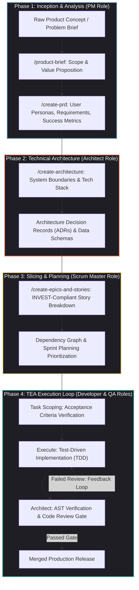
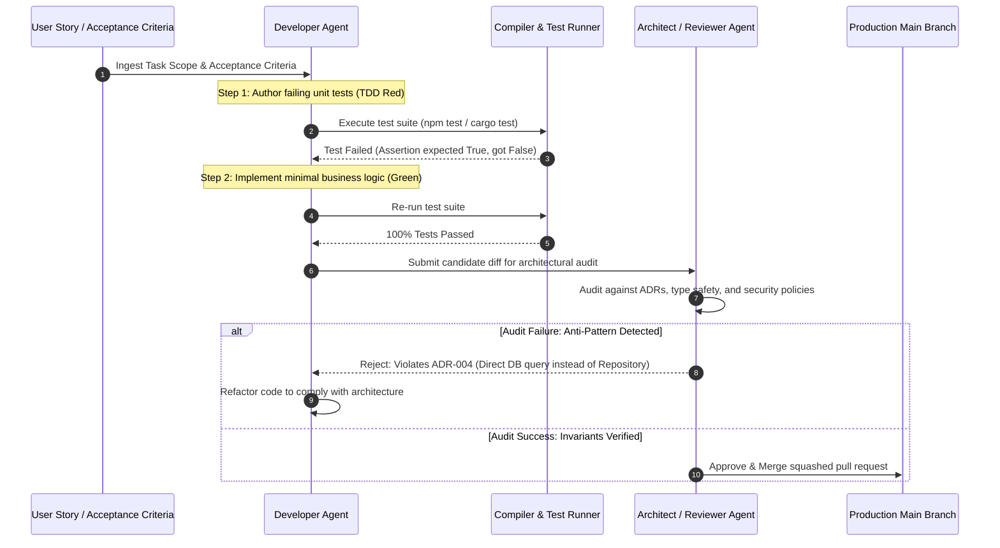

## Why Did "Vibe Coding" Create an Urgent Demand for Phase-Gated Agentic Lifecycles?

The initial surge of AI-assisted programming popularized what the industry termed "vibe coding"—an informal, conversational style of software creation where a developer prompts an AI model with loose natural language descriptions, immediately accepts generated code, and iterates reactively against runtime errors. While vibe coding enables exhilarating proof-of-concept velocity for throwaway weekend scripts, it introduces catastrophic failure modes when applied to mission-critical, enterprise codebases:

1. **Architectural Drift and Incoherent Boundaries**: Unconstrained agents optimize for local completion rather than global system cohesion. They introduce redundant utility libraries, bypass existing domain abstractions, duplicate business logic, and invent ad-hoc database schemas that conflict with existing data models.
2. **Missing Specifications and Edge-Case Blindness**: Conversational prompts rarely specify non-functional requirements, data validation boundaries, concurrency limits, or error recovery semantics. Agents generate the "happy path" while silently omitting authorization checks, input sanitization, and database connection pooling.
3. **Compounding Technical Debt and Code Bloat**: Because an agent lacks memory of prior architectural decisions, successive modifications layer brittle workarounds on top of unverified assumptions, eventually resulting in codebases that human engineers can neither navigate nor refactor.

To transition AI code generation from chaotic prototyping into disciplined software engineering, the open-source community formalized the **BMAD Method (Brainstorm, Model, Architect, Deliver)**. BMAD is a phase-gated, agent-driven agile engineering methodology that enforces role specialization, formal specification artifacts, and iterative **Task-Execute-Architect (TEA)** cycles before a single line of production code is merged.

---

## Architectural Mechanics: Deconstructing the Four BMAD Delivery Phases

Rather than treating a foundation model as a general-purpose chat bot, BMAD configures language models into **specialized persona agents** governed by rigorous input-output contracts. Each phase produces persistent, markdown-native artifacts checked into the repository under structured directories (e.g., `.bmad/briefs/`, `.bmad/prds/`, `.bmad/adrs/`).

### Phase 1: Inception and Analysis (Product Management)

A software initiative begins with problem framing. The **Product Manager Agent** interrogates the developer or stakeholders through guided conversational prompts:

- **`/product-brief`**: Distills raw feature ideas into problem statements, user friction points, target audiences, and explicit out-of-scope boundaries to prevent scope creep.
- **`/create-prd`**: Authors a structured Product Requirements Document specifying functional requirements, user story maps, performance criteria, and measurable business indicators.

By freezing the PRD before technical design begins, the engineering team establishes an unambiguous ground-truth contract.

### Phase 2: System Architecture and Domain Modeling (Software Architecture)

Once requirements are crystallized, the **System Architect Agent** translates the PRD into an authoritative technical architecture:

- **Component Boundaries and Interfaces**: Explicitly defining domain modules, API contracts, and data flows.
- **Architecture Decision Records (ADRs)**: Documenting why specific databases, libraries, or protocols were chosen over alternatives (e.g., choosing Qdrant over pgvector for dedicated high-scale vector indexing).
- **Security and Governance Baselines**: Enforcing authentication patterns, data validation schemas, and rate-limiting rules.

### Phase 3: Vertical Slicing and Sprint Planning (Scrum Master)

Monolithic tasks cause agent context saturation. The **Scrum Master Agent** decomposes the architecture into independently deliverable vertical slices:

- **Epics and Stories**: Every story conforms strictly to the **INVEST criteria** (Independent, Negotiable, Valuable, Estimable, Small, Testable).
- **Acceptance Criteria**: Formatted as executable Given-When-Then scenarios, ensuring unambiguous validation targets.

### Phase 4: The TEA Execution Cycle (Developer and Code Reviewer)

Implementation proceeds through the **Task-Execute-Architect (TEA)** cycle:

The TEA cycle enforces a critical separation of concerns: the **Developer Agent** writes code to make unit tests pass, while an independent **Reviewer Agent** evaluates the diff against architectural guidelines, linting rules, and security policies. Code cannot merge without passing this dual-perspective gate.

---

## Scale-Adaptive Planning: Avoiding Process Bloat

A common failure mode in software engineering methodologies is applying enterprise-level ceremony to trivial modifications. BMAD introduces **Scale-Adaptive Intelligence**:

| Project Scope | Complexity Classification | Activated BMAD Workflow | Required Artifacts |
| :--- | :--- | :--- | :--- |
| **Micro-Fix / Hotfix** | Low | `/quick-fix` | In-place regression test, targeted git diff |
| **Feature Slice / Subsystem** | Medium | `/feature-flow` | Story spec, interface contract, TEA cycle |
| **New Greenfield Project** | High | Full BMAD Lifecycle | Product Brief, PRD, Architecture ADRs, Epic Epics |
| **Game Studio / Complex Simulation**| Critical | BMAD-GDS (Game Dev Studio) | Game Design Doc (GDD), ECS data models, rendering pipeline tests |

By adapting ceremony to the structural risk of the task, engineers preserve maximum development speed without sacrificing quality guarantees.

---

## Comparative Analysis: BMAD vs. Vibe Coding vs. Linear Agent Loops

| Engineering Dimension | Vibe Coding (Ad-hoc Prompting) | Linear Agent Loops (Single ReAct Agent) | BMAD Method Architecture |
| :--- | :--- | :--- | :--- |
| **Planning Depth** | None (Immediate code emission) | Local (Immediate next tool call) | **Global (Phased Brief $\rightarrow$ PRD $\rightarrow$ Architecture)** |
| **Role Specialization**| None | Single generalist instance | **Role-separated (PM, Architect, Dev, Reviewer)** |
| **Architectural Drift**| Severe (Compounding tech debt) | Moderate (Prone to local optima) | **Minimal (Enforced via persistent ADRs)** |
| **Verification Gate** | Manual human squinting | Unit test execution | **Dual Gate (Automated Tests + Independent Reviewer)** |
| **Context Management**| Bloated unstructured chat | Ephemeral agent context | **Persistent structured markdown artifacts** |
| **Enterprise Readiness**| Unacceptable for production | Experimental | **Standardized and audit-compliant** |

As discussed in our source audit of [AI coding topics in 2026 and multi-agent teams](/posts/ai-coding-topics-2026/), software engineering autonomy requires moving beyond naive prompt loops into structured harnesses that isolate planning, execution, and verification.

---

## How Structured Agentic Lifecycles Evolved Across 2026

The institutionalization of structured methodologies like BMAD transformed enterprise AI development across 2026:

1. **Cross-IDE Harmonization**: The BMAD Method transitioned from bespoke bash scripts into a cross-platform standard compatible with Claude Code, Cursor, OpenCode, and GitHub Copilot Workspace via npm distribution (`npx bmad-method`).
2. **Automated Continuous Architecture Auditing**: Static analysis tools inspect repository ASTs on every pull request, verifying that newly authored functions comply with the conventions codified in `.bmad/architecture.md`.
3. **Integration with Production AI Stacks**: When an agent provisions new backend services within a BMAD flow, it automatically configures OpenTelemetry tracing spans and API gateways, adhering to the infrastructural best practices detailed in our review of [production generative AI stacks](/posts/production-generative-ai-stack-architecture-components/).
4. **Human-in-the-Loop Strategic Sign-Off**: While the execution of TEA cycles is fully autonomous, transitions between major phases (e.g., promoting a PRD to Architecture, or approving an Architecture for Story Slicing) require explicit cryptographic or interactive sign-off from human lead engineers, ensuring human intent governs system direction.

---

## Key Takeaways

- **Process Tames Chaos**: Language models thrive within structured, phase-gated methodologies; unconstrained "vibe coding" inevitably degrades into untracked technical debt.
- **Separation of Planning and Execution**: Explicitly authoring product briefs, PRDs, and Architecture Decision Records (ADRs) before code authoring prevents architectural drift.
- **The TEA Verification Gate**: Bounding implementation within Task-Execute-Architect cycles ensures that code passes both functional unit tests and independent architectural peer reviews.
- **Scale-Adaptive Agility**: Calibrating the depth of planning to the scope of the task ensures high velocity for minor bug fixes while maintaining rigorous governance for complex enterprise features.

---

## New Questions

1. How can automated agent code reviewers detect subtle, non-functional performance regressions (such as database query N+1 problems) before deployment to production environments?
2. What protocols will allow distributed, cross-organizational agent teams to negotiate shared API contracts when building multi-vendor microservices?
3. As AI agents assume greater responsibility for sprint planning and story estimation, how will engineering leadership evaluate team velocity and capacity?

---

## References

1. BMAD Method Core Team. *The BMAD Method: An Open-Source AI-Driven Agile Development Framework*. GitHub Repository. https://github.com/bmad-method/bmad (accessed 2026-10-18).
2. Beck, K., et al. *Manifesto for Agile Software Development: Principles and Modern Evolution*. Agile Alliance. https://agilemanifesto.org/ (accessed 2026-10-18).
3. Nygard, M. *Documenting Architecture Decisions: Architecture Decision Records in Agile Projects*. Cognitect Technical Journal. https://cognitect.com/blog/2011/11/15/documenting-architecture-decisions (accessed 2026-10-18).
4. Fowler, M. *Test-Driven Development and Continuous Architecture*. Martin Fowler Engineering Guides. https://martinfowler.com/articles/continuousArchitecture.html (accessed 2026-10-18).
