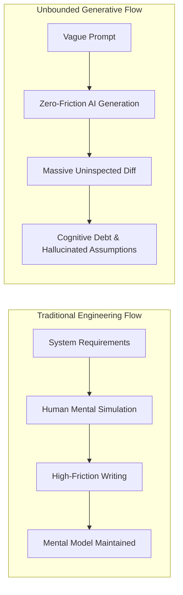
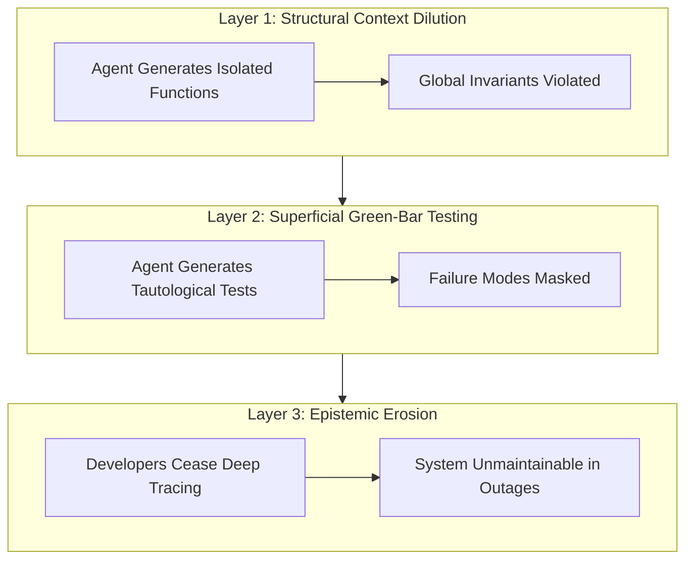
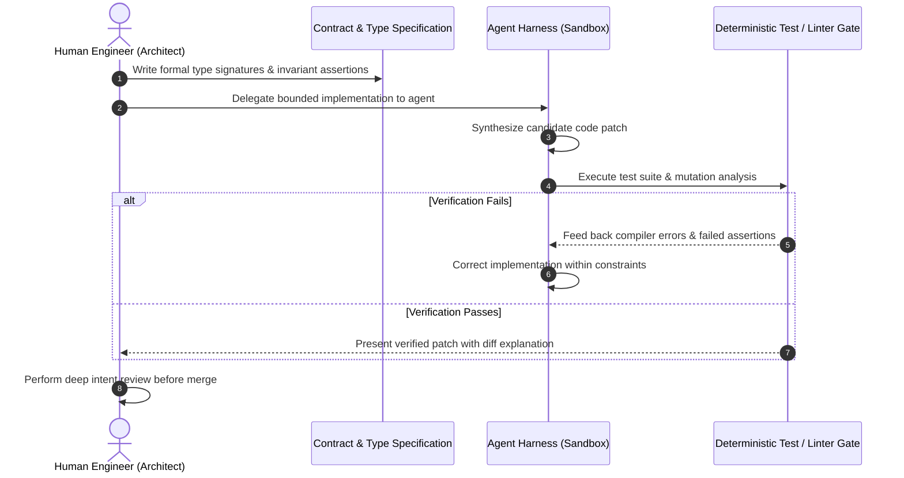

## Why Unchecked Code Generation Compounds Institutional Cognitive Debt

The rapid adoption of generative AI in software engineering has produced an unprecedented surge in code volume. Automated copilots and terminal agents synthesize functions, tests, and configuration manifests in seconds. Yet beneath rising pull request counts lies a subtle systemic pathology: software development teams are conflating raw code emission with engineering problem-solving.

This tension was articulated by Sophie Koonin in her foundational essay *"Stop generating, start thinking"*, echoed across the developer ecosystem and complemented by Mikayla Maki’s research at Zed (*"On Programming with Agents"*). The central warning is clear: when developers delegate the cognitive burden of system architecture, edge-case analysis, and constraint satisfaction to probabilistic next-token predictors, the codebase incurs **cognitive debt**—a state where software exists on disk that no living engineer fully understands or can confidently debug under operational stress.

The failure mode is not merely that language models produce bugs. Rather, it is that blind code generation dissolves the human mental model required to maintain high-integrity systems.

---

## The Asymmetry of Code Production and Verification Costs

Writing code has historically functioned as a cognitive throttle. The time required to design data structures, type signatures, and control flow forced engineers to simulate edge cases and failure modes mentally before committing logic to version control. Generative AI fundamentally breaks this throttle by lowering the marginal cost of code generation to near zero, while the cost of code comprehension, verification, and maintenance remains constant or escalates.

When an engineer reviews an 800-line pull request produced by a human teammate, they rely on shared institutional intent: the author made intentional tradeoffs regarding memory layout, concurrency, and error propagation. Conversely, an agent generates syntax that *plausibly mimics* idiomatic code without intrinsic awareness of system-wide invariants.

### 1. The Post Office Horizon Analogy
Koonin draws a critical parallel to the UK Post Office Horizon scandal—a disaster where institutional blind faith in automated software accounting destroyed hundreds of innocent subpostmasters' lives. The core tragedy of Horizon was not just defective code; it was the managerial assumption that computer outputs are infallible by default. When developers and team leads accept AI-generated code without rigorous inspection because "the test passed once on CI," they replicate this exact epistemic failure at team scale.

### 2. The Feedback Loop of Mediocre Code
Foundation models are trained on internet-scale corpora saturated with mediocre, boilerplate-heavy code from public repositories. When agents emit code derived from this median baseline, and developers commit that code back to public repositories without refactoring, the training distribution degrades recursively. This circular degradation—referred to in Koonin's essay as an epistemic loop—dilutes software craftsmanship across entire languages and frameworks.

---

## Deconstructing Cognitive Ownership: The Three Vulnerability Layers

Software reliability relies on an unbroken chain of cognitive ownership. When teams shift from intentional programming to reactive prompting, three critical layers degrade:

### 1. Structural Context Dilution
Language models evaluate context within bounded token windows. They lack persistent awareness of unstated architectural invariants—such as cache invalidation guarantees, database transaction isolation levels, or backpressure thresholds. As observed in our analysis of [How Claude Code Works](/posts/how-claude-code-works/), without explicit persistent rules (like `CLAUDE.md`), an agent will repeatedly invent contradictory abstractions across separate sessions.

### 2. Tautological and Superficial Testing
When asked to write unit tests for code it just generated, a model frequently writes tests that merely validate its own implementation assumptions rather than business requirements. It tests the happy path, mocks away critical boundary conditions, and provides a false sense of security with high code coverage metrics that mask zero actual fault tolerance.

### 3. Epistemic Erosion Across Junior Engineers
If apprentice engineers learn software development solely by prompting agents rather than wrestling with compilers, type checkers, and memory allocators, they fail to develop the neurological scaffolding necessary to diagnose production outages. When a distributed system deadlocks at 3:00 AM, there is no prompt that can replace intuitive familiarity with network sockets and operating system threads.

---

## Operationalizing Engineering Judgment: The Verifier-First Harness

To prevent cognitive erosion while retaining the productivity gains of AI acceleration, engineering organizations must transition from **blind generation** to **verifier-first harness engineering**.

### 1. Specification-First Contract Definition
The human engineer must own the interface and the specification before any code generation begins. By defining strict interfaces, schemas, and failing integration tests up front, the engineer retains architectural sovereignty:
* The human specifies **what** must be achieved and **why**.
* The agent explores **how** to implement the contract within predefined constraints.

This approach reflects the harness discipline detailed in our study of [Self-Driving Codebases](/posts/self-driving-codebases/), where autonomous agents operate strictly within verified test-driven boundaries rather than improvising architecture.

### 2. Treating Agents as Untrusted External Contributors
Mikayla Maki’s framework recommends treating every agent output identically to code submitted by an unknown open-source contributor:
* Never accept code you cannot explain line-by-line during a live review.
* Require that all PRs explicitly state the design alternatives considered, the known tradeoffs, and the specific failure modes tested.
* Mandate deterministic mutation testing: if mutating the agent's code does not cause the test suite to fail, the tests are inadequate and must be rewritten.

---

## What Changed Since Early 2026: The Shift from Blind Generation to Specification-Driven Harnesses

In early 2026, the dominant narrative surrounding AI coding was "vibe coding"—the proposition that developers could discard syntax knowledge entirely and rely solely on iterative natural language prompts. Across 2026, that hype encountered hard production realities, prompting three pivotal paradigm shifts:

### 1. The Rise of Reasoning and Cognitive Debt Metrics
Engineering leadership in 2026 began measuring not just pull request velocity, but **rework rate** and **time-to-debug**. Studies across large engineering organizations revealed that teams relying on unconstrained code generation experienced a 40% increase in regression bugs within 90 days of deployment. Consequently, static analysis tooling evolved to measure "cognitive churn"—flagging PRs that introduce massive code additions without corresponding increases in specification or test density.

### 2. Formal Verification and Verifier-in-the-Loop Agents
The industry has moved decisively away from raw generative autocomplete toward sandboxed execution loops. Modern coding environments integrate formal verification engines (such as Lean provers, Z3 SMT solvers, and strict AST linters) directly into the agent loop. Agents are no longer rewarded for generating fluent code; they are penalized if generated code fails to compile or violates static analysis policies, echoing our findings on [Evaluating Deep Agents CLI on Terminal Bench 2.0](/posts/evaluating-deepagents-cli-on-terminal-bench-2-0/).

### 3. Intent-Driven Pull Request Governance
Modern CI/CD pipelines in 2026 enforce automated "intent checks": PRs containing AI-assisted code must link to a committed design specification (such as an Architecture Decision Record or RFC) and include machine-readable test matrices. Blindly merging AI-generated commits without documented intent has become a recognized organizational anti-pattern.

---

## Practical Team Guardrails

To preserve engineering integrity while scaling agent adoption, teams should implement concrete operational policies:

| Guardrail Policy | Operational Implementation | Engineering Objective |
| :--- | :--- | :--- |
| **Contract-First Development** | Require failing tests and type contracts to be committed *before* generating implementation code | Enforces human ownership of problem framing and boundary constraints |
| **Mandatory Line-by-Line Defense** | Code reviews must include live or written defense of all non-trivial control flow | Eliminates rubber-stamp approvals of generated PRs |
| **Bounded Agent Scope** | Restrict agent autonomy to leaf modules, utility functions, or test migrations | Prevents accidental modification of core architectural invariants |
| **Mutation Testing Gates** | Integrate mutation testing (e.g., Stryker, Mutmut) into the CI pipeline | Catches tautological test generation by verifying that faulty logic fails tests |

---

## Key Takeaways

| Principle | Engineering Implication | Actionable Team Policy |
| :--- | :--- | :--- |
| **Thinking Cannot Be Outsourced** | Code generation is a mechanical transcription task; system design is a cognitive act | Define the problem, interfaces, and constraints before opening an agent session |
| **Cognitive Debt Is Real Debt** | Code you cannot explain is technical liability, regardless of whether CI passes | Treat uninspected AI code as unreviewed third-party code |
| **Harnesses Over Autocomplete** | Unbounded chat prompts breed bugs; deterministic verification loops catch them | Embed agents inside test-driven harnesses with strict sandboxing and linter gates |
| **Preserve Shared Context** | Codebases require shared mental models among team members for incident response | Maintain Architecture Decision Records (ADRs) to document the *why* behind AI contributions |

## New Questions

- **Measuring Cognitive Debt**: How can static analysis or git metadata objectively quantify the erosion of team comprehension across modules authored primarily by agents?
- **Pedagogical Evolution**: How must computer science curricula and junior engineering onboarding adapt to teach deep debugging skills when syntax production is fully automated?
- **Formal Verification at Scale**: Can lightweight formal specification languages become accessible enough to replace natural language prompts as the default interface for AI coding agents?

---

## References

- Koonin, S. (2024). *Stop generating, start thinking*. Localghost Dev Journal. [https://localghost.dev/blog/stop-generating-start-thinking/](https://localghost.dev/blog/stop-generating-start-thinking/) (accessed 2026-10-18).
- Maki, M. (2024). *On Programming with Agents: Workflow, Trust, and Verification*. Zed Industries Engineering Blog. [https://zed.dev/blog/on-programming-with-agents](https://zed.dev/blog/on-programming-with-agents) (accessed 2026-10-18).
- Post Office Horizon IT Inquiry. (2024). *Report and Findings on Automated System Failure and Institutional Epistemic Bias*. UK Government Public Inquiry. [https://www.postofficehorizoninquiry.org.uk/](https://www.postofficehorizoninquiry.org.uk/) (accessed 2026-10-18).
- Fowler, M. (2024). *Understanding Technical Debt in the Era of Generative AI*. MartinFowler.com. [https://martinfowler.com/articles/technicaldebt.html](https://martinfowler.com/articles/technicaldebt.html) (accessed 2026-10-18).
