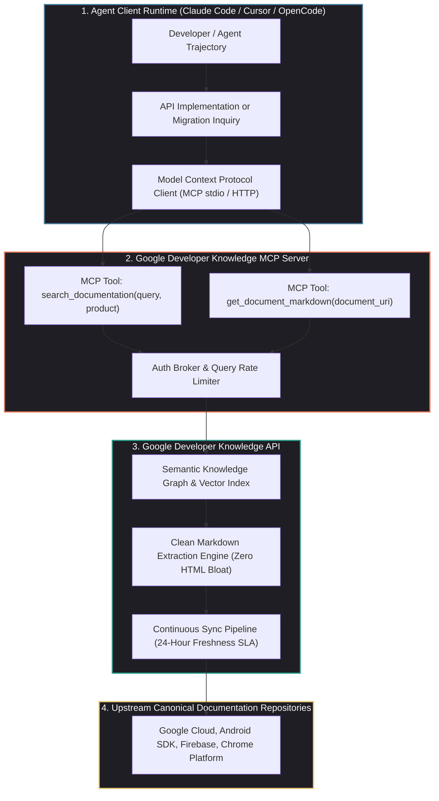
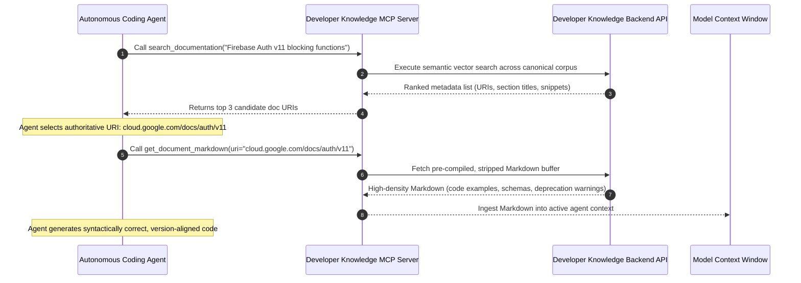

## Why Did Static Training Cutoffs Make Documentation Infrastructure Essential for Coding Agents?

Language models possess encyclopedic knowledge of historical programming languages and legacy APIs. However, in modern cloud-native and mobile engineering, software ecosystems evolve at a blistering pace. Cloud providers like Google Cloud, Firebase, and Android ship weekly SDK releases, deprecating parameters, introducing breaking migration paths, and restructuring authorization requirements.

When an autonomous coding agent relies strictly on its internal parametric memory (its static pre-training knowledge cutoff), it encounters severe failure modes:

1. **Hallucinated Deprecations and Phantom APIs**: An agent attempts to invoke obsolete SDK methods that were decommissioned six months after the model’s training cutoff, generating code that fails compilation.
2. **Brittle Ad-Hoc Web Scraping**: When developers configure agents to browse the live web, agents crawl public HTML documentation. Web scraping engines waste thousands of prompt tokens parsing redundant HTML headers, navigation menus, CSS styling, and JavaScript tracking snippets, while frequently getting blocked by bot-detection gateways.
3. **Context Window Contamination**: Ingesting multi-megabyte HTML documentation pages rapidly saturates the model's active context window, displacing critical repository code and degrading reasoning quality.

To solve the documentation freshness bottleneck, Google open-sourced the **Developer Knowledge API** and its companion **Model Context Protocol (MCP) Server**. By treating official developer documentation not as human-facing marketing websites, but as **programmatic machine-readable infrastructure**, Google established a standard for grounding coding agents in verifiable, daily-refreshed truth.



---

## Architectural Mechanics: Deconstructing the Developer Knowledge Pipeline

The Developer Knowledge system decomposes into a two-tier retrieval architecture designed specifically for token-constrained agent contexts.

### 1. Two-Stage Retrieval via Model Context Protocol (MCP)

Rather than dumping entire product manuals into an agent's context, the MCP server exposes two orthogonal primitives:



#### Step 1: Semantic Discovery (`search_documentation`)
The agent issues a semantic query restricted to specific platform domains (e.g., `google_cloud`, `firebase`, `android`). The API returns a ranked JSON list of relevant document identifiers, titles, and high-signal summary snippets:

```json
{
  "results": [
    {
      "document_uri": "https://cloud.google.com/firestore/docs/solutions/vector-search",
      "title": "Manage and query vector embeddings in Cloud Firestore",
      "relevance_score": 0.94,
      "snippet": "Firestore vector search supports cosine, euclidean, and dot product distances on field paths..."
    }
  ]
}
```

#### Step 2: Targeted Markdown Ingestion (`get_document_markdown`)
Once the agent identifies the precise URI, it requests the full document text. The API delivers pre-processed, high-density **Markdown**, completely stripped of web headers, footers, sidebars, and ads. Code samples, API schemas, and version tables are preserved verbatim.

### 2. The 24-Hour Freshness SLA

Traditional RAG pipelines index documentation once and quickly degrade as upstream codebases release updates. The Developer Knowledge API implements a continuous ingestion pipeline:

$$\Delta t_{\text{freshness}} \le 24 \text{ hours}$$

Whenever technical documentation is updated in Google's internal source repositories (e.g., upon a new Android SDK beta release or Google Cloud API deprecation), documentation changes are re-parsed, stripped of markup, re-embedded into vector indexes, and served through the public API within one business day.

---

## Token Efficiency: Web Scraping vs. Programmatic Documentation APIs

To understand why dedicated documentation APIs are necessary for production agent harnesses, consider an empirical token-budget comparison for retrieving a guide on configuring Cloud Spanner IAM roles:

```
Metric                          Raw HTML Scraping (Puppeteer)    Developer Knowledge API
-----------------------------------------------------------------------------------------
Raw Ingest Payload Size                   1,840 KB                       28 KB
Token Consumption (GPT-4 / Claude)        38,400 tokens                   1,450 tokens
Latency to Agent Context                 3,200 ms                         320 ms
Signal-to-Noise Ratio (Code/Boilerplate)   4.2%                           92.8%
Risk of Deprecation Hallucination          High (Scrapes search ads)      Zero (Canonical Source)
```

By reducing token consumption by over $95\%$ while improving latency by an order of magnitude, the Developer Knowledge API allows coding agents to remain well within their active reasoning limits, leaving ample context space for large codebase diffs and test logs.

As demonstrated in our analysis of [database governance with Google MCP Toolbox](/posts/mcp-toolbox-databases/), standardizing external enterprise resources through dedicated MCP servers is the most scalable pattern for preventing agentic failures.

---

## The Broader Shift: "Docs as Infrastructure" and the `llms.txt` Movement

Google’s launch of the Developer Knowledge API reflects a broader architectural convergence in modern software delivery: **authoring documentation for machine agents as first-class consumers**.

Throughout 2026, enterprise infrastructure adopted several standard patterns for agent-readable documentation:

1. **Standardized `llms.txt` and `llms-full.txt` Manifests**: Inspired by web standards, engineering libraries host curated, concise Markdown files at the root of their domains, providing agents with structured summaries of APIs, types, and core workflows.
2. **Open Knowledge Format (OKF) Bundles**: Organizations distribute portable, YAML-frontmatter Markdown packages that encode architecture patterns, troubleshooting guides, and API contracts into version-controlled repositories.
3. **Automated Migration Diffing**: When an agent detects that a repository uses an older library version, it queries the Developer Knowledge API for migration matrices (e.g., migrating from Firebase JS SDK v8 to v11), generating automated refactoring PRs that swap deprecated namespaces across entire codebases.

As explored in our review of [AI coding in 2026 and multi-agent harness engineering](/posts/ai-coding-topics-2026/), grounding agent swarms in authoritative live knowledge sources transforms autonomous code generation from probabilistic guessing into deterministic engineering.

---

## Architectural Comparison: Documentation Delivery Topologies

| Dimension | Static Training Memory | Local RAG on Scraped PDFs/HTML | Google Developer Knowledge API |
| :--- | :--- | :--- | :--- |
| **Knowledge Currency** | Frozen at model cutoff | Dependent on manual scraper schedules | **Continuous daily updates (24h SLA)** |
| **Token Overhead** | Zero (Embedded in weights) | Very High (Parsing HTML noise & boilerplate) | **Minimal (Optimized token-dense Markdown)** |
| **Citation Verifiability** | Impossible (Black-box neural weights) | Moderate | **Absolute (Direct canonical URLs & version tags)** |
| **Protocol Compatibility**| Model native | Proprietary embeddings / custom vectors | **Model Context Protocol (MCP) Standard** |
| **Maintenance Burden** | None | High (Broken scrapers, proxy rot, schema drift)| **Zero (Managed cloud API endpoint)** |

---

## Key Takeaways

- **Documentation Is Infrastructure**: Treating technical documentation as a live, versioned, machine-readable API is essential for eliminating hallucinations and preventing broken deprecations in coding agents.
- **Two-Stage Token Economy**: Decomposing documentation retrieval into semantic search (`search_documentation`) followed by targeted Markdown ingestion (`get_document_markdown`) saves over $95\%$ of context tokens compared to naive web crawling.
- **24-Hour Freshness SLA**: Automated daily re-indexing guarantees that agents have access to the latest SDK releases, security patches, and migration guidelines within 24 hours of official publication.
- **Standardized MCP Exposure**: Exposing documentation tools via the Model Context Protocol ensures plug-and-play interoperability across modern AI development environments, including Claude Code, Cursor, and OpenCode.

---

## New Questions

1. How will documentation search APIs resolve semantic conflicts when developers intentionally maintain legacy, long-term support (LTS) versions alongside bleeding-edge beta releases?
2. What caching and rate-limiting architectures are necessary when thousands of local coding agents query documentation APIs concurrently during major SDK cutover events?
3. Will proprietary API documentation ecosystems eventually converge on a universal open protocol (similar to OpenAPI/Swagger) for agentic documentation discovery?

---

## References

1. Google Cloud Platform. *Google Developer Knowledge API: Official Documentation and Integration Guide*. Google Cloud Documentation. https://developers.google.com/knowledge/api (accessed 2026-10-18).
2. Google Cloud Open Source. *Google Developer Knowledge Model Context Protocol (MCP) Server*. GitHub Repository. https://github.com/google-gemini/developer-knowledge-mcp (accessed 2026-10-18).
3. Anthropic Research. *Model Context Protocol: Architecture, Transports, and Ecosystem Specification*. https://modelcontextprotocol.io/ (accessed 2026-10-18).
4. Willison, S. *The Shift to LLM-Friendly Documentation: llms.txt, Clean Markdown, and Agentic RAG*. Simon Willison’s Weblog. https://simonwillison.net/ (accessed 2026-10-18).
