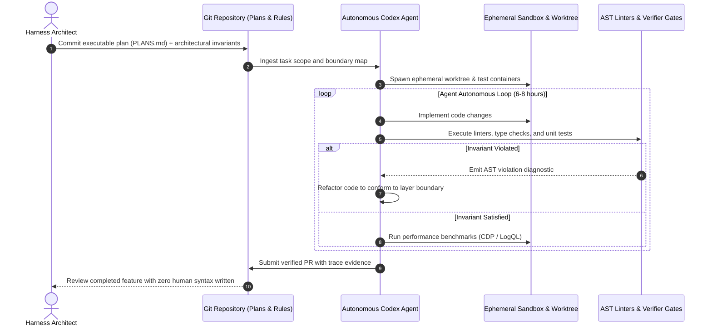

## Why Autonomous Code Generation Demands Harness Design Over Prompt Tuning

When autonomous coding agents fail to complete complex software tasks, developer intuition routinely defaults to conversational debugging: rewriting the prompt, appending exclamation marks, or instructing the model to "think step by step." In production codebases, this strategy reliably hits a ceiling. As repositories scale past thousands of files and multi-layered dependency graphs, agent failure is rarely a failure of raw model reasoning—it is almost invariably an **environment affordance failure**.

This architectural reality was demonstrated in OpenAI's seminal engineering report on **Harness Engineering**. Operating under a radical operational constraint—zero human-written production code, with all commits authored exclusively by OpenAI Codex agents—a small engineering team built a full-stack production application from an empty repository to over **one million lines of code**, shipping a real service to daily active users at roughly ten times the velocity of traditional manual engineering.

The critical insight of this experiment is that software engineering in the agentic era ceases to be about writing syntax. Instead, engineering becomes the discipline of **harness design**: constructing the deterministic boundaries, structural tests, ephemeral observability stacks, and progressive documentation maps that allow autonomous agents to operate safely and converge on correct implementations.

---

## The Five Structural Pillars of Harness Engineering

OpenAI's findings deconstruct the software development lifecycle into five mechanical rules governing agent-environment interactions.

```mermaid
flowchart TD
    subgraph Pillar1["1. Repo-Native Memory"]
        A1[Human Context & RFCs] --> A2[Executable PLANS.md & ARCHITECTURE.md]
        A2 --> A3[Machine-Readable State on Disk]
    end

    subgraph Pillar2["2. Capability Affordances"]
        B1[Agent Stalls on Bottleneck] --> B2{Tool or Primitive Missing?}
        B2 -->|Yes| B3[Build Custom Concurrency / Telemetry Helper]
        B2 -->|No| B4[Simplify APIs / Choose Stable Tech]
    end

    subgraph Pillar3["3. Mechanical Invariants"]
        C1[Architectural Layers Defined] --> C2[Custom AST Linters & Static Bounds]
        C2 --> C3[Deterministic Build Failure on Violation]
    end

    subgraph Pillar4["4. First-Class Observability"]
        D1[Ephemeral Git Worktree] --> D2[Dedicated Metrics, LogQL & CDP Tracing]
        D2 --> D3[Autonomous Benchmark-Driven Optimization]
    end

    subgraph Pillar5["5. Progressive Topology Maps"]
        E1[Concise AGENTS.md Index] --> E2[Scoped docs/ Hierarchy]
        E2 --> E3[Continuous Doc-Gardening Agents]
    end
```

### 1. If the Agent Cannot Read It, It Does Not Exist
Institutional knowledge residing in Slack conversations, Jira tickets, Notion workspaces, or developer brains is completely invisible to an agent running inside a terminal sandbox. 

To overcome context blindness, every design decision, API contract, and execution roadmap must be committed directly to version control:
* **Executable Plans (`PLANS.md`)**: Complex multi-step initiatives are broken down into self-contained, beginner-readable execution plans. Each plan specifies exact starting conditions, modified files, expected intermediate states, and concrete verification commands. Codex agents can execute uninterrupted for seven or more hours off a single structured plan.
* **Architectural Boundaries (`ARCHITECTURE.md`)**: Serves as a spatial map rather than an exhaustive narrative manual, defining module ownership and permitted data flows.

### 2. Capability Affordances Over "Try Harder"
When an agent fails to solve an integration problem or produces buggy concurrency logic, issuing natural language pleas ("make sure there are no race conditions") rarely works. The engineer's role is to diagnose what capability the agent lacks in its runtime environment:
* If the agent cannot debug concurrent state, provide an explicit synchronization abstraction instrumented with OpenTelemetry spans.
* If third-party APIs have volatile documentation or ambiguous type definitions, replace bleeding-edge libraries with "boring," mature technologies (e.g., PostgreSQL, standard HTTP servers, typed SQL builders) whose patterns are thoroughly represented in pre-training data.

### 3. Consistency Enforced Through Mechanical Constraints
Narrative guidelines ("services should never call repository helpers directly") inevitably rot. In a codebase growing at tens of thousands of lines per week, consistency can only be preserved through **mechanical invariants enforced at compilation time**:
* **Layered Domain Separation**: Codebases are partitioned into strict unidirectional layers:

$$\text{Types} \longrightarrow \text{Config} \longrightarrow \text{Repository} \longrightarrow \text{Service} \longrightarrow \text{Runtime} \longrightarrow \text{UI}$$

* **Static Architecture Testing**: Dependency direction is validated via static analysis and custom linters (often authored by the agents themselves). If an agent attempts to import a UI component into a database service, the build fails instantly with machine-readable diagnostic feedback.

### 4. First-Class Observability with Ephemeral Worktrees
To debug runtime regressions, agents require sensory feedback comparable to human developers:
* **Headless Browser CDP**: The agent runtime integrates directly with the Chrome DevTools Protocol, enabling agents to inspect the live DOM, capture screenshots, analyze layout rendering shifts, and trace client-side JavaScript console errors.
* **Ephemeral Worktree Telemetry**: Each agent operates within an isolated git worktree with dedicated, ephemeral telemetry endpoints. Agents query Prometheus metrics via PromQL and log aggregators via LogQL directly. Tasks such as "optimize server cold start to less than 800ms" become executable optimization loops where the agent measures latency, patches bottlenecks, and re-profiles.

### 5. Progressive Topology Maps Over Monolithic Manuals
Feeding a 500-page operational manual into a prompt consumes context windows and triggers attention degradation. High-performance harnesses adopt a **progressive disclosure model**:
* `AGENTS.md` acts strictly as an index or table of contents, directing the agent to specific subdirectories within `docs/`.
* Background **doc-gardening agents** monitor git diffs continuously, updating reference documentation and purging obsolete examples to prevent documentation drift.

---

## Comparing the Three Major Agent Harness Paradigms

Harness engineering is not limited to OpenAI's internal tools; it defines the operational divide across leading modern agent systems:

| Architectural Dimension | OpenAI Codex Harness | Claude Code Terminal Harness | Cursor Background Agent Harness |
| :--- | :--- | :--- | :--- |
| **Primary Execution Model** | Long-running headless batch loops (6–8 hrs) | Interactive terminal ReAct loop with human gates | Ephemeral cloud container runners |
| **Memory Architecture** | `PLANS.md` + `ARCHITECTURE.md` on disk | Hierarchical `CLAUDE.md` + progressive skills | AST dependency graph + codebase embeddings |
| **Verification Gate** | Custom AST linters & PromQL / LogQL queries | Local subshell exit codes & compiler diagnostics | Remote shadow-branch CI & headless testing |
| **Isolation Boundary** | Isolated git worktrees + per-worktree telemetry | Unix process permissions & file checkpoints | Containerized sandbox microVMs |
| **Primary Failure Mode** | Agent rabbit-holing without plan checkpoints | Context window exhaustion on large code dumps | Git lock contention across parallel workers |

As we explored in our deep dives into [How Claude Code Works](/posts/how-claude-code-works/) and [Self-Driving Codebases](/posts/self-driving-codebases/), while interaction styles differ, all successful autonomous systems converge on the same core principle: model intelligence is throttled or amplified by the precision of its environmental feedback loop.

---

## What Changed Since Early 2026: From Monolithic Agent Sessions to Ephemeral Worktree Swarms

When the OpenAI harness engineering case study first circulated in early 2026, most teams attempted to replicate the results by running single, monolithic agent sessions on local developer machines. This approach frequently failed due to context contamination and session degradation. Over the course of 2026, harness architecture matured through three significant structural evolutions:

### 1. Ephemeral Multi-Worktree Swarms
Running an agent for eight continuous hours in a single working directory causes git lock contention and unrecoverable state pollution. Modern harnesses decompose large features across independent git worktrees. A lead planning agent generates decoupled tickets, spawning ephemeral subagents that each operate inside a dedicated worktree with isolated ports, databases, and log streams. These worktrees are validated independently before being merged through automated rebase pipelines, echoing the multi-agent locking protocols examined in [Claude Opus 4.6 Agent Teams](/posts/claude-opus-46-agent-teams/).

### 2. Machine-Readable Architectural Decision Records (ADRs)
Documentation has shifted from passive human prose to machine-actionable policy specifications. Modern ADRs define structured JSON/YAML frontmatter specifying explicit import allowlists, prohibited dependency edges, and mandatory test coverage thresholds. Linters read these records dynamically, allowing the harness to enforce architectural rules without requiring manual rule file maintenance.

### 3. Verifier-in-the-Loop Benchmark Calibration
The industry has moved beyond relying on subjective code reviews to assess agent output. Harnesses now continuously calibrate agent performance against standardized benchmarks like Terminal Bench and SWE-bench, applying the rigorous harness instrumentation discussed in [Evaluating Deep Agents CLI on Terminal Bench 2.0](/posts/evaluating-deepagents-cli-on-terminal-bench-2-0/). If a prompt or tool modification causes benchmark regressions, the harness automatically rolls back configuration changes.

---

## Practical Engineering Tradeoffs

Transitioning to a harness-first engineering culture introduces distinct operational overheads that engineering leaders must balance:

| Harness Investment | Operational Tradeoff | Mitigation Strategy |
| :--- | :--- | :--- |
| **Strict AST Linters & Static Tests** | High upfront friction when writing initial code and refactoring contracts | Generate linter rules and structural tests using the agents themselves during initial scaffolding |
| **Isolated Ephemeral Telemetry** | Running dedicated logging and metrics stacks per agent consumes compute resources | Utilize lightweight embedded observability tools (e.g., SQLite trace backends, local vector stores) |
| **Comprehensive Markdown Maps** | Documentation rot invalidates agent plans and causes hallucination | Deploy automated documentation-gardening bots on every pull request merge |
| **Batch Autonomy vs. Oversight** | Long-running unsupervised loops can burn API budgets on dead-end solutions | Implement bounded execution limits, circuit breakers, and mandatory intermediate checkpoint commits |

---

## Key Takeaways

| Principle | Architectural Requirement | Operational Action |
| :--- | :--- | :--- |
| **Harness Over Prompting** | Environment affordances determine task success | When an agent stalls, build a tool, linter, or abstraction instead of modifying adjectives in the prompt |
| **Repo-Native Grounding** | All critical knowledge must exist within version control | Eliminate external wikis; write `PLANS.md`, `ARCHITECTURE.md`, and machine-readable ADRs |
| **Mechanical Enforcement** | Architectural invariants must fail the build | Replace code review guidelines with AST linters that enforce strict unidirectional dependency flow |
| **Sensory Observability** | Agents need real-time execution feedback | Expose headless browser CDP, structured logs, and metrics query engines directly to the agent runtime |

## New Questions

- **Self-Healing Harnesses**: Can agent harnesses dynamically synthesize their own AST linters and compile-time boundaries when they observe recurring regression patterns in their own PR history?
- **Cognitive Debt at 10M Lines**: As repositories built entirely by agents expand to tens of millions of lines, how will human architects conduct disaster recovery when edge-case distributed failures occur?
- **Harness Standardization Across Models**: Will cross-runtime standards (such as Model Context Protocol and AGENTS.md) enable seamless migration of complex harness stacks between foundation model providers without retraining?

---

## References

- OpenAI Codex Team. (2025). *Harness Engineering: Building a 1M-Line Production Application with Autonomous Agents*. OpenAI Research & Engineering Blog. [https://openai.com/index/harness-engineering/](https://openai.com/index/harness-engineering/) (accessed 2026-10-18).
- Kladov, A. (matklad). (2021). *ARCHITECTURE.md: Architecture Documentation in Practice*. matklad's blog. [https://matklad.github.io/2021/02/06/ARCHITECTURE.md.html](https://matklad.github.io/2021/02/06/ARCHITECTURE.md.html) (accessed 2026-10-18).
- OpenAI Developers. (2025). *Codex Execution Plans: Structuring Multi-Hour Autonomous Development*. OpenAI Cookbook. [https://developers.openai.com/cookbook/articles/codex_exec_plans](https://developers.openai.com/cookbook/articles/codex_exec_plans) (accessed 2026-10-18).
- Logic Inc. (2025). *AI Is Forcing Us to Write Good Code: Architectural Invariants in the Age of LLMs*. Bits by Logic. [https://bits.logic.inc/p/ai-is-forcing-us-to-write-good-code](https://bits.logic.inc/p/ai-is-forcing-us-to-write-good-code) (accessed 2026-10-18).
