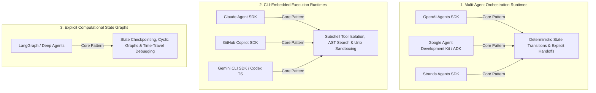
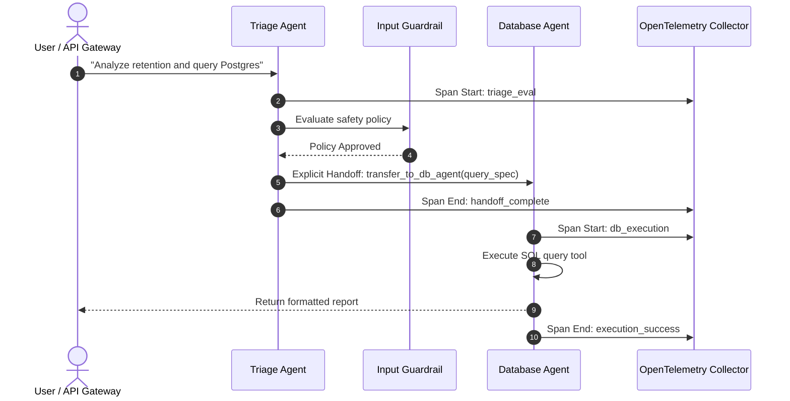

## Why Modern Agent Development Shifted from Models to Embedded Runtimes

In the initial wave of agent development, engineering teams spent the bulk of their effort on model selection and prompt engineering: tweaking system prompts, adjusting temperature, and chaining raw API completion calls. However, as agent workflows transitioned from single-turn chat scripts to production pipelines—executing database mutations, refactoring source repositories, and orchestrating multi-agent delegations—teams encountered identical structural bottlenecks.

The primary failure modes in autonomous systems do not stem from model IQ deficits. Rather, they arise from runtime operational failures: unhandled tool timeouts, runaway conversational loops, untracked context drift, missing permission boundaries, and opaque telemetry. 

Consequently, the industry consensus has inverted: **the model is an interchangeable reasoning engine, but the harness SDK is the production runtime**. Agent Software Development Kits (SDKs) have evolved from thin API wrappers into full-fledged operating systems for cognitive computation, providing first-class primitives for tool execution, state persistence, subagent handoffs, and guardrail enforcement.

---

## Architectural Taxonomy of Modern Agent SDKs

Modern agent frameworks fall into three distinct architectural categories based on their runtime execution model:



### 1. Multi-Agent Orchestration Frameworks
Frameworks such as the **OpenAI Agents SDK** and **Google ADK** prioritize explicit routing between specialized agents. Rather than maintaining a single giant prompt that attempts to handle all tasks, they define narrow, expert agents with dedicated tool subsets and explicit handoff functions. Context state is passed deterministically across agency boundaries, minimizing token bloat and eliminating prompt distraction.

### 2. Terminal-Native and CLI-Embedded SDKs
Frameworks like the **Claude Agent SDK**, **GitHub Copilot SDK**, and **Gemini CLI SDK** are built around filesystem and subshell primitives. They embed directly into developer environments, offering built-in AST search (`GrepTool`), non-destructive file patching (`Edit`), and Unix permission isolation, as analyzed in our review of [How Claude Code Works](/posts/how-claude-code-works/).

### 3. Stateful Graph Engines
Engines like LangGraph decouple control flow into directed state graphs where transitions are governed by typed state schemas, human-in-the-loop interrupts, and persistent checkpoint stores, as detailed in our guide to [All Agentic Architectures: A Comprehensive Guide](/posts/all-agentic-architectures-comprehensive-guide/).

---

## Comparative Matrix: Major SDK Capabilities and Architecture

| SDK / Framework | Primary Language | Core Coordination Pattern | Tool Protocol & Extensibility | Observability & Guardrails | Target Production Use Case |
| :--- | :--- | :--- | :--- | :--- | :--- |
| **OpenAI Agents SDK** | Python, TypeScript | Explicit agent handoffs (`Agent(handoffs=[...])`) | Python callables, strict Pydantic schemas | Native OpenTelemetry spans, input/output Guardrails | Enterprise customer support, multi-tier classification, back-office workflows |
| **Google ADK** | Python (Java, Go, TS) | Code-first declarative agents & evaluators | In-process tools, Vertex Extensions, MCP | Vertex AI Model Monitoring, built-in eval harness | Cloud-native multi-modal applications on Google Cloud and Vertex AI |
| **Claude Agent SDK** | Python, TypeScript | Terminal ReAct loop with progressive tool discovery | In-process tools, standard Model Context Protocol (MCP) | `PreToolUse`/`PostToolUse` security hooks, session checkpoints | Autonomous software engineering, local codebase refactoring, terminal automation |
| **GitHub Copilot SDK** | Python, TS, Go, .NET | Client-server daemon proxying Copilot CLI engine | LSP-native language intelligence tools | Centralized GitHub audit telemetry, organization policies | Enterprise developer platforms, automated PR review, CI bot agents |
| **Strands Agents SDK** | Python, TypeScript | Provider-agnostic router with model abstraction | Built-in MCP client/server transport | Distributed cloud trace logging, multi-provider fallbacks | AWS-centric serverless agents, multi-cloud microservice orchestration |
| **Codex / Gemini CLI SDK** | TypeScript | Embedded subshell execution with local filesystem hooks | Standardized CLI tools, local AST tools | Local JSONL telemetry, deterministic exit code traps | Rapid prototype CLI utilities, local-first coding assistants |

---

## Deep Dive: SDK Architecture Profiles

````carousel

<!-- slide -->

<!-- slide -->

<!-- slide -->

<!-- slide -->

<!-- slide -->

<!-- slide -->

<!-- slide -->

````

### 1. OpenAI Agents SDK: Explicit Handoffs and Typed Guardrails
The OpenAI Agents SDK departs from monolithic agent swarms by introducing **explicit handoff routing**. Instead of an orchestrator dynamically generating natural language routing instructions, an agent delegates execution to a peer agent through a strongly typed handoff function:

```python
from agents import Agent, Runner, GuardrailFunctionOutput

def validate_sql_safety(ctx, agent, input_data):
    if "DROP TABLE" in input_data.upper():
        return GuardrailFunctionOutput(terminate=True, message="Destructive SQL blocked")
    return GuardrailFunctionOutput(terminate=False)

db_agent = Agent(
    name="DatabaseAgent",
    instructions="Execute verified analytical queries",
    tools=[run_sql_query],
    input_guardrails=[validate_sql_safety]
)

triage_agent = Agent(
    name="TriageAgent",
    instructions="Analyze incoming requests and route to database agent",
    handoffs=[db_agent]
)

result = Runner.run_sync(triage_agent, "Generate monthly retention report")
```

The runtime enforces **OpenTelemetry-native tracing** across every turn: prompt serialization, tool arguments, subagent transitions, and guardrail decisions are emitted as standard distributed spans, making multi-agent reasoning transparent to existing observability backends (Datadog, Langfuse, Honeycomb).



### 2. Google ADK: Enterprise Tool Registry and Evaluation Harness
Google's Agent Development Kit (ADK) emphasizes code-first, model-agnostic enterprise integration. It treats tools not merely as simple JSON function declarations, but as managed components within an enterprise tool registry. ADK includes native connectors for Google Cloud BigQuery, Vertex AI Search, and Cloud Run, while incorporating an evaluation framework that systematically tests agent runs against golden regression datasets.

### 3. Claude Agent SDK: Terminal Autonomy and In-Process MCP
Where other SDKs emphasize stateless cloud functions, Anthropic's Claude Agent SDK brings the power of Claude Code into custom applications. It runs directly against the local operating system, embedding standard Model Context Protocol (MCP) clients and servers in-process. Its security architecture relies on `PreToolUse` hooks, giving developers programmatic control to intercept or sandbox destructive commands before subshell execution occurs.

---

## What Changed Since Early 2026: Convergence on Open Standards and Runtime Decoupling

In early 2026, the agent ecosystem suffered from severe vendor lock-in: choosing a model provider dictated the agent framework, tool format, and deployment stack. Over the course of 2026, the landscape underwent three critical structural shifts:

### 1. Model Context Protocol (MCP) as the Universal Muscle
The proliferation of custom tool interfaces came to a halt with the universal adoption of Anthropic’s **Model Context Protocol (MCP)**. Whether developers use Claude Agent SDK, OpenAI Agents SDK, Google ADK, or Strands, tools are now packaged as independent MCP servers communicating over JSON-RPC (stdio or HTTP SSE). This decoupling means an enterprise only needs to write a database connector or GitHub integration once; every compliant agent harness consumes it natively.

### 2. Universal Agent Memory and Policy Standards (`AGENTS.md`)
Framework-specific prompt configurations have consolidated into standardized repository markdown specifications. The convergence of `AGENTS.md` and `CLAUDE.md` across Codex, Claude Code, and Gemini CLI ensures that organizational policies, architectural invariants, and directory-level constraints remain portable, regardless of which underlying agent SDK drives the execution loop.

### 3. Benchmarking Harness Quality Over Raw Foundation Models
Engineering teams no longer choose agent SDKs based on synthetic LLM leaderboards alone. Instead, harnesses are evaluated on standard agent execution benchmarks like Terminal Bench 2.0 and SWE-bench, applying the rigorous benchmarking discipline described in [Evaluating Deep Agents CLI on Terminal Bench 2.0](/posts/evaluating-deepagents-cli-on-terminal-bench-2-0/) and [Harness Engineering: Architectural Principles for Scaling Agents to 1M Lines](/posts/harness-engineering/). The key performance metrics are **cost-per-resolved-issue**, **guardrail false-positive rates**, and **loop termination reliability**.

---

## Practical Engineering Decision Matrix

Selecting the appropriate Agent SDK requires matching project architectural requirements to runtime design trade-offs:

| If your primary engineering requirement is... | Recommended SDK | Key Architectural Rationale |
| :--- | :--- | :--- |
| **Enterprise cloud deployment on Vertex AI with multi-modal tools** | **Google ADK** | Native enterprise security, Vertex integration, and built-in regression evaluation |
| **Multi-agent customer workflows with strict safety policies** | **OpenAI Agents SDK** | Provider-agnostic handoffs, Pydantic validation, and native OpenTelemetry tracing |
| **Local software engineering, automated refactoring, and code review** | **Claude Agent SDK** | First-class subshell execution, file checkpoint rollback, and mature MCP support |
| **Embedding automated agents directly into enterprise developer IDEs** | **GitHub Copilot SDK** | Language Server Protocol (LSP) integration and centralized enterprise compliance |
| **Multi-cloud or AWS-native serverless agent deployments** | **Strands Agents SDK** | Lightweight multi-provider routing with standard MCP client support |

---

## Key Takeaways

| Dimension | Architectural Truth | Actionable Engineering Guidance |
| :--- | :--- | :--- |
| **Harness Over Model** | The runtime environment dictates system reliability, not prompt phrasing | Standardize on SDKs that offer deterministic state transitions, timeouts, and circuit breakers |
| **Decouple Muscle via MCP** | Tool definitions should never be hardcoded into prompt strings | Package database, API, and shell capabilities as standalone MCP servers |
| **Explicit Handoffs Beat Swarms** | Monolithic prompt routers cause context dilution and hallucinated delegation | Use typed, explicit handoffs between narrow, single-purpose subagents |
| **Telemetry Is Mandatory** | You cannot debug non-deterministic multi-agent failures without traces | Choose frameworks with native OpenTelemetry support to track step-level latency and token cost |

## New Questions

- **Standardized A2A Communication**: How will emerging Agent-to-Agent (A2A) networking protocols standardize distributed state synchronization across heterogeneous SDK runtimes?
- **Subagent Sandboxing at Scale**: As agents execute increasingly privileged tool mutations, what lightweight kernel-level virtualization standards will emerge to isolate subshell SDK execution without Docker overhead?
- **Automated Harness Calibration**: Can future agent SDKs automatically tune their own internal retry budgets and model tier allocations based on real-time cost-latency telemetry?

---

## References

- OpenAI. (2025). *OpenAI Agents SDK: Lightweight Framework for Multi-Agent Workflows*. GitHub Repository. [https://github.com/openai/openai-agents-python](https://github.com/openai/openai-agents-python) (accessed 2026-10-18).
- Google Cloud. (2025). *Agent Development Kit (ADK) for Python: Enterprise Agent Orchestration*. Google Cloud Platform. [https://github.com/google/adk-python](https://github.com/google/adk-python) (accessed 2026-10-18).
- Anthropic. (2025). *Claude Agent SDK: Building Terminal-Native Autonomous Agents*. Anthropic Engineering Documentation. [https://github.com/anthropics/claude-agent-sdk-python](https://github.com/anthropics/claude-agent-sdk-python) (accessed 2026-10-18).
- GitHub. (2025). *GitHub Copilot SDK: Embedded Agent Capabilities for Developer Tools*. GitHub Technical Preview. [https://github.com/github/copilot-sdk](https://github.com/github/copilot-sdk) (accessed 2026-10-18).
- Strands Agents. (2025). *Strands Agents SDK: Model-Agnostic, MCP-Native Agent Framework*. [https://github.com/strands-agents/sdk-python](https://github.com/strands-agents/sdk-python) (accessed 2026-10-18).
