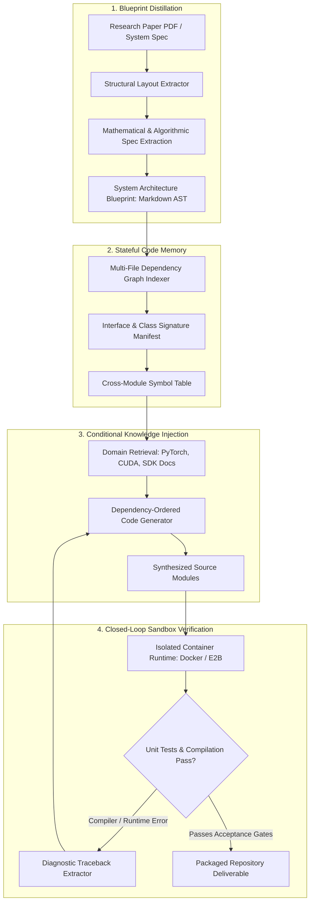
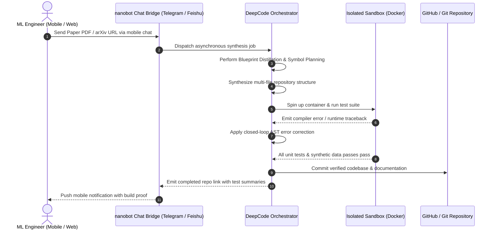

## Why Translating Academic Research into Production Repositories Stalls

A perennial bottleneck in modern machine learning engineering is the translation of theoretical preprints into verified, runnable codebases. Research publications describe novel loss functions, algorithmic topologies, and hyperparameter schedules across dense prose and mathematical notation. However, supplementary codebases are often missing, unmaintained, or tightly coupled to proprietary cluster configurations.

Engineering teams spend weeks manually re-implementing equations, scaffolding boilerplate, debugging numerical gradient mismatches, and hunting down missing dependency pins. Traditional AI code completion tools fail on this task because they operate on short lexical snippets; they lack the global context required to digest a twenty-page PDF, extract its mathematical core, map its architectural dependencies, and synthesize a cohesive multi-file repository from scratch.

To tackle this challenge, researchers from The University of Hong Kong's Data Intelligence Lab (HKUDS)—the team behind [LightRAG](/posts/lightrag/)—introduced **DeepCode** (arXiv:2512.07921). DeepCode reframes repository-scale code generation as an information channel optimization problem. When paired with **nanobot**, an asynchronous mobile chat bridge, developers can dispatch complex multi-file codebase generation tasks directly from messaging platforms like Telegram or Feishu.

---

## The Four-Stage Information Architecture of DeepCode

Rather than treating repository synthesis as an unconstrained single-prompt generation task, DeepCode structures the lifecycle into four discrete information processing stages:

### 1. Blueprint Distillation (Information Compression)
Unstructured academic papers contain immense lexical noise: historical surveys, promotional prose, and tangential performance claims. The **Blueprint Distillation** module strips this narrative noise, compressing twenty pages of text into a concise, machine-actionable architectural blueprint:
* **Algorithmic Core**: Extracts explicit mathematical equations, matrix transformations, and loss formulations.
* **Structural Dependency Graph**: Identifies input data pipelines, model forward passes, training loops, and evaluation metrics.
* **External Interface Specs**: Derives concrete configuration schemas and command-line entry points (`argparse` parameters, environment variable configs).

### 2. Stateful Code Memory (Hierarchical Indexing)
A major failure mode in multi-file synthesis is **interface hallucination**: an agent writes `module_a.py` importing a function from `module_b.py`, but later implements `module_b.py` with entirely different argument names and type signatures. 
DeepCode mitigates this by maintaining an explicit, stateful code memory:
* Maintains a global symbol table tracking exported classes, type signatures, and function contracts.
* Updates interface hashes incrementally as new files are drafted, preventing symbol divergence across deep directory trees.

### 3. Conditional Knowledge Injection (Targeted RAG)
Even frontier language models occasionally hallucinate framework-specific API changes (e.g., deprecated PyTorch autograd flags or altered Hugging Face Transformers initialization signatures). DeepCode injects verified documentation snippets conditionally based on the libraries identified during the blueprint distillation phase, ensuring that synthesized code adheres to pinned library versions.

### 4. Closed-Loop Sandbox Verification
No code generated by DeepCode is delivered without empirical verification:
* The generated repository is scaffolded into a sandboxed Docker or microVM container.
* Synthesized unit tests execute against dummy inputs to verify tensor shapes, gradient flow, and memory bounds.
* If a runtime exception occurs, the traceback is parsed and injected back into the generator with exact file-and-line coordinates for iterative self-correction.

---

## Evaluating the PaperBench Claims

DeepCode gained significant community attention by reporting state-of-the-art results on **PaperBench**—an intensive benchmark designed to evaluate an agent's capability to replicate end-to-end codebases from research publications:

| Evaluation System | PaperBench Reproduction Pass Rate | Verification Method | Execution Latency |
| :--- | :--- | :--- | :--- |
| **Top Human PhD Baseline** | 72.4% | Manual inspection & multi-day implementation | 3–5 working days per paper |
| **Baseline Frontier LLM (Direct Prompt)** | ~34.2% | Single-pass script generation | < 5 minutes (high hallucination rate) |
| **Leading Commercial Coding Agents** | ~58.7% | Interactive ReAct terminal loop | 45–90 minutes |
| **DeepCode (Reported)** | **75.9% (Overall) / 84.8% (Targeted)** | Multi-stage blueprint distillation + sandbox test loop | 30–60 minutes |

### Methodological Skepticism and Production Caveats
While author-reported benchmark numbers demonstrate substantial architectural leverage, production engineering teams must maintain healthy skepticism:
1. **Scope of "Reproduction"**: Benchmarks often evaluate whether sample input data passes through a forward pass without throwing runtime exceptions, rather than verifying convergence on state-of-the-art benchmark training accuracy.
2. **Proprietary Hardware Assumptions**: Replicating distributed training pipelines (e.g., Megatron-LM tensor parallelisms or custom FP8 kernels) requires specialized compute environments that simple container sandboxes cannot emulate.
3. **Overfitting to Open-Source Paper Repositories**: Many preprints evaluated on PaperBench have open-source implementations present in the training corpora of base models, creating subtle data contamination risks.

---

## The nanobot Layer: Decoupling Developer Interface from Local Machines

The integration between DeepCode and **nanobot** represents a fundamental UX evolution in agentic workflows: shifting the primary developer interface from local IDEs to asynchronous, mobile-first chat channels.

Traditionally, running an autonomous agent required a tethered workstation: an active terminal window, open browser tabs, and constant developer oversight. When an agent runs for 45 minutes compiling a deep learning library, local machine tethering becomes an operational friction.

Nanobot decouples this interaction:
* **Asynchronous Webhooks**: Users forward arXiv URLs, GitHub issue links, or raw algorithm prompts to a bot in Telegram or Feishu.
* **Remote MicroVM Orchestration**: The bot forwards the payload to a remote cloud worker running DeepCode inside an isolated sandbox, avoiding host machine contamination.
* **Progressive Status Streaming**: The agent streams milestones to the mobile chat: *"Blueprint extracted (12 classes, 4 models) → Scaffolded directory → Running unit test 3/5 → Fixed tensor dimension mismatch → Build successful."*

This mobile-driven orchestration pattern validates the harness engineering principles explored in [Harness Engineering: Architectural Principles for Scaling Agents to 1M Lines](/posts/harness-engineering/) and [Evaluating Deep Agents CLI on Terminal Bench 2.0](/posts/evaluating-deepagents-cli-on-terminal-bench-2-0/): when the harness feedback loop is deterministic and autonomous, human intervention is required only at task initiation and final pull request review.

---

## What Changed Since Early 2026: From Standalone CLI to Containerized Chat-First Dev Pipelines

When DeepCode and nanobot were initially demonstrated in early 2026, the tool operated as a standalone Python utility tightly bound to specific chat platforms. Across 2026, the landscape of paper-to-code synthesis and remote agent orchestration advanced through three major shifts:

### 1. Hardened MicroVM Sandboxing (E2B and Firecracker)
Early implementations relied on local Docker sockets, creating severe security vulnerabilities when executing arbitrary, agent-synthesized Python code on host machines. Modern architectures route code execution through ephemeral, microVM-isolated runtimes (such as Firecracker or managed platforms like E2B), ensuring that malicious or uncalibrated code cannot execute network exploits or access host filesystems.

### 2. Multi-Modal Vision Ingestion of Math and Diagrams
Initial paper parsing relied on text-layer extractors (like `pdfplumber`), which frequently corrupted multi-line mathematical proofs, complex subscripts, and architectural diagrams. In 2026, ingestion pipelines integrate multimodal vision models that directly interpret diagram flowcharts and LaTeX formulas from page crops, preserving architectural context that text extractors discard.

### 3. Integration with Standard PR Review Bots
Chat interfaces have evolved from simple notification bots into collaborative pull request teammates. Rather than dumping a raw zip file into a chat thread, nanobot automatically branches from target repositories, opens a draft pull request, annotates diffs with mathematical citations linking back to specific equation numbers in the original preprint, and requests human architectural signoff.

---

## Practical Engineering Tradeoffs

Deploying an autonomous Paper2Code pipeline in research or commercial environments involves distinct technical compromises:

| Operational Layer | Core Tradeoff | Practical Mitigation |
| :--- | :--- | :--- |
| **Token Cost vs. Context Fidelity** | Distilling 20-page papers and full dependencies consumes millions of tokens per run | Implement progressive two-stage extraction: fast vision layout filtering followed by targeted equation distillation |
| **Sandbox Execution Security** | Running untrusted synthesized code risks container escapes or resource exhaustion | Restrict network access to pinned PyPI mirrors; enforce strict CPU, GPU, and execution timeout quotas |
| **Algorithm Veracity vs. Execution Success** | Code that runs without crashing may still contain subtle mathematical bugs | Require agents to synthesize formal property-based tests (e.g., Hypothesis) and verify invariants against analytic paper bounds |
| **Mobile Asynchrony vs. Review Quality** | Approving PRs from a smartphone screen increases rubber-stamping risks | Restrict mobile chat commands to branch generation and testing; mandate desktop workstation review before production merging |

---

## Key Takeaways

| Architecture Layer | Core Mechanism | Production Implementation Rule |
| :--- | :--- | :--- |
| **Information Distillation** | Blueprint extraction from dense academic PDFs | Never feed raw paper text directly into code generation prompts; distill equations, schemas, and flowcharts into a structured intermediate AST |
| **Interface Coherence** | Global stateful code memory across modules | Maintain a centralized symbol table and interface hash manifest to prevent cross-file signature divergence |
| **Empirical Verification** | Closed-loop sandbox container testing | Do not deliver code based on conversational confidence; require clean test execution and zero-error stack traces in an isolated container |
| **Decoupled Orchestration** | Asynchronous mobile chat bridges (nanobot) | Decouple agent computation from local developer workstations using remote microVM runners and mobile notification webhooks |

## New Questions

- **Automated Mathematical Proof Checking**: How can Paper2Code engines integrate formal proof verifiers (such as Lean or Isabelle) to verify that synthesized tensor operations mathematically match published theorem claims?
- **Dataset and Weight Ingestion**: When a research paper depends on unpublished training datasets, how can agents automatically scaffold synthetic dummy generators that match empirical feature distributions?
- **Cognitive Debt in Scientific Computing**: If research teams adopt AI-synthesized implementations of papers they have not manually parsed, what safeguards will prevent subtle numerical drift from corrupting future scientific findings?

---

## References

- HKUDS Research Group. (2025). *DeepCode: An Open-Source Multi-Agent Framework for End-to-End Software Engineering and Paper Reproduction*. arXiv:2512.07921 [cs.SE]. [https://arxiv.org/abs/2512.07921](https://arxiv.org/abs/2512.07921) (accessed 2026-10-18).
- HKUDS. (2025). *DeepCode Official GitHub Repository and nanobot Chat Bridge*. GitHub. [https://github.com/HKUDS/DeepCode](https://github.com/HKUDS/DeepCode) (accessed 2026-10-18).
- OpenAI. (2024). *PaperBench: A Benchmark for Evaluating AI Agents on End-to-End Scientific Code Generation*. OpenAI Research. [https://github.com/openai/paperbench](https://github.com/openai/paperbench) (accessed 2026-10-18).
- E2B Team. (2025). *Secure Cloud Sandboxes for AI Code Execution and Autonomous Agents*. E2B Infrastructure Documentation. [https://e2b.dev/docs](https://e2b.dev/docs) (accessed 2026-10-18).
