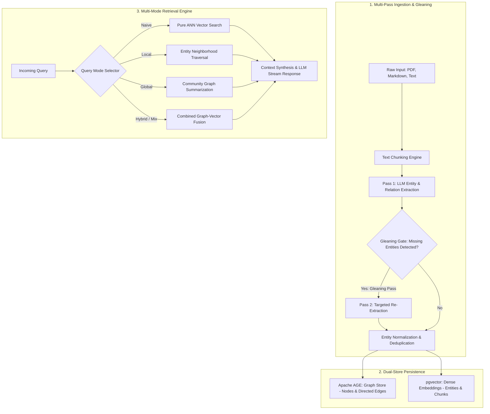
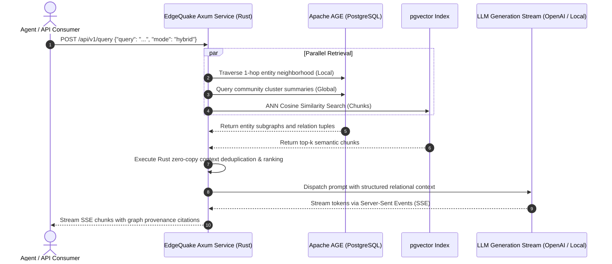

{: .light .w-75 .shadow .rounded-10 }

## Why Vector-Only Retrieval Fails on Relational and Multi-Hop Queries

Standard Retrieval-Augmented Generation (RAG) architectures rely almost exclusively on dense vector similarity search: documents are sliced into text chunks, converted into high-dimensional embeddings via transformer models, and stored in an approximate nearest neighbor (ANN) index. While effective for localized semantic lookups, this paradigm exhibits severe structural blindness when confronted with complex enterprise knowledge:

1. **Multi-Hop Blindness**: Questions requiring transitive reasoning—such as *"How does the auth gateway depend on the cache invalidation service when network partitions occur?"*—cannot be resolved by a single cosine distance query because the connecting facts reside in disparate documents.
2. **Context Fragmentation**: Vector search treats retrieved chunks as independent bags of tokens, discarding the topological relationships and entity hierarchies linking them together.
3. **Global Thematic Insensitivity**: Summarization queries—such as *"What are the primary operational risks identified across all quarterly audits?"*—fail because vector search retrieves only the top-$k$ nearest chunks, missing systemic themes distributed across thousands of passages.

To bridge this structural gap, research groups introduced Graph-RAG architectures. However, reference implementations like Microsoft's GraphRAG and HKUDS's [LightRAG](/posts/lightrag/) were built primarily as exploratory Python research prototypes. When deployed into high-concurrency production environments, Python-based Graph-RAG stacks suffer from Global Interpreter Lock (GIL) contention, heavy runtime memory footprints, and slow graph serialization.

**EdgeQuake**, developed by Raphael Mansuy, re-engineers the LightRAG architecture from the ground up in **Rust**. Built on the Tokio asynchronous runtime, Apache AGE graph extension, and `pgvector`, EdgeQuake provides a zero-copy, highly concurrent Graph-RAG engine designed for sub-second retrieval SLAs.

---

## The Dual-Layer Ingestion Pipeline: Graph Extraction and Gleaning

EdgeQuake implements the dual-level knowledge graph extraction pipeline introduced in the LightRAG algorithm, replacing Python script bottlenecks with compiled Rust performance.

### 1. The Two-Pass Gleaning Loop
Standard single-pass information extraction frequently misses subtle relational assertions, particularly when entity names appear colloquially. EdgeQuake incorporates LightRAG's **gleaning** loop:
* **Pass 1 (Primary Extraction)**: The LLM processes each chunk, identifying core entities, types, and explicit predicate relations.
* **Pass 2 (Targeted Gleaning)**: The engine evaluates whether unresolved pronouns, dangling references, or unmapped entities remain in the source chunk. If detected, a secondary gleaning prompt extracts secondary relations before entity resolution.

### 2. Entity Normalization in Compiled Rust
In large document collections, entities appear under synonymous surface forms (`"PostgreSQL"`, `"Postgres"`, `"pg_backend"`). Merging these nodes is computationally expensive in interpreted languages. EdgeQuake handles entity deduplication and graph normalization via compiled string algorithms and locality-sensitive hashing, collapsing aliases into canonical nodes before persisting them to the database.

---

## The Six Retrieval Modes of EdgeQuake

A central architectural advantage of EdgeQuake is its six specialized query modes. Rather than forcing every question through a one-size-fits-all retrieval pipeline, the engine exposes explicit modes calibrated for latency, cost, and analytical depth:

| Query Mode | Operational Mechanism | Best Use Case | Performance Tradeoff |
| :--- | :--- | :--- | :--- |
| **`naive`** | Pure vector similarity against indexed chunk embeddings | Simple factual lookups, exact keyword-adjacent questions | Lowest latency (<50ms), zero graph traversal |
| **`local`** | Identifies query entities, traverses immediate 1-hop / 2-hop graph neighborhoods | Questions about specific entities, dependencies, or immediate interactions | Moderate latency; high precision on relational facts |
| **`global`** | Evaluates high-level community clusters and global graph summaries | High-level architectural overviews, thematic synthesis | Higher token consumption; broad conceptual coverage |
| **`hybrid`** | Executes parallel local entity expansion and global community retrieval | Complex multi-faceted inquiries requiring both specifics and context | Balanced precision and recall; standard production default |
| **`mix`** | Dynamic weighted combination of naive vector chunks and graph subgraphs | Heterogeneous documents containing tabular data and prose | Highly configurable; tunable weighting coefficients |
| **`bypass`** | Dispatches the query directly to the LLM without context retrieval | General conversational turns, greetings, or meta-instructions | Zero retrieval overhead; relies on pre-trained knowledge |

---

## Systems Engineering: Why Rust Architecture Matters for Graph-RAG

While Python dominates machine learning prototyping, production retrieval services require predictable memory allocation, strict type safety, and sustained concurrency. EdgeQuake’s systems architecture delivers distinct operational advantages:

### 1. Tokio Async Concurrency and Zero-Copy Deserialization
Graph traversal generates fan-out queries: fetching an entity requires retrieving its adjacent edges, neighbor node attributes, and associated text chunk embeddings simultaneously. In EdgeQuake:
* Concurrency is managed via the **Tokio** runtime, handling tens of thousands of simultaneous async graph queries without thread starvation.
* Leveraging `serde` and zero-copy byte slices, graph responses from PostgreSQL are parsed directly into typed Rust structs without allocating intermediate Python dictionary objects, as discussed in [Combining Rust and Python for High-Performance AI Systems](/posts/combining-rust-and-python-for-high-performance-ai-systems/).

### 2. Unified PostgreSQL Backing Store (Apache AGE + pgvector)
Deploying separate graph databases (e.g., Neo4j) and vector databases (e.g., Pinecone or Milvus) creates operational fragmentation, dual-write synchronization hazards, and distributed transaction complexity. 
EdgeQuake consolidates both storage paradigms into a single database instance:
* **Apache AGE**: Adds an open-source graph extension to PostgreSQL, enabling openCypher graph queries (`MATCH (p:Person)-[:WORKS_AT]->(c:Company)...`).
* **`pgvector`**: Stores vector embeddings inside the identical database cluster, allowing single-transaction ACID commits across both relational chunks and graph nodes.

### 3. Native Model Context Protocol (MCP) Integration
EdgeQuake ships with an out-of-the-box **Model Context Protocol (MCP)** server interface. AI coding agents—such as Claude Code or OpenAI Agents—can mount EdgeQuake as a standardized tool without bespoke API client glue code, querying graph neighborhoods directly during autonomous problem-solving loops.

---

## What Changed Since Early 2026: The Transition from Prototype Python Scripts to Native Systems Retrieval

When LightRAG was originally published in late 2024 and early 2025, Graph-RAG was largely treated as an academic experiment. Running extraction on a 500-page book required hundreds of dollars in OpenAI API calls and hours of unoptimized Python execution. Across 2026, the retrieval landscape transformed along three axes:

### 1. Native Systems Implementations Replacing Script Glue
The era of chaining unoptimized LangChain scripts or raw Python loops in production has ended. Enterprise infrastructure teams now demand compiled, containerized microservices written in Rust, Go, or C++ that expose OpenAPI 3.0 specifications and Server-Sent Event (SSE) streaming natively. Systems like EdgeQuake reduce container idle memory footprints from gigabytes to megabytes, fitting neatly into modern Kubernetes clusters alongside services documented in [Production Generative AI Stack Architecture Components](/posts/production-generative-ai-stack-architecture-components/).

### 2. Cost-Effective Local Distillation for Graph Extraction
The original LightRAG formulation relied on expensive closed API models (like GPT-4o) for every entity extraction and gleaning step. In 2026, extraction is routinely offloaded to specialized local reasoning models (such as distilled Qwen or DeepSeek models running via vLLM or Ollama). EdgeQuake’s configurable model backend allows developers to execute entity extraction locally at near-zero inference cost, reserving frontier commercial APIs solely for the final user-facing response synthesis.

### 3. Interactive Visualization and Real-Time Graph Debugging
Early Graph-RAG systems functioned as opaque black boxes: developers could not inspect why a specific node was traversed or why an entity relationship was formed. EdgeQuake pairs its Rust backend with a modern **React 19** frontend powered by **Sigma.js** and WebGL. Engineers visually explore entity clusters, click nodes to view underlying source citations, and tune extraction thresholds interactively.

---

## Practical Engineering Tradeoffs

Integrating Graph-RAG into enterprise architectures introduces significant operational tradeoffs compared to naive vector search:

| Architectural Dimension | Vector-Only RAG | EdgeQuake (Graph-RAG in Rust) | Production Mitigation |
| :--- | :--- | :--- | :--- |
| **Ingestion Cost & Latency** | Low (Single-pass embedding generation) | High (Multi-pass LLM entity extraction + gleaning) | Use batched asynchronous ingestion queues; leverage small local models for entity extraction |
| **Storage Complexity** | Simple flat ANN vector index (`pgvector`, FAISS) | Dual-model storage (Apache AGE graph + `pgvector`) | Consolidate on PostgreSQL with unified ACID transactions to prevent dual-write drift |
| **Query Latency** | 10–50ms (Approximate Nearest Neighbors) | 150–500ms (Multi-hop graph traversal + hybrid merge) | Cache common entity subgraphs; route simple queries to `naive` mode |
| **Maintenance & Pruning** | Easy chunk invalidation via primary key delete | Complex graph pruning when source documents are modified | Maintain entity-to-chunk provenance edges to prune orphaned graph nodes automatically |

---

## Key Takeaways

| Pillar | Engineering Reality | Implementation Rule |
| :--- | :--- | :--- |
| **Topological Grounding** | Vector similarity cannot perform multi-hop relational inference | Use Graph-RAG when questions hinge on entity relationships, dependencies, and structural hierarchies |
| **Systems Performance** | Python RAG prototypes collapse under high concurrent read loads | Deploy compiled Rust runtimes (Tokio, Axum, zero-copy deserialization) to sustain sub-second enterprise SLAs |
| **Single-Store Simplicity** | Distributed database clusters introduce sync drift | Consolidate graph tables and vector embeddings inside PostgreSQL using Apache AGE and `pgvector` |
| **Multi-Mode Routing** | A single retrieval mode cannot balance speed, cost, and depth | Route incoming queries dynamically across `naive`, `local`, `global`, and `hybrid` modes based on question intent |

## New Questions

- **Dynamic Graph Self-Healing**: How can Graph-RAG engines automatically prune stale or hallucinated entity edges when underlying source documentation is updated or deleted?
- **Streaming Graph Traversal**: Can graph traversal algorithms be implemented to stream intermediate entity subgraphs directly to frontier model reasoning chains before retrieval fully completes?
- **Universal Graph-Agent Interfaces**: As MCP becomes universal, what standardized JSON schemas will govern how autonomous agents pass complex graph traversal constraints to backends like EdgeQuake?

---

## References

- Mansuy, R. (2025). *EdgeQuake: High-Performance Graph-RAG Engine Built in Rust*. GitHub Repository. [https://github.com/raphaelmansuy/edgequake](https://github.com/raphaelmansuy/edgequake) (accessed 2026-10-18).
- Guo, Z., et al. (2024). *LightRAG: Simple and Fast Retrieval-Augmented Generation with Dual-Level Knowledge Graphs*. arXiv:2410.05779 [cs.CL]. [https://arxiv.org/abs/2410.05779](https://arxiv.org/abs/2410.05779) (accessed 2026-10-18).
- Apache Software Foundation. (2025). *Apache AGE: Graph Database Extension for PostgreSQL*. Apache Software Foundation. [https://age.apache.org/](https://age.apache.org/) (accessed 2026-10-18).
- Anthropic. (2024). *Model Context Protocol: Standardizing Tool and Resource Connectivity for AI Agents*. [https://modelcontextprotocol.io/](https://modelcontextprotocol.io/) (accessed 2026-10-18).
