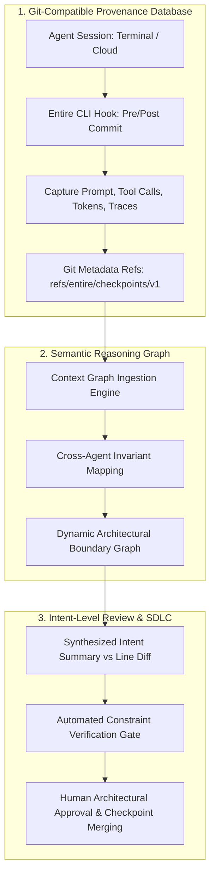
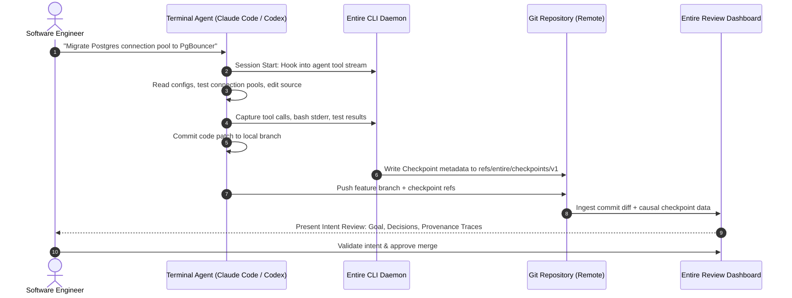

## Why Traditional Git Workflows and Pull Requests Collapse Under Agent Velocity

Software engineering methodologies for the past three decades have been built around a fundamental constraint: human developers write code slowly. Version control systems like Git, issue trackers like Jira, and code collaboration interfaces like GitHub Pull Requests were designed as asynchronous communication channels between humans. A developer spends two days crafting an 80-line change, writes a descriptive commit message, opens a pull request, and waits twenty-four hours for a teammate to inspect the diff line by line.

The rise of autonomous coding agents—such as Claude Code, OpenAI Codex, and Cursor background workers—completely shatters this throughput assumption. As analyzed in [Self-Driving Codebases](/posts/self-driving-codebases/), autonomous agent clusters can generate, compile, and commit code at rates exceeding 1,000 commits per hour. 

When human engineers are suddenly confronted with fifty complex pull requests arriving every morning, traditional code review grinds to a halt. The bottleneck in software engineering has violently shifted from **writing syntax** to **comprehending intent and validating invariants**. 

Moreover, Git itself suffers from an acute epistemic flaw in the agent era: **Git records *what* characters changed on disk, but completely drops *why* the change happened**. The user's prompt, the agent's chain-of-thought reasoning, the intermediate tool calls, the compiler errors encountered along the way, and the alternative solutions evaluated and discarded all vanish the moment the terminal session closes.

To address this systemic failure of developer infrastructure, Thomas Dohmke (former CEO of GitHub) announced **Entire**, raising $60 million led by Felicis to build an agent-native software development lifecycle (SDLC) platform centered on Git-compatible provenance and session checkpoints.

---

## The Three Structural Layers of the Entire Platform

Entire reframes developer tooling from a text-file synchronization engine into an integrated cognitive assembly line:

### 1. Git-Compatible Checkpoints: Durable Session Lineage
In standard agent workflows, session context is ephemeral. If an agent hallucinated an edge case or chose an obscure algorithm, future maintainers inspecting `git log -p` see only the raw code change. 

Entire resolves this through **Checkpoints**:
* Integrated via hooks into agent CLIs (Claude Code, Google Gemini CLI, Codex).
* Whenever an agent creates a commit, Entire captures the complete causal chain: the verbatim user prompt, the model's internal thinking trace, all dispatched tool calls (file reads, shell outputs, unit test runs), and token telemetry.
* Rather than polluting standard git commit logs or requiring proprietary database backends, Entire writes this structured metadata into dedicated Git namespace references (`refs/entire/checkpoints/v1` or an isolated orphan branch).
* Because the metadata lives inside Git objects, it pushes and pulls transparently across any existing Git remote (GitHub, GitLab, Gerrit, self-hosted servers) without breaking existing CI/CD pipelines.

### 2. Semantic Context Graph
Beyond recording flat session transcripts, Entire maps code modifications to a semantic dependency graph. If Agent A alters a database schema in module `billing`, the context graph establishes semantic links between the migration file, the user-facing RFC, and the downstream API client models maintained by Agent B, preventing cross-agent context drift.

### 3. Intent-Level Review vs. Line-by-Line Scrutiny
When a pull request contains 1,500 lines of generated code across thirty files, human line-by-line review is an illusion; reviewers inevitably skim and rubber-stamp. Entire inverts the review interface:
* The review dashboard displays the **Intent Contract**: What goal did the human request? Which constraints were imposed?
* The reviewer inspects the **Decision Graph**: What alternative implementations did the agent test in the sandbox? Why did it reject Approach B in favor of Approach A?
* Static invariant checks verify that the agent's changes adhere to repository policies, echoing the mechanical guardrails explored in [Harness Engineering: Architectural Principles for Scaling Agents to 1M Lines](/posts/harness-engineering/).

---

## Comparing the Traditional Human SDLC with the Agent-Native Assembly Line

The transition from human-centric software engineering to agent-native orchestration alters every phase of the development lifecycle:

| SDLC Phase | Traditional Human SDLC (Git + GitHub) | Agent-Native SDLC (Entire Platform) |
| :--- | :--- | :--- |
| **Problem Definition** | Narrative Jira tickets, high-level user stories | Formal type specifications, machine-readable constraints |
| **Implementation** | Manual typing, IDE autocomplete, multi-day cycles | Bounded autonomous agent loops executing in seconds |
| **Context Retention** | Implicit in author's brain; lost when engineer leaves | Explicitly versioned in Git checkpoints (`refs/entire/...`) |
| **Code Review** | Manual line-by-line diff inspection (`git diff`) | Intent verification, constraint checking, and trace auditing |
| **Incident Post-Mortem** | `git blame` identifies author; why it changed is unknown | Checkpoint trace reproduces the exact prompt, tools, and tests |
| **Team Bottleneck** | Code production velocity (lines of code per engineer) | Cognitive review bandwidth and specification clarity |

As argued in [Stop Generating, Start Thinking: Cognitive Debt and Verification in AI Engineering](/posts/stop-generating-start-thinking/), when teams produce code without capturing intent, repositories accumulate devastating cognitive debt. By tying agent reasoning directly to versioned Git commits, platforms like Entire restore cognitive audibility.

---

## What Changed Since Early 2026: From Ephemeral Prompts to Versioned Decision Lineage

When Entire was announced in early 2026, the developer tooling landscape was fragmented: developers ran one-off CLI prompts in their terminals, copying generated code into local branches with standard `git commit -m "fix: updated prompt"`. Throughout 2026, the agentic tooling ecosystem consolidated around three core infrastructure realities:

### 1. Standardization of Agent Session Provenance
The practice of running unrecorded agent sessions on developer machines has become a major enterprise compliance liability. Financial and healthcare engineering organizations now mandate **cryptographic agent provenance**: every commit generated by an AI model must carry signed metadata detailing the model ID, prompt hash, and execution trace. Entire’s use of standard Git refs provided an open blueprint that avoided vendor lock-in.

### 2. Emergence of Intent-Verification CI Gates
Early CI pipelines ran only unit tests and lint scripts. Modern CI systems in 2026 evaluate **intent-conformance checks**:
* Did the generated code touch files outside the scope declared in the prompt?
* Did the agent disable any existing assertions or decrease test coverage to achieve green-bar status?
* Does the reasoning trace indicate that the agent bypassed a security warning?
If an anomaly is detected in the checkpoint trace, the pull request is blocked automatically before human review.

### 3. Cross-Harness Session Hand-Offs
A single engineering task often spans multiple specialized agents: an initial architecture plan drafted in Claude Code, background refactoring executed in Cursor, and final performance profiling conducted via Codex. Because Entire captures checkpoints in a universal schema on Git, an agent session can be paused in one harness and resumed in another without losing conversational memory or environmental discoveries, realizing the vision described in [How Claude Code Works](/posts/how-claude-code-works/).

---

## Practical Engineering Tradeoffs

Adopting an agent-native provenance layer involves operational complexities that infrastructure teams must evaluate:

| Operational Consideration | Primary Tradeoff | Architectural Mitigation |
| :--- | :--- | :--- |
| **Repository Storage Bloat** | Storing full token logs and shell traces in Git can balloon repository clone sizes | Store verbose traces as content-addressed Git blobs in separate namespaces, fetching them shallowly on demand |
| **Developer Workflow Friction** | Introducing mandatory session capture tools could slow down rapid prototyping | Ensure CLI hooks operate completely transparently in the background with zero developer latency |
| **Privacy and Secret Leakage** | Agent reasoning traces might inadvertently capture sensitive API keys or PII from stdout | Implement local regex and AST sanitization filters in the CLI daemon *before* metadata is committed to Git |
| **Tool Vendor Lock-In** | Proprietary review platforms risk isolating teams from standard git tooling | Guarantee full two-way compatibility with raw `git` commands and standard GitHub/GitLab pull requests |

---

## Key Takeaways

| Dimension | Engineering Reality | Implementation Rule |
| :--- | :--- | :--- |
| **Provenance Over Diffs** | A code diff without its generating prompt and reasoning trace is unmaintainable technical debt | Capture full agent context (prompts, tool calls, token usage) alongside every commit |
| **Git-Native Extensibility** | Developers will not abandon Git for proprietary platforms | Store agent metadata in standard Git references (`refs/entire/...`) to ensure complete remote portability |
| **Intent-Level Review** | Human line-by-line review cannot scale to thousands of agent-generated lines | Shift engineering review from syntax checking to intent, constraint, and architectural verification |
| **The Assembly Line Mindset** | When agents produce code, the engineer’s role is quality control and system constraint design | Treat the agent harness as an industrial assembly line requiring continuous telemetry and inspection gates |

## New Questions

- **Automated Provenance Pruning**: How should teams establish retention policies for agent reasoning traces as repositories age over five to ten years?
- **AI-to-AI Code Review**: Can independent reviewer agents reliably detect subtle hallucinations in author-agent checkpoint traces without human cognitive exhaustion?
- **Universal Metadata Standards**: Will the Linux Foundation or Git core team standardize agent provenance namespaces to ensure universal interoperability across Entire, GitHub, and open-source tooling?

---

## References

- Dohmke, T. (2026). *Hello Entire World: Rebuilding Developer Tools for the Agent Era*. Entire Engineering Blog. [https://entire.io/blog/hello-entire-world/](https://entire.io/blog/hello-entire-world/) (accessed 2026-10-18).
- Entire Team. (2026). *Entire CLI and Checkpoints Architecture Documentation*. [https://entire.io/docs](https://entire.io/docs) (accessed 2026-10-18).
- Orosz, G. (2026). *The Shift to Agent-Native Development: Analyzing Entire's $60M Launch*. The Pragmatic Engineer. [https://newsletter.pragmaticengineer.com/](https://newsletter.pragmaticengineer.com/) (accessed 2026-10-18).
- Chacon, S., & Straub, B. (2014). *Pro Git: Git Internals and Custom References*. Apress. [https://git-scm.com/book/en/v2/Git-Internals-Git-References](https://git-scm.com/book/en/v2/Git-Internals-Git-References) (accessed 2026-10-18).
