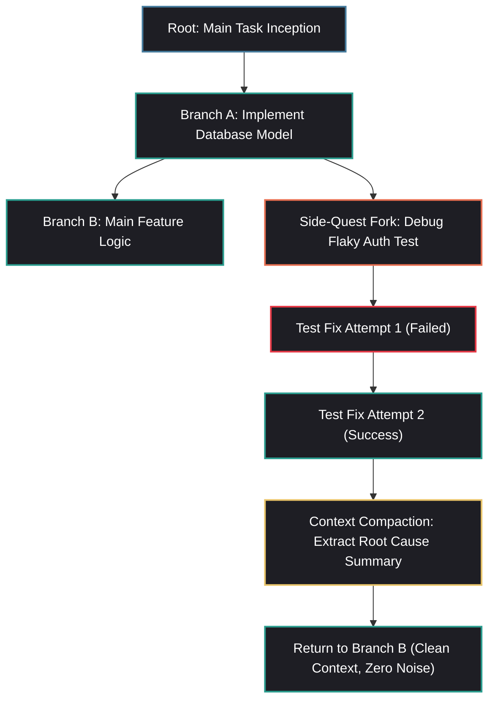

## Why Did Agentic Architecture Rebound from Tool Bloat to Minimal Primitive Kernels?

As language model agent frameworks proliferated between 2024 and 2026, the dominant industry instinct was capability expansion via tool accumulation. Frameworks competed by offering hundreds of pre-packaged connectors: GitHub tools, Slack integrations, Jira issue fetchers, database clients, web scrapers, and calculator modules.

However, in production software engineering and systems operation, this tool-aggregation paradigm triggered severe structural failure modes:

1. **Schema Context Exhaustion**: Injecting dozens of tool JSON schemas into an agent's system prompt consumes thousands of tokens on every single turn. This static overhead starves the model of necessary context space for large codebase diffs and test diagnostics.
2. **Routing Paralysis and Tool Misuse**: When a model is presented with 30+ overlapping tools, reasoning degrades. The model frequently hallucinates arguments, selects suboptimal tool variations, or confuses parameter types.
3. **Brittle Upstream API Dependencies**: Every external tool client introduces third-party dependencies, breaking schema changes, and potential authentication failures that can crash the agent loop.

In response to this architectural bloat, software veterans Armin Ronacher and Mario Zechner introduced **Pi**—the minimal agent runtime engine powering OpenClaw. Pi rejects tool proliferation in favor of a radical architectural hypothesis: **if an autonomous agent possesses the ability to read, write, edit, and execute arbitrary code, it requires exactly four primitive tools. Any additional specialized capability can be synthesized by the agent itself on demand.**

```mermaid
flowchart TD
    subgraph BloatedParadigm["Conventional Tool-Heavy Agent Architecture"]
        A["Agent Prompt"] --> B["30+ Dedicated JSON Schemas (Slack, Git, SQL, Docker, Jira)"]
        B --> C["Heavy Context Overhead & Schema Hallucinations"]
        C --> D["Fragile Upstream RPC Dependencies"]
    end

    subgraph PiKernel["The Pi Minimalist Agent Architecture"]
        E["Agent Prompt"] --> F["Four Primitive Kernel Tools: read, write, edit, bash"]
        F --> G["Zero Schema Bloat: Minimal Token Consumption"]
        G --> H["Self-Extension: Agent Synthesizes Custom Scripts & Extensions"]
        H --> I["Tree-Shaped Session Branching (Isolated Sub-Tasks)"]
    end

    style BloatedParadigm fill:#1e1e24,stroke:#e63946,stroke-width:2px,color:#fff
    style PiKernel fill:#1e1e24,stroke:#2a9d8f,stroke-width:2px,color:#fff
```



---

## Architectural Mechanics: Deconstructing the Pi Agent Runtime

The Pi architecture distills autonomous execution into two foundational innovations: an irreducible primitive toolset and a tree-structured conversational state graph.

### 1. The Four-Tool Primitive Kernel

Rather than exposing distinct API endpoints for searching files, running git commands, compiling code, or making HTTP requests, Pi constrains its tool namespace to four operations:

- **`read_file(path, offset, limit)`**: Inspects arbitrary filesystem text or binary metadata with deterministic byte/line pagination.
- **`write_file(path, content)`**: Atomically writes complete file contents, creating parent directories automatically.
- **`edit_file(path, target, replacement)`**: Applies exact contiguous string replacements, preserving surrounding code integrity.
- **`bash(command)`**: Dispatches POSIX shell commands directly to the underlying operating system.

Because the `bash` primitive provides access to the complete standard utility suite (`curl`, `git`, `grep`, `jq`, `python`, `node`), the agent is theoretically Turing-complete in its operating environment. If Pi needs to query a PostgreSQL database, it does not require a specialized Postgres MCP tool; it simply invokes:

```bash
python3 -c "import psycopg2; conn = psycopg2.connect('...'); ..."
```

Or, if an operation requires repeated invocation, Pi writes a reusable helper script to disk and executes it locally.

### 2. Tree-Shaped Session State vs. Linear Conversation History

Conventional conversational agents operate within a linear list of messages ($M = [m_0, m_1, \dots, m_t]$). When an agent encounters an unexpected error or embarks on an exploratory tangent (e.g., attempting an experimental refactor that fails unit tests), the failed attempts and noisy error logs permanently pollute the linear context window.

Pi models execution history as a **directed tree of checkpoints** ($T = (V, E)$):



When an agent needs to investigate a peripheral bug, Pi **forks a child branch**:

1. The agent enters an isolated exploratory sub-session.
2. It executes multiple bash commands, edits files, and inspects stack traces.
3. Once the issue is resolved or the hypothesis is invalidated, Pi compacts the exploratory trajectory into a succinct summary.
4. The execution context reverts to the parent node, appending only the compacted conclusion and discarding intermediate error churn.

This tree-branching capability preserves token budget integrity, preventing prompt context bloat from degrading attention accuracy over extended multi-hour tasks.

### 3. Dynamic Self-Extension and Hot-Reloading

Pi treats its own runtime as malleable software. If a workflow demands specialized capabilities (e.g., custom AST navigation or dynamic memory caching), Pi does not require the developer to install third-party plugins.

Instead, the agent authors an extension script directly into its local environment:

```typescript
// .pi/extensions/ast_search.ts
import { registerTool } from "pi-engine";
import { parse } from "@babel/parser";

registerTool("find_function_symbols", {
  description: "Locates all exported function signatures in a source tree",
  parameters: { path: "string" },
  execute: async ({ path }) => {
    // Custom AST extraction logic
  }
});
```

Using Node.js/Bun dynamic imports, Pi hot-reloads the newly authored extension in-memory without terminating the active session, allowing the agent to continuously adapt its capabilities to match project-specific architectures.

---

## The Philosophical Schism: Self-Extension vs. Model Context Protocol (MCP)

Pi’s intentional omission of native Model Context Protocol (MCP) client support highlights an ideological divergence in modern agent design:

| Architectural Lens | Protocol-Centric (Model Context Protocol) | Primitive-Centric (Pi Minimal Engine) |
| :--- | :--- | :--- |
| **Core Philosophy** | Expose standardized RPC servers for every service | Strip tools to primitives; write code to interact |
| **Context Overhead** | Dynamic JSON schemas loaded per tool | 4 static tool schemas ($\approx 250$ tokens total) |
| **Boundary Control** | Guardrails enforced at the RPC server boundary | Guardrails enforced at OS / process sandbox boundary |
| **Failure Modes** | Network timeouts, schema version mismatches | Shell syntax errors, local compiler failures |
| **Malleability** | Rigid; tools must be updated by server maintainers | Extreme; agent can rewrite scripts on the fly |

While the MCP ecosystem excels at providing secure enterprise gateways to shared corporate infrastructure—such as the database pooling patterns reviewed in our audit of [Google MCP Toolbox](/posts/mcp-toolbox-databases/)—Pi demonstrates that for raw software development, code execution and filesystem primitives are far more expressive and token-efficient than static API wrappers.

---

## How Minimal Agent Kernels Evolved Across 2026

The lessons pioneered by Pi influenced the broader 2026 developer agent landscape:

1. **POSIX-Native Execution as Standard**: Autonomous CLI agents (such as Claude Code and OpenCode) converged on minimalist tool kernels, relying on native shell commands (`git`, `grep`, `npm`) rather than maintaining bespoke tool wrappers for every command-line utility.
2. **Deterministic Context Pruning via Branching**: Enterprise agent frameworks adopted Pi’s tree-structured session logs. Instead of maintaining infinite append-only chat histories, agents routinely checkpoint states and prune failed exploration trajectories before continuing linear planning.
3. **Hardware-Isolated Edge Deployment**: As explored in our source audit of [deploying OpenClaw on mobile Android hardware](/posts/openclaw-old-android-phone/), minimalist runtimes like Pi have virtually zero memory overhead, allowing full agent kernels to run on low-power ARM devices and constrained edge environments.
4. **Integration with Phase-Gated Engineering**: In our evaluation of the [BMAD Method and TEA execution cycles](/posts/bmad-method/), minimalist agents serve as high-speed implementation workers inside structured agile pipelines, executing tasks within isolated Git worktrees without architectural drift.

---

## Key Takeaways

- **The Supremacy of Primitive Tools**: An agent equipped with `read`, `write`, `edit`, and `bash` is Turing-complete; adding dozens of specialized API tools wastes tokens and degrades routing accuracy.
- **Tree-Shaped Session State**: Branching conversation history allows agents to explore peripheral hypotheses and debug errors in temporary forks, compacting lessons without polluting the primary context window.
- **Self-Extending Runtimes**: Allowing agents to author and hot-reload their own utility extensions provides greater adaptability than waiting for static external plugins.
- **Token Budget Conservation**: Restricting the tool namespace to four primitives leaves maximum context window space for large codebases, compiler diagnostics, and multi-file reasoning.

---

## New Questions

1. When an agent is permitted to dynamically write and hot-reload its own executable runtime extensions, what security boundaries prevent prompt injection from inducing permanent sandbox escapes?
2. How can tree-branching session states be serialized and shared among distributed multi-agent swarms working across asynchronous Git branches?
3. Will future foundation models be explicitly pre-trained on POSIX shell primitives, rendering JSON-RPC tool calling obsolete for developer workflows?

---

## References

1. Ronacher, A. *Pi: The Minimal Agent Architecture and the Power of Primitive Tools*. Armin Ronacher’s Thoughts and Writings. https://lucumr.pocoo.org/2026/1/31/pi/ (accessed 2026-10-18).
2. Zechner, M. *Pi-Mono: Minimalist Agent Kernel and Branching Session Engine*. GitHub Repository. https://github.com/badlogic/pi-mono (accessed 2026-10-18).
3. Anthropic Research. *Effective System Prompts and Minimalist Tool Design for Coding Agents*. Anthropic Engineering Insights. https://docs.anthropic.com/en/docs/build-with-claude/tool-use (accessed 2026-10-18).
4. Huntley, G. *The Ralph Wiggum Pattern: Autonomous Agent Loops and Error Convergence*. https://ghuntley.com/ralph/ (accessed 2026-10-18).
