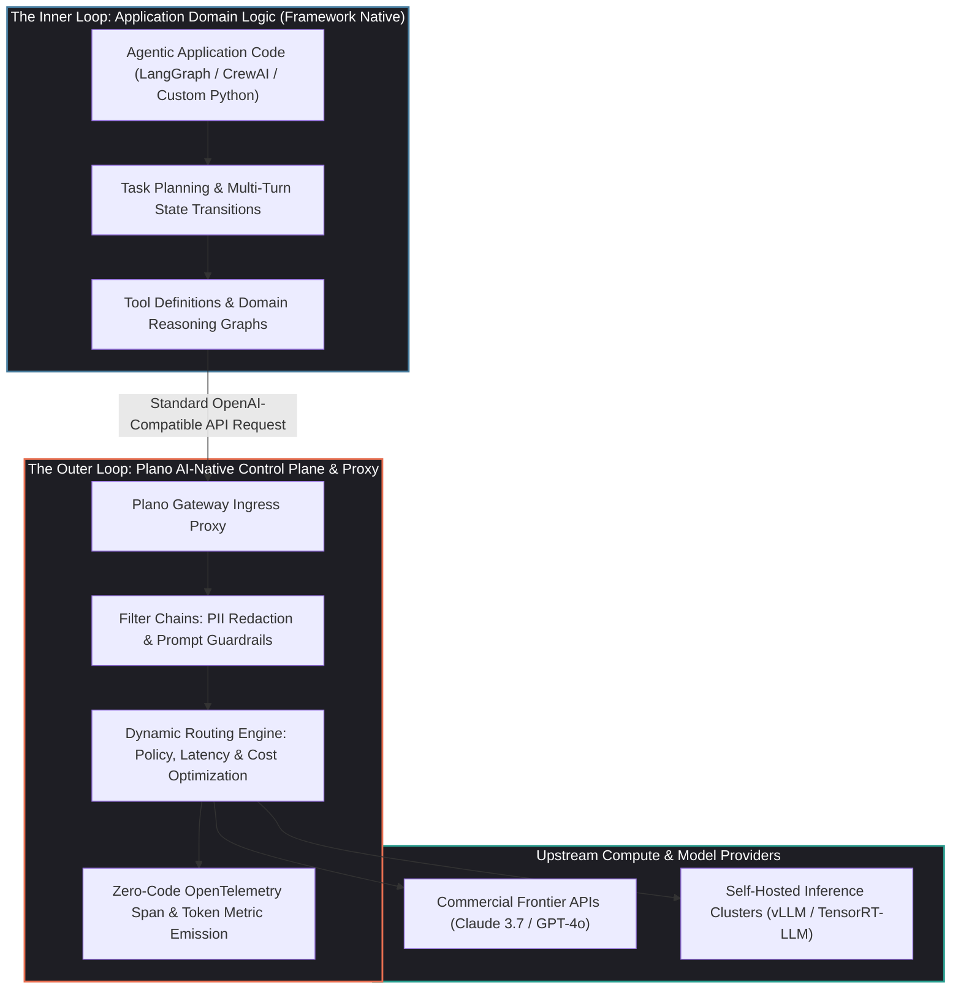
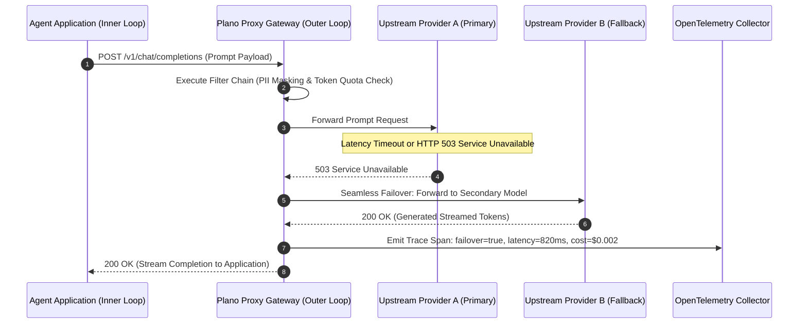

## Why Did Enterprise Agent Deployment Demand an "ONNX Moment" for Infrastructure?

In the early evolution of deep learning, machine learning engineers faced severe operational fragmentation: models trained in PyTorch, TensorFlow, or Caffe could not be easily ported across diverse hardware backends (NVIDIA TensorRT, Intel OpenVINO, Apple CoreML) without rewriting execution graphs from scratch. The breakthrough that unlocked production ML deployment was **ONNX (Open Neural Network Exchange)**—an open specification that decoupled model definition from runtime execution.

Between 2024 and 2026, autonomous agent engineering reached an identical structural inflection point. Building an agent prototype using Python frameworks (such as LangGraph, CrewAI, AutoGen, or LlamaIndex) is straightforward. However, when organizations attempt to run these agents across production Kubernetes clusters, they encounter severe architectural friction:

1. **Tight Coupling of Domain Logic and Infrastructure**: Application code invariably becomes cluttered with operational plumbing—hardcoded model API keys, bespoke retry loops, manual fallback logic for HTTP 429 rate limits, and custom PII-scrubbing regexes.
2. **Provider Lock-In and Migration Friction**: Swapping an underlying foundation model (e.g., migrating from OpenAI GPT-4o to DeepSeek-V3 or Anthropic Claude) requires refactoring core orchestration pipelines, modifying prompt formatting functions, and risking regression across hundreds of distributed microservices.
3. **Fragmented Observability and Policy Enforcement**: Every team within an enterprise implements their own tracing hooks and guardrails. Central IT and security organizations possess zero unified control over prompt spending, compliance auditing, or data exfiltration policies.

**Plano** emerged as the **"ONNX layer" for autonomous agents**. By operating as an AI-native proxy server and data plane, Plano establishes a formal architectural boundary: it isolates the **agent's inner loop** (domain logic, prompt schemas, and reasoning graphs) from the **outer loop** (model routing, failover policies, security filter chains, and OpenTelemetry observability).



---

## Architectural Mechanics: Deconstructing the Inner Loop vs. Outer Loop Dichotomy

The central paradigm shift enforced by Plano is the strict decoupling of operational responsibilities between application developers and platform infrastructure engineers.

### 1. The Inner Loop: Pure Domain Reasoning

In a clean architecture, the software engineer authoring an agent should focus exclusively on domain intent:

- What tools are available to the agent?
- How should multi-step sub-tasks be sequenced?
- What are the acceptance criteria for terminating the execution loop?

The inner loop communicates exclusively over standard, protocol-agnostic interfaces (such as the standard `/v1/chat/completions` REST format). It does not know or care which physical cloud datacenter executes the forward pass, how much the query costs, or whether the primary provider is currently experiencing an outage.

### 2. The Outer Loop: Declarative Infrastructure Policy

Plano captures all outbound model interactions at the network layer, managing operational concerns through declarative YAML configuration manifests:

```yaml
# plano-config.yaml - Declarative Infrastructure Control
model_providers:
  - id: "primary-fast"
    provider: "openai"
    model: "gpt-4o-mini"
    api_key: "${OPENAI_API_KEY}"
    timeout_ms: 2500

  - id: "deep-reasoner"
    provider: "deepseek"
    model: "deepseek-reasoner"
    api_key: "${DEEPSEEK_API_KEY}"
    timeout_ms: 8000

  - id: "local-fallback"
    provider: "vllm"
    endpoint: "http://vllm-cluster.internal:8000/v1"
    model: "qwen2.5-coder-32b"

routing_rules:
  - name: "code_refactoring_traffic"
    match:
      header: "X-Task-Type"
      value: "code_generation"
    target: "deep-reasoner"
    fallback: ["primary-fast", "local-fallback"]

filter_chains:
  - name: "enterprise_safety_gate"
    filters:
      - type: "pii_masking"
        entities: ["EMAIL", "CREDIT_CARD", "API_KEY"]
      - type: "prompt_injection_guardrail"
        action: "reject"
```

If an upstream provider returns an HTTP 503 error or breaches its $2500\text{ms}$ latency budget, Plano’s data plane automatically re-routes the prompt to the configured fallback provider without dropping the active agent connection or throwing an unhandled exception inside the application code.



---

## Filter Chains and Zero-Code Governance

In traditional microservice architectures, API gateways (such as Envoy, Kong, or Traefik) utilize filter chains to enforce rate limiting, TLS termination, and authentication. Plano adapts the filter chain concept specifically for generative AI workloads:

### 1. Ingress Filter Pipeline (Request Pre-Processing)
- **Semantic Caching**: Hashes incoming prompt embeddings against an in-memory vector cache, returning cached responses in sub-15ms for identical queries.
- **Data Loss Prevention (DLP)**: Scans input text and tool parameters for corporate credentials, client personal data, or proprietary tokens, replacing sensitive entities with reversible synthetic placeholders.
- **Injection Classifiers**: Evaluates incoming text against dedicated lightweight classification models to intercept jailbreak attempts before tokens reach expensive frontier models.

### 2. Egress Filter Pipeline (Response Post-Processing)
- **Hallucinated Leakage Prevention**: Scans generated outputs for system prompt leakage or internal server infrastructure addresses.
- **Format Validation**: Enforces JSON schema adherence, automatically repairing malformed JSON output or triggering a localized retry if required.

---

## Observability: Native OpenTelemetry Signals Without Code Instrumentation

One of the most persistent operational hurdles in enterprise agent deployment is tracing multi-turn causal chains across complex systems. Manually instrumenting Python code with SDK spans is tedious, error-prone, and clutters domain business logic.

Because Plano sits inline as an HTTP proxy, it emits comprehensive **OpenTelemetry (OTel)** spans automatically:

- **Prompt and Completion Token Accounting**: Accurately measures prompt, completion, and reasoning token counts across disparate vendor formats.
- **Provider Latency Breakdown**: Decomposes total turn latency into Time-to-First-Token (TTFT), inter-token generation time, and network proxy transit overhead.
- **Causal Execution Trees**: Tags spans with custom headers (`X-Agent-ID`, `X-Session-ID`, `X-Turn-Index`), allowing platforms like Jaeger, Datadog, and Langfuse to render full visual execution graphs of complex agent swarms.

As analyzed in our comprehensive review of [production generative AI stack architectures](/posts/production-generative-ai-stack-architecture-components/), centralized telemetry at the gateway plane is the single most effective defense against runaway token budgets and silent model drift.

---

## Comparative Analysis: Plano vs. Monolithic Agent Frameworks vs. Standard API Gateways

| Operational Dimension | Monolithic Frameworks (LangChain/CrewAI) | Standard Gateways (Envoy/Kong) | Plano AI Data Plane |
| :--- | :--- | :--- | :--- |
| **Separation of Concerns** | Low (All infra embedded in Python code) | High (Network layer only) | **High (Specialized for LLM/Agent semantics)** |
| **Model Agility** | Requires code refactoring to change providers | Unaware of LLM token semantics | **Declarative YAML routing & dynamic failover** |
| **Observability** | Requires framework-specific callback handlers | Generic HTTP metrics (bytes, status codes) | **Native GenAI OTel spans (tokens, TTFT, prompts)** |
| **Guardrail Execution** | Hardcoded per-prompt python wrappers | Custom Lua / WASM plugins required | **Out-of-the-box Filter Chains (PII, Injection)** |
| **Runtime Portability** | Bound to Python/Node.js language environments | Language agnostic | **Language agnostic (OpenAI-compatible HTTP)** |

---

## How Agent Control Planes Evolved Across 2026

The separation of agent reasoning from operational infrastructure catalyzed broad industry transformations across 2026:

1. **Kubernetes Sidecar Injection**: Plano-style proxies transitioned from standalone microservices into Kubernetes sidecar containers injected automatically alongside agent pods, managing local TLS certificates, secret rotation, and egress filtering transparently.
2. **Dynamic Speculative Decoding and Hybrid Routing**: Modern proxies inspect prompt difficulty dynamically. Simple formatting and retrieval queries are automatically dispatched to fast, low-cost local models—such as the 3B active MoE engines explored in our audit of [Qwen3-Coder-Next](/posts/qwen3-coder-next/)—reserving costly frontier models strictly for complex algorithmic reasoning tasks.
3. **Integration with Primitive Agent Kernels**: As demonstrated in our analysis of the [Pi minimal agent runtime](/posts/pi-minimal-agent/), pairing a stripped-down, 4-tool inner-loop kernel with an intelligent outer-loop proxy like Plano delivers peak architectural elegance: absolute simplicity in code combined with enterprise-grade resilience in operations.
4. **Autonomous Infrastructure Negotiation**: Next-generation proxies negotiate rate limits and billing quotas dynamically across multi-cloud provider accounts, auto-shifting enterprise traffic away from regions experiencing GPU thermal throttling or network latency spikes.

---

## Key Takeaways

- **The Inner/Outer Loop Boundary**: Decoupling domain agent reasoning (prompts, tools, state graphs) from infrastructure concerns (routing, retries, security, telemetry) is essential for production scalability.
- **Declarative Model Agility**: Moving provider credentials, timeouts, and fallbacks into declarative YAML manifests allows engineering teams to swap foundation models without code refactoring.
- **Filter-Chain Defense**: Enforcing PII redaction and prompt injection guardrails at the proxy layer guarantees consistent security policies across all organizational microservices.
- **Zero-Code Semantic Telemetry**: Inline proxy architecture captures high-fidelity OpenTelemetry spans and token metrics without requiring invasive application instrumentation.

---

## New Questions

1. When an AI proxy performs automatic failovers between models with different prompt sensitivities, how can it ensure that structured JSON tool outputs maintain schema consistency?
2. What distributed consensus protocols are required to enforce global tenant rate limits across a cluster of multi-region proxy gateways without introducing latency bottlenecks?
3. As on-device local models proliferate, will edge devices run lightweight embedded proxies to manage local-to-cloud model handoffs seamlessly?

---

## References

1. Plano Core Team. *Plano: The AI-Native Proxy and Data Plane for Production Agents*. GitHub Repository. https://github.com/plano-ai/plano (accessed 2026-10-18).
2. Open Neural Network Exchange. *ONNX: Open Standard for Machine Learning Interoperability*. https://onnx.ai/ (accessed 2026-10-18).
3. Cloud Native Computing Foundation. *Envoy Proxy: Architecture Principles and Filter Chains*. https://www.envoyproxy.io/ (accessed 2026-10-18).
4. OpenTelemetry Governance Committee. *Semantic Conventions for Generative AI Operations and Spans*. https://opentelemetry.io/docs/specs/semconv/gen-ai/ (accessed 2026-10-18).
