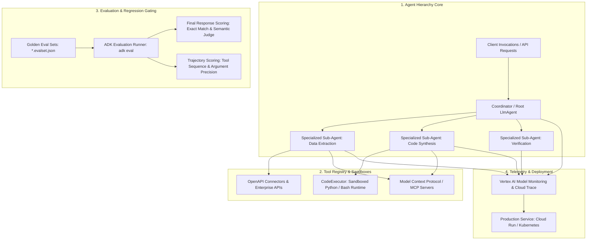
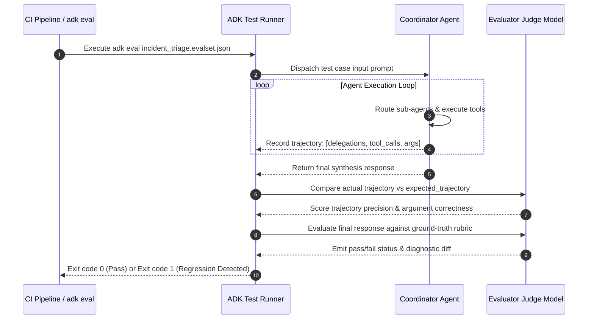

{: .light .w-75 .shadow .rounded-10 }

## Why Production Agent Engineering Demands Code-First Frameworks Over Prompt Prototyping

In enterprise software engineering, experimental prototypes routinely fail when transitioning to production. A developer can assemble an impressive demonstration in an afternoon using a few dozen lines of unconstrained prompting and an ad-hoc function-calling loop. However, the moment that agent is subjected to real-world operational constraints—multi-tenant concurrency, non-deterministic tool failures, compliance audits, and regression testing across hundreds of edge cases—unstructured prompt scripts collapse.

The failure is methodological: software engineering practices developed over decades—such as static type checking, unit testing, continuous integration, regression suites, and observable telemetry—are frequently discarded when building LLM applications. 

To bridge this gap, Google developed the **Agent Development Kit (ADK)** for Python (`google/adk-python`). ADK enforces a **code-first, evaluation-driven architecture**. Instead of treating an agent as a black-box prompt string, ADK structures agent systems as typed software components: explicit coordinator-worker hierarchies, sandboxed code execution environments (`CodeExecutor`), native Model Context Protocol (MCP) tool bindings, and first-class evaluation datasets (`.evalset.json`) designed to gate production deployments.

---

## Architectural Anatomy of Google ADK

ADK decomposes autonomous agent applications into five decoupled subsystems:



### 1. Code-First Hierarchical Orchestration
ADK models multi-agent coordination through explicit component trees. Instead of relying on a chaotic swarm where agents broadcast messages indiscriminately, ADK structures systems into clear parent-child delegation trees:

```python
from google.adk.agents import LlmAgent

# Scoped, single-purpose worker agents
data_extractor = LlmAgent(
    name="data_extractor",
    model="gemini-2.5-flash",
    instruction="Extract structured JSON metrics from raw server logs.",
    tools=[parse_log_archive]
)

code_debugger = LlmAgent(
    name="code_debugger",
    model="gemini-2.5-flash",
    instruction="Diagnose runtime stack traces and propose minimal patches.",
    tools=[inspect_source_ast]
)

# Root coordinator agent with explicit routing scope
coordinator = LlmAgent(
    name="incident_coordinator",
    model="gemini-2.5-flash",
    description="Triage production alerts and dispatch analysis to specialized workers.",
    sub_agents=[data_extractor, code_debugger]
)
```

This hierarchical topology enforces the separation of concerns analyzed in [The Agent SDK Landscape: Comparing Orchestration Runtimes and Harness Primitives](/posts/agent-sdk-landscape/): the coordinator manages conversational state and routing, while leaf agents operate within strictly bounded tool scopes.

{: .light .w-75 .shadow .rounded-10 }

### 2. Deterministic Sandboxed Execution with `CodeExecutor`
Language models frequently generate syntactically plausible Python scripts or SQL queries to analyze data. Executing these scripts directly on the application host creates critical security vulnerabilities and risks state corruption.
ADK embeds a dedicated **`CodeExecutor`** abstraction:
* Generated code blocks are extracted into isolated sandbox environments (Docker containers or gVisor-isolated runtimes).
* Execution is bounded by strict CPU, memory, and wall-clock timeouts.
* Only serialized stdout, stderr, and explicit return artifacts are fed back into the agent context, preventing arbitrary host system access.

{: .light .w-75 .shadow .rounded-10 }

---

## First-Class Trajectory Evaluation: Moving Beyond Vibe Checks

The most critical production contribution of ADK is treating **evaluation as a continuous integration primitive**. In standard web development, no pull request merges without passing unit and integration test suites. In contrast, teams building agent systems frequently deploy based on anecdotal testing ("it worked on my three test prompts").

ADK introduces machine-readable evaluation suites (`.evalset.json`):

```json
{
  "eval_set_id": "incident_triage_regression_v1",
  "test_cases": [
    {
      "id": "case_memory_leak_oom",
      "input_prompt": "Pod payment-service-7f8b crashed with OOMKilled. Investigate memory metrics and find the root cause commit.",
      "expected_trajectory": [
        {
          "agent": "incident_coordinator",
          "action": "delegate_to",
          "target": "data_extractor"
        },
        {
          "agent": "data_extractor",
          "tool_call": "fetch_prometheus_metrics",
          "arguments_match": {"metric": "container_memory_working_set_bytes"}
        },
        {
          "agent": "incident_coordinator",
          "action": "delegate_to",
          "target": "code_debugger"
        }
      ],
      "evaluation_criteria": {
        "trajectory_match_threshold": 0.90,
        "semantic_similarity_threshold": 0.85
      }
    }
  ]
}
```



### Dual-Layer Evaluation Scoring
ADK evaluates agent behavior across two distinct dimensions:
1. **Trajectory Scoring**: Did the agent invoke the correct tools in the correct order? Did it pass appropriate parameters, or did it invoke redundant, expensive search tools unnecessarily?
2. **Outcome Scoring**: Does the final synthesized response satisfy semantic correctness criteria when scored against reference ground truth by an automated judge model?

This dual-layer scoring mirrors the benchmarking rigor explored in [Evaluating Deep Agents CLI on Terminal Bench 2.0](/posts/evaluating-deepagents-cli-on-terminal-bench-2-0/), ensuring that regressions in subagent routing are flagged before reaching production users.

{: .light .w-75 .shadow .rounded-10 }

---

## Developer Experience: The Built-In Web Inspection UI

Debugging asynchronous multi-agent conversations using raw terminal logs is cognitively overwhelming: interleaved tool calls, multi-turn context dumps, and JSON serialization artifacts obscure the causal flow of decisions.

ADK addresses this by providing a local web development interface (`adk web`):
* **Visual Trajectory Timeline**: Developers inspect the conversation tree as an interactive visual graph, expanding individual turns to examine prompt tokens, raw model completions, and tool inputs.
* **Live Sandbox Inspection**: Shows exact commands executed within `CodeExecutor`, including stdout streams and execution latency metrics.
* **Mock Tool Injection**: Engineers can simulate tool failures (e.g., forcing a database query tool to return HTTP 500) to observe how gracefully the coordinator handles exceptions.

{: .light .w-75 .shadow .rounded-10 }

---

## What Changed Since Early 2026: The Evolution from Scripted Bots to Production Agent Microservices

When Google ADK was initially previewed in early 2026, most agent frameworks were oriented around rapid local scripts running inside Jupyter Notebooks. Over the course of 2026, production requirements forced three major structural evolutions across the ADK ecosystem:

### 1. Standardization on Model Context Protocol (MCP)
Initial ADK versions relied exclusively on bespoke Python tool decorators and OpenAPI JSON schemas. In 2026, Google aligned ADK with the industry-wide **Model Context Protocol (MCP)**. ADK agents can now mount standard MCP servers dynamically over stdio or HTTP SSE, allowing Google Cloud agents to share the exact same tool ecosystem utilized by Claude Code and Codex environments.

### 2. Native Cloud Run and Vertex AI Microservice Deployment
Early agent architectures required custom daemon infrastructure to keep long-running agent threads alive. ADK transformed agents into cloud-native microservices:
* Agents package directly into lightweight container images deployable to **Cloud Run** or **Vertex AI Reasoning Engine**.
* Sessions are persisted in Google Cloud Datastore or Cloud Spanner, allowing stateless HTTP request routing with automatic horizontal autoscaling.

### 3. Automated Eval-Driven Regression Testing in CI/CD
In 2026, progressive engineering teams do not merge agent prompt changes or tool updates without automated evaluation gates. ADK CLI (`adk eval`) is now integrated directly into GitHub Actions and Google Cloud Build pipelines. If an engineer alters a system prompt and the agent's trajectory accuracy on golden test sets drops by more than 2%, the pull request is blocked automatically, enforcing the mechanical discipline documented in [Harness Engineering: Architectural Principles for Scaling Agents to 1M Lines](/posts/harness-engineering/).

---

## Practical Engineering Tradeoffs

Deploying Google ADK in production requires navigating specific architectural compromises:

| Architectural Layer | Core Tradeoff | Practical Mitigation |
| :--- | :--- | :--- |
| **Strict Trajectory Scoring vs. Agent Creativity** | Exact trajectory tests can be brittle when models discover alternative valid tool paths | Use semantic trajectory matching with allowed tool subsets rather than strict deterministic sequence checks |
| **Sandbox Execution Overhead** | Spinning up isolated microVMs or containers for `CodeExecutor` adds 500–1200ms latency | Pool pre-warmed sandbox containers and cache intermediate dependency layers |
| **Google Cloud Ecosystem Coupling** | Native features (Vertex AI extensions, Cloud Monitoring) incentivize vendor lock-in | Restrict model calls to standard LiteLLM or model-agnostic ADK drivers to maintain multi-provider portability |
| **Golden Test Set Maintenance** | Maintaining `.evalset.json` files requires ongoing engineering hours as APIs evolve | Deploy autonomous doc-gardening and synthetic test generation pipelines to update eval sets incrementally |

---

## Key Takeaways

| Pillar | Engineering Reality | Implementation Rule |
| :--- | :--- | :--- |
| **Code-First Rigor** | Prompt strings rot; typed code hierarchies scale | Build agents with typed interfaces, explicit parent-child coordinators, and bounded sub-agents |
| **Evaluation as CI Gate** | Anecdotal testing breeds production outages | Maintain versioned `.evalset.json` suites and block deployments when trajectory or outcome scores regress |
| **Sandboxed Execution** | Language models must never execute arbitrary code on production application hosts | Run all dynamic code generation inside isolated `CodeExecutor` containers with strict resource bounds |
| **Visual Observability** | Debugging multi-agent systems via terminal logs is unsustainable | Utilize visual trajectory timelines (`adk web`) to inspect token flow and tool execution causality |

## New Questions

- **Dynamic Evaluation Set Generation**: Can agent frameworks automatically synthesize their own regression eval sets from production incident post-mortems without human curation?
- **Sub-Second Trajectory Routing**: As multi-agent trees deepen to 5+ hierarchy levels, how will frameworks optimize inter-agent serialization latency to maintain sub-second user responses?
- **Cross-Framework Trajectory Benchmarking**: Will standardized evaluation formats emerge allowing trajectory test suites authored in ADK to run natively against OpenAI Agents SDK or LangGraph runtimes?

---

## References

- Google Cloud Platform. (2025). *Google Agent Development Kit (ADK) for Python: Technical Architecture and Reference*. GitHub Repository. [https://github.com/google/adk-python](https://github.com/google/adk-python) (accessed 2026-10-18).
- Google ADK Documentation Team. (2025). *ADK Developer Documentation, Evaluation Guides, and Web UI*. [https://google.github.io/adk-docs/](https://google.github.io/adk-docs/) (accessed 2026-10-18).
- Google Cloud. (2025). *Vertex AI Reasoning Engine: Deploying Code-First Agent Applications*. Google Cloud Architecture Center. [https://cloud.google.com/vertex-ai/docs/reasoning-engine](https://cloud.google.com/vertex-ai/docs/reasoning-engine) (accessed 2026-10-18).
- Anthropic. (2024). *Model Context Protocol: Standardizing Tool and Resource Connectivity for AI Agents*. [https://modelcontextprotocol.io/](https://modelcontextprotocol.io/) (accessed 2026-10-18).
