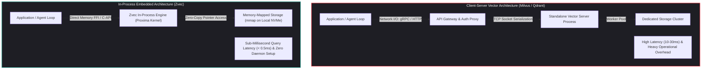

## Why Did Micro-RAG and Local Agent Workflows Demand In-Process Embedded Vector Engines?

During the initial expansion of Retrieval-Augmented Generation (RAG), architectural best practices assumed a client-server topology. Whenever an application required vector search, engineering teams provisioned standalone database clusters—such as Milvus, Qdrant, Pinecone, or Weaviate. While centralized client-server databases are well-suited for enterprise-wide document corpuses serving thousands of concurrent users, they introduce severe operational friction when applied to decentralized developer workflows:

1. **The Infrastructure Tax on Local Utilities**: For command-line coding assistants, IDE indexing daemons, local test harnesses, and desktop productivity tools, requiring a running Docker daemon or cloud VPC connection to query a few thousand vector embeddings is an operational anti-pattern.
2. **Network Transit Latency and Serialization Bottlenecks**: In high-speed reasoning loops where an agent executes dozens of retrieval queries per turn, network round-trips over gRPC or HTTP introduce $5\text{ms}$ to $25\text{ms}$ of latency per call. Furthermore, serializing large float arrays into JSON or Protocol Buffers consumes significant CPU cycles.
3. **Multi-Tenant State Isolation Overhead**: Giving every developer or local agent instance an isolated vector namespace in a shared cloud database creates credential sprawl, connection pool saturation, and data sovereignty compliance concerns.

Just as the database industry embraced **SQLite** to eliminate the operational tax of running a full Postgres or MySQL instance for local applications, the vector retrieval ecosystem experienced its own embedded revolution. Alibaba open-sourced **Zvec**—an ultra-fast, in-process vector database engine designed to run embedded inside application binaries, persisting indexes directly to local disk with zero daemon dependencies.



---

## Architectural Mechanics: Deconstructing Alibaba Zvec and the Proxima Kernel

At the core of Zvec lies **Proxima**—Alibaba’s battle-tested vector retrieval engine that powers semantic search across millions of queries per second on Taobao and Alibaba Cloud. Zvec wraps Proxima's high-performance C++ core in a lightweight, native Python C-extension.

### 1. Zero-Copy In-Process Query Execution

Because Zvec runs inside the caller's process memory space, querying an index bypasses the TCP networking stack, kernel socket buffers, and serialization protocols.

Using NumPy C-API bindings, incoming query vectors are passed directly as contiguous memory pointers to the C++ search routines:

$$\text{Query}(\mathbf{q}) \longrightarrow \text{Direct Pointer Dereference}(\mathbf{q}) \longrightarrow \text{SIMD AVX-512 / ARM NEON Graph Traversal}$$

This zero-copy architecture reduces per-query retrieval latency to **under $500\text{ microseconds}$** ($< 0.5\text{ms}$) on commodity hardware, enabling agents to execute iterative retrieval loops at wire speed.

```python
import zvec

# 1. Define schema supporting dense vectors and scalar metadata
schema = zvec.CollectionSchema(
    name="codebase_symbols",
    vectors=zvec.VectorSchema("embedding", zvec.DataType.VECTOR_FP32, dimension=768),
    fields=[
        zvec.FieldSchema("file_path", zvec.DataType.STRING),
        zvec.FieldSchema("line_number", zvec.DataType.INT32),
        zvec.FieldSchema("is_exported", zvec.DataType.BOOL),
    ]
)

# 2. Open embedded collection mapped directly to a local directory
collection = zvec.create_and_open(path="./.zvec/code_index", schema=schema)

# 3. Insert documents with zero network serialization
collection.insert([
    zvec.Doc(
        id="sym_auth_handler",
        vectors={"embedding": [0.012, -0.045, 0.089, ...]},
        fields={"file_path": "src/auth/jwt.rs", "line_number": 42, "is_exported": True}
    )
])

# 4. Execute hybrid query combining vector distance and scalar filter
results = collection.query(
    zvec.VectorQuery("embedding", vector=target_query_vector),
    filter="is_exported == true",
    topk=5
)
```

### 2. Memory-Mapped Disk Persistence (`mmap`)

Unlike purely in-memory vector libraries (such as raw FAISS or hnswlib) which require explicitly serializing and reloading entire index arrays into RAM upon every process invocation, Zvec utilizes **memory-mapped files (`mmap`)**:

- **Instantaneous Cold Starts**: Opening a multi-gigabyte vector collection requires only mapping the file descriptors into virtual memory. The operating system kernel lazily pages blocks from NVMe storage into RAM on demand, achieving sub-10ms process initialization.
- **Shared Memory Concurrency**: Multiple read-only processes (e.g., parallel agent worker threads or separate CLI commands) can memory-map the exact same physical index file on disk, sharing the OS page cache without duplicating RAM usage.

### 3. Native Single-Stage Hybrid Retrieval

Enterprise RAG architectures require filtering semantic results by metadata (such as file paths, tenant IDs, or commit timestamps). 

Naive two-stage systems execute "post-filtering" (performing vector search on the entire graph, then discarding candidates that fail metadata checks), which causes severe recall collapse when filters are highly selective. Zvec integrates **single-stage filtered HNSW traversal**: metadata predicates are evaluated directly during graph edge exploration, guaranteeing that exactly $k$ valid candidates are returned without graph disconnection.

```mermaid
sequenceDiagram
    autonumber
    participant CLI as Local Agent CLI (Claude / Cursor)
    participant Zvec as Zvec In-Process Engine
    participant MMAP as OS Page Cache (mmap NVMe)
    participant Engine as Proxima HNSW Traversal

    CLI->>Zvec: collection.query(vector, filter="repo == 'backend'")
    Zvec->>MMAP: Access mapped virtual memory address
    Note over Zvec,MMAP: Zero network overhead; zero socket serialization
    Zvec->>Engine: Traverse HNSW graph with predicate evaluation
    Engine-->>Zvec: Return top-k candidate document pointers
    Zvec-->>CLI: Return typed Python Doc list (< 0.4ms)
```

---

## Comparative Analysis: Embedded Engines vs. Server-Based Vector Databases

In our architectural guide to [vector database selection for LLM systems](/posts/choice-vector-database-for-llm/), we evaluated centralized distributed engines. Zvec represents the opposite end of the architectural spectrum:

| Evaluation Dimension | Client-Server (Milvus / Qdrant / Weaviate) | Embedded In-Process (Alibaba Zvec) | In-Memory FAISS (Raw Library) |
| :--- | :--- | :--- | :--- |
| **Operational Topology** | Standalone cluster (Docker/K8s/Cloud) | **Embedded shared library (C++ / Python)** | In-memory library |
| **Query Latency (10K Vectors)**| $8.0\text{ms} - 25.0\text{ms}$ (Network + SerDe) | **$0.3\text{ms} - 0.8\text{ms}$ (In-memory pointer)** | $0.2\text{ms} - 0.5\text{ms}$ |
| **Persistence Mechanism** | Distributed Raft / Object Storage | **Single-file / directory memory-mapped disk**| Manual dump/load to disk |
| **Metadata Filtering** | Full SQL/JSON payload filtering | **Single-stage HNSW predicate integration** | Manual post-filtering only |
| **Cold-Start Startup Time** | Seconds to minutes (Cluster boot) | **Sub-10ms (Lazy mmap initialization)** | High (Must load entire file to RAM) |
| **Best Production Fit** | Enterprise-wide multi-tenant document stores | **Local agents, edge devices, IDE indexers, CI/CD**| Ephemeral mathematical scripts |

---

## How Embedded Vector Storage Evolved Across 2026

The adoption of embedded vector search accelerated rapidly across 2026, driven by edge computing requirements and local coding agent architectures:

1. **The Standard for Agentic Code Search**: Developer tools (such as Claude Code, OpenCode, and local IDE plugins) replaced external cloud vector search with embedded databases like Zvec and LanceDB. Local repositories are embedded on-the-fly into `.zvec/` directories, providing immediate semantic symbol navigation without transmitting proprietary enterprise source code over the internet.
2. **Standardized Benchmarking Verification**: As documented in our source audit of [AutoRAG-Research standardized RAG evaluation](/posts/autorag-research/), embedding engines are systematically profiled across diverse workloads. In-process engines consistently achieve $10\times$ higher QPS throughput for batch RAG evaluation than network-bound client-server architectures.
3. **Integration with Production AI Gateways**: Even in centralized enterprise stacks—such as those analyzed in our review of [production generative AI stack architectures](/posts/production-generative-ai-stack-architecture-components/)—AI gateways utilize local in-process vector engines to maintain ultra-fast semantic caches, resolving repetitive user queries in sub-millisecond times before hitting cloud inference endpoints.
4. **On-Device Edge Deployment**: Because Zvec has minimal binary footprint and compiles cleanly for ARM64 architectures, it runs natively on resource-constrained mobile hardware, enabling the physical sandbox architectures examined in our audit of [mobile agent sandboxing](/posts/openclaw-old-android-phone/).

---

## Key Takeaways

- **The SQLite of Vector Search**: Zvec eliminates the operational burden of deploying and maintaining standalone vector database servers for local applications, CLI tools, and edge agents.
- **Sub-Millisecond Zero-Copy Latency**: Running directly inside process memory eliminates network overhead and serialization penalties, delivering query responses in under $500\text{ microseconds}$.
- **Memory-Mapped Persistence**: Utilizing `mmap` enables instant cold-start process initialization and shared-memory concurrency across multiple local processes without memory bloat.
- **Single-Stage Predicate Filtering**: Integrating scalar metadata filters directly into the HNSW graph traversal prevents recall collapse on highly constrained search queries.

---

## New Questions

1. How do embedded vector databases handle concurrent multi-process write operations without introducing heavy file locking contention on memory-mapped files?
2. What compaction and garbage-collection algorithms are required to prevent fragmentation when documents and vectors are frequently deleted and re-inserted in dynamic code repositories?
3. Will future operating systems integrate native vector indexing primitives directly into the filesystem layer (e.g., vector-indexed extended file attributes)?

---

## References

1. Alibaba DAMO Academy & Tongyi Lab. *Zvec: Lightweight, Fast Embedded Vector Database Built on Proxima*. GitHub Repository. https://github.com/alibaba/zvec (accessed 2026-10-18).
2. Malkov, Y. A., & Yashunin, D. A. *Efficient and Robust Approximate Nearest Neighbor Search Using Hierarchical Navigable Small World Graphs*. IEEE Transactions on Pattern Analysis and Machine Intelligence, 42(4), 824-836. https://arxiv.org/abs/1603.09320 (accessed 2026-10-18).
3. Hipp, D. R. *SQLite: Small, Fast, Reliable, Full-Featured SQL Database Engine*. https://www.sqlite.org/ (accessed 2026-10-18).
4. Douze, M., et al. *The Faiss Library: Billion-Scale Similarity Search with GPUs*. arXiv preprint arXiv:2401.04081. https://arxiv.org/abs/2401.04081 (accessed 2026-10-18).
