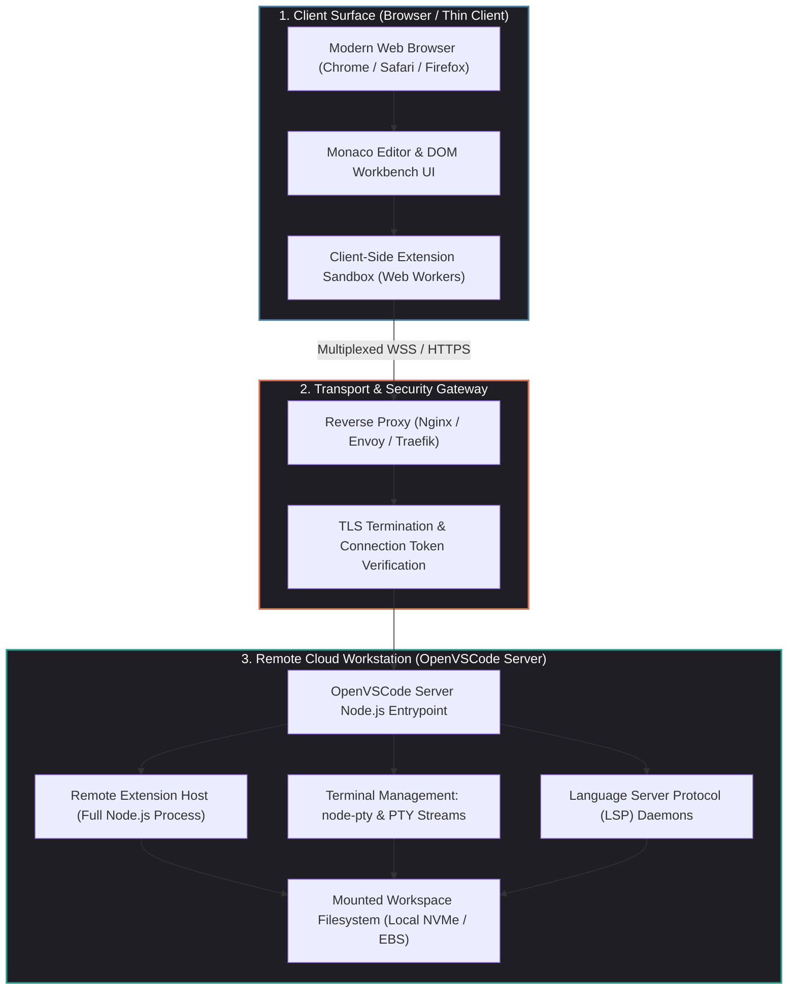
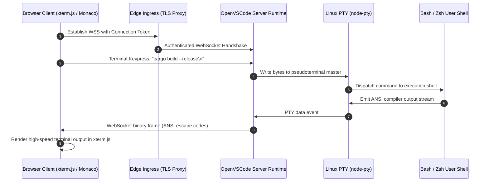

## Why Did Enterprise Developer Infrastructure Migrate from Local Machines to Cloud Workstations?

For decades, the dominant model of software development was local: engineers cloned massive repositories onto physical laptops, installed local runtimes, configured localized databases, and executed compiler toolchains on client hardware. However, as enterprise software scaled into distributed microservices and multi-gigabyte monorepos, local development collapsed under its own operational weight:

1. **The "Works on My Machine" Onboarding Tax**: Setting up a complete development environment across heterogeneous operating systems (macOS, Windows, Linux) often takes new engineers multiple days. Subtle drift in OS-level dependencies, Homebrew versions, or C++ standard libraries creates frustrating, non-reproducible bugs.
2. **Compute and Memory Starvation**: Modern codebases require resource-intensive compilation, containerized dependencies (Docker-in-Docker), local vector indexes, and continuous test runners. Running these workloads on thermal-throttled laptops drains battery life and throttles developer iteration velocity.
3. **Intellectual Property and Security Risks**: Storing proprietary source code, internal dataset dumps, and staging credentials across thousands of employee laptops creates a massive corporate attack surface. A lost, stolen, or compromised laptop represents an immediate corporate security breach.

To resolve these structural bottlenecks, cloud-native development environments (CDEs) migrated developer workspaces into remote cloud infrastructure. Initiated by Gitpod and aligned with Microsoft's remote development architecture, **OpenVSCode Server** open-sourced the standard for delivering a full, upstream-aligned VS Code IDE directly through modern web browsers.



---

## Architectural Mechanics: Upstream Parity and the Remote Extension Host

Early community attempts to run VS Code in the browser (such as original code-server implementations) relied on extensive, brittle AST monkey-patching of Microsoft’s proprietary Electron wrapper. Whenever Microsoft released a new version of VS Code, downstream forks broke, creating an unsustainable maintenance burden.

OpenVSCode Server solved this by leveraging Microsoft’s native, upstream **client-server separation**:

### 1. The Decoupled Extension Host

VS Code's architecture is explicitly partitioned into two execution domains:

- **The Workbench UI (Browser Client)**: Responsible exclusively for rendering the interface (Monaco editor buffers, file trees, status bars, and settings panels). It runs in the user's browser, consuming minimal client CPU and memory.
- **The Remote Extension Host (Server Container)**: Runs inside the remote Linux container. It executes the full Node.js runtime, manages file system I/O, launches language servers (such as `rust-analyzer`, `pyright`, or `gopls`), and spawns child terminal processes.

Because extensions run inside the remote Linux container, they possess direct access to native compiler toolchains (`cargo`, `gcc`, `mvn`) and cluster network interfaces without requiring emulation.

### 2. Multiplexed WebSocket RPC Protocol

Communication between the browser workbench and the remote server is mediated over a single, multiplexed **WebSocket connection**:

$$\text{Browser Client} \xleftrightarrow{\quad \text{WebSocket RPC (JSON / Binary)} \quad} \text{OpenVSCode Server}$$

This multiplexed connection carries:

1. **File System Synchronization**: Incremental file diffs and workspace directory events (`chokidar` watchers).
2. **PTY Terminal Streams**: Raw input/output bytes connecting the browser terminal emulator (`xterm.js`) directly to remote shell processes via `node-pty`.
3. **Language Server Protocol (LSP)**: Autocompletions, go-to-definition queries, and real-time diagnostic squiggles streamed with sub-20ms latency over cloud backbones.



---

## Security, Token Authentication, and Container Hardening

Deploying remote IDEs accessible via public networks requires strict zero-trust operational boundaries:

### 1. Connection Token Enforcement

Since version 1.64, OpenVSCode Server enforces token-based authentication by default. Without a valid cryptographic token, the HTTP handshake is rejected:

```bash
# Launching hardened OpenVSCode Server with secret token file
openvscode-server \
  --host 0.0.0.0 \
  --port 3000 \
  --connection-token-file /etc/secrets/workspace-token \
  --telemetry-level off
```

In production architectures, this token is injected dynamically by the cloud control plane (e.g., Gitpod, Coder, or Kubernetes Operator) and validated before browser session initialization.

### 2. Container Isolation and Zero-Privilege Security

Remote workspaces must be treated as untrusted tenant environments:

- **Rootless Execution**: The container runs under a non-privileged `workspace` user (`uid 1000`). Root operations are disabled to prevent container escape exploits.
- **Network Ingress Isolation**: Workspaces reside in private Kubernetes pod subnets. Ingress traffic is routed exclusively through an authenticating reverse proxy (Nginx or Envoy) enforcing HTTPS/WSS with TLS 1.3.

---

## Synergy with Autonomous Coding Agents

In our survey of [enterprise adoption of Claude Code and agentic CLI workflows](/posts/microsoft-claude-code-inside/), we highlighted that the primary developer interface is rapidly expanding beyond manual keystrokes to autonomous terminal loops.

OpenVSCode Server provides the ideal execution substrate for autonomous coding swarms:

- **Co-located High-Speed Execution**: When an autonomous agent (such as Claude Code or OpenCode) runs inside the OpenVSCode Server container, its file edits and bash commands execute on high-speed cloud NVMe drives with gigabit datacenter connectivity.
- **Zero Local Machine Contention**: While the agent runs compute-heavy integration test suites, the developer’s local laptop remains completely unburdened, experiencing zero battery drain or fan noise.
- **Collaborative Human-Agent Inspection**: Because OpenVSCode Server streams filesystem changes in real time via WebSockets, human developers observe file modifications and terminal compilation steps live in their browser as the agent executes its [BMAD Method TEA cycle](/posts/bmad-method/).

---

## Architectural Comparison: OpenVSCode Server vs. Local VS Code vs. Legacy Code-Server

| Architectural Dimension | Local VS Code (Desktop Electron) | Legacy code-server (Coder v1) | OpenVSCode Server (Gitpod / Upstream) |
| :--- | :--- | :--- | :--- |
| **Compute Location** | Local client hardware | Remote Linux server | **Remote cloud container / VM** |
| **Upstream Code Parity** | 100% Microsoft proprietary build | Forked with custom patches | **Minimal-change upstream Microsoft parity** |
| **Client Requirement** | Heavy Electron desktop install | Modern web browser | **Modern web browser (Thin client / iPad)** |
| **Extension Marketplace** | Microsoft Visual Studio Marketplace | Open VSX Registry | **Open VSX Registry (Fully customizable)** |
| **Onboarding Velocity** | Hours to days (Manual installs) | Minutes (Pre-built container) | **Instantaneous (Pre-warmed cloud snapshots)** |
| **Source Code Security** | High risk (Code on local drives) | Low risk (Code stays in cloud) | **Absolute (Air-gapped VPC storage)** |

---

## How Cloud Development Environments Evolved Across 2026

The deployment of remote development infrastructure matured into an enterprise standard throughout 2026:

1. **Pre-Warmed Snapshot Pools**: Rather than building containers from scratch on every login, CDE orchestrators maintain warm pools of hibernated containers. A developer clicks a repository link, and a fully compiled, pre-indexed workspace boots in under two seconds.
2. **GPU-Accelerated Workstation Streaming**: For game developers and AI researchers, remote workstations integrate virtual GPU (vGPU) passthrough. Compute-heavy model fine-tuning and 3D rendering execute directly inside the cloud workspace, streaming display buffers smoothly over WebRTC.
3. **Integration with Production AI Infrastructure**: As explored in our review of [production generative AI stacks](/posts/production-generative-ai-stack-architecture-components/), cloud development environments are pre-configured with private VPC access to internal vector databases, model inference clusters, and OpenTelemetry collectors, eliminating credential distribution to personal machines.

---

## Key Takeaways

- **Upstream Architecture Parity**: OpenVSCode Server tracks Microsoft's official VS Code architecture with minimal changes, eliminating the fragility and maintenance debt of legacy remote forks.
- **Decoupled Extension Host**: Offloading the Node.js extension host to a remote Linux container allows thin web browsers to access full compiler toolchains and language servers without local overhead.
- **Zero-Trust Security**: Enforcing connection tokens, container isolation, and TLS reverse proxies ensures enterprise source code and credentials remain secure inside cloud VPCs.
- **The Ideal Agent Substrate**: Remote cloud workstations provide autonomous coding agents with high-performance compute and datacenter bandwidth while enabling seamless human-in-the-loop browser inspection.

---

## New Questions

1. How will cloud workstation orchestrators handle real-time WebRTC audio/video collaboration when multiple distributed engineers and autonomous agents share the same active workspace?
2. What distributed filesystem optimizations are required to prevent disk I/O bottlenecks when thousands of ephemeral containers simultaneously build massive monorepos?
3. As browser-based WebAssembly (Wasm) engines improve, will certain compiler and language server workloads migrate back into browser client threads to reduce cloud compute costs?

---

## References

1. Gitpod & OpenVSCode Server Team. *OpenVSCode Server: Run Upstream VS Code in the Browser for Cloud Development Environments*. GitHub Repository. https://github.com/gitpod-io/openvscode-server (accessed 2026-10-18).
2. Microsoft Developer Division. *VS Code Remote Development Architecture and Extension Host Protocol*. Visual Studio Code Documentation. https://code.visualstudio.com/docs/remote/remote-overview (accessed 2026-10-18).
3. Eclipse Foundation. *Open VSX Registry: An Open-Source Vendor-Neutral Marketplace for VS Code Extensions*. https://open-vsx.org/ (accessed 2026-10-18).
4. Coder Technologies. *The Enterprise Cloud Development Environment (CDE) Whitepaper*. https://coder.com/docs (accessed 2026-10-18).
