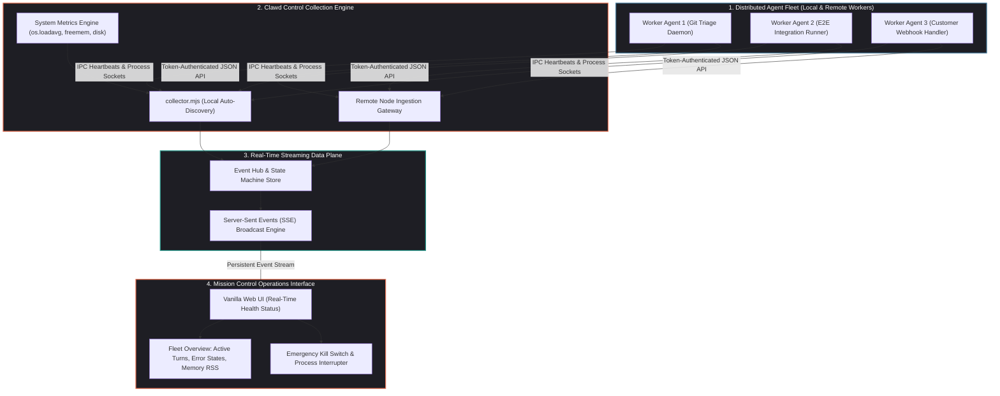
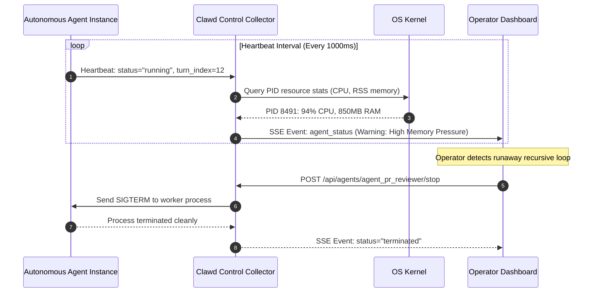

## Why Did Autonomous Agent Fleets Require Real-Time Operational Mission Control?

Deploying a single autonomous AI agent in a developer terminal is manageable: an engineer observes standard output, tracks shell commands, and manually cancels execution if the model enters an infinite loop. However, as software organizations scaled autonomous systems into **fleets of persistent agents**—handling automated issue triage, continuous testing, customer communication, and data ingestion—traditional operational monitoring collapsed:

1. **The Silent Deadlock Dilemma**: Unlike web servers that crash with HTTP 500 status codes, autonomous agents fail silently. A reasoning loop can stall waiting on a hanging network socket, run in circles attempting the same invalid tool invocation, or burn thousands of dollars in token credits while appearing "healthy" to standard operating system process monitors.
2. **Ambiguity Between System Contention and Model Drift**: When an agent's execution slows down, operators cannot distinguish whether the degradation is caused by external foundation model API latency, local CPU/RAM starvation, or a corrupted prompt context window.
3. **Configuration Sprawl Across Distributed Nodes**: Fleets running across developer workstations, edge nodes, and cloud containers suffer from fragmented configuration files, inconsistent tool permissions, and unmanaged API keys.

To resolve the operational visibility vacuum, Temaki-AI open-sourced **Clawd Control**. Built as a dedicated, lightweight operations control plane for Clawdbot and OpenClaw swarms, Clawd Control transforms opaque background agent processes into a live, observable, and controllable fleet.



---

## Architectural Mechanics: Deconstructing Clawd Control

Clawd Control deliberately avoids heavy enterprise application frameworks, frontend build steps, and complex database dependencies. Instead, it implements a lean, zero-build Node.js architecture centered on **Server-Sent Events (SSE)** and modular event collection.

### 1. Server-Sent Events (SSE) Real-Time Streaming

Traditional monitoring dashboards either overwhelm servers with high-frequency HTTP polling (`GET /status` every $500\text{ms}$) or implement bidirectional WebSocket connections that require complex reconnection handshakes and stateful proxies.

Clawd Control utilizes **Server-Sent Events (SSE)** for unidirectional real-time event distribution:

$$\text{Clawd Control Server} \xrightarrow{\quad \text{text/event-stream (HTTP Chunked)} \quad} \text{Browser Dashboard}$$

Whenever an agent emits a heartbeat, transitions from reasoning to tool execution, or throws a runtime error, an event packet is pushed down the persistent SSE connection:

```
event: agent_update
data: {"id":"agent_pr_reviewer","status":"executing_tool","tool":"run_test_suite","duration_ms":4200,"rss_mb":218}

event: system_metric
data: {"load_average":[1.45, 1.20, 0.95],"free_memory_mb":4192,"active_agent_count":4}
```

The browser UI renders live health gauges, tool status badges, and resource bars with zero rendering lag and minimal network overhead.

### 2. Disambiguating Host Contention from Agent Logic Stalls

A critical operational capability of Clawd Control is its dual-metric collection engine (`collector.mjs`):

- **Host-Level Telemetry**: Continuous sampling of OS kernel statistics—CPU load averages (`os.loadavg()`), free physical memory (`os.freemem()`), and storage disk saturation.
- **Agent-Level Telemetry**: Tracking process-level Resident Set Size (RSS), heap allocation, active socket counts, and cumulative token expenditure.



If an agent stalls while CPU utilization spikes to $100\%$, operators immediately recognize an algorithmic infinite loop. Conversely, if an agent stalls while CPU utilization drops to $0\%$, operators know the agent is blocked waiting on an external API response, allowing for precise diagnostic triage.

### 3. Local Auto-Discovery and Remote Federation

To eliminate manual configuration friction, Clawd Control implements automated agent discovery:

- **Local Discovery (`discover.mjs`)**: Scans local Unix domain sockets, named pipes, and standard agent configuration directories (`~/.clawdbot/agents/`, `.openclaw/`). When an engineer launches a new local agent, Clawd Control detects the process automatically and binds it to the dashboard.
- **Remote Agent Registration**: Distributed worker nodes running on cloud VMs or edge devices—such as the physical hardware environments examined in our audit of [deploying agents on mobile Android hardware](/posts/openclaw-old-android-phone/)—register back to Clawd Control via token-authenticated REST endpoints, exposing fleet-wide status on a single unified pane of glass.

---

## Operational Safety Gates: Circuit Breakers and Human-in-the-Loop Interrupters

Autonomous agent swarms executing without operational circuit breakers risk catastrophic resource exhaustion. Clawd Control introduces several mandatory safety mechanisms:

### 1. The Emergency Kill-Switch
Operators can issue instantaneous `SIGTERM` or `SIGKILL` commands directly from the UI. If an agent misbehaves or attempts unauthorized file modifications, its execution is halted within milliseconds.

### 2. Automated Circuit Breakers
Administrators configure hard operational thresholds:

```json
{
  "safety_limits": {
    "max_turns_per_task": 50,
    "max_consecutive_tool_failures": 5,
    "memory_rss_limit_mb": 1024,
    "action_on_breach": "pause_and_alert"
  }
}
```

If an agent breaches its turn limit or fails five consecutive tool executions, Clawd Control transitions the agent to a `PAUSED` state, requiring human verification before execution can resume.

As highlighted in our review of [Plano and outer-loop agent control planes](/posts/plano-onnx-moment-for-agents/), decoupling runtime management from application logic is essential for enterprise safety.

---

## Comparative Analysis: Clawd Control vs. Standard APM vs. Model Tracing Platforms

| Operational Dimension | General APM (Datadog / Prometheus) | LLM Tracing (Langfuse / Phoenix) | Clawd Control (Agent Ops Dashboard) |
| :--- | :--- | :--- | :--- |
| **Primary Monitored Unit** | HTTP services & host containers | Prompt & completion token traces | **Autonomous agent processes & fleets** |
| **Real-Time Responsiveness** | Batched metric aggregation (10–60s) | Post-turn span logging | **Sub-second Server-Sent Events (SSE)** |
| **Process Control** | None (Read-only monitoring) | None (Read-only analytics) | **Active process management (Pause / Kill)** |
| **Host Contention Analysis** | Host-centric (unaware of agent turns)| Model-centric (unaware of host CPU)| **Dual-layer (Correlates PID to prompt turn)**|
| **Deployment Footprint** | Heavy agent daemons & cloud agents | Requires cloud/database backends | **Zero-build single Node.js script** |

As discussed in our architectural overview of [production generative AI stacks](/posts/production-generative-ai-stack-architecture-components/), mission-critical multi-agent systems require both semantic distributed tracing for model evaluation and real-time operational control planes for process governance.

---

## How Agent Fleet Operations Evolved Across 2026

Operational tooling for autonomous agent swarms matured rapidly throughout 2026:

1. **Decentralized Swarm Health Protocols**: Instead of relying solely on centralized dashboards, agents began utilizing peer-to-peer gossip protocols (adhering to Agent-to-Agent standards) to monitor peer availability, automatically reallocating unfinished tasks if a worker node crashes.
2. **Automated Cost and Budget Quotas**: Fleets enforce dynamic daily financial budgets. If an organization reaches $80\%$ of its allocated token spend, non-critical background agents (e.g., automated refactoring or exploratory fuzzing) are throttled, preserving quota for customer-facing systems.
3. **Integration with IDE Workstations**: Fleet operations dashboards integrated natively into cloud workstations, such as the containerized architectures reviewed in our audit of [OpenVSCode Server](/posts/openvscode-server-remote-ide/), allowing engineers to monitor agent swarms executing inside remote IDE containers without switching windows.

---

## Key Takeaways

- **Visibility Precedes Autonomy**: Deploying persistent agent swarms without real-time operational monitoring inevitably leads to silent failures, runaway loops, and unmetered token burn.
- **Server-Sent Events Efficiency**: Utilizing SSE delivers low-latency real-time health streaming to operator dashboards without the connection overhead of WebSockets or the latency of HTTP polling.
- **Dual-Layer Correlation**: Simultaneously tracking host-level OS resources (CPU load, memory RSS) and agent reasoning states allows operators to isolate system bottlenecks from algorithmic model bugs.
- **Active Safety Gates**: Centralized dashboards must provide interactive kill-switches and automated circuit breakers to enforce human-in-the-loop governance over autonomous swarms.

---

## New Questions

1. How can agent operations platforms automatically detect subtle semantic loops where an agent changes its wording slightly on every turn while making zero tangible progress toward task completion?
2. What cryptographic protocols should verify remote agent status heartbeats to prevent compromised edge nodes from spoofing operational health?
3. As agent fleets scale to thousands of nodes, how can operations dashboards summarize fleet behavior without overwhelming human operators with visual cognitive noise?

---

## References

1. Temaki-AI Development Team. *Clawd Control: Lightweight Real-Time Monitoring and Management Dashboard for Agent Fleets*. GitHub Repository. https://github.com/Temaki-AI/clawd-control (accessed 2026-10-18).
2. WhatWG. *Server-Sent Events: Real-Time Unidirectional Event Streaming Standard*. HTML Living Standard. https://html.spec.whatwg.org/multipage/server-sent-events.html (accessed 2026-10-18).
3. Cloud Native Computing Foundation. *OpenTelemetry Architecture and Semantic Conventions for Distributed Systems*. https://opentelemetry.io/docs/concepts/ (accessed 2026-10-18).
4. Google Site Reliability Engineering Group. *Site Reliability Engineering: How Google Runs Production Systems*. O'Reilly Media. https://sre.google/sre-book/table-of-contents/ (accessed 2026-10-18).
