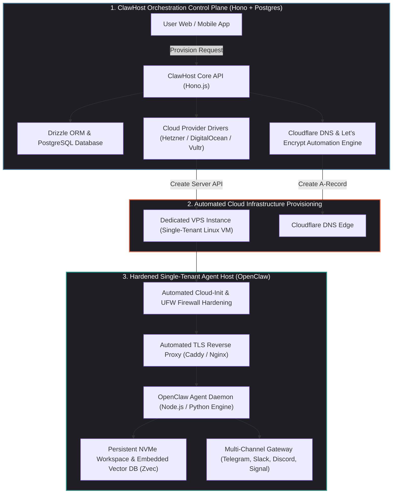
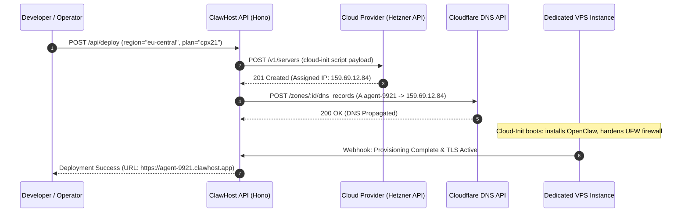

## Why Did Autonomous Agent Deployment Demand Dedicated VPS Infrastructure Over Multi-Tenant Serverless?

When generative AI applications first moved into cloud deployment, software architects reflexively turned to serverless execution models (such as AWS Lambda, Google Cloud Run, or Vercel Edge Functions). Serverless environments excel at stateless REST endpoints: an HTTP request arrives, the function executes for a few hundred milliseconds, emits a JSON payload, and terminates.

However, as autonomous agent architectures transitioned from single-turn chat completion wrappers into **persistent, stateful swarms**, the multi-tenant serverless paradigm broke down completely:

1. **Hard Execution Timeouts and Cold Starts**: Autonomous agents performing deep multi-step research, codebase refactoring, or iterative fuzzing require execution horizons spanning tens of minutes or hours. Serverless platforms enforce strict execution limits (typically 15 minutes on AWS Lambda), forcibly terminating long-running agent reasoning loops.
2. **Lack of Persistent Local State and Vector Storage**: Agents rely heavily on local embedded vector stores (such as Zvec or SQLite), filesystem workspaces, and memory caches. Serverless containers run on ephemeral, non-persistent disks that disappear upon container shutdown, forcing costly external database re-synchronizations.
3. **Execution Sandbox and Tool Restrictions**: Autonomous agents frequently need to invoke terminal commands, run isolated Docker containers, or manage long-polling messaging sockets (Telegram, Discord, Signal). Multi-tenant serverless runtimes disallow Docker-in-Docker (DinD) execution and block arbitrary system daemon creation.

To bridge this operational gap, the open-source community created **ClawHost**. Operating as an automated provisioning control plane, ClawHost automates the deployment of **OpenClaw** onto dedicated Virtual Private Servers (VPS). By combining one-click cloud provisioning with single-tenant dedicated hardware, ClawHost provides autonomous agents with the persistence, compute sovereignty, and security boundaries required for continuous production workloads.



---

## Architectural Mechanics: Deconstructing the ClawHost Provisioning Engine

ClawHost is engineered as a modern TypeScript monorepo designed for high-concurrency cloud orchestration:

```
apps/
  api/          # Hono.js edge API & cloud provider drivers
  web/          # React + Vite administrative dashboard
  mobile/       # React Native + Expo mobile client
  clawhostgo/   # Electron desktop operational client
packages/
  db/           # Drizzle ORM schemas & PostgreSQL migrations
  shared/       # Shared TypeScript types & validation schemas
```

The automated provisioning lifecycle executes across four deterministic phases:

### 1. Dedicated Cloud Instance Spin-Up

Rather than executing inside shared containers with CPU limits, ClawHost provisions dedicated single-tenant virtual machines via provider APIs (such as Hetzner Cloud, DigitalOcean, or Vultr):

$$\text{User Deployment Request} \longrightarrow \text{Provider API Token} \longrightarrow \text{Dedicated KVM Instance Provisioning}$$

The instance is configured with dedicated CPU cores, physical RAM allocations, and persistent NVMe block storage, ensuring that adjacent noisy neighbors in public clouds cannot throttle agent compute performance.

### 2. Zero-Touch Networking and TLS Automation

A major friction point in self-hosting is DNS configuration and SSL certificate management. ClawHost fully automates this pipeline:

1. **Dynamic DNS Registration**: As soon as the cloud provider allocates a public IPv4/IPv6 address, ClawHost invokes the Cloudflare API to provision a dedicated sub-domain A-record (e.g., `agent-9921.clawhost.app`).
2. **Automated TLS Termination**: The host image boots with an integrated reverse proxy (such as Caddy or Nginx with ACME certbot) that negotiates Let's Encrypt TLS certificates automatically over HTTP-01 or DNS-01 challenges, ensuring zero unencrypted plaintext traffic.



### 3. Automated Host Hardening and Security Boundaries

Because OpenClaw executes shell tools and network scripts, the host system must be locked down before accepting public traffic:

- **Uncomplicated Firewall (UFW) Locking**: All ingress ports are closed by default, leaving open strictly port 443 (HTTPS) and port 80 (for ACME challenges). Direct SSH port 22 access is restricted to developer public keys injected at provision time.
- **Rootless Process Isolation**: While the developer possesses root SSH access to the underlying VPS, the OpenClaw agent daemon executes within a non-privileged `openclaw` user space, preventing accidental system partition corruption.

### 4. Multi-Channel Messaging Ingress Gateway

Autonomous agents are rarely accessed through dedicated web portals; they live inside human communication channels. ClawHost provisions integrated messaging gateways out of the box:

- Inbound webhooks from **Telegram, Discord, Slack, Signal, and WhatsApp** are routed directly into the OpenClaw execution daemon.
- The agent long-polls or receives push events, processes reasoning trajectories in its dedicated NVMe workspace, and streams Markdown summaries back into the chat channel.

---

## Single-Tenant VPS vs. Shared Multi-Tenant SaaS: Architectural Trade-Offs

When organizations evaluate hosting strategies for autonomous agents, they face a critical architectural choice between proprietary multi-tenant cloud platforms and self-hosted dedicated instances:

| Architectural Dimension | Shared Multi-Tenant SaaS (CustomGPT, Dify) | Serverless Functions (AWS Lambda) | Dedicated VPS Hosting (ClawHost / OpenClaw) |
| :--- | :--- | :--- | :--- |
| **Hardware Isolation** | Multi-tenant shared containers | Ephemeral microVMs | **Dedicated single-tenant KVM instance** |
| **Execution Horizon** | Strict per-turn limits | Hard 15-minute timeout | **Unbounded (Runs 24/7 background daemons)** |
| **Filesystem Persistence**| Ephemeral or external S3 sync | Ephemeral scratch storage | **Persistent, low-latency NVMe block storage** |
| **Tool Execution Rights**| Severely restricted webhooks | No Docker or system daemons | **Full root access & unrestricted shell tools** |
| **Data Privacy & Sovereignty**| Provider inspects & stores logs | Managed cloud perimeter | **Absolute (Operator owns encryption keys & logs)** |
| **Cost at Sustained Scale**| Expensive per-message / seat markup | High invocation costs | **Fixed, predictable monthly VPS fee ($5–$20/mo)** |

As demonstrated in our source audit of [deploying agents on mobile Android hardware](/posts/openclaw-old-android-phone/), physical and hardware-level isolation remains the most robust defense against prompt injection and unauthorized network exfiltration.

---

## How Autonomous Agent Hosting Evolved Across 2026

The infrastructure powering autonomous agent hosting transformed significantly throughout 2026:

1. **Automated Fleet Lifecycle Operations**: Platforms like ClawHost integrated with real-time operations dashboards, as examined in our review of [Clawd Control real-time fleet telemetry](/posts/clawd-control-agent-ops/). SRE teams monitor memory pressure and token burn across hundreds of provisioned VPS instances from a single operational pane.
2. **Minimalist Agent Kernels**: By pairing dedicated VPS hosting with lightweight execution kernels—such as the 4-tool primitive engine analyzed in our audit of the [Pi minimal agent runtime](/posts/pi-minimal-agent/)—agents boot instantly and consume minimal system resources, leaving maximum RAM and CPU available for compilation and test suites.
3. **Hybrid Edge-Cloud Bursting**: Enterprises adopt hybrid topologies: routine day-to-day triage executes on low-cost dedicated VPS instances, while compute-intensive tasks (such as fine-tuning or 3D rendering) burst dynamically to GPU-accelerated cloud clusters.
4. **Zero-Trust Private VPC Peering**: Next-generation hosting control planes provision WireGuard and Tailscale mesh tunnels automatically, allowing dedicated VPS agents to query internal corporate databases without exposing public ingress ports to the internet.

---

## Key Takeaways

- **Dedicated Compute Over Serverless**: Persistent autonomous agents demand dedicated, single-tenant virtual machines with persistent NVMe storage and unbounded execution horizons, making serverless functions obsolete for complex agent workflows.
- **Zero-Touch Provisioning Velocity**: Automating cloud provider APIs, Cloudflare DNS propagation, and Let's Encrypt TLS generation reduces VPS deployment time from hours to under three minutes.
- **Data Sovereignty and Compliance**: Single-tenant VPS deployment guarantees that source code, customer records, and API credentials remain under the operator's absolute control, avoiding multi-tenant SaaS vendor risks.
- **Multi-Channel Accessibility**: Native webhook integration with Telegram, Slack, and Discord embeds autonomous agents directly into human collaborative workflows.

---

## New Questions

1. How can automated VPS provisioning engines implement instantaneous disaster recovery and state migration when an underlying cloud datacenter suffers an unannounced outage?
2. What sandboxing primitives within Linux (such as Landlock and seccomp-bpf) provide optimal security for agents running on dedicated VPS nodes without restricting essential developer toolchains?
3. As decentralized computing networks expand, will automated agent hosting shift toward decentralized physical infrastructure networks (DePIN) rather than traditional hyperscaler VPS providers?

---

## References

1. ClawHost Core Engineering Team. *ClawHost: Open-Source Automated VPS Provisioning Platform for OpenClaw Agent Fleets*. GitHub Repository. https://github.com/Temaki-AI/clawhost (accessed 2026-10-18).
2. OpenClaw Community. *OpenClaw: Architecture and Deployment Guide for Autonomous Developer Agents*. https://github.com/openclaw/openclaw (accessed 2026-10-18).
3. Cloudflare Infrastructure Engineering. *Automating Edge DNS and SSL at Scale with the Cloudflare API*. Cloudflare Developer Documentation. https://developers.cloudflare.com/api/ (accessed 2026-10-18).
4. Hetzner Online GmbH. *Hetzner Cloud API Documentation: Cloud-Init and Automated Server Lifecycle Management*. https://docs.hetzner.cloud/ (accessed 2026-10-18).
