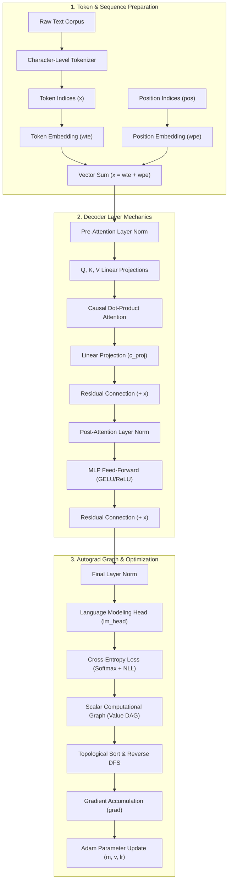
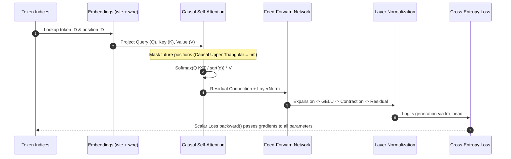

## Why Did Understanding Transformers Demand a Dependency-Free Pure Python Micro-Model?

Modern transformer engineering is often obscured by deep software abstractions. Frameworks like PyTorch, JAX, and Hugging Face Transformers wrap memory allocators, CUDA execution kernels, distributed communication primitives, and dynamic computation graphs beneath opaque C++ bindings. While these abstractions enable high-throughput model training across distributed GPU clusters, they obscure the fundamental mathematical and algorithmic machinery of deep neural networks from practitioners. When gradient explosions, loss plateaus, or attention masking bugs occur in production pipelines, engineers lacking intuition for raw backpropagation struggle to diagnose root causes.

Andrej Karpathy's MicroGPT addresses this comprehension gap by distilling an entire decoder-only transformer training and inference pipeline into a single dependency-free Python file. Rather than relying on tensor libraries, MicroGPT constructs an explicit scalar-level automatic differentiation engine (`Value`), directly builds causal multi-head self-attention mechanisms, implements multi-layer perceptron (MLP) projections, computes cross-entropy classification losses, and runs Adam parameter updates using standard Python lists and basic arithmetic operations.

Auditing MicroGPT reveals how token embeddings, residual connections, causal attention masking, backpropagation DAG traversals, and adaptive moment estimation fit together mechanically without a single external library import.



---

## Deconstructing the Minimal Scalar Autograd Engine

At the foundation of MicroGPT is a minimal reverse-mode automatic differentiation engine encapsulated within the `Value` class. While industrial frameworks manage multi-dimensional tensors on strided memory layouts, MicroGPT executes backpropagation at the granularity of individual scalar values.

Each `Value` instance tracks four fundamental attributes:
1. `data`: The floating-point numerical payload evaluated during the forward pass.
2. `grad`: The accumulated partial derivative of the final scalar objective (the training loss) with respect to this value ($\frac{\partial L}{\partial x}$).
3. `_children`: A tuple referencing the immediate antecedent `Value` objects that produced this node in the computational graph.
4. `_local_grads`: A tuple storing the analytical local gradients with respect to each child operand evaluated at forward runtime.

```python
class Value:
    __slots__ = ('data', 'grad', '_children', '_local_grads')

    def __init__(self, data, children=(), local_grads=()):
        self.data = float(data)
        self.grad = 0.0
        self._children = children
        self._local_grads = local_grads

    def __add__(self, other):
        other = other if isinstance(other, Value) else Value(other)
        # Local derivative of (a + b) with respect to a is 1.0, and to b is 1.0
        return Value(self.data + other.data, (self, other), (1.0, 1.0))

    def __mul__(self, other):
        other = other if isinstance(other, Value) else Value(other)
        # Local derivative of (a * b) with respect to a is b, and to b is a
        return Value(self.data * other.data, (self, other), (other.data, self.data))

    def __pow__(self, other):
        assert isinstance(other, (int, float)), "Power only supports numeric exponents"
        return Value(self.data ** other, (self,), (other * (self.data ** (other - 1)),))

    def log(self):
        import math
        return Value(math.log(self.data), (self,), (1.0 / self.data,))

    def exp(self):
        import math
        exp_val = math.exp(self.data)
        return Value(exp_val, (self,), (exp_val,))

    def backward(self):
        # Construct directed acyclic graph topological ordering
        topo = []
        visited = set()

        def build_topo(v):
            if v not in visited:
                visited.add(v)
                for child in v._children:
                    build_topo(child)
                topo.append(v)

        build_topo(self)

        # Seed the output node gradient
        self.grad = 1.0

        # Traverse reverse topological order applying the multivariable chain rule
        for node in reversed(topo):
            for child, local_grad in zip(node._children, node._local_grads):
                child.grad += local_grad * node.grad
```

By traversing the computational graph in reverse topological order, the `backward()` method implements the multivariate chain rule across arbitrary mathematical expressions. If a scalar variable forks into multiple computation paths, its accumulated gradient correctly sums the incoming partial derivatives:

$$\frac{\partial L}{\partial x} = \sum_{y \in \text{children}(x)} \frac{\partial L}{\partial y} \cdot \frac{\partial y}{\partial x}$$

This architectural simplicity eliminates memory management heuristics, CUDA context switches, and dynamic shape validation, exposing pure calculus in execution.

---

## Transformer Architecture Mechanics in Dependency-Free Python

MicroGPT constructs the classic GPT architecture (decoder-only causal transformer) on top of this scalar autograd engine. Unlike standard tutorials that lean on high-level matrix multiplications, every vector operation is expressed through primitive loops.



### 1. Token and Position Embeddings
The model utilizes a discrete character-level vocabulary. For a vocabulary size $V$ and embedding dimension $D$, the token embedding table `wte` is initialized as a list of lists of `Value` objects, representing a $V \times D$ parameter matrix. Position embeddings `wpe` use a sequence length context table $T \times D$.

For an input sequence of token indices $[t_0, t_1, \dots, t_{n-1}]$, the representation at sequence position $i$ is evaluated by scalar addition:

$$h_i = \text{wte}[t_i] + \text{wpe}[i]$$

### 2. Multi-Head Causal Self-Attention
Self-attention routes information across temporal positions in the sequence. For each head, the input vector $h_i$ is linearly projected into Query ($Q$), Key ($K$), and Value ($V$) representations using scalar dot-products:

$$Q_i = W_Q h_i, \quad K_i = W_K h_i, \quad V_i = W_V h_i$$

Causal masking enforces autoregressive conditioning: token $i$ can only attend to tokens at indices $j \le i$. MicroGPT implements this directly by evaluating dot-product attention scores only for valid causal history:

$$\text{score}_{i, j} = \frac{Q_i \cdot K_j}{\sqrt{d_k}} \quad (\text{for } j \le i)$$

A numerically stable softmax is then computed across the valid historical scores:

$$\alpha_{i, j} = \frac{\exp(\text{score}_{i, j} - \max_k \text{score}_{i, k})}{\sum_{m \le i} \exp(\text{score}_{i, m} - \max_k \text{score}_{i, k})}$$

The contextual representation for position $i$ is synthesized as the weighted sum:

$$\text{out}_i = \sum_{j \le i} \alpha_{i, j} V_j$$

### 3. Multi-Layer Perceptron (MLP) and Residual Highways
Following self-attention, the intermediate representation passes through a two-layer feed-forward network with a non-linear activation function (such as GELU or ReLU), expanding the hidden dimension to $4D$ before projecting back to $D$. Residual connections add the layer inputs directly to the block outputs:

$$x_{\text{mid}} = x_{\text{in}} + \text{Attention}(\text{LayerNorm}(x_{\text{in}}))$$
$$x_{\text{out}} = x_{\text{mid}} + \text{MLP}(\text{LayerNorm}(x_{\text{mid}}))$$

These residual connections provide unobstructed gradient highways during reverse topological traversal, preventing vanishing gradients across deep layer stacks.

---

## Training Dynamics: Cross-Entropy Loss and Adam Optimization

Once the forward pass computes language modeling logits for sequence position $t$, the next-token prediction loss is evaluated using cross-entropy:

$$\mathcal{L}_t = -\log \left( \frac{\exp(\text{logit}_{t, y_{t+1}})}{\sum_{v \in V} \exp(\text{logit}_{t, v})} \right)$$

MicroGPT accumulates the total sequence loss:

$$\mathcal{L} = \frac{1}{T-1} \sum_{t=0}^{T-2} \mathcal{L}_t$$

Executing `loss.backward()` propagates gradients backwards through the entire causal graph to every weight parameter in `wte`, `wpe`, attention matrices, MLP projections, and layer norm scales.

```python
# Pure Python Adam Optimizer Step
learning_rate = 1e-2
beta1, beta2 = 0.9, 0.999
eps = 1e-8
step = 0

m = {p: 0.0 for p in parameters}
v = {p: 0.0 for p in parameters}

for epoch in range(num_epochs):
    # Forward Pass & Loss Computation
    loss = compute_sequence_loss(model, tokens)

    # Zero parameter gradients
    for p in parameters:
        p.grad = 0.0

    # Backpropagation via Scalar Computational Graph
    loss.backward()
    step += 1

    # Parameter Update
    for p in parameters:
        # First moment estimate
        m[p] = beta1 * m[p] + (1.0 - beta1) * p.grad
        # Second raw moment estimate
        v[p] = beta2 * v[p] + (1.0 - beta2) * (p.grad ** 2)
        # Bias-corrected estimates
        m_hat = m[p] / (1.0 - (beta1 ** step))
        v_hat = v[p] / (1.0 - (beta2 ** step))
        # Update weight parameter data payload
        p.data -= learning_rate * m_hat / (math.sqrt(v_hat) + eps)
```

By inspecting this explicit loop, developers observe how Adam maintains moving averages of first and second moments to adjust per-parameter learning rates dynamically based on gradient sparsity and variance.

---

## Architectural Comparison: MicroGPT vs Industrial Runtimes

Understanding MicroGPT's structural trade-offs clarifies why production systems require dedicated hardware compilers and memory kernels.

| Dimension | MicroGPT (Karpathy Minimal) | PyTorch / LibTorch C++ | Modern 2026 Inference Engines (vLLM / SGLang) |
| :--- | :--- | :--- | :--- |
| **Execution Granularity** | Individual scalar `Value` objects | Strided Tensor chunks (`torch.Tensor`) | Paged Attention blocks & fused CUDA graphs |
| **Graph Construction** | Dynamic Python object references | TorchScript / TorchDynamo FX Graphs | Static AOT compiled execution plans |
| **Memory Overhead** | High (object pointer metadata per scalar) | Contiguous memory buffers (Row-major) | Paged KV cache allocation & quantization |
| **Autograd Engine** | Depth-first topological DAG traversal | C++ native engine (`autograd::Node`) | Kernel-level backpropagation / Triton kernels |
| **Hardware Target** | Single-thread CPU | SIMD CPU, CUDA, ROCm, Apple Metal | Multi-GPU tensor parallel clusters |
| **Primary Objective** | Conceptual transparency & pedagogy | High-throughput research & training | Ultra-low latency production serving |

For engineers seeking deeper insights into production deployment and optimization workflows, our detailed technical analyses on [fine-tuning LLMs](/posts/explained-fintune-llm/), [deploying machine learning models](/posts/deploy-an-ml-model/), and [building Llama 4 from scratch](/posts/building-llama-4-from-scratch-mixture-of-experts/) explore the industrial scaling side of these principles.

---

## How Educational Deep Learning Runtimes Evolved Across 2026

Throughout 2026, educational machine learning engineering experienced a marked shift from monolithic framework tutorials toward transparent, dependency-free reference implementations. Several major architectural trends define this shift:

1. **Single-Header C and CUDA Reference Models**: Following the widespread adoption of `llm.c`, educational repos moved from pure Python toward single-file C99 and raw CUDA implementations. Practitioners study bare-metal memory layouts, kernel launch configurations, and shared memory tiling without framework dispatch layers.
2. **Systems-Level Language Implementations (Rust and Mojo)**: Educational rewrites in Rust (leveraging Burn or `candle`) and Mojo emphasize static memory safety and compile-time shape verification while retaining readable high-level syntax.
3. **Multi-Modal Educational Micro-Architectures**: In late 2026, the MicroGPT pedagogical pattern expanded to vision-language models (e.g., MicroVLM), demonstrating how patch extraction, linear image projection, and causal text decoding integrate in less than 500 lines of readable code.
4. **Symbolic Autograd with Formal Verification**: Modern instructional curricula combine scalar autograd with lightweight formal verification tools (e.g., Z3 theorem proving), mathematically verifying that autograd computational graphs satisfy gradient consistency properties before training runs begin.

---

## Key Takeaways

- **No Magic in Neural Networks**: A complete autoregressive transformer requires nothing more than scalar arithmetic, standard differential calculus, and hash map data structures.
- **Autograd as Graph Inversion**: Reverse-mode automatic differentiation is simply a topological sort of a directed acyclic graph followed by local Jacobian-vector multiplications.
- **Causal Masking Geometry**: Autoregressive generation is guaranteed by constraining query-key dot-product interactions to the lower-triangular sequence history.
- **Residual Highways Enable Deep Propagation**: Additive skip connections prevent gradients from vanishing during deep topological traversals, providing direct error signal back to initial token embeddings.
- **Pedagogy Informs Production Debugging**: Understanding scalar gradient flow builds the diagnostic intuition required to troubleshoot gradient explosions, precision loss, and attention degradation in multi-billion parameter production architectures.

---

## New Questions

- How do quantization schemes (FP8, INT4, 1-bit weights) alter the mathematical stability of scalar-level backpropagation when training from scratch?
- Can symbolic computational graphs be compiled directly into WebAssembly (WASM) runtimes to deliver zero-dependency on-device transformer fine-tuning in browser environments?
- What minimal adaptations are required to extend scalar autograd engines to support non-causal bidirectional architectures like BERT or cross-attention encoder-decoder models like T5?

---

## References

- Karpathy, A. (2024). *MicroGPT: Minimal pure-Python implementation of a decoder-only Transformer with autograd*. GitHub Gist. Available at: https://gist.github.com/karpathy/8627fe009c40f57531cb18360106ce95 (accessed 2026-10-18).
- Vaswani, A., Shazeer, N., Parmar, N., Uszkoreit, J., Jones, L., Gomez, A. N., Kaiser, Ł., & Polosukhin, I. (2017). *Attention Is All You Need*. Advances in Neural Information Processing Systems (NeurIPS 2017). Available at: https://arxiv.org/abs/1706.03762 (accessed 2026-10-18).
- Kingma, D. P., & Ba, J. (2014). *Adam: A Method for Stochastic Optimization*. International Conference on Learning Representations (ICLR 2015). Available at: https://arxiv.org/abs/1412.6980 (accessed 2026-10-18).
- Karpathy, A. (2022). *micrograd: A tiny scalar-valued autograd engine and neural net*. GitHub Repository. Available at: https://github.com/karpathy/micrograd (accessed 2026-10-18).
