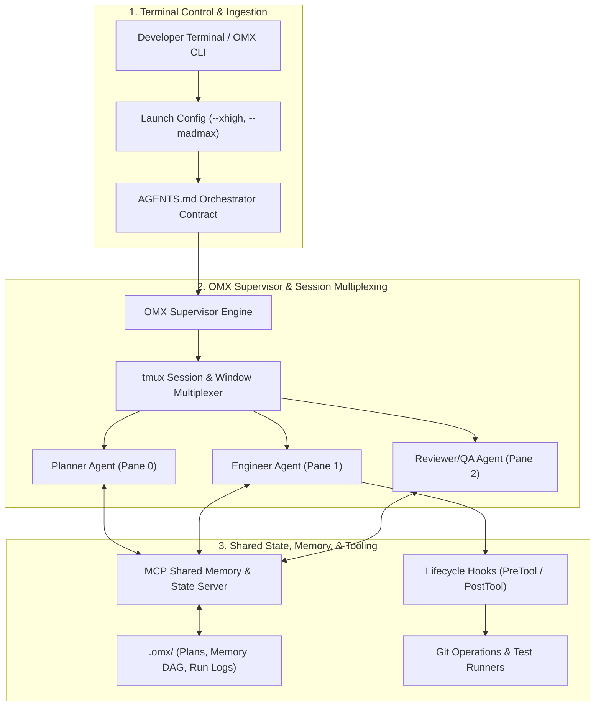
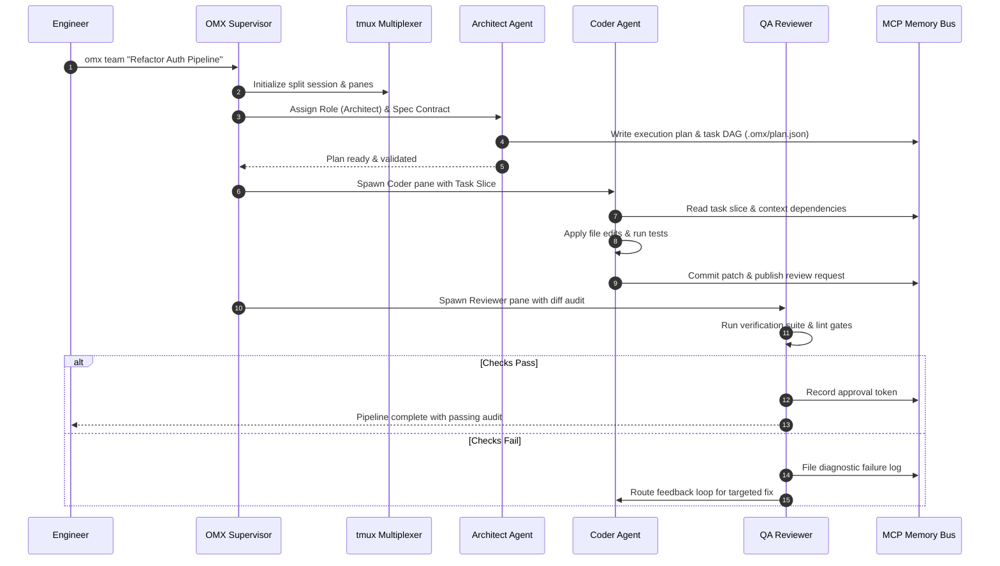
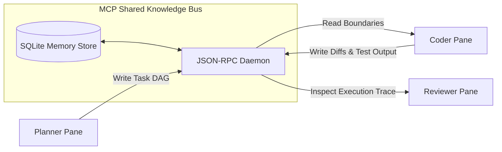

## Why Did Autonomous Coding Demand Multiplexed Multi-Agent Coordination Over Single Prompts?

Single-agent terminal interfaces like OpenAI Codex CLI excel at targeted programmatic interventions: authoring unit tests, generating isolated functions, and diagnosing syntax errors within single files. However, when deployed against repository-scale refactors, full-stack feature implementations, or cross-service architectural migrations, single-threaded agent loops encounter severe structural limits. A single context window tasked simultaneously with architectural design, code authoring, linting, test execution, and pull-request verification rapidly succumbs to context degradation, hallucinated diffs, and forgotten design constraints.

Oh-My-Codex (OMX) addresses these constraints by superimposing an orchestration harness on top of the native Codex CLI binary. By decoupling high-level product design, specialized implementation roles, and rigorous verification into discrete subagents coordinated through tmux session multiplexing and Model Context Protocol (MCP) memory substrates, OMX transforms standalone Codex sessions into collaborative developer teams.

Auditing the OMX codebase reveals how Unix terminal multiplexing, standardized role definitions, lifecycle hooks, and external memory systems combine to deliver deterministic multi-agent execution in production repositories.



---

## The OMX System Topology: Roles, Skills, and Hooks

OMX does not alter the underlying proprietary language model or modify OpenAI Codex binary internals. Instead, it operates as an external operational wrapper that configures the agent runtime environment before each invocation.

The architecture comprises four primary operational layers:

1. **Role Prompts (`~/.codex/prompts/*.md`)**: Standardized persona definitions that enforce distinct behavioral guardrails. A `planner` role focuses purely on dependency graph mapping and task decomposition without issuing write commands; a `coder` role focuses on minimal, targeted diff generation; a `reviewer` role performs read-only static analysis and verification checks.
2. **Workflow Skills (`~/.agents/skills/*/SKILL.md`)**: Reusable operational instructions triggered on demand. When an engineer invokes `$refactor` or `$security-audit`, OMX injects structured multi-step execution playbooks directly into the Codex session context.
3. **Team Orchestration Subsystem (`omx team`)**: A process multiplexer that launches isolated Codex instances across background tmux windows. Instead of executing subagents in parallel within the same Python thread, each agent runs inside a dedicated terminal pane with isolated environment variables and stderr/stdout logging.
4. **Lifecycle Hooks Engine (`omx hooks`)**: Event interceptors configured in `~/.codex/config.toml` that trigger before and after tool executions, blocking destructive shell commands (such as uncommitted `git reset --hard` or unauthorized environment variable exports).



---

## Architectural Decomposition: Core Subsystems

### 1. Tmux Process Multiplexing and IPC
A critical vulnerability in naive multi-agent scripts is the risk of runaway background threads competing for terminal stdout or crashing the primary process during API timeouts. OMX avoids this by delegating process isolation to tmux:

```bash
# Conceptual OMX Team Session Provisioning
tmux new-session -d -s omx-workspace -n supervisor "omx supervisor --daemon"
tmux split-window -h -t omx-workspace:supervisor "codex --prompt-file ~/.codex/prompts/planner.md"
tmux split-window -v -t omx-workspace:supervisor "codex --prompt-file ~/.codex/prompts/engineer.md"
tmux split-window -v -t omx-workspace:supervisor "codex --prompt-file ~/.codex/prompts/qa.md"
tmux select-layout -t omx-workspace:supervisor tiled
```

Inter-process communication (IPC) between panes is established through the local file system under `.omx/` and Unix FIFO sockets. When the supervisor needs to dispatch a task to the engineer pane, it sends simulated terminal keystrokes directly to the target tmux pane (`tmux send-keys -t omx-workspace:0.1 "..." ENTER`), ensuring full fidelity with interactive terminal sessions.

### 2. Context Isolation and Memory Federation via MCP
Rather than repeatedly re-transmitting whole-repository schemas into the context window of every subagent, OMX coordinates shared project state using the Model Context Protocol (MCP).

An embedded SQLite-backed MCP server tracks:
- **Active Plans**: The global task DAG generated by the architect role, detailing finished, active, and blocked milestones.
- **Symbol Indices**: High-level semantic maps of file paths, exports, and public API signatures.
- **Session Ephemera**: Ephemeral findings, error traces, and verification logs emitted during test runs.

Subagents query this server via JSON-RPC calls (`mcp.read_resource("omx://plan/current")`), retrieving only the immediate context necessary for their assigned task slice.



### 3. Verification Gates and the Anti-Regressive Loop
OMX enforces a mandatory verification lifecycle before any task slice can be marked complete:

$$\text{Task Status} = \begin{cases} 
\text{Draft}, & \text{Plan created} \\
\text{Implementing}, & \text{Coder applying diffs} \\
\text{Auditing}, & \text{QA running checks} \\
\text{Accepted}, & \text{Linter, tests, and diff review pass} \\
\text{Blocked}, & \text{Failure logged with reproduction script}
\end{cases}$$

This strict state machine eliminates "optimistic completion" hallucinations where an agent declares success without running unit tests or type checks.

---

## Comparing Terminal Orchestrators: OMX, Claude Code, and Standalone CLIs

Examining OMX alongside related agent frameworks clarifies its operational niche within the modern terminal ecosystem.

| Dimension | Oh-My-Codex (OMX) | Claude Code Subagent Loop | Native Codex CLI |
| :--- | :--- | :--- | :--- |
| **Process Model** | Multiplexed tmux sessions | Single-process nested agent tree | Single-process interactive loop |
| **Role Separation** | Explicit files (`planner`, `coder`, `qa`) | Ad-hoc subagent system prompts | Single generalist prompt |
| **State Persistence** | Local SQLite MCP & `.omx/` files | Session transcript JSONL | Ephemeral terminal context |
| **Terminal Transparency** | Live inspectable panes via tmux | Background spinner / hidden tasks | Direct interactive input |
| **Safety Interceptors** | Shell hook filters & permission gates | Shell safety classifier & approvals | Sandbox / Approval prompts |
| **Coordination Pattern** | Staged pipeline & supervisor dispatch | Hierarchical delegation | Sequential conversational turns |

For teams exploring terminal-based agent architecture, our related technical audits on the [Pi minimal agent architecture](/posts/pi-minimal-agent/), [Clawd Control agent operations](/posts/clawd-control-agent-ops/), and the [BMAD method](/posts/bmad-method/) provide complementary perspectives on multi-agent execution design.

---

## How Terminal-Based Agent Teams Evolved Across 2026

Throughout 2026, terminal-based AI software engineering transitioned from experimental novelty scripts to enterprise-grade development pipelines. Key technical developments include:

1. **Deterministic Multi-Pane Multiplexing**: While early 2025 scripts relied on brittle shell pipe redirection, 2026 systems leverage standardized multiplexer APIs (tmux and Zellij) with robust IPC protocols, allowing human supervisors to inspect live agent thinking panes side-by-side.
2. **Schema-First Task Decomposition**: Ad-hoc natural language prompts have been replaced by structured JSON task schemas (such as OpenAgent Task contracts). Roles communicate using typed inputs and expected outputs, eliminating misaligned requirements between planners and coders.
3. **MCP as Universal Inter-Agent Memory**: The Model Context Protocol established itself as the dominant standard for cross-agent memory. Instead of proprietary vector database connectors, agents connect to lightweight local MCP servers that present repository graphs and git histories as standardized resources.
4. **Containerized Worktree Isolation**: Modern harnesses integrate git worktrees directly into multiplexer panes. Each worker agent operates inside an isolated temporary directory branch (`git worktree add`), ensuring that broken builds or untested refactors cannot corrupt the developer's working tree until verification passes.

---

## Key Takeaways

- **Process Decoupling Eliminates Single-Context Bloat**: Separating planning, implementation, and review into distinct processes preserves context quality and prevents task hallucination.
- **tmux is the Ultimate Local Agent Bus**: By utilizing battle-tested Unix terminal multiplexers, orchestrators gain process monitoring, human visual observability, and robust crash recovery without heavy infrastructure.
- **External State Over Context Memory**: Durable project knowledge must live in local files and SQLite-backed MCP stores, not inside the LLM context window where it is vulnerable to compaction and truncation.
- **Verification Gates are Non-Negotiable**: Multi-agent pipelines succeed only when reviewer roles hold veto authority backed by executable test runners and static analysis tools.

---

## New Questions

- What is the optimum concurrency limit for local git worktree branches before disk I/O and language server daemons (LSPs) saturate developer workstations?
- How can inter-agent conflict resolution be automated when two concurrent coder panes modify interdependent interface signatures?
- Can cross-agent communication protocols be standardized across heterogeneous CLI tools (e.g., an OMX planner dispatching tasks to Claude Code and Gemini CLI agents)?

---

## References

- OpenAI. (2024). *OpenAI Codex: Transforming Natural Language to Code*. Technical Report. Available at: https://openai.com/index/openai-codex/ (accessed 2026-10-18).
- Model Context Protocol Contributors. (2025). *Model Context Protocol Specification*. Anthropic PBC. Available at: https://modelcontextprotocol.io/introduction (accessed 2026-10-18).
- tmux Project. (2024). *tmux: A Terminal Multiplexer User Guide and Reference*. Available at: https://github.com/tmux/tmux (accessed 2026-10-18).
- Oh-My-Codex Contributors. (2026). *Oh-My-Codex: Multi-Agent Orchestration for Terminal AI Workflows*. GitHub Repository. Available at: https://github.com/YHM-YHM/oh-my-codex (accessed 2026-10-18).
