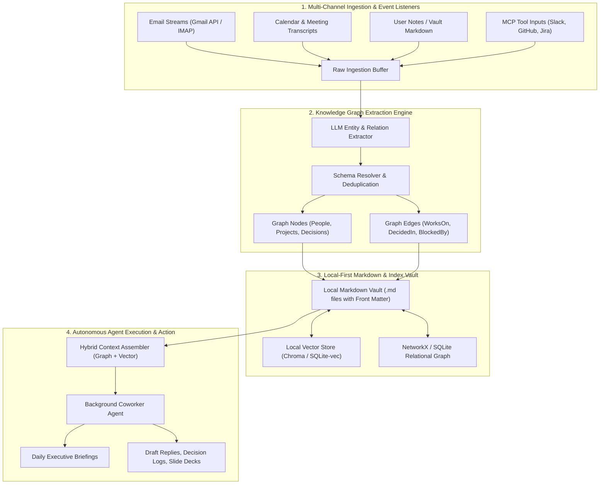
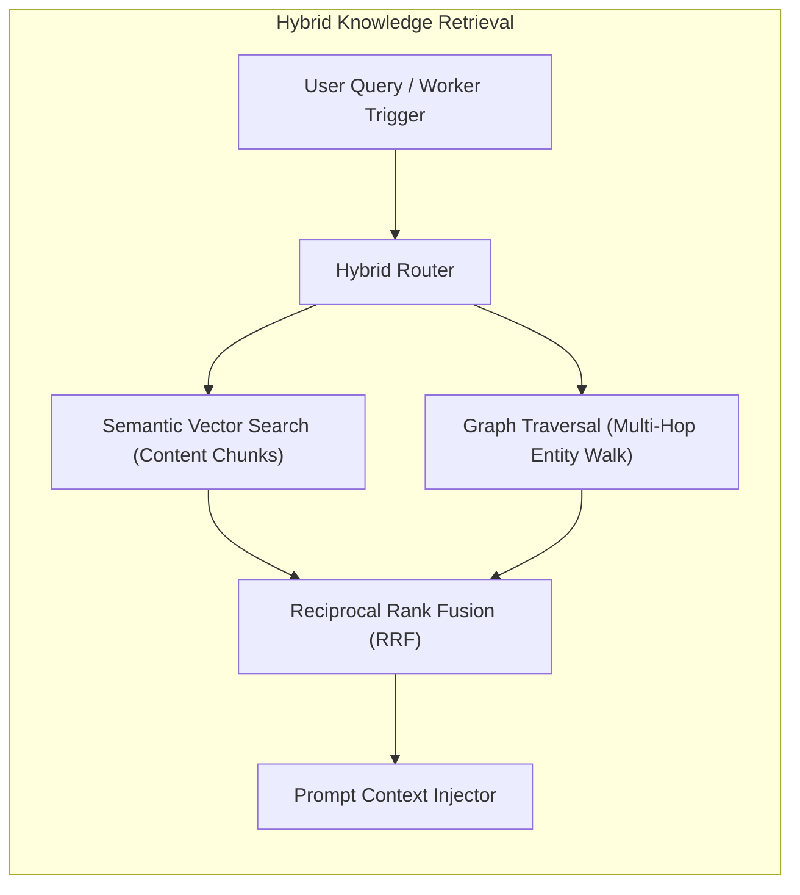
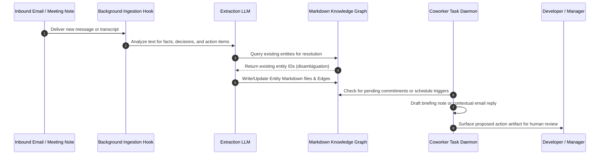
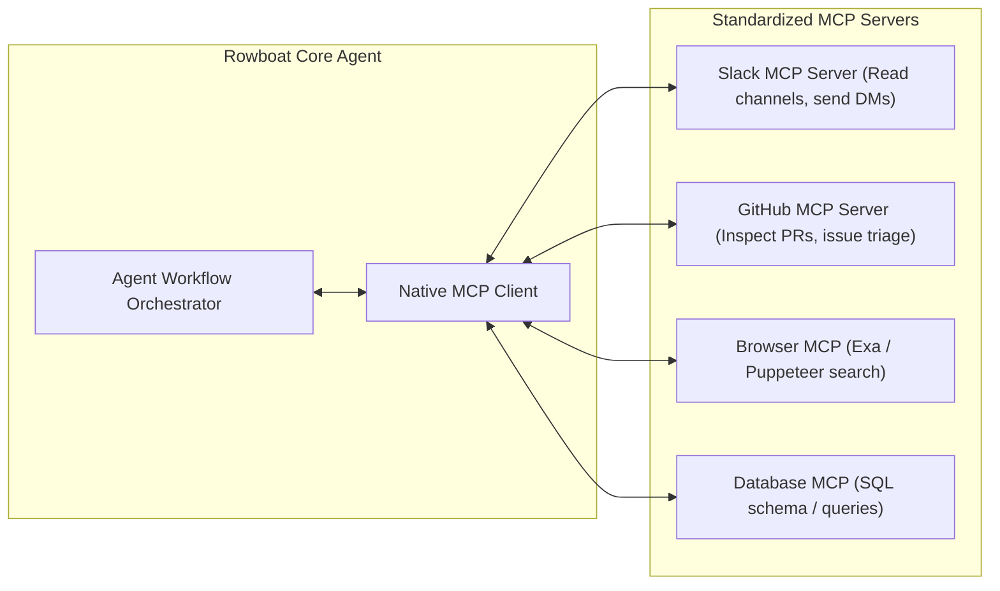

## Why Did Daily Knowledge Work Demand Local-First Compounding Memory Over Ephemeral Chatbots?

Most conversational AI assistants suffer from institutional amnesia. While they can synthesize complex code or summarize documents within an ephemeral prompt session, closing the browser tab wipes out all accumulated context. When a knowledge worker returns the next morning, they must re-explain team structures, ongoing project milestones, client commitments, and technical constraints from scratch. Traditional Retrieval-Augmented Generation (RAG) systems attempt to solve this by indexing flat document stores using dense vector embeddings, but vector similarity frequently fails when complex relational reasoning across multiple organizational entities is required.

Rowboat was designed to eliminate this daily reset by introducing a local-first, open-source AI coworker grounded in an explicit, compounding knowledge graph. Rather than locking organizational knowledge inside proprietary cloud databases, Rowboat persists entities, relationships, meeting decisions, and email threads directly as human-readable Markdown files within a local filesystem vault.

Auditing Rowboat's architecture reveals how graph extraction pipelines, local Markdown persistence, Model Context Protocol (MCP) tool routing, and autonomous background worker daemons operate to provide continuous context across long-running professional workflows.



---

## The Knowledge Graph Architecture: Markdown as Graph Substrate

At the core of Rowboat is the architectural principle that memory should be inspection-safe, portable, and durable. Rather than relying solely on opaque graph database binaries (like Neo4j) or vector databases, Rowboat represents graph nodes and edges as plain Markdown files augmented with YAML front matter and Wiki-links (`[[Entity]]`).

Each conceptual entity—whether a colleague, a client, a technical architecture decision, or an active sprint—is maintained as a discrete file in the user's vault:

```markdown
---
id: project-alpha-auth
type: Project
status: In-Progress
lead: [[person-sarah-chen]]
created: 2026-02-18
tags: [security, oauth, infra]
---

# Project Alpha: Authentication Overhaul

## Objectives
Transition all internal services from static API keys to short-lived mTLS and OAuth2 tokens.

## Related Entities & Decisions
- Blocked by: [[infra-cert-manager-upgrade]]
- Key Stakeholder: [[person-alex-rivera]]
- Decision Record: [[decision-2026-02-15-passkey-support]]

## Activity Log & Extracted Commitments
- 2026-02-18: Sarah agreed to deliver the JWT verification middleware by Friday.
```

By linking files via bidirectional wikilinks, Rowboat leverages a dual-layer indexing engine:
1. **Structural Graph Engine**: An in-memory graph (backed by NetworkX or SQLite) that parses all wikilinks and YAML relations on startup, enabling instantaneous multi-hop traversal (e.g., "Find all open blockers owned by Sarah's direct reports").
2. **Semantic Vector Engine**: A lightweight local embedding store that computes dense vector embeddings across Markdown sections, allowing fuzzy conceptual queries to surface relevant graph nodes.



---

## Autonomous Background Coworker Daemons

A distinguishing feature of Rowboat is that it does not wait passively for prompt submissions. Instead, it operates background daemons that monitor incoming communication channels, extract latent commitments, and generate actionable artifacts autonomously.



### 1. Decision and Commitment Extraction
When meeting transcripts or emails arrive via IMAP or API webhooks, Rowboat's extraction pipeline invokes a structured schema extraction prompt. The model identifies:
- Explicit commitments ("I will submit the PR by Tuesday afternoon").
- Implicit dependencies ("We cannot proceed until the security review finishes").
- Key decisions ("The team decided against using GraphQL for service X").

These extracted facts are matched against existing entities in the Markdown vault using fuzzy entity resolution. If an entity exists, its Markdown file is incrementally updated with a timestamped entry. If a novel entity is detected, a new Markdown file is provisioned.

### 2. Artifact Synthesis
Grounded in this compounding graph, the coworker agent produces high-fidelity artifacts:
- **Morning Executive Briefings**: Synthesizes what was decided yesterday, what tasks are due today, and which team members are currently blocked.
- **Context-Grounded Email Drafts**: Pre-populates response drafts that reference historical decisions made three weeks prior without hallucinating dates or names.
- **Decision Records**: Formats meeting conclusions into standardized Architecture Decision Records (ADRs).

---

## Tooling and Extensibility: Model Context Protocol (MCP)

Rowboat decouples its internal business logic from external productivity services through the Model Context Protocol (MCP). Rather than maintaining brittle proprietary plugins for every software tool, Rowboat hosts an internal MCP client that connects to external community MCP servers:



By leveraging MCP, Rowboat achieves several critical architectural goals:
- **Security Isolation**: Credentials for external services (e.g., Slack tokens, GitHub PATs) remain isolated within standalone MCP daemon processes.
- **Pluggable Execution**: Developers can toggle external tools on or off by editing a single configuration file without modifying the core agent codebase.
- **Multi-Model Portability**: Rowboat supports local models (via Ollama or LM Studio) as well as hosted frontier APIs (OpenAI, Anthropic, Gemini). If an organization mandates zero data egress, the entire stack—model, vector store, and Markdown graph—runs entirely offline on an air-gapped machine.

---

## Comparative Analysis: Rowboat vs Commercial Productivity Agents

Comparing Rowboat's architecture to mainstream commercial productivity tools clarifies its unique positioning for privacy-conscious software and engineering teams.

| Architectural Dimension | Rowboat (Open-Source Local-First) | Microsoft Copilot / Google Duet | Standard RAG Chatbot (e.g., ChatPDF) |
| :--- | :--- | :--- | :--- |
| **Data Storage** | Plain Markdown files in local filesystem | Cloud Microsoft Graph / Google Drive | Cloud Vector DB (Pinecone, Weaviate) |
| **Knowledge Representation** | Explicit bidirectional graph + Vector index | Proprietary Enterprise Graph index | Flat vector embeddings of text chunks |
| **Data Privacy & Egress** | Zero-egress option (Ollama / Local LLM) | Bound to vendor enterprise cloud | Cloud API egress mandatory |
| **Human Auditability** | 100% human-editable Markdown & Git | Opaque enterprise indexes | Opaque floating-point embeddings |
| **Tool Extensibility** | Open Model Context Protocol (MCP) | Proprietary Microsoft/Google plugins | Fixed pre-configured API endpoints |
| **Agent Autonomy** | Autonomous background daemons | User-triggered inline assistant | Purely reactive request-response |

For teams designing distributed knowledge and memory pipelines, our technical evaluations on [Zvec SQLite of vector databases](/posts/zvec-sqlite-of-vector-dbs/), [MCP toolbox for databases](/posts/mcp-toolbox-databases/), and the [developer knowledge API via MCP](/posts/developer-knowledge-api-mcp/) provide deeper technical benchmarks on embedding storage and tool routing.

---

## How Local-First Knowledge Agents Evolved Across 2026

Throughout 2026, the local-first software paradigm converged with autonomous agent architectures, driving significant evolution in personal knowledge management (PKM):

1. **Embedded Knowledge Graphs Over Cloud Graph Databases**: Heavy Neo4j installations were replaced by zero-config embedded graph engines such as SQLite graph extensions and native Rust graph crates. These engines run directly inside client processes with negligible memory footprints.
2. **Deterministic Markdown Synchronization**: Systems adopted Conflict-Free Replicated Data Types (CRDTs) and Git-backed sync daemons, enabling seamless multi-device vault synchronization without exposing unencrypted customer notes to centralized cloud servers.
3. **Hybrid On-Device Inference Routing**: Modern coworkers execute lightweight entity extraction and summarization on local neural processing units (Apple Silicon Neural Engine / Qualcomm NPU) while reserving heavy cloud frontier models for complex multi-step reasoning.
4. **Verifiable Audit Logs for Autonomous Actions**: As background coworkers began sending emails and committing code, architectures incorporated cryptographic audit trails. Every autonomous action records the exact knowledge graph subgraph and model prompt that triggered the decision.

---

## Key Takeaways

- **Explicit Graphs Outperform Flat Vector Chunks**: Tracking organizational entities, blockers, and decisions as structured graph relations eliminates hallucinations and enables deterministic multi-hop reasoning.
- **Local Markdown Ensures Lifetime Durability**: Relying on open, human-readable Markdown guarantees that knowledge remains accessible, editable, and version-controllable regardless of software vendor lifecycles.
- **Compounding Memory Delivers True Productivity**: Shifting from ephemeral chatbot sessions to long-lived memory transforms AI from a novel drafting utility into a context-aware colleague.
- **Standardized Protocols Simplify Integration**: Adopting the Model Context Protocol allows local-first agents to integrate with enterprise communication channels without bespoke plugin code.

---

## New Questions

- How do we define automated pruning and decay policies so that outdated knowledge graph edges do not pollute agent reasoning over multi-year projects?
- Can CRDT-based knowledge graphs resolve semantic merge conflicts when two background agents update the same entity Markdown file concurrently?
- What are the privacy implications of autonomous background scrapers ingesting confidential personal correspondence into shared team vaults?

---

## References

- Rowboat Authors. (2025). *Rowboat: An Open-Source, Local-First AI Coworker*. GitHub Repository. Available at: https://github.com/rowboatlabs/rowboat (accessed 2026-10-18).
- Kleppmann, M., Wiggins, A., van Hardenberg, P., & McGranaghan, M. (2019). *Local-first software: You own your data, in spite of the cloud*. Onward! 2019: Proceedings of the 2019 ACM SIGPLAN International Symposium on New Ideas, New Thinking, and Quick Thinking Programming and Software. Available at: https://doi.org/10.1145/3359591.3359737 (accessed 2026-10-18).
- Model Context Protocol Contributors. (2025). *Model Context Protocol Specification*. Anthropic PBC. Available at: https://modelcontextprotocol.io/introduction (accessed 2026-10-18).
- Edge, D., Trinh, H., Cheng, N., Bradley, J., Chao, A., Mody, A., Truitt, S., & Larson, J. (2024). *From Local to Global: A Graph RAG Approach to Query-Focused Summarization*. arXiv preprint arXiv:2404.16130. Available at: https://arxiv.org/abs/2404.16130 (accessed 2026-10-18).
