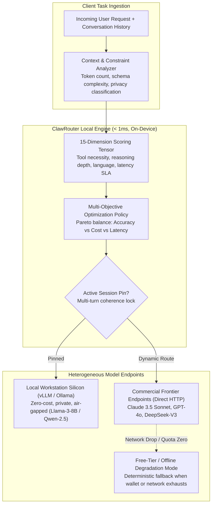

{: .light .w-75 .shadow .rounded-10 }

## Why Does Centralized Cloud Model Routing Impair Local Agent Autonomy?

As the generative artificial intelligence landscape diversified into hundreds of specialized commercial and open-weight models, developers recognized that routing every user prompt to a single flagship model (such as GPT-4o or Claude 3.5 Sonnet) was economically and operationally unsustainable. Routing a trivial greeting or a simple JSON extraction to a massive foundation model wastes budget and incurs hundreds of milliseconds of unnecessary network latency.

In response, the market introduced centralized cloud routing proxies (e.g., OpenRouter, Martian, Portkey). However, for local-first assistants and edge agents, delegating routing decisions to a remote cloud intermediary introduces a severe paradox. First, it doubles network round-trip latency: user prompts must travel to a remote router server before being forwarded to the chosen model endpoint. Second, it destroys data privacy: sending prompt tokens to an external router proxy exposes sensitive enterprise data and internal codebase context. Third, it introduces a single point of failure: an outage in the cloud router severs the agent from all underlying models, even local models running on the developer's workstation.

Developed within the minimal OpenClaw ecosystem, **ClawRouter** resolves this architectural tension. ClawRouter is a **local-first, on-device model routing engine** that evaluates prompts across a multi-dimensional scoring vector in under 1 millisecond, routing tasks between local workstation engines (vLLM, Ollama) and commercial cloud APIs without external telemetry or intermediate proxy hops.

---

## 1. Mathematical Formulation of Local Multi-Objective Routing

Rather than deploying a secondary language model to classify incoming queries (which incurs significant financial and latency penalties), ClawRouter models task dispatch as a deterministic, multi-objective optimization problem solved locally via lightweight feature extraction.

Let $\mathcal{M} = \{m_1, m_2, \dots, m_K\}$ represent the set of candidate model endpoints, where each model possesses a profile of capabilities, context limits, and cost metrics:
- $C(m)$: Cost per 1,000 input/output tokens.
- $T(m)$: Expected Time to First Token (TTFT) and decode latency.
- $L_{\max}(m)$: Maximum context window length.
- $E_{\text{tool}}(m) \in [0, 1]$: Empirical tool-calling and JSON adherence score.
- $E_{\text{reason}}(m) \in [0, 1]$: Deductive reasoning and mathematical benchmark score.

Given an incoming prompt $x$ with token length $|x|$, tool array $\mathcal{T}$, and user-defined priority weights $\mathbf{w} = [w_{\text{qual}}, w_{\text{cost}}, w_{\text{lat}}]$, the router filters candidate models satisfying physical constraints:

$$\mathcal{M}_{\text{feasible}} = \left\{ m \in \mathcal{M} \;\middle|\; |x| \le L_{\max}(m) \quad \text{and} \quad (\mathcal{T} = \emptyset \lor E_{\text{tool}}(m) \ge \tau_{\text{tool}}) \right\}$$

The optimal target model $m^*$ maximizes the utility function:

$$m^* = \arg\max_{m \in \mathcal{M}_{\text{feasible}}} \left[ w_{\text{qual}} \cdot S_{\text{task}}(m, x) - w_{\text{cost}} \cdot C(m, |x|) - w_{\text{lat}} \cdot T(m) \right]$$

Where $S_{\text{task}}(m, x)$ is evaluated via heuristic feature extractors:
- **Lexical Pattern Indicators**: Detects code keywords (`def `, `import `, `class `), mathematical notation, or conversational small talk in $\mathcal{O}(|x|)$ time.
- **Syntactic Structural Depth**: Evaluates AST node depth or markdown list structures to distinguish complex refactoring tasks from routine queries.

Because evaluation relies entirely on vectorized numerical matrix multiplication over pre-compiled model capability matrices, the entire scoring pipeline finishes in **under 800 microseconds** on modern CPUs, introducing imperceptible overhead compared to remote network round-trips.

---

## 2. Architectural Features of Minimalist Routing

ClawRouter implements five structural capabilities designed specifically for lightweight personal assistants:

### 1. Zero External Dependency & Full Local Privacy
ClawRouter runs in-process or as a local Unix domain socket daemon. The prompt text never touches an intermediary telemetry server. Prompts dispatched to local models (via Ollama or vLLM) execute completely air-gapped on workstation silicon, fulfilling the privacy guarantees detailed in our [nanobot architecture audit](/posts/nanobot-ultralight-agent/).

### 2. Session Pinning for Multi-Turn Coherence
A classic failure mode of dynamic model routing in conversational assistants is "personality jitter." If turn 1 routes to Claude 3.5 Sonnet, turn 2 to Llama-3-8B, and turn 3 to GPT-4o, the assistant's stylistic register and system prompt interpretation fluctuate wildly. ClawRouter implements **session pinning**: once a model is selected for a conversational thread, the router pins that model for the duration of the multi-turn session unless the user explicitly invokes a manual model override (e.g., `/model sonnet`) or the context length approaches the pinned model's limits.

### 3. Agentic Task Auto-Detection
When an agent framework emits an internal tool execution chain or multi-step plan, ClawRouter automatically elevates the routing threshold, dispatching the prompt to models optimized for tool recursion (such as Kimi K2.5 or Claude 3.5 Sonnet) rather than lightweight conversational variants.

---

## 3. Decentralized Economics: x402 Micropayments vs. API Key Sprawl

Enterprise developers managing dozens of model providers routinely suffer from **API key sprawl**: maintaining separate accounts, billing thresholds, and credit card subscriptions across OpenAI, Anthropic, Google Cloud, DeepSeek, and Mistral.

ClawRouter integrates support for the **x402 HTTP micropayment protocol**:
- **Single Wallet Identity**: The developer funds a single cryptographic wallet with USDC on the Base Layer-2 network.
- **Pay-Per-Request Dispatch**: When an external commercial model is selected, ClawRouter signs an on-chain micro-transaction paying directly for the generated token payload, eliminating API keys, monthly minimums, and unexpected subscription renewals.
- **Free-Tier Fallback Loop**: If the wallet balance exhausts or network connectivity drops, ClawRouter automatically degrades gracefully to free local open-weight models, ensuring that the developer's core assistant never crashes due to billing exhaustion.

---

## Comparative Matrix: Centralized Cloud Routers vs. Local ClawRouter

| Dimension | Centralized Cloud Proxies (OpenRouter / Portkey) | Local-First Router (ClawRouter) |
| :--- | :--- | :--- |
| **Routing Latency** | 150 ms – 350 ms (Network round-trip) | **< 1 ms (On-device execution)** |
| **Data Privacy** | Prompts pass through third-party proxy servers | **100% on-device; zero intermediate telemetry** |
| **Air-Gapped Operation** | Impossible; requires continuous internet | **Full native support via local vLLM / Ollama** |
| **Failure Domain** | Cloud proxy outage disables all models | **Fully resilient; fails over to local models** |
| **Billing Management** | Proprietary markup or multi-account API keys | **x402 decentralized micropayments or local zero-cost** |
| **Framework Overhead** | Heavy SDK dependencies | **Minimal single-file Python / Rust integration** |

This comparison highlights that for privacy-sensitive enterprise environments and game development workflows, local-first routing preserves sovereignty while maximizing latency efficiency, reinforcing the system design principles established in our blueprint for [minimal OpenClaw assistants](/posts/build-your-own-ai-assistant-minimal-openclaw/).

---

## How Model Routing Architectures Evolved Across 2026

Entering 2026, model routing transitioned from static query dispatching into dynamic, token-level speculative orchestration:

1. **Speculative Cascading Across Silicon Tiers**: Rather than picking a single model, modern routers stream initial prompt tokens simultaneously to a local 3B model and a remote 70B model. If the local model emits high-confidence tokens verified by a local reward head, the remote stream is canceled, saving 90% of cloud compute expenditure.
2. **Local Policy Alignment Checks**: Enterprise routers execute real-time guardrail evaluations locally (checking for prompt injection, confidential IP leakage, and toxic content) before allowing a prompt to traverse external internet gateways, a critical requirement analyzed in our survey of [modern AI developer productivity tooling](/posts/21-top-ai-tools/).
3. **Decentralized Model Marketplaces**: Decentralized agent networks coordinate compute resources across peer-to-peer nodes, using local routers to dynamically arbitrate between local GPU availability and distributed spot compute providers.

---

## Key Takeaways

- **Routing Belongs on the Edge**: Offloading routing decisions to remote cloud proxies introduces double latency, privacy leakage, and brittle external dependencies.
- **Mathematical Heuristics Beat LLM Classifiers**: A 15-dimension local heuristic scoring vector solves model routing in under 1 millisecond without consuming API tokens.
- **Session Pinning Preserves Coherence**: Dynamic routing must respect conversational continuity; pinning models within multi-turn sessions prevents jarring stylistic drift.

---

## New Questions

- How can local routers dynamically update their model capability scoring matrices as frontier providers silently update model weights and quantization profiles?
- What cryptographic verification methods can prove that a remote model provider genuinely executed the specific checkpoint requested by an autonomous x402 routing payment?

---

## References

- HKUDS. (2024). *OpenClaw: Minimalist Agent Runtimes and Local-First Tooling*. GitHub Repository. [https://github.com/HKUDS/nanobot](https://github.com/HKUDS/nanobot) (accessed 2026-10-18).
- Chen, L., Zaharia, M., & Zou, J. (2023). *FrugalGPT: How to Use Large Language Models While Reducing Cost and Improving Performance*. arXiv preprint arXiv:2305.05176. [https://arxiv.org/abs/2305.05176](https://arxiv.org/abs/2305.05176) (accessed 2026-10-18).
- Ong, D. S., et al. (2024). *RouteLLM: Learning to Route to Large Language Models with Preference Data*. arXiv preprint arXiv:2406.18665. [https://arxiv.org/abs/2406.18665](https://arxiv.org/abs/2406.18665) (accessed 2026-10-18).
- Yao, S., Zhao, J., Yu, D., Du, N., Shafran, I., Narasimhan, K., & Cao, Y. (2023). *ReAct: Synergizing Reasoning and Acting in Language Models*. International Conference on Learning Representations (ICLR 2023). [https://arxiv.org/abs/2210.03629](https://arxiv.org/abs/2210.03629) (accessed 2026-10-18).
- Kwon, W., Li, Z., Zhuang, S., Sheng, Y., Zheng, L., Yu, C. H., ... & Stoica, I. (2023). *Efficient Memory Management for Large Language Model Serving with PagedAttention*. Proceedings of the 29th ACM Symposium on Operating Systems Principles (SOSP 2023). [https://doi.org/10.1145/3600006.3613165](https://doi.org/10.1145/3600006.3613165) (accessed 2026-10-18).
