## Why Are Developers Abandoning Heavy Monolithic Agent Frameworks?

Early enterprise agent implementations relied on monolithic abstractions. Frameworks like early LangChain or AutoGen wrapped language model APIs in multi-layered object hierarchies, bloated dependency trees, and opaque prompt injection chains. A minimal autonomous loop designed simply to read a local file, query a tool, and emit an action frequently required hundreds of megabytes of node runtime dependencies, tens of thousands of lines of Python boilerplate, and indeterminate startup latencies exceeding several seconds.

In production environments—ranging from real-time local developer tooling to resource-constrained IoT edge devices and game simulation loops—these monolithic overheads are unacceptable. When an agent must execute within sub-second reaction windows or operate securely on confidential on-premise hardware without external telemetry leakage, architectural bloat becomes a primary point of failure.

This friction catalyzed the rise of **minimalist agent harnesses**, inspired by the open-source OpenClaw philosophy. Rather than wrapping models in complex orchestration platforms, modern minimal agents deconstruct autonomy into three lean primitives: a stateless deterministic router, an isolated capability sandbox, and a lightweight event-driven state machine implemented in systems languages such as Rust, Go, or bare-metal C.

```mermaid
flowchart TD
    subgraph HeavyLegacy["Legacy Monolithic Agent Stacks"]
        A["Python Runtime (>200MB Memory)"] --> B["Heavy Framework Wrappers (50+ Deps)"]
        B --> C["Opaque Prompt Chaining & Hidden Context Injection"]
        C --> D["Uncontrolled Latency (>3000ms Startup)"]
    end

    subgraph MinimalistHarness["Modern Minimalist Agent Architecture"]
        E["Native Compiled Binary (Rust / Go / C)"] --> F["Explicit Capability Sandbox (WASM / Seccomp)"]
        F --> G["Event-Driven Loop (epoll / File Queue)"]
        G --> H["Deterministic Model Tool Routing"]
        H --> I["Zero-Dependency Startup (<15ms, <10MB RAM)"]
    end

    style D fill:#ffe6e6,stroke:#ff4d4d,stroke-width:2px
    style I fill:#e6ffe6,stroke:#33cc33,stroke-width:2px
```



## Deconstructing the Minimal Agent Taxonomy

The lightweight agent ecosystem diverges across runtime requirements, varying from desktop developer daemons to embedded microcontrollers. Analyzing representative implementations highlights the specific trade-offs between execution speed, memory footprint, and isolation guarantees.

### 1. Research-Focused Python Micro-Cores: NanoBot

While production runtimes favor compiled binaries, rapid research iteration requires readable, hackable code. Implementations like **NanoBot** strip away complex abstractions, compressing the entire agentic loop—prompt templating, OpenAI/Anthropic API communication, tool dispatch, and conversational history—into fewer than 4,000 lines of standard library-centric Python.

By eliminating nested framework wrappers, developers can trace every token and inspect tool execution payloads without digging through layers of third-party middleware, directly avoiding the coroutine stalls analyzed in [Python async event loop architectures](/posts/async-code-performance-issues-solutions/).

{: .light .w-75 .shadow .rounded-10 }

### 2. High-Throughput Daemon Architectures: PicoClaw (Go) and ZeroClaw (Rust)

For local background processes that run continuously alongside developer workstations or operating system shells, startup latency and idle memory footprint dominate design criteria:

- **PicoClaw (Go)**: Leverages Go's lightweight goroutines and static compilation. PicoClaw maintains an active daemon consuming less than 15 MB of resident set size (RSS), listening on Unix domain sockets to execute tool actions across local filesystems with instant responsiveness.
- **ZeroClaw (Rust)**: Prioritizes absolute memory safety and zero-cost abstractions. Written in memory-safe Rust with Tokio and Reqwest, ZeroClaw achieves cold-start execution times under 10 milliseconds. It utilizes compile-time trait bounds to enforce tool boundaries, ensuring that unauthorized filesystem or network operations fail at compile time.

{: .light .w-75 .shadow .rounded-10 }

### 3. Containerized Personal Assistants: NanoClaw

In personal workflow automation, security boundaries are paramount. Unrestricted agent tool access allows malicious prompts (prompt injection attacks via untrusted web pages or emails) to execute destructive shell commands or exfiltrate private API credentials.

**NanoClaw** pairs lightweight agent logic with hardened containerization (Docker or Podman sidecars). Every tool execution—such as evaluating Python code, interacting with git, or scraping URLs—runs in an ephemeral, rootless Linux container with restricted network capabilities. If a prompt injection attempt occurs, the blast radius remains strictly confined to the discardable container sandbox.

{: .light .w-75 .shadow .rounded-10 }

### 4. Bare-Metal Embedded Agents: MimiClaw (C on ESP32-S3)

The extreme boundary of minimal agent engineering is executing on microcontrollers without an underlying operating system. **MimiClaw** runs on a $5 Espressif ESP32-S3 microcontroller equipped with 512 KB of SRAM and 8 MB of PSRAM:

- **Zero OS / Zero Node Runtime**: Written in pure C/C++ using the ESP-IDF framework.
- **Hardware Peripherals as Direct Tools**: The agent loop communicates directly with hardware GPIO pins, I2C temperature sensors, and SPI displays via structured JSON tool-call responses streamed over low-power Wi-Fi.
- **On-Chip State Machines**: Rather than maintaining gigabytes of conversational memory, state transitions are encoded into compact bitmasks and local ring buffers, proving that agentic tool use is fundamentally an architectural pattern rather than a compute-bound luxury.

{: .light .w-75 .shadow .rounded-10 }

### 5. Encrypted and Multi-Agent Runtimes: IronClaw and TinyClaw

- **IronClaw (Rust)**: Addresses enterprise compliance and edge privacy. All persistent memories, scratchpad logs, and tool call traces are stored in an encrypted SQLite database using SQLCipher and local zero-knowledge encryption keys. Even if the underlying edge device is physically compromised, agent conversation history cannot be decrypted.
- **TinyClaw (Multi-Agent File Queues)**: Eliminates complex distributed consensus mechanisms (such as Redis queues or Kafka clusters) in favor of POSIX file locks and markdown files. Subagents collaborate by reading and writing markdown tasks into shared local directories, mirroring [decoupled lakehouse architectures](/posts/explore-the-landscape-of-open-source-data-engineering/).

| System | Language | Target Runtime | Key Architectural Trait |
| :--- | :--- | :--- | :--- |
| **NanoBot** | Python | Workstation Research | Minimal codebase (<4,000 LOC), transparent prompt flow |
| **PicoClaw** | Go | CLI / Daemon Service | Low memory footprint (<15 MB RSS), static binary |
| **ZeroClaw** | Rust | Systems / Real-Time | Sub-10ms startup, compile-time capability enforcement |
| **NanoClaw** | TypeScript / Shell | Personal Cloud | Hardened rootless container isolation per tool call |
| **MimiClaw** | C / ESP-IDF | ESP32-S3 Microcontroller | Bare-metal execution, zero OS overhead, direct hardware GPIO |
| **IronClaw** | Rust | Privacy-Sensitive Edge | Encrypted local storage (SQLCipher), zero-telemetry design |
| **TinyClaw** | Multi-Language | Distributed Swarms | File-queue multi-agent communication via POSIX locks |

## How Local Agent Runtimes Evolved Across 2026

Throughout 2026, the artificial intelligence industry experienced a sharp divergence between hyperscale cloud reasoning models and ultra-lean local execution harnesses:

1. **Decoupling of Reasoning from Execution**: While models like DeepSeek-R1 and Claude 3.5 Sonnet handle complex multi-step reasoning in the cloud or on local private clusters, the agent execution runtime has moved entirely to the client device. Thin client harnesses maintain local state, validate schemas, and execute bash commands locally without cloud middleware latency.
2. **Standardization of WebAssembly (WASM) Tool Sandboxing**: Enterprise environments largely abandoned raw shell execution in favor of WebAssembly System Interface (WASI) sandboxes. Tools are packaged as pre-compiled WASM modules. The agent host runtime grants strict, capability-based filesystem and network capabilities at runtime, mitigating prompt injection vulnerabilities.
3. **Transition to Model Context Protocol (MCP)**: Custom proprietary plugin APIs were superseded by open standards like Anthropic's Model Context Protocol (MCP). Lightweight agents in Rust and Go implement streaming JSON-RPC over standard input/output (stdio), connecting seamlessly to database connectors, IDE servers, and terminal emulators without custom integration code.
4. **Local Small Language Model (SLM) Integration**: With 3B–8B quantized models running efficiently on local NPU and GPU hardware (via llama.cpp or Apple Metal), minimal agent harnesses can route low-complexity tool decisions locally, reserving expensive cloud calls exclusively for high-entropy architectural planning, directly complementing [LLM systems design and serving best practices](/posts/machine-learning-interview-questions/).

## Implementation: A Minimalist Rust-Inspired Agent Router in Python

To demonstrate the power of minimalist architecture, the following self-contained script implements an event-driven agent loop with explicit tool dispatch, schema validation, and state isolation in fewer than 90 lines:

```python
"""
minimal_agent.py - Self-contained, zero-dependency lightweight agent runtime.
"""

from typing import Callable, Dict, Any, List
import json


class MinimalAgentHarness:
    """
    A lightweight, explicit agent runner with strict tool capability dispatch.
    """
    def __init__(self, system_prompt: str):
        self.system_prompt = system_prompt
        self.tools: Dict[str, Callable[[Dict[str, Any]], Dict[str, Any]]] = {}
        self.memory: List[Dict[str, str]] = [{"role": "system", "content": system_prompt}]

    def register_tool(self, name: str, handler: Callable[[Dict[str, Any]], Dict[str, Any]]) -> None:
        """Explicitly registers a deterministic tool handler."""
        self.tools[name] = handler

    def execute_step(self, user_input: str, mock_model_router: Callable[[str, List[str]], Dict[str, Any]]) -> str:
        """
        Executes a single observe-orient-decide-act (OODA) agent cycle.
        """
        self.memory.append({"role": "user", "content": user_input})
        
        # Available tool capabilities exposed to model
        available_tools = list(self.tools.keys())
        
        # Decision step: model returns structured tool call intent
        action = mock_model_router(user_input, available_tools)
        
        tool_name = action.get("tool")
        tool_args = action.get("arguments", {})
        
        if tool_name in self.tools:
            try:
                # Execution step: isolated tool invocation
                tool_result = self.tools[tool_name](tool_args)
                result_str = json.dumps(tool_result)
            except Exception as e:
                result_str = json.dumps({"error": str(e)})
                
            self.memory.append({"role": "tool", "name": tool_name, "content": result_str})
            return f"Action [{tool_name}] executed with result: {result_str}"
        
        # Direct response when no tool is required
        direct_reply = action.get("reply", "No action taken.")
        self.memory.append({"role": "assistant", "content": direct_reply})
        return direct_reply


def local_calculator(args: Dict[str, Any]) -> Dict[str, Any]:
    expr = args.get("expression", "0")
    # Safe evaluation of basic mathematical expressions
    return {"calculated": eval(expr, {"__builtins__": {}})}


def mock_llm_router(query: str, tools: List[str]) -> Dict[str, Any]:
    """Simulates structured JSON function calling output from an LLM."""
    if "calculate" in query or "+" in query:
        return {"tool": "calculator", "arguments": {"expression": "42 * 12"}}
    return {"reply": f"Understood query: {query}"}


if __name__ == "__main__":
    harness = MinimalAgentHarness(system_prompt="You are a minimal autonomous assistant.")
    harness.register_tool("calculator", local_calculator)
    
    response = harness.execute_step("Please calculate 42 * 12 for the report.", mock_llm_router)
    print("Agent Execution Output:")
    print(f"  {response}")
    print(f"  Current Memory Steps: {len(harness.memory)}")
```

This stripped-down pattern demonstrates that agency does not require complex frameworks; it requires clean contracts between model intent and isolated execution environments.

## Key Takeaways

- **Ownership Over Monopolies**: Minimalist architectures allow engineering teams to own their agent infrastructure, eliminating unpredictable framework deprecations and external telemetry leakage.
- **Startup Latency Dictates Usability**: For interactive terminal CLI tools and edge robotics, cold-start latencies must stay below 50ms. Compiled languages like Rust and Go outperform multi-second Python framework startups.
- **Extreme Portability to Microcontrollers**: Frameworks like MimiClaw prove that structured tool dispatch can execute on bare-metal $5 ESP32 chips with 512KB of RAM, bringing agency to IoT hardware.
- **Sandboxed Capability Enforcement**: Production systems isolate tool execution inside rootless containers or WASM sandboxes to prevent prompt injection from compromising host systems.
- **Clean Tool Protocols Triumph**: Open standards like MCP and Unix domain sockets allow thin clients to coordinate complex workflows without heavy runtime dependencies.

## New Questions

- How can formal verification techniques be applied to minimal agent loops to mathematically prove the absence of unbounded execution cycles?
- What are the bandwidth and power consumption trade-offs of streaming token-by-token tool definitions over Bluetooth Low Energy (BLE) to edge microcontrollers?
- Can capability-based security models in WebAssembly completely eliminate the risk of privilege escalation during agent tool execution?
- How should multi-agent file queues arbitrate concurrent write conflicts across distributed filesystems without introducing centralized database dependencies?

## References

- Anthropic. (2024). *Building Effective Agents*. Anthropic Research Insights. URL: [https://www.anthropic.com/research/building-effective-agents](https://www.anthropic.com/research/building-effective-agents) (accessed 2026-10-18).
- Edge Impulse & TinyML Foundation. (2024). *State of On-Device Machine Learning and Microcontroller Intelligence*. TinyML Research. URL: [https://www.tinyml.org/](https://www.tinyml.org/) (accessed 2026-10-18).
- Hong, S., Zheng, X., Chen, J., Cheng, Y., Wang, J., Zhang, C., Wang, Z., Yau, S. K. S., Lin, Z., Zhou, L., Ran, C., Xiao, L., & Wu, C. (2023). *MetaGPT: Meta Programming for A Multi-Agent Collaborative Framework*. arXiv preprint arXiv:2308.00352. URL: [https://arxiv.org/abs/2308.00352](https://arxiv.org/abs/2308.00352) (accessed 2026-10-18).
- Wu, Q., Bansal, G., Zhang, J., Wu, Y., Li, B., Zhu, E., Jiang, L., Zhang, X., Zhang, S., Liu, J., Awadallah, A. H., White, R. W., Burger, D., & Wang, C. (2023). *AutoGen: Enabling Next-Gen LLM Applications via Multi-Agent Conversation*. arXiv preprint arXiv:2308.08155. URL: [https://arxiv.org/abs/2308.08155](https://arxiv.org/abs/2308.08155) (accessed 2026-10-18).
