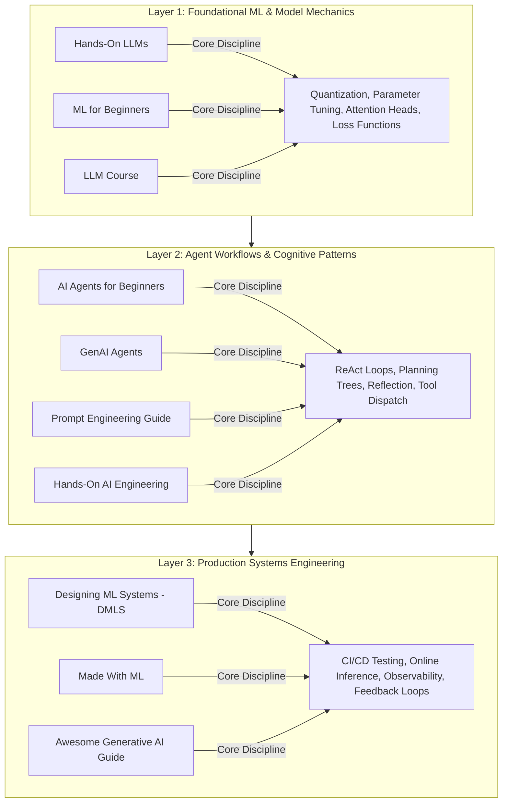

{: .light .w-75 .shadow .rounded-10 }

## Why Reading Production Codebases Outperforms Academic Surveys for Agent Builders

In the fast-moving artificial intelligence ecosystem, developers are inundated with high-level conceptual surveys, vendor whitepapers, and promotional video demonstrations. Yet when an engineer sits down to build an agent system that must execute reliably in enterprise environments, high-level theory offers little guidance. Real agent development requires concrete answers to unglamorous systems problems: How do you serialize tool schemas without exhausting context? How do you prevent cascade failures in multi-agent handoffs? How do you monitor latency and token burn across asynchronous pipelines?

The most effective curriculum for mastering agentic development is reading battle-tested, open-source codebases. By examining how experienced practitioners handle data validation, state checkpointing, error recovery, and model quantization, developers develop the architectural instincts required to ship reliable systems.

This source audit deconstructs **ten foundational open-source repositories** that map the modern AI agent stack—spanning core foundation model mechanics, agentic design patterns, and production machine learning systems engineering.

---

## Architectural Taxonomy of the Agent Engineering Stack

Building production-grade agents requires synthesizing knowledge across three distinct engineering strata:

---

## The 10 Foundational Repositories

### 1. Hands-On Large Language Models (`HandsOnLLM/Hands-On-Large-Language-Models`)
* **Primary Domain**: Foundation Model Architecture & Fine-Tuning.
* **Why It Matters**: Most agent tutorials treat the underlying language model as an opaque magic box accessed via an HTTP REST API. Jay Alammar and Maarten Grootendorst strip away this abstraction, providing end-to-end Python implementations of tokenization algorithms, positional encodings, cross-attention mechanics, and parameter-efficient fine-tuning (PEFT/LoRA). Understanding these internals is essential for diagnosing context-window degradation and attention drift in agent execution loops.

{: .light .w-75 .shadow .rounded-10 }

### 2. AI Agents for Beginners (`microsoft/ai-agents-for-beginners`)
* **Primary Domain**: Agent Component Onboarding & Structured Delegation.
* **Why It Matters**: Microsoft’s curriculum provides an approachable, enterprise-focused introduction to agent architecture. Rather than jumping straight into complex autonomous swarms, it methodically breaks down agent design into verifiable modules: the reasoning brain, external memory backends, perception sensors, and action tools. It serves as an optimal baseline for establishing team-wide engineering vocabulary.

{: .light .w-75 .shadow .rounded-10 }

### 3. GenAI Agents (`NirDiamant/GenAI_Agents`)
* **Primary Domain**: Concrete Agent Pattern Catalog.
* **Why It Matters**: Nir Diamant’s repository provides reference implementations of modern agent topologies: Self-Correction, Plan-and-Solve, Multi-Agent Collaboration, and Memory-Augmented Trajectories. Instead of abstract diagrams, each pattern is implemented as runnable Python code with explicit message serialization, illustrating the patterns explored in [All Agentic Architectures: A Comprehensive Guide](/posts/all-agentic-architectures-comprehensive-guide/).

{: .light .w-75 .shadow .rounded-10 }

### 4. Made With ML (`madewithml/basics`)
* **Primary Domain**: Production ML Operations & Deployment Engineering.
* **Why It Matters**: Authored by Goku Mohandas, this repository teaches the discipline that separates hobbyist AI scripts from production services: automated testing, continuous integration, data versioning, containerization, and monitoring. It enforces the rule that an agent is ultimately a backend microservice that must satisfy strict availability and latency SLAs.

{: .light .w-75 .shadow .rounded-10 }

### 5. Prompt Engineering Guide (`dair-ai/Prompt-Engineering-Guide`)
* **Primary Domain**: Reasoning Protocols & In-Context Learning.
* **Why It Matters**: Maintained by DAIR.AI, this is the canonical reference hub for reasoning protocols. Beyond naive few-shot prompting, it covers formal Chain-of-Thought (CoT), Tree-of-Thoughts (ToT), Directional Stimulus Prompting, and Retrieval-Augmented Generation (RAG) evaluation. It provides the foundational prompting theory required to construct deterministic agent instructions.

{: .light .w-75 .shadow .rounded-10 }

### 6. Hands-On AI Engineering (`Sumanth077/Hands-On-AI-Engineering`)
* **Primary Domain**: Full-Stack Real-World Applications.
* **Why It Matters**: Sumanth Rh’s repository bridges the gap between CLI scripts and user-facing web applications. It demonstrates how to integrate agents with relational databases, vectorize multi-modal files, stream tokens over Server-Sent Events (SSE), and build responsive frontends, demonstrating the practical integration patterns covered in [The Agent SDK Landscape: Comparing Orchestration Runtimes and Harness Primitives](/posts/agent-sdk-landscape/).

{: .light .w-75 .shadow .rounded-10 }

### 7. Awesome Generative AI Guide (`aishwaryanr/awesome-generative-ai-guide`)
* **Primary Domain**: Ecosystem Landscaping & Research Tracking.
* **Why It Matters**: Aishwarya Naresh Reganti’s collection categorizes the sprawling ecosystem across model weights, evaluation benchmarks, and deployment stacks. It functions as an architectural radar, helping engineering leaders track which tools survive and which fade.

{: .light .w-75 .shadow .rounded-10 }

### 8. Designing Machine Learning Systems (`chiphuyen/dmls-book`)
* **Primary Domain**: Distributed Systems & Infrastructure Tradeoffs.
* **Why It Matters**: Chip Huyen’s work represents the definitive textbook on production ML systems. It analyzes the fundamental tensions of software infrastructure: online inference vs. batch prediction, feature stores, data distribution shift, and feedback loops. For agent builders, it provides the systems vocabulary necessary to prevent silent cascade failures in multi-agent pipelines.

{: .light .w-75 .shadow .rounded-10 }

### 9. Machine Learning for Beginners (`microsoft/ML-For-Beginners`)
* **Primary Domain**: Core Mathematical & Statistical Foundations.
* **Why It Matters**: A 26-lesson curriculum covering classical statistical learning, regression, classification, and vector spaces. When modern neural agents fail, diagnosing the failure often requires classical statistical methods—understanding confidence intervals, loss surfaces, and sampling variance.

{: .light .w-75 .shadow .rounded-10 }

### 10. LLM Course (`mlabonne/llm-course`)
* **Primary Domain**: Model Alignment, Distillation, and Post-Training.
* **Why It Matters**: Maxime Labonne’s comprehensive curriculum walks through post-training: Reinforcement Learning from Human Feedback (RLHF), Direct Preference Optimization (DPO), model merging, and quantization (GGUF, EXL2). It equips engineers with the skills to distill massive frontier models into specialized, cost-effective 7B–14B parameter local agent executors.

{: .light .w-75 .shadow .rounded-10 }

---

## Cross-Cutting Matrix: Mapping Repositories to Production Engineering Roles

| Engineering Need | Primary Repository | Secondary Repository | Key Architectural Competency |
| :--- | :--- | :--- | :--- |
| **Model Selection & Quantization** | `LLM Course` | `Hands-On LLMs` | Balancing inference VRAM footprint against context fidelity |
| **Agentic Workflow Design** | `GenAI Agents` | `AI Agents for Beginners` | Designing deterministic state machines and tool dispatch loops |
| **Production Deployment & CI/CD** | `Made With ML` | `DMLS Book Resources` | Establishing automated linting, container sandboxes, and latency monitoring |
| **Prompt Invariants & Reasoning** | `Prompt Engineering Guide` | `Hands-On AI Engineering` | Constructing structured Chain-of-Thought prompts and verifier gates |
| **Foundational Theory & Statistics** | `ML for Beginners` | `DMLS Book Resources` | Evaluating sample variance, distribution shift, and data drift |

---

## What Changed Since Early 2026: From Curated Awesome-Lists to Production Systems Benchmarks

When developers began compiling agent repository lists in early 2026, the ecosystem was dominated by superficial "Awesome" lists: long markdown tables collecting dozens of experimental toy scripts without qualitative filtering or verification. Across 2026, three major shifts matured the open-source agent landscape:

### 1. Shift from Chat Demos to Standardized Agent Harnesses
The industry recognized that chaining raw prompts inside Jupyter notebooks does not constitute software engineering. Successful projects moved decisively toward **harness engineering**—constructing explicit compile-time invariants, sandbox environments, and execution boundaries, as demonstrated in [Harness Engineering: Architectural Principles for Scaling Agents to 1M Lines](/posts/harness-engineering/). Repositories that emphasized toy chatbot wrappers were abandoned in favor of frameworks offering typed tool schemas and deterministic state persistence.

### 2. The Universal Adoption of Model Context Protocol (MCP)
In early 2026, every open-source repository invented its own proprietary tool-calling schema. Today, tool interoperability has standardized on Anthropic’s **Model Context Protocol (MCP)**. Repositories focused on agent tooling now expose standard MCP servers, allowing tool integrations to be shared across Claude Code, Google ADK, and local runners without custom glue code.

### 3. Empirical Evaluation Gating (Evals Over Vibes)
Modern agent repositories no longer evaluate quality using anecdotal screenshots. Repositories like `madewithml/basics` and modern agent benchmarks mandate continuous evaluation suites (such as SWE-bench, Terminal Bench, and custom `.evalset.json` suites). If a pull request modifies an agent's reasoning prompt or tool logic, CI pipelines run regression suites automatically to detect performance drops before code is merged.

---

## Practical Engineering Advice for Builders

For engineering teams seeking to operationalize these repositories into production agent workflows:

1. **Start Single-Purpose**: Never begin with a complex multi-agent swarm. Build a single, deterministic agent that performs one scoped task (e.g., parsing a specific log format or refactoring a single interface) backed by unit tests.
2. **Standardize on MCP Early**: Do not hardcode API calls into prompt strings. Wrap database connectors, search tools, and command-line execution primitives as standalone Model Context Protocol servers.
3. **Budget for Evaluation Infrastructure**: The bottleneck in shipping agents is not model inference cost; it is the time required to verify that agent outputs are correct. Invest early in automated evaluation sets and continuous integration gates.

---

## Key Takeaways

| Pillar | Core Architectural Truth | Production Rule |
| :--- | :--- | :--- |
| **Systems Over Prompts** | Prompts change with every model release; software architecture persists | Treat agents as distributed backend services requiring schemas, timeouts, and tests |
| **Understand the Model Layer** | Context window degradation and hallucination stem from attention mechanics | Study transformer internals (Alammar, Labonne) to design robust chunking and retrieval boundaries |
| **Standardize Tools via MCP** | Custom tool formats create technical debt and vendor lock-in | Package all system affordances as standard Model Context Protocol servers |
| **Continuous Trajectory Evaluation** | Anecdotal testing breeds catastrophic production outages | Implement automated regression suites that score both final answers and tool trajectories |

## New Questions

- **Automated Curriculum Distillation**: Can agents analyze repository diffs and automatically synthesize customized technical onboarding curricula for new team members?
- **Standardizing Agent Metrics**: How will open-source benchmarks converge to provide standardized "reliability-per-dollar" metrics across disparate model families?
- **Self-Refactoring Repositories**: As open-source agent repositories mature, will libraries transition to autonomous maintenance loops where agents update their own dependencies and test suites?

---

## References

- Alammar, J., & Grootendorst, M. (2024). *Hands-On Large Language Models*. O'Reilly Media. GitHub: [https://github.com/HandsOnLLM/Hands-On-Large-Language-Models](https://github.com/HandsOnLLM/Hands-On-Large-Language-Models) (accessed 2026-10-18).
- Mohandas, G. (2024). *Made With ML: Production Machine Learning Lifecycle and Engineering*. GitHub: [https://github.com/madewithml/basics](https://github.com/madewithml/basics) (accessed 2026-10-18).
- Huyen, C. (2022). *Designing Machine Learning Systems: An Iterative Process for Production-Ready Applications*. O'Reilly Media. GitHub: [https://github.com/chiphuyen/dmls-book](https://github.com/chiphuyen/dmls-book) (accessed 2026-10-18).
- DAIR.AI. (2024). *Prompt Engineering Guide: Advanced In-Context Learning and Agentic Reasoning*. GitHub: [https://github.com/dair-ai/Prompt-Engineering-Guide](https://github.com/dair-ai/Prompt-Engineering-Guide) (accessed 2026-10-18).
- Labonne, M. (2024). *The Large Language Model Course: From Fundamentals to Fine-Tuning and Alignment*. GitHub: [https://github.com/mlabonne/llm-course](https://github.com/mlabonne/llm-course) (accessed 2026-10-18).
- Microsoft. (2024). *AI Agents for Beginners: A 10-Lesson Curriculum on Agent Architecture*. GitHub: [https://github.com/microsoft/ai-agents-for-beginners](https://github.com/microsoft/ai-agents-for-beginners) (accessed 2026-10-18).
