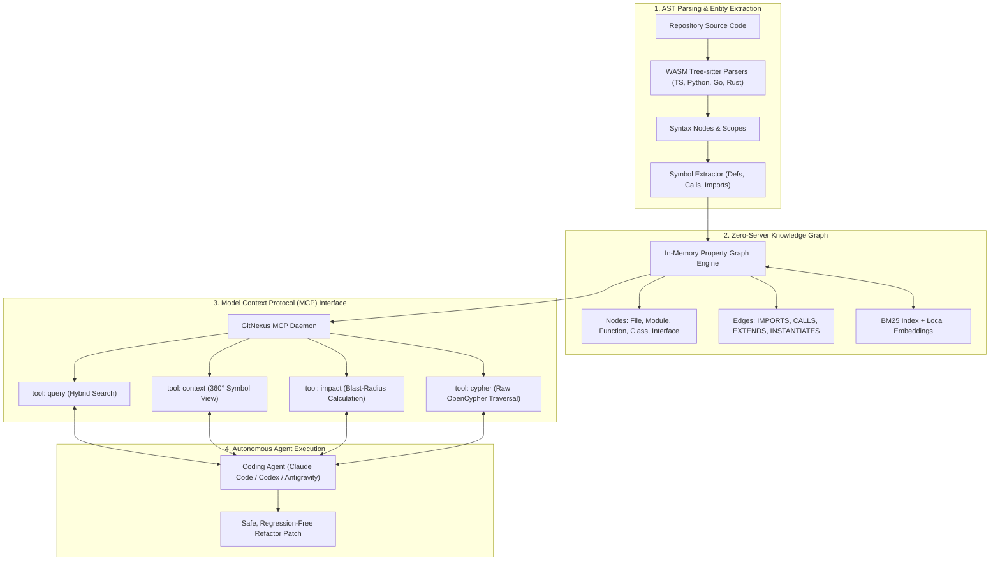
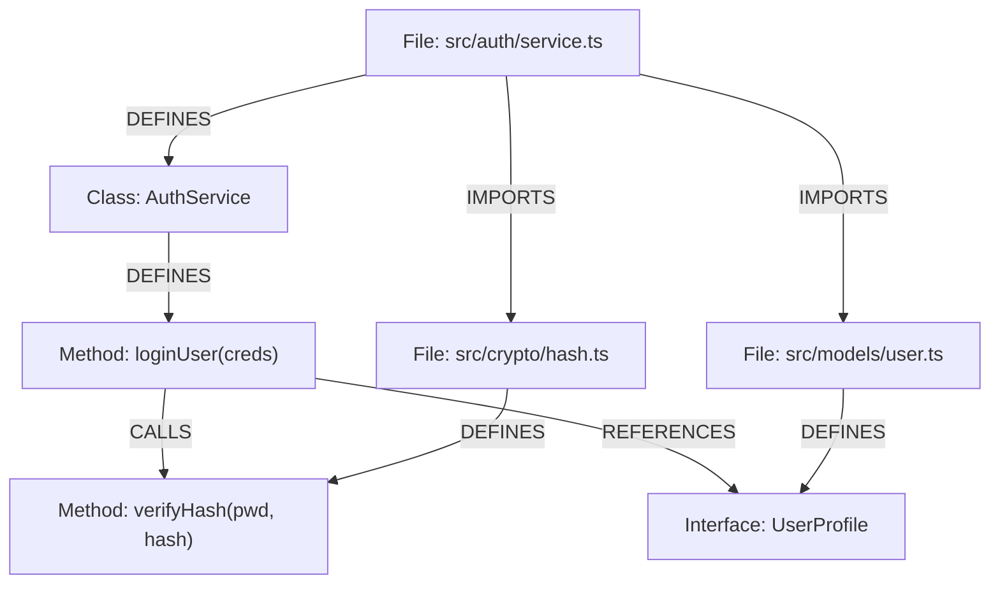
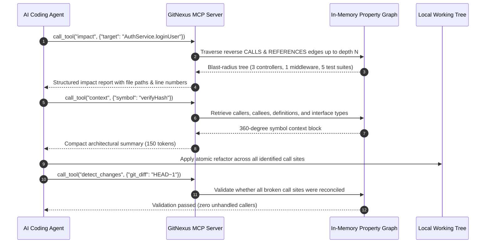

## Why Did Autonomous Code Refactoring Demand In-Process Architectural Graphs Over Blind Grep?

When AI coding agents edit large software repositories, their primary failure mode is rarely syntax generation. Modern frontier models generate valid syntax across Python, TypeScript, Go, and Rust with high precision. Instead, agentic refactors fail due to architectural blindness: agents modify a function signature without updating downstream call sites, rename a database model field without updating serialization schemas, or introduce circular dependencies between loosely coupled modules.

Traditional command-line discovery tools like `grep`, `ripgrep`, or `find` provide lexical pattern matching, but lexical matching cannot distinguish between a function definition, an invocation, a comment mention, or an unrelated variable with an identical name. Conversely, enterprise Language Server Protocol (LSP) daemons or centralized code search platforms require heavy backend servers, high memory footprints, and complex background indexing processes that are difficult to embed directly inside lightweight agent loops or browser sandboxes.

GitNexus was developed to resolve this trade-off by introducing a zero-server, client-side code intelligence engine. By compiling Tree-sitter parsers and graph query engines into WebAssembly (WASM), GitNexus constructs an in-memory knowledge graph of an entire repository directly within a Node.js CLI process or a web browser. Exposing this graph through the Model Context Protocol (MCP), GitNexus equips autonomous agents with deep call-chain visibility and blast-radius impact analysis without transmitting proprietary source code to external cloud backends.



---

## Deconstructing the GitNexus Knowledge Graph Schema

Rather than treating source code as linear token sequences, GitNexus models a repository as a strongly typed directed property graph. The schema maps concrete syntactic entities to graph nodes and explicit code relationships to typed edges.

### 1. Node Classifications
- **Repository / Module / File**: Structural containers representing folder hierarchies and compilation units.
- **Function / Method**: Executable blocks capturing signature parameters, return types, and lexical scope bounds.
- **Class / Interface / Type**: Structural contracts and data definitions.
- **Variable / Constant**: Package-level or class-level state references.

### 2. Edge Typologies
- `DEFINES`: Parent-child ownership (e.g., a File defines a Class; a Class defines a Method).
- `IMPORTS`: Cross-file module dependency link.
- `CALLS`: Direct or indirect function invocation passing execution control.
- `EXTENDS / IMPLEMENTS`: Class inheritance or interface contract adherence.
- `REFERENCES`: Variable or type usage in expressions and signatures.



By traversing these edges, the engine can answer questions that baffle linear search tools: "If I modify the return signature of `verifyHash`, which public API endpoints in the controllers directory will break?"

---

## The Seven MCP Tools That Make Refactoring Safe

GitNexus exposes its graph traversal capabilities through seven specialized Model Context Protocol tools. Instead of flooding an LLM context window with thousands of lines of raw source code, the agent selectively queries precise structural slices:



### Critical Tool Breakdown:
1. `list_repos`: Discovers all currently indexed repositories and active branch states.
2. `query`: Performs hybrid retrieval combining BM25 keyword matching with lightweight semantic embeddings to locate entrypoint symbols.
3. `context`: Generates a complete 360-degree architectural view of a symbol: its definition location, docstrings, incoming callers, outgoing calls, and implemented interfaces.
4. `impact`: Evaluates the blast radius of modifying a symbol, tracing transitive dependencies across the entire project graph.
5. `detect_changes`: Analyzes uncommitted git diffs against the knowledge graph, detecting broken contracts or forgotten call-site updates before tests are even executed.
6. `rename`: Coordinates multi-file symbol renames safely, updating all import specifiers, definitions, and call references in one atomic operation.
7. `cypher`: Allows advanced agents to execute arbitrary openCypher graph queries directly against the repository schema:

```cypher
MATCH (c:Class)-[:EXTENDS]->(base:Class {name: 'BaseController'})
MATCH (c)-[:DEFINES]->(m:Method)-[:CALLS]->(dep:Method)
WHERE dep.name = 'deprecatedSessionLookup'
RETURN c.name, m.name, dep.file
```

---

## Architectural Comparison: GitNexus vs Traditional Code Intelligence

Understanding GitNexus's structural trade-offs clarifies why client-side in-process graphs have emerged as the preferred pattern for local coding agents.

| Capability | GitNexus (Zero-Server WASM) | Language Server Protocol (LSP / tsserver) | Enterprise Code Graph (Sourcegraph / Kythe) |
| :--- | :--- | :--- | :--- |
| **Server Requirement** | Zero (runs in Node CLI / Browser WASM) | Local language daemon per language | Heavy distributed backend clusters |
| **Data Privacy** | 100% Local (zero external network egress) | Local machine execution | Often centralized cloud or enterprise server |
| **Cross-Language Graphs** | Unified property graph across polyglot repos | Fragmented (separate daemon per language) | Unified semantic schema across languages |
| **Query Mechanism** | Structured MCP tools & Cypher queries | JSON-RPC LSP methods (Go to Def, References) | GraphQL / Custom search syntax |
| **Blast-Radius Analysis** | Native multi-hop transitive graph walk | Requires repeated manual reference searches | Cloud pre-computed dependency indexes |
| **Resource Footprint** | Extremely low (WASM memory slab) | Medium to High (heavy Node/Java memory) | High (requires cluster orchestration) |

For teams building robust developer tooling and persistent agent context, our technical analyses on [SQLite graph Cypher query support](/posts/sqlite-graph-cypher-query-support-analysis/), [MCP toolbox for databases](/posts/mcp-toolbox-databases/), and the [developer knowledge API via MCP](/posts/developer-knowledge-api-mcp/) explore complementary storage and routing architectures.

---

## How Zero-Server Code Intelligence Evolved Across 2026

Throughout 2026, developer tooling underwent a fundamental shift toward embedded, zero-server architectures designed specifically for autonomous agent consumption:

1. **WASM-Compiled Universal Tree-sitter Runtimes**: Early agent scripts relied on regex matching or language-specific compiler binaries that broke across operating systems. In 2026, standardized WebAssembly builds of Tree-sitter Grammars enable zero-dependency AST generation across Linux, macOS, Windows, and browser sandboxes.
2. **Standardized openCypher Querying for Codebases**: Graph databases ceased being separate infrastructure servers. Embedded Cypher query engines (such as Kùzu or embedded SQLite graph engines) allow agents to query call graphs using standard graph syntax without database administrative overhead.
3. **Continuous Incremental Graph Re-Indexing**: Rather than rebuilding repository graphs from scratch on every git commit, modern engines listen to file system change events (via `fsevents` or `inotify`). Only the modified syntax trees and their direct edges are patched, maintaining real-time graph consistency in under 50 milliseconds.
4. **Pre-Commit Agentic Blast-Radius Certification**: CI/CD workflows began enforcing automated blast-radius checks. Pull requests generated by AI agents must attach a certified dependency graph traversal proving that all downstream callers were evaluated and covered by updated regression tests.

---

## Key Takeaways

- **Lexical Grep is Insufficient for Agentic Refactoring**: Autonomous agents require typed relational context (callers, callees, implementations) rather than flat string search to avoid shipping breaking changes.
- **Zero-Server WASM Delivers Complete Privacy**: Parsing codebases directly in WebAssembly eliminates the need to upload proprietary code to cloud servers or configure complex backend daemons.
- **Blast-Radius Analysis Prevents Silent Regressions**: Calculating the transitive impact of code edits before applying diffs allows agents to plan comprehensive refactoring passes across all affected files.
- **MCP Standardizes Codebase Navigation**: Exposing graph traversal tools through the Model Context Protocol allows any compatible agent (Claude Code, OpenAI Codex, Antigravity) to navigate architectural relationships seamlessly.

---

## New Questions

- How can dynamic language call graphs (such as Python duck-typing or JavaScript monkey-patching) be resolved accurately without full runtime execution tracing?
- What are the memory scaling limits of in-browser WASM property graphs when indexing monorepos with tens of millions of lines of code?
- Can agent-authored architecture decision records (ADRs) be generated automatically by diffing code graph snapshots across git releases?

---

## References

- Patwari, A. (2025). *GitNexus: Zero-Server Code Intelligence for AI Coding Agents*. GitHub Repository. Available at: https://github.com/abhigyanpatwari/GitNexus (accessed 2026-10-18).
- Model Context Protocol Contributors. (2025). *Model Context Protocol Specification*. Anthropic PBC. Available at: https://modelcontextprotocol.io/introduction (accessed 2026-10-18).
- Brunel, M., & Tree-sitter Authors. (2024). *Tree-sitter: An Incremental Parsing System for Programming Tools*. Available at: https://tree-sitter.github.io/tree-sitter/ (accessed 2026-10-18).
- Francis, N., Green, A., Guagliardo, P., Libkin, L., Lindaaker, T., Marsault, V., Plantikow, S., Rydberg, M., Selmer, P., & Taylor, A. (2018). *Cypher: An Evolving Query Language for Property Graphs*. Proceedings of the 2018 International Conference on Management of Data (SIGMOD '18). Available at: https://doi.org/10.1145/3183713.3190657 (accessed 2026-10-18).
