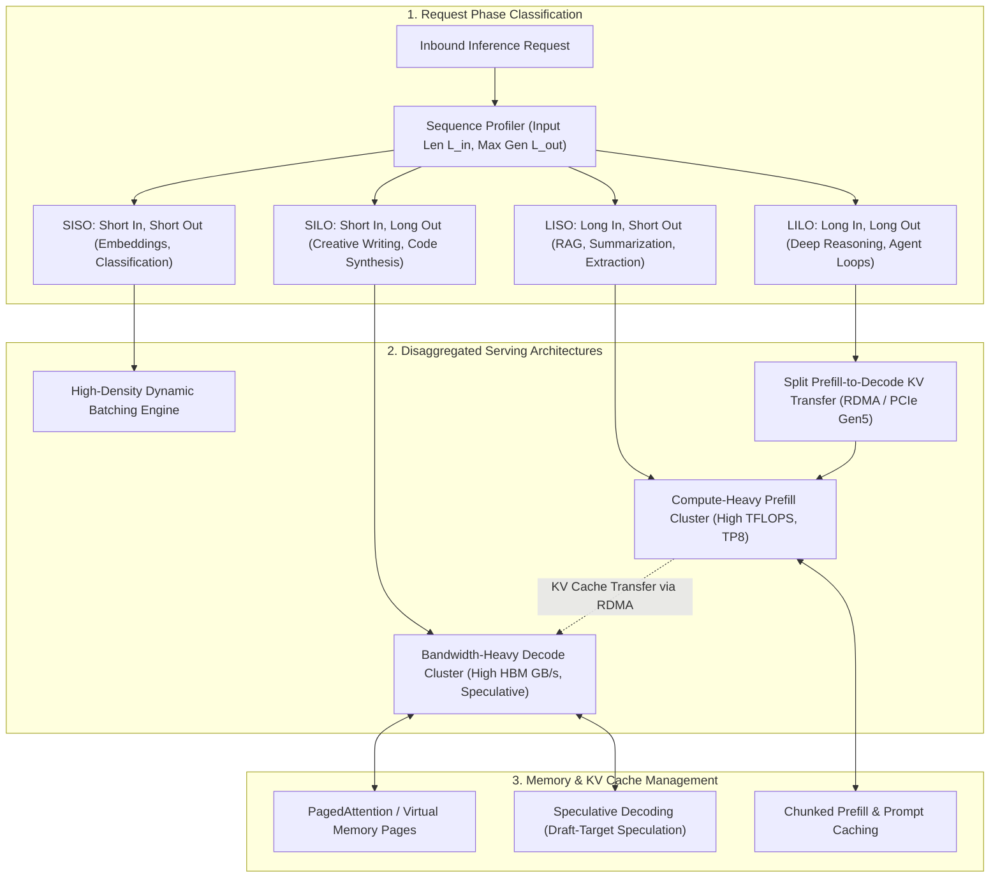
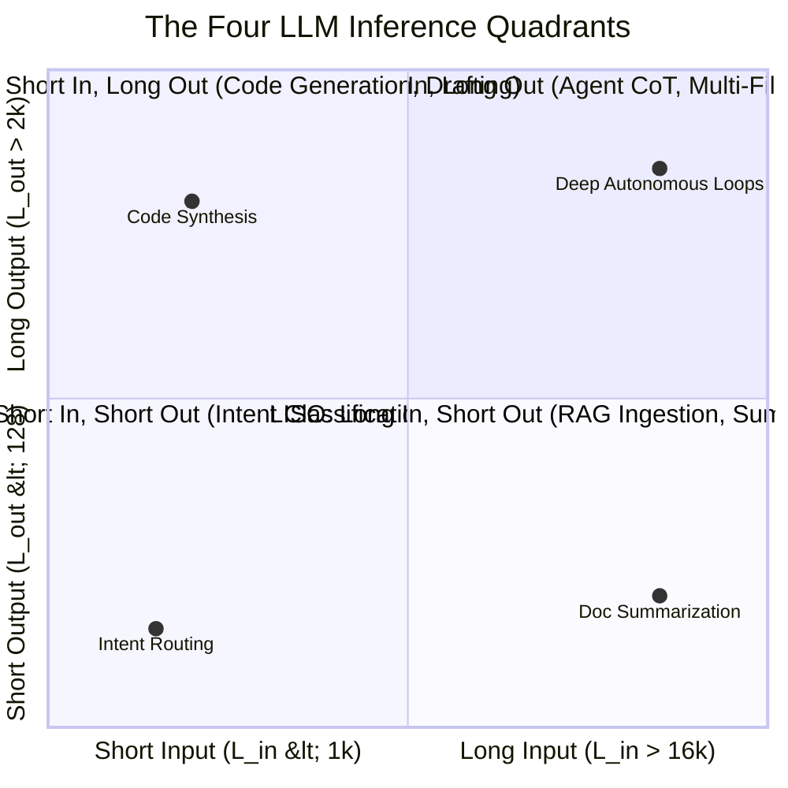
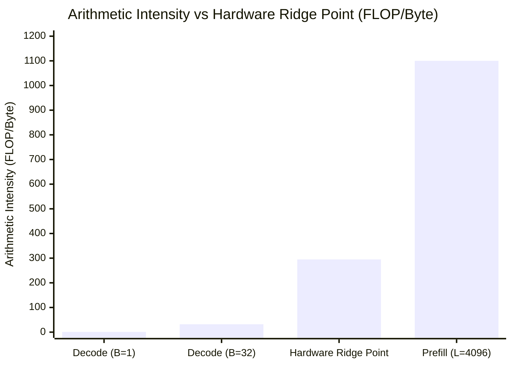
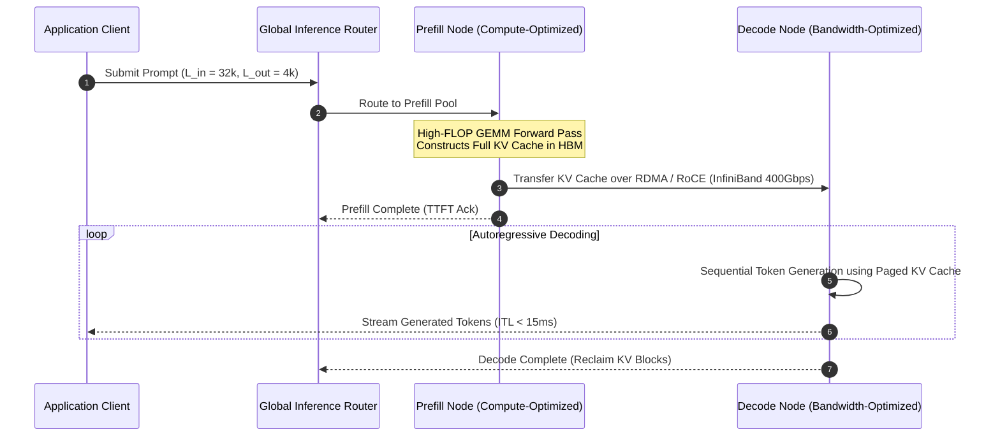

## Why Does Autoregressive Token Generation Break Traditional ML Serving Paradigms?

Traditional machine learning inference—such as image classification, tabular ranking, or object detection—exhibits static computational and memory complexity. A batch of images enters a convolutional or Vision Transformer network, passes through a deterministic sequence of matrix operations, and returns output tensors with fixed dimensional bounds. Serving engines optimize these static graphs by establishing fixed tensor allocations and maximizing GPU hardware compute utilization ($TFLOPS$).

Large Language Model (LLM) serving fundamentally breaks this static paradigm due to the asymmetric mechanics of autoregressive decoding. Every LLM inference request executes across two radically distinct operational phases:

1. **Prefill (Prompt Processing)**: The model processes the input token sequence concurrently in a single forward pass. Because the entire prompt is known upfront, operations are compute-bound (GEMM-heavy) and achieve near-peak Tensor Core utilization. During prefill, the Key and Value projection states across all attention layers are computed and stored into high-bandwidth GPU memory (HBM) as the Key-Value (KV) cache.
2. **Decode (Token Generation)**: The model generates tokens sequentially, one token per step. Each generated token relies on the accumulated KV cache of all prior tokens. Because each decode step processes only a single token per request while reading the massive KV cache from memory, arithmetic intensity collapses: decoding is severely memory-bandwidth bound (GEMV-heavy).

Serving engines that attempt to co-locate both phases on identical GPU instances inevitably suffer from hardware underutilization, head-of-line blocking, and unpredictable tail latency.

---

## The Four Inference Operational Profiles: SISO, LISO, SILO, and LILO

To design cost-effective serving infrastructure, engineering teams must decompose workloads into four canonical inference quadrants based on the ratio of prompt input tokens ($L_{\text{in}}$) to generated output tokens ($L_{\text{out}}$):

### 1. SISO (Short-In, Short-Out)
- **Workload Profile**: $L_{\text{in}} < 1,000$ tokens; $L_{\text{out}} < 128$ tokens.
- **Typical Use Cases**: Query intent routing, sentiment classification, entity extraction, semantic reranking.
- **System Bottleneck**: Kernel launch overhead and GPU underutilization. Because both phases are brief, single requests fail to saturate modern GPU architectures (e.g., NVIDIA H100 or B200).
- **Optimization Strategy**: Aggressive continuous batching, tensor parallelism reduction (TP1 or TP2), and deployment on smaller quantized edge models or quantized dense models.

### 2. LISO (Long-In, Short-Out)
- **Workload Profile**: $L_{\text{in}} > 16,000$ tokens; $L_{\text{out}} < 256$ tokens.
- **Typical Use Cases**: Document summarization, repository search QA, Retrieval-Augmented Generation (RAG) extraction, legal contract auditing.
- **System Bottleneck**: Time to First Token (TTFT) and compute capacity. Processing massive input contexts requires enormous GEMM throughput during the prefill phase.
- **Optimization Strategy**: Prompt caching (reusing pre-computed KV prefix trees), chunked prefill (interleaving prefill chunks with decode steps to prevent tail-latency spikes), and routing to high-FLOP prefill-optimized hardware.

### 3. SILO (Short-In, Long-Out)
- **Workload Profile**: $L_{\text{in}} < 500$ tokens; $L_{\text{out}} > 2,048$ tokens.
- **Typical Use Cases**: Automated code synthesis, creative storytelling, chain-of-thought mathematical reasoning, synthetic dataset generation.
- **System Bottleneck**: Inter-Token Latency (ITL) and High-Bandwidth Memory (HBM) bandwidth. Because generating each subsequent token requires streaming the model weights and existing KV cache through memory buses, latency is bound by gigabytes-per-second memory bandwidth rather than raw TFLOPS.
- **Optimization Strategy**: Speculative decoding (using a tiny draft model to propose $K$ candidate tokens verified by the target model in a single GEMM step), FP8/FP4 KV cache quantization, and memory-bandwidth maximized serving instances.

### 4. LILO (Long-In, Long-Out)
- **Workload Profile**: $L_{\text{in}} > 32,000$ tokens; $L_{\text{out}} > 4,096$ tokens.
- **Typical Use Cases**: Autonomous coding agent loops, multi-agent simulation harnesses, multi-document synthesis, recursive software refactoring.
- **System Bottleneck**: Simultaneous compute exhaustion and extreme VRAM memory pressure. A single concurrent LILO request can consume tens of gigabytes of VRAM exclusively for its expanding KV cache, triggering GPU out-of-memory (OOM) faults or aggressive request preemption.
- **Optimization Strategy**: Disaggregated prefill-decode architectures, PagedAttention virtual memory paging, cross-node KV cache offloading via high-speed RDMA, and context compression.

---

## Mathematical Foundations of the Memory-Bandwidth Wall

To understand why decoding behaves differently from prefill, consider the arithmetic intensity $I$, defined as the ratio of floating-point operations (FLOPs) performed per byte of memory transferred:

$$I = \frac{\text{FLOPs}}{\text{Bytes Transferred}} \quad \left[\frac{\text{FLOP}}{\text{Byte}}\right]$$

For an autoregressive decoder model with parameter count $P$, generating a single token for a single batch ($B = 1$) requires loading every weight parameter from HBM into the register files:

$$\text{Memory Transferred} \approx P \times \text{Precision Bytes} + \text{KV Cache Size}$$
$$\text{FLOPs Executed} \approx 2P$$

For FP16 weights ($\text{Precision} = 2$ bytes per parameter):

$$I_{\text{decode}} \approx \frac{2P}{2P} = 1 \text{ FLOP/Byte}$$

Compare this with modern GPU hardware capabilities. An NVIDIA H100 SXM5 GPU features:
- **Peak Compute Capacity**: $989 \times 10^{12} \text{ FLOP/s}$ (FP16 Tensor Core).
- **Peak Memory Bandwidth**: $3.35 \times 10^{12} \text{ Bytes/s}$ (HBM3).

The hardware balance point (the machine ridge point) is:

$$I_{\text{hardware}} = \frac{989 \times 10^{12}}{3.35 \times 10^{12}} \approx 295 \text{ FLOP/Byte}$$

Because $I_{\text{decode}} \ll I_{\text{hardware}}$, single-request decoding achieves less than $1\%$ of the GPU's theoretical compute throughput. Only by increasing the batch size ($B$) or leveraging speculative multi-token generation can arithmetic intensity approach the hardware ridge point.

---

## Disaggregated Serving: Separating Prefill and Decode Nodes

To resolve the interference between prefill and decode phases, advanced 2026 serving runtimes (such as Splitwise, DistServe, and vLLM Disaggregated) decouple cluster infrastructure into dedicated prefill workers and decode workers.

By disaggregating hardware:
- **Prefill Nodes** are provisioned with high-compute configurations (e.g., higher Tensor Parallelism $TP=8$) to minimize Time to First Token.
- **Decode Nodes** are provisioned with maximum memory bandwidth and larger batch capacities, using Pipeline Parallelism ($PP$) to maximize token throughput without suffering from prefill-induced latency interruptions.
- High-speed RDMA interconnects transmit multi-gigabyte KV cache buffers between nodes in milliseconds.

---

## Workload Strategy Matrix

| Dimension | SISO | LISO | SILO | LILO |
| :--- | :--- | :--- | :--- | :--- |
| **Typical Context** | In: 256 / Out: 32 | In: 32,000 / Out: 128 | In: 256 / Out: 4,096 | In: 64,000 / Out: 8,192 |
| **Primary Metric** | Cost per 1M Queries | Time to First Token (TTFT) | Inter-Token Latency (ITL) | Total Cost & OOM Resilience |
| **KV Cache Strategy** | Minimal footprint | Prefix Tree / Prompt Caching | Quantized FP8/FP4 KV Cache | PagedAttention + Offloading |
| **Serving Architecture** | Colocated High-Batch | Dedicated Prefill Cluster | Speculative Decoding Engines | Disaggregated Prefill-Decode |
| **Parallelism Best-Fit** | Data Parallelism ($DP$) | High Tensor Parallelism ($TP$) | Pipeline Parallelism ($PP$) | Disaggregated ($TP$ Prefill $\to PP$ Decode) |

For practitioners engineering end-to-end LLM pipelines, our related investigations into [MicroGPT pure Python scalar autograd](/posts/microgpt-learning-guide/), [FlexAttention and FlashAttention CUDA implementation](/posts/flexattention-flash-attention-cute-dsl-guide/), and [building Llama 4 from scratch](/posts/building-llama-4-from-scratch-mixture-of-experts/) detail the underlying attention and tensor kernel mechanics.

---

## How Disaggregated Inference Architectures Evolved Across 2026

Throughout 2026, inference system engineering shifted definitively from single-server monolithic engines to distributed, pattern-aware serving meshes:

1. **Sub-Millisecond Runtime Pattern Classification**: API gateway proxies (such as AMRouter and Envoy-AI) evaluate prompt token lengths and predicted output distributions at ingestion time, routing requests to dedicated SISO, LISO, SILO, or LILO clusters in under 500 microseconds.
2. **Standardized RDMA KV Cache Transfer Protocols**: The adoption of standardized zero-copy memory fabrics (such as UCX and Mooncake) enabled direct GPU-to-GPU transfer of PagedAttention memory pools across InfiniBand networks without CPU serialization bottlenecks.
3. **Hardware-Native Speculative Decoding**: Modern server architectures integrate dedicated low-power draft accelerators alongside primary GPU clusters, allowing speculative multi-token generation to execute with zero target-model latency penalties.
4. **Adaptive FP4 KV Cache Quantization**: When context lengths exceed 128k tokens in LILO workloads, serving engines dynamically compress older KV cache pages from FP16 down to FP4 precision, slashing memory footprints by $75\%$ while preserving needle-in-a-haystack retrieval accuracy.

---

## Key Takeaways

- **Inference is Asymmetric**: Prefill is compute-bound and highly parallel; decode is memory-bandwidth bound and strictly sequential.
- **Four Distinct Operational Profiles**: Classifying workloads into SISO, LISO, SILO, and LILO is essential for sizing GPU clusters and preventing tail-latency degradation.
- **The Arithmetic Intensity Gap**: Single-request autoregressive decoding executes at $\approx 1 \text{ FLOP/Byte}$, orders of magnitude below modern GPU hardware capabilities.
- **Disaggregation Unlocks Production Efficiency**: Decoupling prefill nodes from decode nodes via RDMA KV cache transfers eliminates phase interference and maximizes hardware return on investment.

---

## New Questions

- How do emerging state-space models (Mamba, RecurrentGemma) and linear attention mechanisms alter the memory bandwidth economics of long-context decoding compared to standard transformers?
- What are the networking bandwidth thresholds where disaggregated KV cache transfer over PCIe Gen5 becomes a bottleneck compared to unified HBM memory architectures?
- Can reinforcement learning agents predict token generation stopping points accurately enough to optimize KV cache allocation before generation begins?

---

## References

- Patel, P., Choukse, E., Zhang, C., Shah, A., & Goiri, Í. (2024). *Splitwise: Efficient Generative LLM Inference Using Phase Splitting*. Proceedings of the 51st Annual International Symposium on Computer Architecture (ISCA '24). Available at: https://arxiv.org/abs/2311.18677 (accessed 2026-10-18).
- Kwon, W., Li, Z., Zhuang, S., Sheng, Y., Zheng, L., Yu, C. H., Gonzalez, J. E., Zhang, H., & Stoica, I. (2023). *Efficient Memory Management for Large Language Model Serving with PagedAttention*. Proceedings of the 29th ACM Symposium on Operating Systems Principles (SOSP '23). Available at: https://arxiv.org/abs/2309.06180 (accessed 2026-10-18).
- Zhong, Y., Liu, S., Chen, J., Hu, B., Chou, Y. H., & Zhang, H. (2024). *DistServe: Disaggregating Prefill and Decoding for Goodput-Optimized Large Language Model Serving*. Proceedings of the 18th USENIX Symposium on Operating Systems Design and Implementation (OSDI '24). Available at: https://arxiv.org/abs/2401.09670 (accessed 2026-10-18).
- Leviathan, Y., Kalman, M., & Matias, Y. (2023). *Fast Inference from Transformers via Speculative Decoding*. International Conference on Machine Learning (ICML 2023). Available at: https://arxiv.org/abs/2211.17192 (accessed 2026-10-18).
