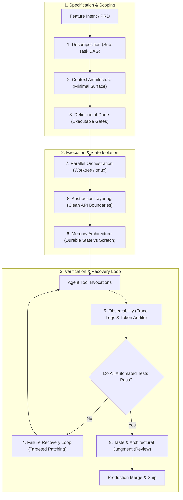
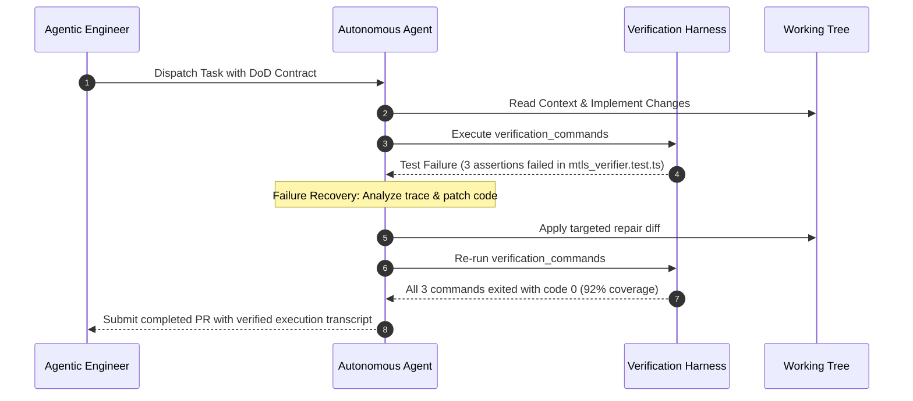

## Why Does Autonomous Agent Productivity Stall at the Last Twenty Percent?

In modern software development, generative coding agents can scaffold an entire prototype application in minutes. Given a high-level natural language prompt, frontier models generate database schemas, API routes, React components, and deployment configuration files with impressive fluency. Yet when teams attempt to integrate these agents into production workflows, progress frequently stalls on the final twenty percent: edge case handling, regression prevention, integration testing, and architectural coherence across existing services.

This breakdown occurs because standard prompt-and-pray interactions treat language models as all-knowing monolithic oracles rather than nondeterministic cognitive components within a broader systems engineering harness. When an agent is handed an ambiguous multi-thousand-line specification without explicit boundaries, it drifts into context degradation, makes uncoordinated edits across uninspected files, and hallucinates passing tests.

Flowkater's "Nine Skills of Agentic Engineering" codifies the engineering discipline required to bridge this gap. Rather than obsessing over prompt phrasing, agentic engineering treats software authoring as an orchestration lifecycle governed by formal decomposition, context boundary enforcement, automated verification gates, and explicit failure recovery protocols.



---

## Deconstructing the Nine Disciplines of Agentic Engineering

Flowkater identifies nine core competencies that separate disposable script demos from maintainable software systems:

### 1. Task Decomposition (Granular Slice Engineering)
Large software tasks must be broken down into atomic, vertically sliced tasks that fit comfortably within an agent's effective reasoning horizon. A single prompt asking to "rebuild the authentication system and update all endpoints" overwhelms an agent's working memory. Effective engineers decompose the initiative into discrete directed acyclic graph (DAG) nodes: schema migration, token generation middleware, test suite authoring, and endpoint conversion.

### 2. Context Architecture (Curating the Information Envelope)
Flooding an LLM context window with an entire monorepo degrades retrieval accuracy and wastes token budgets. Context architecture is the deliberate curation of the minimal necessary information envelope: specific file paths, public interface signatures, database schemas, and architectural guidelines. Tools like repomix or specialized MCP servers ensure agents receive high-density structural context rather than raw directory dumps.

### 3. Definition of Done (DoD as Executable Code)
Ambiguous requirements guarantee hallucinated completion. In agentic engineering, the Definition of Done is never an abstract checklist; it is an executable test suite, type-check command, and linting contract:

```python
# Executable Definition of Done (DoD) Contract Specification
TASK_DEFINITION_OF_DONE = {
    "task_id": "auth-mtls-transition",
    "inputs": [
        "src/auth/interfaces.ts",
        "docs/rfcs/004-mtls-spec.md"
    ],
    "outputs": [
        "src/auth/mtls_verifier.ts",
        "tests/auth/mtls_verifier.test.ts"
    ],
    "invariants": {
        "max_cyclomatic_complexity": 8,
        "zero_unhandled_promise_rejections": True,
        "no_new_external_dependencies": True
    },
    "verification_commands": [
        "npm run type-check",
        "npm run lint",
        "npx jest tests/auth/mtls_verifier.test.ts --coverage"
    ],
    "minimum_coverage_percent": 90.0
}
```



### 4. Failure Recovery Loops (Bounded Repair Cycles)
When an agent encounters a compiler error or test failure, naive implementations fall into circular error loops where the model applies random permutations until the code breaks further. Agentic engineering institutes bounded recovery loops: capturing stderr traces, feeding targeted diffs back into the reasoning prompt, and reverting working trees if the error remains unresolved after $N$ attempts.

### 5. Deep Observability (Traces Over Vibes)
Engineering teams cannot optimize what they cannot inspect. Observability tracks the complete trajectory of an agent session: exact tool call inputs, system prompt versions, token consumption ratios, cache hit rates, and file modifications. Structured telemetry allows developers to identify exactly where an agent strayed off course.

### 6. Memory Architecture (Ephemera vs Durable Graph)
Distinguishing between transient scratchpad data and permanent institutional knowledge is vital. Intermediate scratch scripts, compiler warnings, and draft code belong in temporary session storage. Architectural decisions, schema contracts, and domain models must be committed directly to version control as Markdown files or structured knowledge graphs.

### 7. Parallel Process Orchestration (Worktrees and Multiplexing)
Running multiple concurrent agents on a single uncommitted git branch produces catastrophic write collisions. Parallel orchestration isolates each agent into dedicated git worktrees (`git worktree add ../feature-branch`) and terminal multiplexer sessions (tmux/Zellij), merging branches only after verification gates pass.

### 8. Abstraction Layering (Deep Modules and Narrow Interfaces)
Codebases designed for human engineers frequently employ shallow, fragmented classes. For AI agents, shallow modules increase cross-file call overhead and context dispersion. Agentic engineering champions deep modules: clean, simple public interfaces that conceal extensive internal implementation details, allowing an agent to safely modify internal routines without breaking consumers.

### 9. Taste and Architectural Judgment (The Human North Star)
While agents generate code and tests mechanically, they lack holistic aesthetic judgment, product intuition, and long-term maintenance foresight. Human engineers supply the taste: deciding which technical trade-offs align with business goals, rejecting over-engineered abstractions, and maintaining cohesive architectural style across the organization.

---

## Comparative Matrix: Ad-Hoc Prompting vs Agentic Engineering

| Operational Aspect | Ad-Hoc AI Prompting | Disciplined Agentic Engineering |
| :--- | :--- | :--- |
| **Input Specification** | Broad natural language paragraph | Typed task slice with explicit DoD contract |
| **Context Strategy** | Pasting thousands of lines into chat | Programmatic context extraction via MCP |
| **Verification Gate** | Human eyeball scan of output diff | Automated test runners, linters, and type checkers |
| **Failure Handling** | Manually typing "that didn't work" | Automated closed-loop retry and rollback harness |
| **Concurrency Model** | Single sequential chat window | Multiplexed worktree branches running in parallel |
| **Artifact Lifecycle** | Ephemeral chat transcript | Version-controlled tests, ADRs, and commit records |
| **Human Role** | Line-by-line copy-paster | Systems architect, gatekeeper, and reviewer |

For organizations evaluating agent orchestration and operational patterns, our related architectural audits on [Oh-My-Codex multi-agent orchestration](/posts/oh-my-codex-agents/), the [BMAD method](/posts/bmad-method/), and [Clawd Control agent operations](/posts/clawd-control-agent-ops/) provide practical execution blueprints.

---

## How Agentic Engineering Frameworks Evolved Across 2026

Throughout 2026, agentic engineering evolved from an informal collection of developer heuristics into a formalized software engineering discipline:

1. **Contract-Driven Agent Handoffs**: Rather than relying on free-form conversational instructions, teams standardized on typed interface schemas (such as JSON-LD task descriptors). An architect agent passes an immutable contract to an implementation agent, which cannot report completion until a validator agent issues a cryptographically signed test certificate.
2. **Worktree-Aware Terminal Sandboxes**: Development environments integrated git worktree management directly into agent CLI runtimes. Agents automatically spin up isolated worktrees in temporary RAM disks, run comprehensive regression suites, and auto-delete corrupted scratch trees without developer intervention.
3. **Automated Blast-Radius Verification**: Integrating code-intelligence knowledge graphs into pre-merge pipelines allows CI systems to verify that an agent's changes did not inadvertently violate architectural boundary layers.
4. **Shift from Code Generation to Verification Engineering**: Because AI models generate raw implementation code effortlessly, the primary role of software engineers inverted: junior developers spend their time authoring comprehensive integration tests, fuzzing suites, and architectural contracts that constrain and validate autonomous generation.

---

## Key Takeaways

- **Coordination Trumps Model Intelligence**: Production bottlenecks are caused by ambiguous task boundaries and missing verification gates, not language model reasoning deficits.
- **The Definition of Done Must Be Executable**: If a requirement cannot be verified by an automated test script, an autonomous agent cannot be trusted to complete it.
- **Context Curation Is an Architectural Discipline**: Feeding models minimal, high-density structural context prevents hallucination and drastically reduces token costs.
- **Deep Modules Accelerate Agent Autonomy**: Simple, stable public interfaces with rich internal implementations provide ideal boundaries for autonomous agent modifications.
- **Engineering Taste Remains Irreplaceable**: Human judgment is essential to guide architectural direction, evaluate business trade-offs, and maintain long-term software health.

---

## New Questions

- How do we benchmark an engineering team's "agentic maturity" using quantitative metrics rather than anecdotal developer surveys?
- Can failure recovery loops be trained using reinforcement learning to recognize architectural antipatterns before compiling code?
- What formal verification tools can be embedded directly into local agent harnesses to mathematically prove interface compatibility during automated refactors?

---

## References

- Flowkater. (2025). *The 9 Skills of Agentic Engineering: Moving Beyond Code Generation to Autonomous Shipping*. Engineering Whitepaper. Available at: https://flowkater.io/agentic-engineering (accessed 2026-10-18).
- Ousterhout, J. (2018). *A Philosophy of Software Design*. Yaknyam Press. Available at: https://web.stanford.edu/~ouster/cgi-bin/book.php (accessed 2026-10-18).
- Beck, K. (2002). *Test-Driven Development: By Example*. Addison-Wesley Professional. Available at: https://www.oreilly.com/library/view/test-driven-development/0321146530/ (accessed 2026-10-18).
- Anthropic. (2024). *Building Effective AI Agents: Architectural Patterns and Best Practices*. Anthropic Research Blog. Available at: https://www.anthropic.com/research/building-effective-agents (accessed 2026-10-18).
