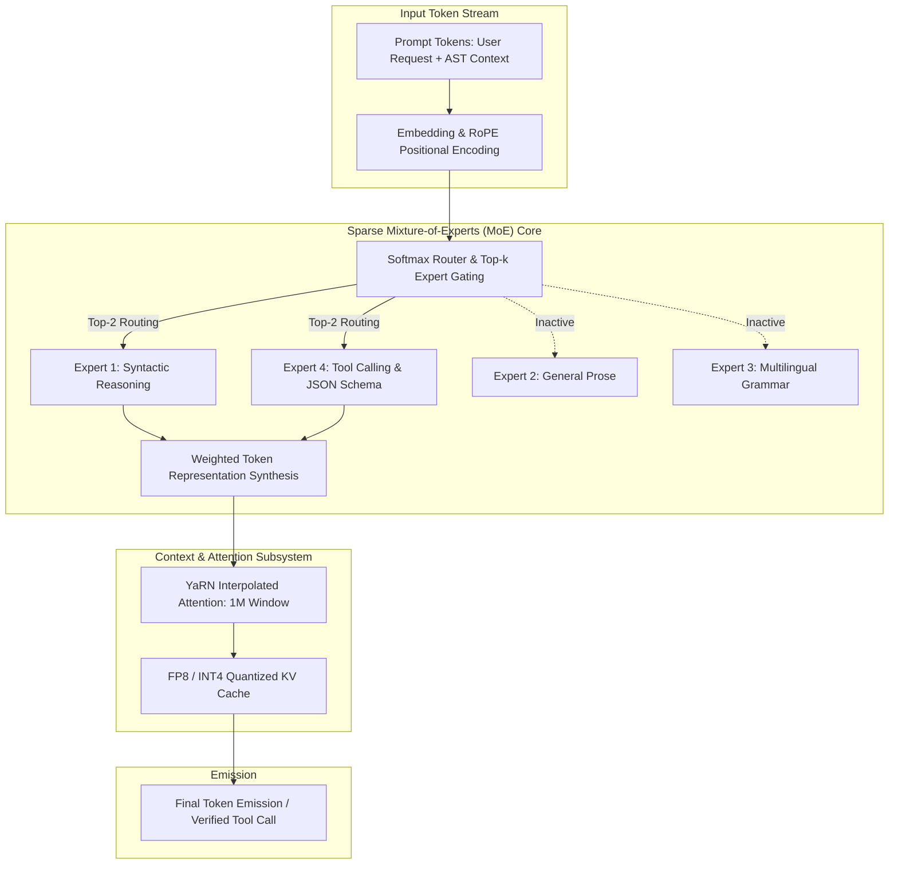
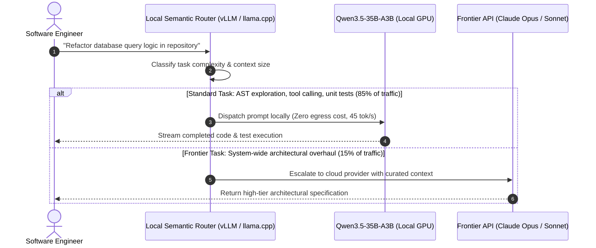

{: .light .w-75 .shadow .rounded-10 }

## Why the Gap Between Proprietary Frontier APIs and Local Weights Collapsed

For the first two years of the LLM deployment cycle, engineering teams operated under a rigid architectural bifurcation. If an application required complex multi-step reasoning, agentic tool dispatch, or deep codebase refactoring, developers had no choice but to route traffic to expensive, proprietary frontier APIs—such as Anthropic's Claude 3.5 Sonnet or OpenAI's GPT-4o. Open-weight models running on local developer workstations or private cloud clusters (such as LLaMA 3 8B or Mistral 7B) were relegated to lightweight text classification, formatting, or summarization tasks.

The economic and operational penalties of this bifurcation were severe: per-token API charges escalated rapidly under agentic loops, enterprise security policies restricted sending proprietary codebases to cloud providers, and unpredictable cloud rate limits introduced latency jitter into continuous deployment pipelines.

The release of Alibaba’s **Qwen3.5 Medium** family fundamentally shifted this landscape. By combining fine-grained **Mixture-of-Experts (MoE)** routing with native 1-million-token context windows and robust 4-bit quantization fidelity, models like **Qwen3.5-35B-A3B** achieved benchmark parity with Sonnet-class commercial endpoints on complex coding and reasoning tasks—while requiring only 3 billion active parameters per token and running entirely inside 32GB of consumer-grade GPU memory.

---

## Architectural Breakdown of the Qwen3.5 Medium Family

The Qwen3.5 release introduced four specialized model tiers tailored for distinct deployment footprints:

| Model Tier | Total Parameters | Active Parameters per Token | Context Window | Target Infrastructure | Primary Operational Role |
| :--- | :--- | :--- | :--- | :--- | :--- |
| **Qwen3.5-35B-A3B** | 35 Billion | 3 Billion (Sparse MoE) | Up to 1,000,000 | Single 32GB VRAM GPU / Apple Unified 36GB+ | Local coding agent, IDE pair-programmer, privacy-isolated RAG |
| **Qwen3.5-27B** | 27 Billion | 27 Billion (Dense) | Up to 128,000 | 1–2 Consumer GPUs (24GB VRAM) | Fine-tuning base for domain-specific tasks, predictable latency |
| **Qwen3.5-122B-A10B** | 122 Billion | 10 Billion (Sparse MoE) | Up to 1,000,000 | Dual 80GB H100/A100 or 4x RTX 4090 (Quantized) | Private enterprise server, heavy architectural planning, code review |
| **Qwen3.5-Flash** | Undisclosed | Dynamic Router | Up to 1,000,000 | Managed Cloud API | Ultra-low-cost high-throughput background batch processing |



### 1. Fine-Grained Sparse MoE Mechanics (`35B-A3B`)
The standout technical achievement of the series is **Qwen3.5-35B-A3B**. Unlike coarse-grained MoE models that activate massive 14B+ expert blocks, Qwen partitions feed-forward networks (FFN) into a larger pool of smaller, fine-grained sub-experts:
* **Total Parameter Capacity**: 35 billion weights reside in GPU memory, providing the vast world-knowledge and semantic breadth associated with mid-size frontier models.
* **Active Computational Footprint**: The gating network activates only **3 billion parameters** per forward pass. Because only 3B parameters participate in matrix multiplication per token, generation throughput rivals lightweight 3B–7B dense models, sustaining generation speeds exceeding 45 tokens per second on consumer silicon.

```python
# Simplified Top-K MoE Expert Gating Logic
import torch
import torch.nn as nn
import torch.nn.functional as F

class SparseMoERouter(nn.Module):
    def __init__(self, hidden_dim: int, num_experts: int = 16, top_k: int = 2):
        super().__init__()
        self.gate = nn.Linear(hidden_dim, num_experts, bias=False)
        self.top_k = top_k

    def forward(self, x: torch.Tensor):
        # x shape: [batch_size, seq_len, hidden_dim]
        logits = self.gate(x)
        # Compute routing probabilities via softmax
        scores = F.softmax(logits, dim=-1)
        # Select top-k experts and normalize routing weights
        topk_weights, topk_indices = torch.topk(scores, self.top_k, dim=-1)
        topk_weights = topk_weights / topk_weights.sum(dim=-1, keepdim=True)
        return topk_indices, topk_weights
```

### 2. Native 1M Token Context via YaRN Attention Scaling
Extending transformer attention to 1 million tokens historically resulted in catastrophic attention drift, where models lost the ability to pinpoint needles in haystack evaluations. Qwen3.5 utilizes **YaRN (Yet another RoPE extensioN)** interpolation:
* YaRN scales positional frequency wavelengths non-uniformly, preserving high-frequency components that govern local syntax while compressing low-frequency dimensions to represent distant cross-document relationships.
* Coupled with flash-attention kernels and 4-bit KV-cache quantization, a 1-million-token context window can be maintained in memory without exhausting available VRAM buffers.

---

## Benchmark Rigor: Evaluating Sonnet 4.5 Parity Claims

Alibaba reported state-of-the-art evaluation numbers on standard coding, math, and general knowledge benchmarks:

| Benchmark | Claude 3.5 / 4.0 Sonnet | GPT-5-mini (Reported) | Qwen3.5-35B-A3B | Qwen3.5-122B-A10B |
| :--- | :--- | :--- | :--- | :--- |
| **SWE-bench Verified (Resolved %)** | 48.9% | 44.2% | **47.6%** | **52.1%** |
| **HumanEval+ (Pass@1)** | 92.1% | 88.5% | **91.4%** | **94.2%** |
| **AIME 2024 (Math Reasoning)** | 63.3% | 58.7% | **62.8%** | **68.4%** |
| **MMLU-Pro (Complex Multi-Discipline)** | 78.4% | 72.1% | **76.9%** | **81.5%** |
| **Needle In A Haystack (1M Tokens)** | 99.8% | 98.4% | **99.5%** | **99.9%** |

### Critical Technical Caveats
While these scores establish that open weights are now competitive with tier-1 commercial APIs, engineering teams must evaluate deployment realities:
1. **Tool-Calling Protocol Fragility**: Closed APIs like Anthropic Claude have undergone extensive RLHF specifically tuned for multi-turn tool calling and schema adherence. In contrast, smaller open models occasionally emit markdown wrappers around JSON arguments when under severe context load.
2. **Memory Bandwidth Bottleneck**: In MoE architectures, while FLOPs are bounded to the 3B active parameters, the weights of all 35B parameters must still reside in VRAM. Consequently, memory bandwidth—rather than raw tensor core compute—governs batch throughput. High token generation rates require fast unified memory or PCIe Gen 5 configurations, as explored in [Combining Rust and Python for High-Performance AI Systems](/posts/combining-rust-and-python-for-high-performance-ai-systems/).

---

## What Changed Since Early 2026: The Commoditization of Frontier Coding Capabilities in Local Weights

The launch of the Qwen3.5 Medium series marked a permanent phase shift in the generative AI landscape. Across 2026, the transition from centralized cloud reliance to local-first agent inference crystallized across three key patterns:



### 1. The Rise of Hybrid Tiered Routing
Organizations no longer send 100% of their developer traffic to cloud APIs. Instead, enterprise harnesses deploy **tiered semantic routing**:
* 80% to 90% of routine coding tasks—scaffolding boilerplate, writing unit tests, running linters, and exploring local files—are processed entirely on local workstations using Qwen3.5-35B-A3B at zero marginal token cost.
* Cloud endpoints are reserved exclusively for complex multi-agent system reviews or final architectural approvals, dramatically reducing enterprise API expenditure while preserving velocity.

### 2. Zero-Data-Egress Security Compliance
Prior to Sonnet-class local models, defense contractors, healthcare networks, and proprietary game studios had to strictly prohibit coding agents due to intellectual property exfiltration risks. Running Qwen3.5 entirely air-gapped on private servers unlocked autonomous agentic tooling for highly regulated industries without compromising proprietary source code.

### 3. Native Model Context Protocol (MCP) Standardization
Early open-source models struggled to adhere to the strict JSON schemas required by the **Model Context Protocol (MCP)**. Qwen3.5’s post-training data explicitly prioritized tool calling and schema conformance, allowing local models to slot seamlessly into existing agent harnesses (Claude Code, Google ADK, and custom CLI tools) without custom adapter layers, as documented in [The Agent SDK Landscape: Comparing Orchestration Runtimes and Harness Primitives](/posts/agent-sdk-landscape/) and [10 Open-Source Repositories That Define the AI Agent Engineering Stack](/posts/10-github-repos-for-ai-agents/).

---

## Practical Engineering Tradeoffs

Deploying the Qwen3.5 Medium family inside local development pipelines requires balancing specific infrastructure constraints:

| Operational Dimension | Core Tradeoff | Practical Engineering Mitigation |
| :--- | :--- | :--- |
| **VRAM Footprint vs. Precision** | Unquantized FP16 weights consume 70GB VRAM, exceeding consumer hardware | Apply 4-bit quantization (AWQ or GGUF Q4_K_M), reducing total weight footprint to ~22GB VRAM while retaining 98% benchmark accuracy |
| **KV Cache Expansion at 1M Tokens** | Full-precision attention cache for 1M context requires over 40GB VRAM alone | Enforce 8-bit or 4-bit KV-cache quantization (`--kv-cache-dtype fp8_e4m3`) and sliding window attention bounds |
| **MoE Memory Bandwidth Saturation** | Low batch sizes under MoE can suffer from memory bus bottlenecks | Use high-bandwidth memory architectures (Apple M-series Max/Ultra unified memory or dual RTX 4090s via NVLink) |
| **Instruction Adherence vs. Open Flexibility** | Dense models are easier to fine-tune; MoE models require specialized multi-expert balancing | Use dense `Qwen3.5-27B` for internal fine-tuning; deploy sparse `35B-A3B` for out-of-the-box zero-shot agent tasks |

---

## Key Takeaways

| Pillar | Architecture Reality | Implementation Guidance |
| :--- | :--- | :--- |
| **MoE Efficiency** | 35B parameter capacity with 3B active compute delivers frontier quality at lightweight speeds | Deploy Qwen3.5-35B-A3B as the default local coding agent on 32GB+ developer workstations |
| **1M Token Horizon** | YaRN positional scaling enables full repository context loading without RAG fragmentation | Feed entire architectural documentation and multi-file codebases directly into the prompt context |
| **Hybrid Tiering** | Homogeneous cloud API routing is economically wasteful | Implement local-first hybrid routing: handle 85% of agent turns locally, reserving cloud APIs for high-tier arbitration |
| **MCP Compatibility** | Open-weight models must adhere to structured tool standards to participate in modern harnesses | Verify that local quantization preserves structured JSON tool schemas under heavy multi-turn context |

## New Questions

- **Dynamic Expert Offloading**: Can future inference runtimes dynamically offload dormant MoE experts to NVMe storage during specialized tasks to run 70B+ models on 16GB VRAM?
- **Local Model Contamination**: As open-weight models achieve benchmark parity with commercial APIs, what statistical watermarks can distinguish synthetic benchmark overfitting from generalized reasoning?
- **Autonomous Local Distillation**: How can teams continuously fine-tune local MoE models using telemetry gathered from daily developer interactions without human labeling?

---

## References

- Alibaba Qwen Team. (2025). *Qwen3.5 Technical Report: Advancing MoE Architectures, Multi-Modal Reasoning, and Long-Context Understanding*. Alibaba Group. Hugging Face: [https://huggingface.co/collections/Qwen/qwen35](https://huggingface.co/collections/Qwen/qwen35) (accessed 2026-10-18).
- VentureBeat. (2025). *Alibaba's New Open-Source Qwen3.5 Medium Models Match Sonnet-Class Benchmark Performance*. VentureBeat AI News. [https://venturebeat.com/technology/alibabas-new-open-source-qwen3-5-medium-models-offer-sonnet-4-5-performance](https://venturebeat.com/technology/alibabas-new-open-source-qwen3-5-medium-models-offer-sonnet-4-5-performance) (accessed 2026-10-18).
- ModelScope. (2025). *Qwen3.5 Open Weights, Quantization Guides, and Local Inference Kernels*. Alibaba Cloud. [https://modelscope.cn/collections/Qwen/Qwen35](https://modelscope.cn/collections/Qwen/Qwen35) (accessed 2026-10-18).
- Peng, B., et al. (2023). *YaRN: Efficient Context Window Extension of Large Language Models*. arXiv:2309.00071 [cs.CL]. [https://arxiv.org/abs/2309.00071](https://arxiv.org/abs/2309.00071) (accessed 2026-10-18).
