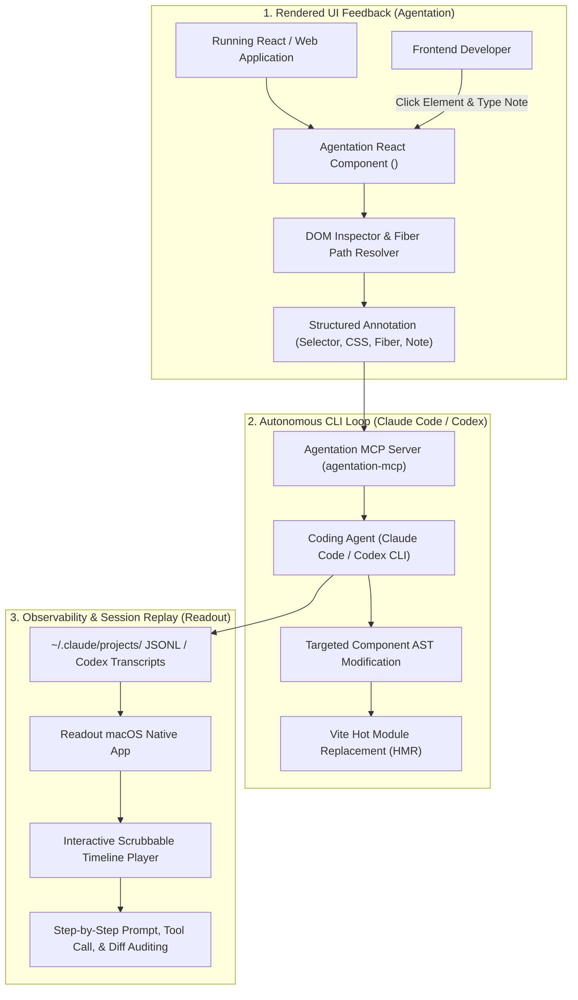
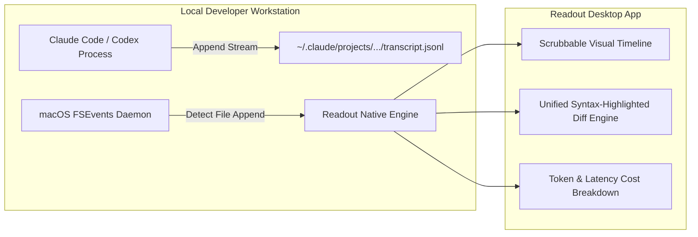

## Why Did Frontend AI Coding Require Exact DOM Anchors and Timeline Replays?

Frontend software development represents one of the most frustrating frontiers for AI coding assistants. While backend logic, database queries, and algorithms map cleanly to textual assertions and deterministic unit tests, user interfaces exist as living, visual, hierarchical document object models (DOMs) rendered across disparate screen viewports.

When developers use command-line agents like Claude Code or OpenAI Codex to modify frontend components, two structural bottlenecks consistently derail productivity:

1. **The Spatial Ambiguity Bottleneck (Input Blindness)**: Describing UI bugs using natural language ("the blue primary button in the user profile navigation bar is overflowing on mobile") is inherently imprecise. Large Language Models often grep through dozens of similar JSX components, CSS modules, or Tailwind utility classes, editing the wrong component or breaking unrelated layout styles.
2. **The Session Opacity Bottleneck (Audit Blindness)**: Once an agent completes an autonomous multi-step turn, developers are left inspecting a massive `git diff` spanning hundreds of lines. Discerning why an agent modified a specific layout hook, whether it attempted and failed three intermediate approaches, or what prompt hallucination caused a regression requires manual log analysis.

Benji Taylor's dual tooling releases—Agentation and Readout—address both sides of this frontend agent divide. By combining interactive rendered-DOM selector extraction with native timeline session replay, they transform frontend agent development from guesswork into a deterministic visual feedback loop.



---

## Agentation Architecture: Precision Grounding for the Rendered DOM

Agentation is an open-source React component library (`agentation`) and companion Model Context Protocol server that converts human visual critique into machine-actionable structured annotations.

### 1. React Fiber Traversal and Unique Selector Synthesis
When a developer clicks an element in an annotated application, Agentation does not simply capture a generic tag name. Instead, it inspects the internal React Fiber tree (`__reactFiber$`) and DOM hierarchy to synthesize an unambiguous location tuple:
- **Exact CSS Selector Path**: A resilient, specificity-optimized CSS path (e.g., `aside#user-sidebar > div.profile-card:nth-child(2) button.action-btn`).
- **React Component Name & File Provenance**: The matching JSX component identifier (e.g., `ProfileCard.tsx:42`) resolved via React development source maps.
- **Computed Bounding Geometry**: The physical rendered coordinates (`x`, `y`, `width`, `height`), device pixel ratio, and active media-query viewport breakpoint.
- **Computed Style Properties**: Active flexbox, grid, font, and color declarations computed directly from `window.getComputedStyle()`.

```json
{
  "annotation_id": "ann_9f82d1c",
  "component_name": "UserProfileHeader",
  "source_file": "src/components/profile/UserProfileHeader.tsx",
  "selector": "header.profile-header > div.avatar-wrapper > button.edit-avatar-btn",
  "viewport": {
    "width": 390,
    "height": 844,
    "breakpoint": "mobile-sm"
  },
  "computed_styles": {
    "display": "flex",
    "overflow": "hidden",
    "background-color": "rgb(37, 99, 235)"
  },
  "feedback_note": "The edit icon collides with the circular border mask on iPhone viewports. Add 4px right margin and shrink icon to 16px."
}
```

```mermaid
sequenceDiagram
    autonumber
    participant Dev as Developer
    participant Browser as React App (<Agentation />)
    participant MCP as Agentation MCP Server
    participant Agent as Claude Code / Codex CLI
    participant FS as Local Source Code

    Dev->>Browser: Click broken avatar button & enter note
    Browser->>Browser: Traverse Fiber AST & extract selector + computed style
    Browser->>MCP: Post structured JSON annotation payload
    Dev->>Agent: Prompt: "Fix pending Agentation annotations"
    Agent->>MCP: call_tool("agentation_get_pending", {})
    MCP-->>Agent: Return structured annotation tuple with source_file & selector
    Agent->>FS: Open exact file (UserProfileHeader.tsx) and patch styles
    Agent->>MCP: call_tool("agentation_resolve", {"annotation_id": "ann_9f82d1c"})
    Browser-->>Dev: Vite HMR updates UI; annotation resolves automatically
```

### 2. Multi-Tier Output Modalities
Agentation supports four distinct output formats depending on developer workflow:
1. **Compact Mode**: High-density string format optimized for terminal copy-pasting with minimal token footprint.
2. **Contextual Mode**: Includes surrounding sibling elements and parent container layout attributes.
3. **Forensic Mode**: Full JSON payload including React props, component state snapshots, and computed CSS rules.
4. **Live MCP Sync**: Autonomous two-way synchronization via `agentation-mcp`. The agent continuously watches for new browser annotations, applies code edits, and marks annotations resolved as hot module reloading (HMR) validates the fix.

---

## Readout Architecture: Native Timeline Replay for Terminal Agents

While Agentation solves input precision, Readout solves output auditability. Packaged as a lightweight, zero-dependency macOS application, Readout acts as a high-fidelity flight recorder for terminal coding agents.

### 1. Zero-Ingress Local Transcript Parsing
Command-line agents like Claude Code and OpenAI Codex store complete conversational trajectories as local JSON Lines (`.jsonl`) files on disk (such as `~/.claude/projects/` or `.codex/sessions/`). Rather than requiring users to sign up for hosted cloud observability platforms or pipe source code over external networks, Readout monitors local file system events (`FSEvents` on macOS) to render session state in real time.



### 2. Interactive Timeline Scrubbing
Readout translates flat execution logs into an interactive video-like scrub bar:
- **Step Navigation**: Jump back and forth through individual agent turns.
- **Tool Call Inspection**: Review exact bash commands executed, file search patterns evaluated, and raw error messages received from linters.
- **Interactive Diff Replay**: Scrubbing through the timeline visualizes how a source file morphed over time, showing failed iterations before the agent arrived at the final solution.
- **Token Analytics**: Real-time breakdowns of input token consumption, output generation, cache hit percentages, and total API cost per feature.

---

## Technical Comparison: The Frontend Agent Feedback Spectrum

Understanding where Agentation and Readout fit within the broader ecosystem clarifies how specialized practitioner tooling outpaces generic chat interfaces.

| Operational Dimension | Pure Chat Assistant (e.g., ChatGPT Web) | Generic DevTools (Chrome DevTools + Grep) | Agentation + Readout Harness |
| :--- | :--- | :--- | :--- |
| **Element Targeting** | Vague natural language descriptions | Manual selector copy-pasting | One-click visual DOM & Fiber extraction |
| **Context Density** | Low (hallucinated component locations) | High (raw manual DOM inspector) | Optimal (focused JSX path + computed style) |
| **Agent Interface** | Manual copy-pasting into chat box | Terminal file editing | Native MCP server (`agentation-mcp`) |
| **Session Auditing** | None (ephemeral browser session) | Git commit history only | Local native timeline scrub & diff replay |
| **Data Privacy** | Cloud API ingress required | Local machine | 100% Local (zero external network egress) |
| **Feedback Latency** | Minutes per manual iteration | Slow manual inspection | Sub-second hot-reload feedback loop |

For engineering teams scaling autonomous developer systems, our technical analyses on [UI-TARS desktop visual agent](/posts/ui-tars-desktop/), [Oh-My-Codex multi-agent orchestration](/posts/oh-my-codex-agents/), and the [Agentic Engineering 9 skills](/posts/agentic-engineering-9-skills/) explore complementary agent interaction patterns.

---

## How Visual Feedback and Agent Observability Evolved Across 2026

Throughout 2026, the interaction between developers and AI coding agents matured from blind textual prompting into rich multi-modal engineering:

1. **Fiber-Aware Component Extraction**: Early visual agents attempted to use computer vision models (VLM screenshots) to guess component locations. In 2026, frameworks moved toward direct AST and framework introspection. Extracting React Fiber, Vue component trees, and Svelte scope IDs directly from the browser runtime provides 100% deterministic code grounding that screenshot models cannot match.
2. **Two-Way MCP Synchronization**: Static prompt copy-pasting was replaced by persistent MCP daemons. When a designer or QA engineer marks a visual bug in a staging environment, an agent running in a background tmux session automatically picks up the ticket, writes the fix, and updates the ticket status without human terminal intervention.
3. **Local-First Native Observability**: Due to intellectual property concerns, enterprises banned cloud-hosted agent tracing services. Lightweight native desktop applications (like Readout) that parse local git worktrees and terminal transcripts became the standard for enterprise agent governance.
4. **Automated Visual Regression Verification**: Before an agent can merge a frontend refactor, visual testing harnesses (such as Playwright and Storybook test runners) automatically take headless browser screenshots, comparing pixel diffs against baseline renders to prevent unintended styling regressions.

---

## Key Takeaways

- **Visual Precision Eliminates Hallucination**: Grounding agent prompts with exact CSS selectors and React component source paths prevents models from editing the wrong files.
- **Session Replay Establishes Developer Trust**: Being able to scrub through an agent's execution timeline and review intermediate tool decisions makes autonomous development transparent and debuggable.
- **Practitioner Tooling Solves Real Friction**: Tools built by active product designers and engineers address acute workflow bottlenecks that generic cloud platform vendors overlook.
- **Local MCP Infrastructure Protects IP**: Integrating tools via local Model Context Protocol servers keeps source code and transcripts entirely on developer workstations.

---

## New Questions

- How can visual DOM annotation tools be extended to support non-web canvas environments (such as Unity WebGL, Flutter, or React Native)?
- Can session replay timelines be parsed by meta-agents to automatically generate synthetic few-shot regression datasets for agent benchmarking?
- What are the performance limits of React Fiber introspection when debugging heavily virtualized canvas applications with tens of thousands of active nodes?

---

## References

- Taylor, B. (2025). *Agentation: The Visual Feedback Layer for Coding Agents*. GitHub Repository. Available at: https://github.com/agentation/agentation (accessed 2026-10-18).
- Taylor, B. (2025). *Readout: Local Session Replay and Observability for Claude Code and Codex*. Application Homepage. Available at: https://readout.ai (accessed 2026-10-18).
- Model Context Protocol Contributors. (2025). *Model Context Protocol Specification*. Anthropic PBC. Available at: https://modelcontextprotocol.io/introduction (accessed 2026-10-18).
- React Core Team. (2024). *React Fiber Architecture and Internal Reconciliation*. Meta Platforms Inc. Available at: https://github.com/acdlite/react-fiber-architecture (accessed 2026-10-18).
