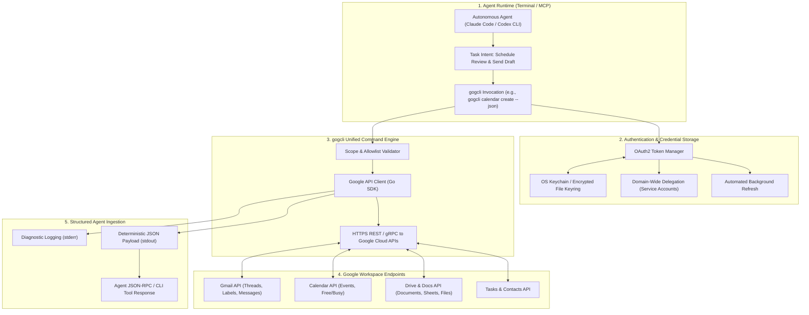
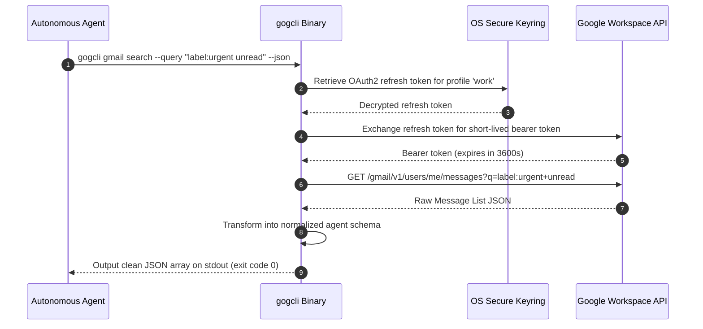

## Why Did Enterprise Agent Workflows Demand JSON-First CLIs Over Brittle Web Scraping?

Autonomous software engineering agents frequently stumble when transitioning from technical codebases to everyday organizational infrastructure. While an agent can comfortably modify source code, trigger unit tests, and interact with git repositories via battle-tested command-line interfaces, enterprise collaboration runs on cloud productivity suites: Google Docs, Gmail, Google Calendar, Sheets, Drive, and Chat.

Historically, connecting AI agents to Google Workspace required one of two flawed approaches:
1. **Brittle Headless Browser Scraping**: Controlling Puppeteer or Playwright browser instances to navigate complex web applications. This approach is slow, consumes gigabytes of memory, and frequently breaks whenever Google deploys dynamic DOM layout changes or anti-bot security challenges.
2. **Heavyweight Bespoke REST Glue Code**: Writing custom OAuth2 client implementations and REST API adapters for each individual Google API endpoint. This creates maintenance overhead and credential sprawl across multiple developer machines.

The open-source `gogcli` tool solves this impedance mismatch by providing a unified, high-performance, JSON-first command-line binary for the entire Google Workspace ecosystem. Written in Go, `gogcli` exposes Gmail, Calendar, Drive, Docs, Sheets, Contacts, Tasks, and Apps Script through a deterministic CLI interface optimized for autonomous agent execution.



---

## Architectural Decomposition: Designed for Agentic DX

Human-facing command-line tools prioritize colorful ASCII tables, animated terminal spinners, and interactive keyboard prompts. For AI agents, however, these human developer experience (DX) patterns are actively harmful: ANSI color escape codes corrupt parser tokens, interactive prompts block non-interactive execution loops, and unstructured tabular text requires fragile regex parsing.

`gogcli` is engineered from the ground up for **Agent Developer Experience (AX)** through four core architectural principles:

### 1. Deterministic JSON-First Output Mode
Every command in `gogcli` supports the `--json` flag. When active, all data payloads are emitted to `stdout` as standardized, schema-compliant JSON objects, while diagnostic logs and progress indicators are routed exclusively to `stderr`:

```bash
# Agent-Friendly Calendar Free/Busy Lookup
gogcli calendar freebusy \
  --time-min "2026-03-04T09:00:00Z" \
  --time-max "2026-03-04T17:00:00Z" \
  --calendars "eng-leads@company.com" \
  --json
```

```json
{
  "status": "success",
  "time_range": {
    "start": "2026-03-04T09:00:00Z",
    "end": "2026-03-04T17:00:00Z"
  },
  "calendars": {
    "eng-leads@company.com": {
      "busy": [
        {
          "start": "2026-03-04T10:00:00Z",
          "end": "2026-03-04T11:00:00Z"
        },
        {
          "start": "2026-03-04T14:30:00Z",
          "end": "2026-03-04T15:30:00Z"
        }
      ]
    }
  }
}
```

### 2. Multi-Account Profile Management & Secure Keyring Storage
Autonomous agents operating in production environments frequently navigate multiple identity contexts (e.g., personal developer account vs. CI/CD service account vs. customer support persona). `gogcli` manages multiple credential profiles stored within the operating system keychain (macOS Keychain, Linux Secret Service, or encrypted file keyrings). Tokens are refreshed automatically without prompting the user for re-authentication.

### 3. Readonly Scoping and Command Allowlisting
To prevent runaway agents from accidentally deleting email archives or overwriting shared company drives, `gogcli` implements granular privilege boundaries:
- **Scope Sandboxing**: Allows provisioning tokens restricted strictly to readonly scopes (e.g., `https://www.googleapis.com/auth/gmail.readonly`).
- **Command Allowlisting**: Environment variable gates (`GOGCLI_ALLOWLIST="calendar:*,gmail:read,drive:search"`) reject mutating commands at the binary entrypoint before API calls are dispatched.



---

## Workspace Capabilities Across the Google Ecosystem

`gogcli` consolidates twelve discrete Google Workspace API surfaces into a coherent command hierarchy:

| Service Domain | Core Capabilities | Agent Automation Use Case |
| :--- | :--- | :--- |
| **Gmail** | Thread search, draft creation, sending, label management, vacation responder settings | Automated inbox triage, customer support responses, meeting follow-ups |
| **Calendar** | Event CRUD, attendee invitation, free/busy querying, focus-time allocation | Multi-attendee meeting scheduling, incident war-room creation |
| **Google Drive** | File upload/download, folder search, permission sharing, trash management | Staging report archiving, asset distribution, build log backup |
| **Google Docs** | Structural document reading, Markdown conversion, section appending | Automated Architecture Decision Record (ADR) authoring, meeting notes |
| **Google Sheets** | Cell updates, formula injection, CSV export/import, formatting | Financial modeling, benchmark data aggregation, sprint velocity tracking |
| **Google Tasks** | List creation, task completion, due date scheduling | Multi-step task tracking synchronized with Jira or GitHub issues |
| **Apps Script** | Remote project deployment, function execution, script log monitoring | Custom enterprise workflow triggers and legacy ERP integration |

---

## Architectural Comparison: gogcli vs Alternate Integration Patterns

Evaluating `gogcli` alongside alternative integration patterns illustrates why dedicated CLI binaries are optimal for autonomous coding agents.

| Architectural Dimension | gogcli (JSON-First CLI) | Headless Browser (Puppeteer/Playwright) | Direct Python/Node SDK Integration |
| :--- | :--- | :--- | :--- |
| **Execution Overhead** | Ultra-lightweight compiled Go binary (<20ms start) | Heavy browser process (>500MB RAM, >2s start) | Medium (Python/Node runtime startup overhead) |
| **Interface Resilience** | High (backed by stable REST/gRPC API contracts) | Fragile (breaks on CSS/DOM layout updates) | High (direct SDK calls) |
| **Agent Portability** | Zero-dependency binary; callable from any shell | Requires Chromium binaries and display drivers | Requires language runtime & dependency virtualenv |
| **Credential Safety** | OS Keychain isolation & read-only allowlists | Session cookies exposed in browser memory | Credentials often stored in plaintext `.env` files |
| **Token Efficiency** | Compact normalized JSON schemas | Massive HTML DOM dumps consuming context | Dependent on custom parsing glue code |
| **MCP Adaptability** | Trivial (single shell wrapper MCP tool) | Complex DOM evaluation protocol | Requires dedicated MCP server implementation |

For organizations architecting local memory and multi-agent coordination, our complementary analyses on [Rowboat local-first AI coworker](/posts/rowboat-local-first-coworker/), [developer knowledge API via MCP](/posts/developer-knowledge-api-mcp/), and [Oh-My-Codex multi-agent orchestration](/posts/oh-my-codex-agents/) demonstrate how standardized CLI tools fit into larger agent pipelines.

---

## How Enterprise Workspace Tooling Evolved Across 2026

Throughout 2026, the interaction between corporate collaboration suites and AI agents transformed from manual chatbot plugins into autonomous background infrastructure:

1. **Agent-Native CLI Standardizations**: Developers abandoned complex webhooks in favor of self-contained CLI binaries. Tools like `gogcli` for Google Workspace, `gh` for GitHub, and `slackcli` for Slack established the "Unix philosophy for AI agents"—small, focused executables that accept text arguments and emit structured JSON.
2. **Short-Lived Ephemeral Scopes via Domain Delegation**: Rather than granting agents permanent admin tokens, enterprise identity providers (IdPs) issue fine-grained, short-lived tokens valid only for the duration of a specific task ticket.
3. **Markdown as the Universal Document Exchange Format**: Tools like `gogcli` integrated bidirectional document converters. Agents compose and edit Google Docs directly using GitHub Flavored Markdown, while internal compilers preserve Google Docs formatting, comments, and change tracking.
4. **Audit-Logged Agent Operations**: Enterprise compliance policies mandate immutable audit logs for all agent-initiated workspace actions. Every email sent or calendar event rescheduled by `gogcli` attaches a cryptographic signature linking back to the verified agent session ID and human approval token.

---

## Key Takeaways

- **CLI-First Beats Browser Scraping**: Interacting with enterprise productivity suites via compiled CLI binaries provides speed, stability, and security that browser automation cannot match.
- **Agent DX Demands Deterministic JSON**: Tools designed for AI agents must emit clean JSON to `stdout` and route diagnostic logs to `stderr` to prevent parsing failures.
- **Keychain Security Prevents Token Leaks**: Storing long-lived OAuth tokens inside OS keyrings rather than plaintext files protects enterprise credentials from accidental exposure.
- **Allowlisting Enforces Principle of Least Privilege**: Constraining agents with read-only scopes and command allowlists guarantees that autonomous loops cannot cause irreversible data loss.

---

## New Questions

- How can conflicting calendar edits be resolved automatically when two autonomous agents attempt to schedule overlapping executive meetings simultaneously?
- Can real-time Google Docs collaboration protocols (operational transformation / CRDTs) be exposed cleanly through a command-line streaming interface?
- What governance frameworks are necessary to monitor automated email correspondence generated by agents across thousands of corporate inboxes?

---

## References

- gogcli Contributors. (2025). *gogcli: Google Workspace CLI for Power Users and Autonomous Agents*. GitHub Repository. Available at: https://github.com/akillness/gogcli (accessed 2026-10-18).
- Google Cloud. (2024). *Google Workspace APIs Overview and Architecture*. Google Developers. Available at: https://developers.google.com/workspace (accessed 2026-10-18).
- Hardt, D. (2012). *The OAuth 2.0 Authorization Framework*. RFC 6749, Internet Engineering Task Force. Available at: https://datatracker.ietf.org/doc/html/rfc6749 (accessed 2026-10-18).
- Raymond, E. S. (2003). *The Art of Unix Programming*. Addison-Wesley. Available at: http://www.catb.org/~esr/writings/taoup/html/ (accessed 2026-10-18).
