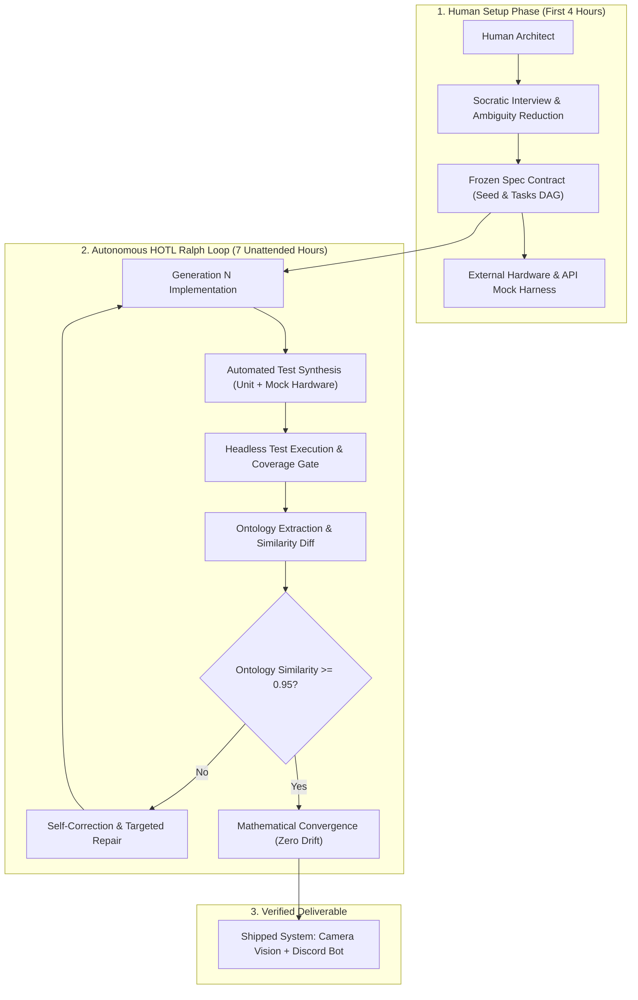
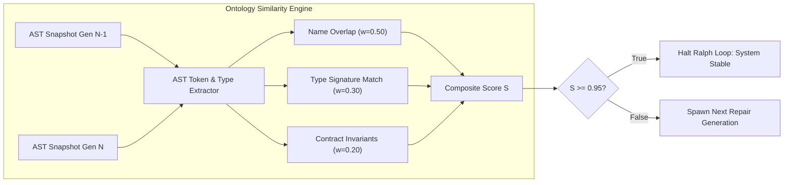
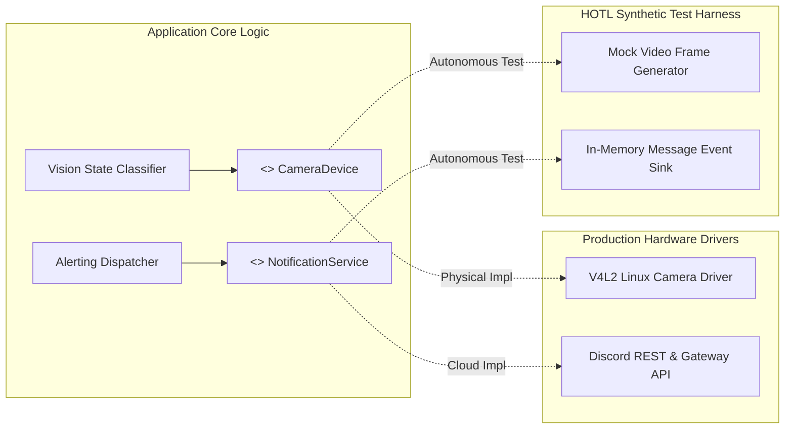

## How Did Human-Outside-the-Loop Execution Achieve Convergence Across Seventy Thousand Tests?

The prevailing dogma in artificial intelligence coding has long centered on Human-in-the-Loop (HITL) workflows. In HITL models, human developers serve as micro-evaluators: typing prompts, scanning output diffs, running local build commands, and correcting compilation failures every few minutes. While this human steering prevents immediate drift, it caps agent productivity at human cognitive and typing throughput. Developers become the primary bottleneck in software delivery.

The alternative frontier is Human-Outside-the-Loop (HOTL)—an operational state where human developers define an initial immutable specification, establish automated verification bounds, and step away completely while autonomous agent loops iterate, test, and self-heal overnight.

At the 2026 Ralphthon hackathon, the Ouroboros harness was deployed under strict competition rules: teams were permitted four hours of initial human-led specification and harness setup, after which all manual keyboard input was prohibited for a seven-hour overnight execution window. Over this unattended run, the Ouroboros agent loop generated over 100,000 lines of production code, synthesized 70,000 lines of comprehensive unit and hardware-mock test suites, and achieved successful convergence on a multi-service IoT camera and Discord bot architecture without human intervention.

---

## The Mathematical Foundation of Ontology Convergence

A catastrophic failure mode of open-ended autonomous agent loops is infinite oscillatory churn: an agent modifies variable names in iteration $N$, reverts them in iteration $N+1$, and continually re-architects modules without making forward progress.

Ouroboros eliminates oscillatory drift by tracking structural ontology similarity across successive code generations ($G_n$ and $G_{n-1}$).

### 1. Structural Ontology Vectorization
Rather than comparing raw string diffs, the Ouroboros evaluator parses the Abstract Syntax Tree (AST) of the repository into an ontology graph comprising:
- **Symbol Names ($S_{\text{names}}$)**: Exported interfaces, function identifiers, and data models.
- **Type Signatures ($S_{\text{types}}$)**: Argument types, return types, and schema boundaries.
- **Contract Invariants ($S_{\text{exact}}$)**: Executable assertions, schema validators, and public API endpoints.

The global ontology similarity metric between generation $n-1$ and generation $n$ is formalized as:

$$\mathcal{S}(G_{n-1}, G_n) = w_1 \cdot \text{Jaccard}(S_{\text{names}}^{(n-1)}, S_{\text{names}}^{(n)}) + w_2 \cdot \text{MatchRatio}(S_{\text{types}}^{(n-1)}, S_{\text{types}}^{(n)}) + w_3 \cdot \text{ExactMatch}(S_{\text{exact}}^{(n-1)}, S_{\text{exact}}^{(n)})$$

In production calibrations, Ouroboros weights these components as:

$$\mathcal{S} = 0.50 \cdot \text{Sim}_{\text{name}} + 0.30 \cdot \text{Sim}_{\text{type}} + 0.20 \cdot \text{Sim}_{\text{exact}}$$

### 2. Pathological Loop Detection and Circuit Breakers
To prevent token waste and API credit exhaustion, the convergence engine monitors four distinct failure signatures:

1. **Stagnation Trap**: $\Delta \mathcal{S} = 0$ across three consecutive generations with failing test suites. Triggers an automatic rollback to the last passing seed commit.
2. **Oscillation Trap**: Generation $G_n$ is topologically identical to generation $G_{n-2}$. Triggers prompt temperature elevation and introduces a mutation barrier.
3. **Repetitive Query Loop**: More than $70\%$ of internal diagnostic questions asked by subagents repeat prior questions. Triggers context memory eviction.
4. **Wonder Loop**: An agent ponders ambiguous design decisions without taking action. Triggers an automated Socratic collapse, forcing the agent into the simplest possible implementation.

$$\text{Termination Rule} = \begin{cases} 
\text{SUCCESS}, & \mathcal{S} \ge 0.95 \land \text{TestsPass} = \text{True} \\
\text{ROLLBACK}, & \text{Stagnation} \lor \text{Oscillation} \\
\text{ABORT}, & \text{Generations} > G_{\max} \lor \text{TokenBudget} \le 0
\end{cases}$$

---

## Isolating External Dependencies: Hardware and Cloud Mock Harnesses

The application developed during the Ralphthon required integrating physical hardware (an overhead kitchen camera capturing live frames) with an external cloud service (a Discord bot broadcasting real-time cleaning alerts).

In an unattended HOTL environment, real hardware and live third-party network APIs present extreme operational hazards: rate limits, network blips, physical camera disconnections, and spamming production Discord channels during debugging loops.

Ouroboros resolved this by enforcing strict dependency inversion during the initial four-hour setup:

By abstracting external systems behind strict interfaces, the autonomous loop generated over 70,000 lines of robust test suites validating:
- **Presence Filtering**: Rejecting camera measurements whenever human silhouettes were identified in frame.
- **Edge Failure Recovery**: Simulating dropped camera frames and network timeouts, verifying that the dispatcher queue implements exponential backoff.
- **Payload Verification**: Asserting that notification webhooks correctly formatted timestamps and Markdown tables without leaking test credentials.

---

## The Socratic Ambiguity Reduction Pipeline

Before entering the autonomous loop, Ouroboros utilizes a formal Socratic interview stage to reduce ambiguity in the human specification. Ambiguity is quantified as:

$$\mathcal{A} = 1.0 - \sum_{i=1}^{M} c_i \cdot w_i$$

Where $c_i \in [0, 1]$ represents the clarity metric across $M$ architectural categories (data models, failure recovery, security scopes, performance budgets) and $w_i$ represents category significance weights.

The system repeatedly questions the human architect until:

$$\mathcal{A} \le 0.10$$

Once this threshold is satisfied, the specification is frozen into an immutable seed file (`spec.json`). During the subsequent seven unattended hours, agents are strictly forbidden from modifying the seed, ensuring that self-healing loops solve technical implementation puzzles without drifting away from original user intent.

---

## Comparative Analysis: HITL vs Autonomous HOTL Harnesses

| Operational Dimension | Human-in-the-Loop (HITL) | Naive Auto-Agent Loop | Ouroboros HOTL Architecture |
| :--- | :--- | :--- | :--- |
| **Human Engagement** | Continuous prompt/review cycle | Disconnected (uncontrolled) | Front-loaded 4h spec setup $\to$ Hands off |
| **Convergence Guarantee** | Dependent on human fatigue | None (frequently drifts/loops) | Mathematical ontology similarity ($\mathcal{S} \ge 0.95$) |
| **Test Generation Ratio** | Low (tests authored as afterthought) | Sparse (basic unit checks) | 70% of total LOC in verified test suites |
| **External Dependency Safety** | Live manual API testing | High risk of rate-limiting/spam | Strict interface inversion & mock harnesses |
| **Drift Mitigation** | Real-time human visual check | None (codebase mutates wildly) | Frozen seed specification & AST diff checks |
| **Execution Scale** | 10–50 file edits per session | Uncontrolled file churn | 100k+ verified LOC produced overnight |

For teams evaluating agent autonomy, our related architectural source audits on the [Agentic Engineering 9 skills](/posts/agentic-engineering-9-skills/), [Oh-My-Codex multi-agent orchestration](/posts/oh-my-codex-agents/), and [RLM Forge evidence-gated recursion](/posts/rlm-forge-evidence-gated-recursion/) detail complementary harness designs.

---

## How Autonomous HOTL Architectures Evolved Across 2026

Throughout 2026, the artificial intelligence industry experienced a paradigm shift from conversational copilot chats to autonomous headless factory loops:

1. **Formalized Specification Freezing**: Rather than allowing agents to dynamically adjust requirements on the fly, production pipelines enforce cryptographic freezing of specifications. Code generation is treated as a deterministic constraint-satisfaction problem where tests define the solution space.
2. **AST-Level Convergence Evaluators**: Early autonomous loops relied on LLMs to self-evaluate whether they were finished, resulting in premature completion claims. 2026 harnesses rely exclusively on deterministic AST parsers and mathematical similarity formulas to verify structural stability.
3. **Synthetic Environment Emulation**: High-performing agent harnesses automatically synthesize mocked physical and cloud environments. Agents generate simulated time series, frame buffers, and mock network endpoints, allowing complete end-to-end testing without hitting production resources.
4. **Shift from Developer to Systems Architect**: Software developers no longer write line-by-line syntax; their role has elevated to designing the constraints, interfaces, and verification harnesses that govern autonomous agent factories.

---

## Key Takeaways

- **HOTL is Production-Viable**: Given a formally frozen specification and a robust verification harness, agents can operate unattended for hours while maintaining architectural convergence.
- **Ontology Similarity Governs Stability**: Tracking the structural AST similarity between generations guarantees convergence and detects oscillatory failure traps before token waste occurs.
- **Harness Engineering Outweighs Prompting**: Front-loading four hours of rigorous interface mocking and ambiguity reduction produces orders of magnitude more impact than tweaking conversational prompts.
- **Tests Are the True Agent Boundary**: Generating extensive test suites (representing the majority of total codebase volume) provides the closed-loop feedback signal required for unattended self-correction.

---

## New Questions

- What mathematical limits bound the complexity of systems that can converge autonomously before state explosion overwhelms local AST parsers?
- How can formal methods (such as TLA+ or Alloy specifications) be compiled directly into Ouroboros seed contracts to prove concurrency safety in HOTL loops?
- What are the carbon footprint and token economic trade-offs of generating 70,000 lines of disposable synthetic tests during overnight convergence runs?

---

## References

- Ralphthon Consortium. (2026). *Ralphthon 2026: The Global Autonomous Agent Benchmark and Hackathon*. Technical Proceedings. Available at: https://ralphthon.dev/proceedings (accessed 2026-10-18).
- Ouroboros Core Team. (2026). *Ouroboros: Autonomous Specification-First Agent Harness with Mathematical Convergence*. GitHub Repository. Available at: https://github.com/akillness/ouroboros (accessed 2026-10-18).
- Jaccard, P. (1912). *The Distribution of the Flora in the Alpine Zone*. New Phytologist, 11(2), 37-50. Available at: https://doi.org/10.1111/j.1469-8137.1912.tb05611.x (accessed 2026-10-18).
- Gamma, E., Helm, R., Johnson, R., & Vlissides, J. (1994). *Design Patterns: Elements of Reusable Object-Oriented Software*. Addison-Wesley. Available at: https://www.oreilly.com/library/view/design-patterns-elements/0201633612/ (accessed 2026-10-18).
