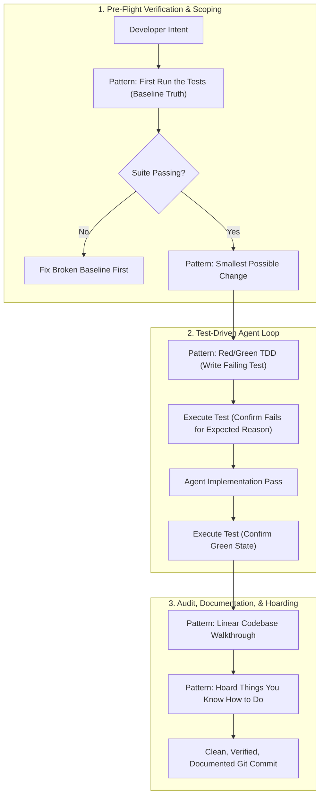
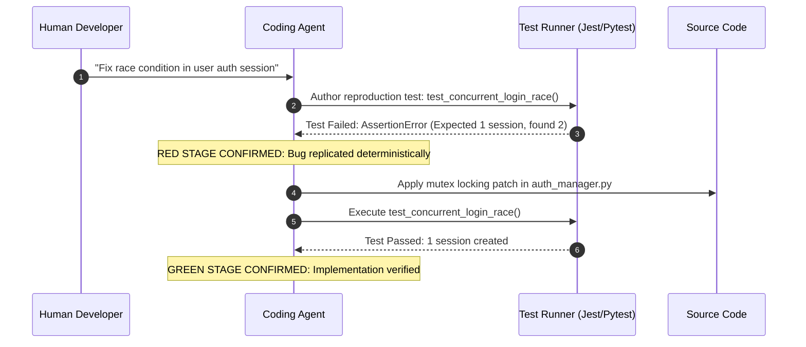

## Why Does Cheap Code Generation Demand Stricter Operational Engineering Patterns?

The economic reality of software authoring has permanently shifted: generating raw source code is now virtually free. Frontier models produce complex boilerplate, algorithmic routines, and API endpoints in fractions of a second. However, this collapse in production cost has created a profound secondary crisis: the cost of reading, reviewing, verifying, and debugging synthetic code has skyrocketed.

When software teams adopt coding agents like Claude Code, OpenAI Codex, or GitHub Copilot without strict operational boundaries, codebases rapidly experience architectural decay. Agents introduce subtle regressions across distant modules, overwrite undocumented edge cases, and author plausible-looking code that passes human visual inspection while failing critical integration requirements.

Simon Willison’s catalog of *Agentic Engineering Patterns* addresses this operational breakdown. Rather than treating AI coding as a casual conversational chat, Willison formulates a collection of disciplined behavioral patterns that constrain, verify, and document autonomous code generation. By combining strict Test-Driven Development (TDD), linear codebase walkthroughs, small-step diff minimization, and institutional prompt hoarding, these patterns transform generative AI from a liability into a high-leverage production factory.



---

## Core Operational Patterns in Willison's Playbook

Simon Willison organizes agentic practices into four operational categories: foundational axioms, testing disciplines, comprehension techniques, and anti-patterns.

### 1. The Pre-Flight Axiom: "First, Run the Tests"
The cardinal rule of agentic engineering is establishing baseline truth before any code is modified. LLMs frequently misdiagnose existing test failures as novel errors caused by their own recent edits, leading them down hours of unnecessary rabbit holes.

Before asking an agent to touch a feature or fix a bug:
1. Instruct the agent to run the entire existing test suite.
2. Require the agent to record the baseline state (e.g., `42 passed, 0 failed`).
3. If an existing test fails, halt the feature task immediately until the baseline suite is restored.

```bash
# Pre-Flight Baseline Script Executed by Agent
npm test -- --bail
if [ $? -ne 0 ]; then
  echo "CRITICAL: Baseline test failure detected. Halting agent modifications."
  exit 1
fi
```

### 2. Red/Green Test-Driven Development (TDD)
Language models excel at authoring comprehensive test suites when decoupled from implementation details. The Red/Green TDD pattern enforces strict two-stage execution:

- **The Red Stage**: The agent is directed to author a new test case specifying the desired behavior or reproducing an existing bug. Crucially, the agent must run the test and prove that it fails with the expected assertion error. An agent that generates a test that passes immediately has either written a vacuous assertion or misunderstood the requirement.
- **The Green Stage**: The agent is granted permission to modify application source files. The model is constrained to make the minimal possible diff required to transition the test from red to green without modifying the test file itself.



### 3. Linear Code Walkthroughs for Human Oversight
Reviewing multi-file AI pull requests is exhausting because models scatter modifications across non-contiguous blocks. The *Linear Walkthrough* pattern requires the agent to generate an accompanying narrative walkthrough explaining its edits in execution order:

1. **Why this seam was chosen**: Explaining why a specific class or hook was touched rather than alternative injection points.
2. **Step-by-step control flow**: Tracing how a request traverses the modified code path from entrypoint to output.
3. **Rejected alternatives**: Documenting intermediate approaches that were evaluated and abandoned during the session.

This artifact transforms code review from a line-by-line guessing game into a high-level architectural evaluation.

### 4. "Hoard Things You Know How to Do" (The Prompt Registry)
Prompt engineering is not disposable conversation; it is reusable institutional software. When a developer crafts an execution prompt that reliably solves a complex migration (such as converting Django views to async FastAPI routes, or generating OpenAPI schemas from raw SQL models), that prompt must be cataloged in version control:

```markdown
<!-- .prompts/library/migrate-sync-endpoint-to-async.md -->
---
title: "FastAPI Sync to Async Endpoint Migration"
triggers: ["migrate-async", "api-refactor"]
inputs: ["target_file.py"]
---

You are an expert Python systems engineer. Your task is to convert the synchronous 
FastAPI endpoint in the specified file to native async/await syntax.

Strict Rules:
1. Run `pytest tests/test_endpoints.py` to establish baseline truth.
2. Replace all blocking database queries with `await session.execute(...)`.
3. Wrap legacy blocking I/O calls in `anyio.to_thread.run_sync(...)`.
4. Ensure all unit tests pass before reporting completion.
```

By maintaining a shared `.prompts/` registry inside the repository, teams compound their organizational capability, allowing junior engineers to execute senior-level migrations deterministically.

---

## Critical Anti-Patterns to Eliminate

Willison identifies several common anti-patterns that consistently derail agent-assisted engineering:

| Anti-Pattern | Operational Manifestation | Remediation Strategy |
| :--- | :--- | :--- |
| **The "Kitchen Sink" Prompt** | Asking an agent to refactor architecture, write tests, and optimize performance simultaneously in a single prompt. | Decompose into distinct, sequential git commits with explicit verification stops. |
| **Blind Permutation Loop** | An agent hits a compiler error and begins guessing random syntax changes without diagnosing the root cause. | Force the agent to explain the compiler error in plain English before generating any file diff. |
| **Over-Abstracted Scaffolding** | An agent invents unnecessary factory classes, generic interfaces, and adapter layers for a simple 10-line helper. | Enforce YAGNI ("You Aren't Gonna Need It") constraints and set hard limits on added cyclomatic complexity. |
| **Eyeball Verification** | A developer skims an agent's code diff, assumes it looks correct, and merges without running executable tests. | Disallow merges unless automated CI suites pass and test coverage thresholds are met. |

---

## Comparative Matrix: Ad-Hoc Agent Usage vs Willison's Patterns

| Practice Dimension | Ad-Hoc AI Usage | Simon Willison Pattern Playbook |
| :--- | :--- | :--- |
| **Pre-Flight Routine** | Jump directly into prompting | Mandate clean baseline test pass before editing |
| **Testing Strategy** | Post-hoc test generation or none | Strict Red/Green TDD (confirm failure first) |
| **Diff Granularity** | Large multi-file sprawling edits | Smallest possible change to turn tests green |
| **Comprehension Layer** | Developer skims raw unified diff | Agent produces ordered linear walkthrough |
| **Knowledge Capture** | Prompts discarded in closed tabs | Structured prompt hoarding in repo registry |
| **Failure Response** | Developer types "try again" | Root-cause diagnosis before code modification |

For engineering organizations establishing agent development standards, our related architectural source audits on the [Agentic Engineering 9 skills](/posts/agentic-engineering-9-skills/), [Oh-My-Codex multi-agent orchestration](/posts/oh-my-codex-agents/), and the [Ouroboros autonomous HOTL harness](/posts/ouroboros-ralphthon-hotl/) provide complementary operational frameworks.

---

## How Agentic Development Patterns Evolved Across 2026

Throughout 2026, the software engineering industry transitioned from treating AI models as magical assistants to integrating them as predictable, constraint-bound compilers:

1. **Automated TDD Enforcement in Agent CLI Runtimes**: Agent harnesses (such as Claude Code and Codex plugins) began programmatically enforcing the Red/Green loop. The harness intercepts tool calls, verifies that a test was executed and failed before allowing modifications to application source files, and rejects commits if test suites were omitted.
2. **Version-Controlled Prompt Infrastructure**: Prompts graduated to first-class software artifacts. Frameworks treat prompt files like functions, versioning them in git, running regression benchmarks against prompt modifications, and managing prompt rollbacks through standard CI/CD pipelines.
3. **Automated PR Walkthrough Generation**: Pull request templates require an agent-generated architectural walkthrough. Before human review begins, the agent annotates its own PR with interactive explanations, diagrams, and call graphs illustrating the exact impact of its changes.
4. **Shift from Code Authoring to Specification Rigor**: Because agents handle low-level syntax effortlessly, senior engineers spend the majority of their time refining API contracts, identifying subtle domain edge cases, and writing robust fuzzing suites to constrain autonomous generation.

---

## Key Takeaways

- **Cheap Code Demands Strict Discipline**: When code generation is free, verification, review, and architectural guardrails become the primary engineering bottlenecks.
- **Always Run Tests First**: Establishing baseline truth before modifying a single line of code prevents agents from chasing non-existent bugs or blaming their own edits for pre-existing errors.
- **Red/Green TDD Guarantees Relevance**: Proving that a test fails before authoring implementation code guarantees that the test actually evaluates the intended behavior.
- **Hoard Successful Prompts**: Reusable prompts that reliably execute complex refactors are durable organizational intellectual property that must be versioned in git.
- **Linear Walkthroughs Protect Maintainability**: Requiring agents to document their reasoning and control flow in linear order keeps human engineers in command of repository architecture.

---

## New Questions

- How can prompt registries be automatically evaluated and updated when upstream frontier models release major weight updates?
- Can automated linters detect prompt "slop"—overly verbose abstractions generated by LLMs—before code reaches human pull request review?
- What metrics accurately quantify developer comprehension and long-term code maintainability in repositories heavily authored by autonomous agents?

---

## References

- Willison, S. (2025). *Agentic Engineering Patterns: Practical Techniques for Coding with LLMs*. Simon Willison’s Weblog. Available at: https://simonwillison.net/ (accessed 2026-10-18).
- Beck, K. (2002). *Test-Driven Development: By Example*. Addison-Wesley Professional. Available at: https://www.oreilly.com/library/view/test-driven-development/0321146530/ (accessed 2026-10-18).
- Fowler, M. (2018). *Refactoring: Improving the Design of Existing Code* (2nd ed.). Addison-Wesley Professional. Available at: https://martinfowler.com/books/refactoring.html (accessed 2026-10-18).
- Anthropic. (2024). *Building Effective AI Agents: Architectural Patterns and Best Practices*. Anthropic Research Blog. Available at: https://www.anthropic.com/research/building-effective-agents (accessed 2026-10-18).
