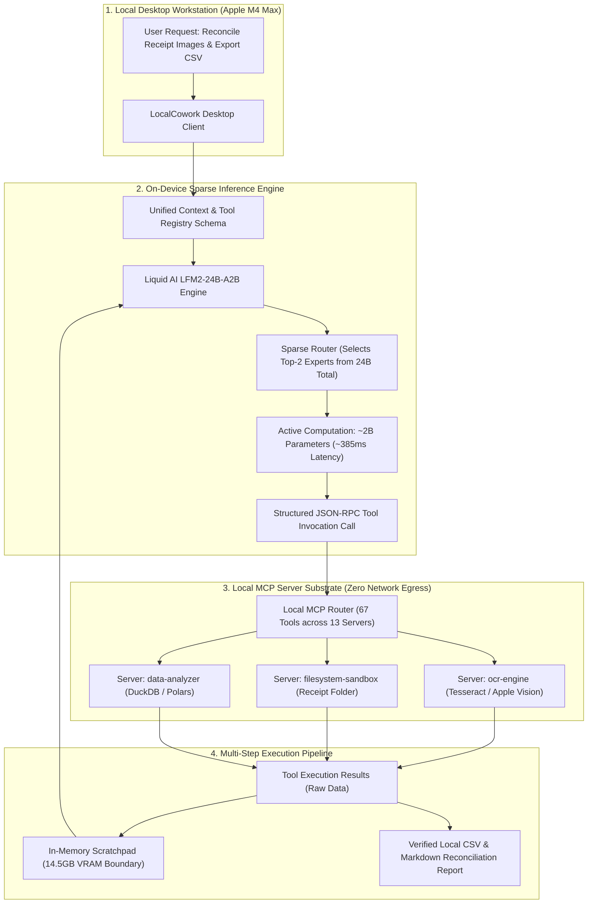
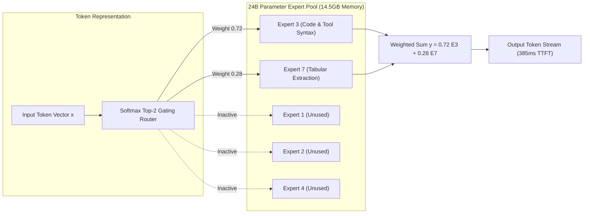
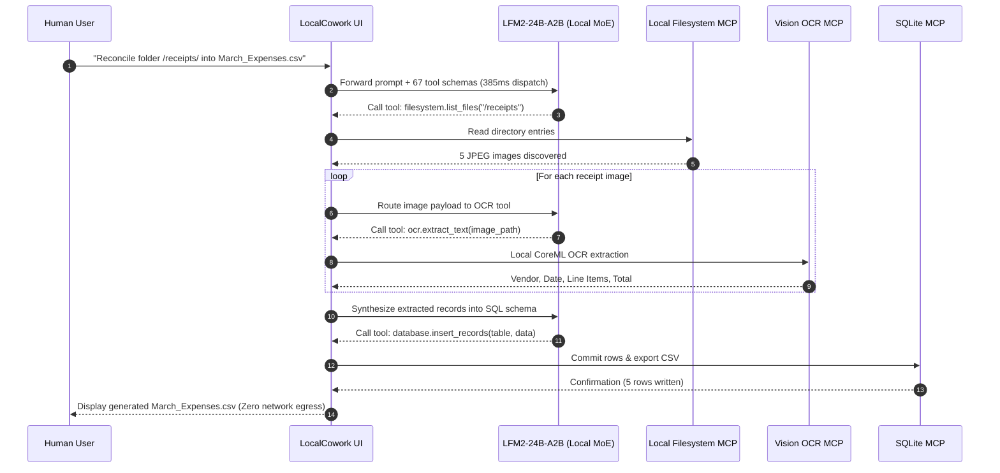

## Why Did On-Device AI Agents Require Sparse Mixture-of-Experts Over Dense Transformers?

Local, client-side AI agents represent the holy grail of software productivity: zero data egress, total intellectual property protection, zero per-token cloud inference costs, and air-gapped operational resilience. However, early attempts to run autonomous agent loops entirely on consumer hardware (such as Apple Silicon MacBooks or Qualcomm Snapdragon workstations) encountered a fatal latency-accuracy trade-off.

Standard dense foundation models sized between 27B and 32B parameters (such as Gemma 3 27B or Qwen 2.5 32B) achieve high tool-calling precision, but require between 15 and 28 seconds per inference step on local unified memory architectures. An autonomous multi-step workflow spanning ten tool invocations forces a developer to wait over four minutes. Conversely, compact 3B to 7B dense models generate answers in hundreds of milliseconds, but their reasoning capacity collapses when faced with large Model Context Protocol (MCP) tool catalogs, resulting in hallucinated arguments and incorrect tool selection.

LocalCowork resolves this architectural deadlock by pairing an on-device desktop harness with Liquid AI's LFM2-24B-A2B foundation model. Utilizing a sparse Mixture-of-Experts (MoE) architecture with approximately 2 billion active parameters per token, LocalCowork achieves an average tool-selection latency of 385 milliseconds across 67 registered MCP tools while consuming just 14.5 gigabytes of unified memory.

---

## Deconstructing the LFM2-24B-A2B Mixture-of-Experts Engine

The core technical differentiator of LocalCowork is the deployment of Liquid AI's LFM2-24B-A2B model. While traditional dense architectures activate all parameter weights for every token generated, sparse MoE models route input tokens to a small subset of specialized expert networks.

### 1. Sparse Gating and Parameter Sparsity
For an input token representation $x \in \mathbb{R}^d$, the routing gate computes soft routing probabilities across $E$ expert networks using a learnable gating parameter matrix $W_g$:

$$H(x) = x \cdot W_g$$
$$G(x) = \text{Softmax}(\text{TopK}(H(x), k))$$

In LFM2-24B-A2B:
- **Total Parameter Count**: $P_{\text{total}} \approx 24 \times 10^9$ parameters.
- **Top-K Routing ($k$)**: $k = 2$ active experts chosen per token.
- **Active Parameter Count ($P_{\text{active}}$)**: $\approx 2.1 \times 10^9$ parameters.

The forward output is the weighted linear combination of the selected expert feed-forward networks ($\text{FFN}_i$):

$$y = \sum_{i \in \text{TopK}} G(x)_i \cdot \text{FFN}_i(x)$$

Because memory bandwidth during the autoregressive decode phase is dominated by reading active parameter weights, activating only 2B parameters reduces memory streaming requirements by more than $90\%$ compared to a dense 24B model, allowing memory buses to deliver generation speeds exceeding 60 tokens per second on consumer hardware.

---

## The 67-Tool Benchmark: Evaluating On-Device Dispatch Fidelity

To evaluate whether a compact MoE model could navigate realistic workplace complexity, the LocalCowork benchmark deployed 67 distinct tools distributed across 13 local Model Context Protocol (MCP) servers:

- **Filesystem & Documents**: PDF extraction, Markdown read/write, file discovery, directory tree indexing.
- **Computer Vision & OCR**: Screen capture, bounding box calculation, OCR text parsing, receipt line-item extraction.
- **Data Engineering**: In-memory SQLite queries, DuckDB aggregations, Polars dataframe transformation, CSV generation.
- **Personal Productivity**: Local calendar event lookups, address book querying, task queue mutation, clipboard synchronization.

### Empirical Latency and Fidelity Comparison

| Model Architecture | Parameter Profile (Active / Total) | Tool Selection Accuracy | Single-Step Latency | Multi-Step End-to-End Task Success |
| :--- | :--- | :--- | :--- | :--- |
| **LFM2-24B-A2B** | **2B / 24B (Sparse MoE)** | **80.4%** | **385 ms** | **26.0%** |
| Mistral-Small-24B | 24B / 24B (Dense) | 85.2% | 1,239 ms | 66.0% |
| Gemma 3 27B | 27B / 27B (Dense) | 91.0% | 24,088 ms | 48.0% |
| Qwen 2.5 32B | 32B / 32B (Dense) | 70.1% | 28,385 ms | 18.0% |

The empirical findings highlight a fundamental trade-off: while dense 24B models (such as Mistral-Small) demonstrate superior multi-step reasoning depth, their three-fold higher latency alters the subjective user experience. For single-turn interactive commands (e.g., "summarize this receipt and add an entry to my expense tracker"), LFM2's 385ms response time feels instantaneous to human operators.

---

## Architectural Comparison: LocalCowork vs Cloud Agent Platforms

| System Dimension | LocalCowork (On-Device MoE) | Cloud Coding Agent (Claude Code / Codex) | Generic Local Ollama Agent |
| :--- | :--- | :--- | :--- |
| **Data Privacy & Egress** | 100% On-Device (Zero internet egress) | Full network egress to provider cloud | 100% On-Device (Zero egress) |
| **Tool Calling Latency** | ~385 ms (Sub-second interactive) | ~1,200 ms - 2,500 ms (Network bound) | ~15,000 ms - 30,000 ms (Dense local model) |
| **Memory Footprint** | 14.5 GB unified RAM | Near-zero local memory (cloud executed) | 20 GB - 32 GB unified RAM |
| **Multi-Step Reasoning** | Moderate (26% full pipeline success) | High (70%+ full pipeline success) | Low to Moderate (15% - 40%) |
| **Operational Cost** | $0.00 marginal inference cost | Recurring API token billing | $0.00 marginal inference cost |
| **Hardware Requirement** | Apple M-Series (16GB+ RAM) / RTX 4080 | Any terminal connected to internet | High-end GPU / 64GB RAM |

For developers designing agent architectures across the spectrum of compute constraints, our complementary evaluations on [building Llama 4 from scratch mixture of experts](/posts/building-llama-4-from-scratch-mixture-of-experts/), [PrismML 1-bit Bonsai on-device AI](/posts/prismml-1-bit-bonsai-on-device-ai/), and [MCP toolbox for databases](/posts/mcp-toolbox-databases/) provide deeper technical benchmarks.

---

## How On-Device Agent Runtimes Evolved Across 2026

Throughout 2026, client-side artificial intelligence engineering made unprecedented strides toward fully autonomous edge execution:

1. **Hardware-Accelerated Sparse MoE Execution**: Apple Silicon (Metal Performance Shaders) and Qualcomm Hexagon NPUs introduced native hardware support for dynamic sparse expert routing. Rather than loading entire 24B weight matrices into active cache, memory controllers dynamically prefetch only the active Top-2 expert weights per layer.
2. **Dynamic Tool Pruning via Semantic Filtering**: Handing an on-device model 100+ raw tool definitions exhausts local context caches. Modern harnesses implement semantic pre-filters: a lightweight 100M parameter embedding model embeds the user prompt and selects the top-10 most relevant MCP tools, feeding only a compact tool subset to the primary generator.
3. **Speculative Decoding on Unified Memory**: Combining tiny 1B draft models with 24B MoE target models enables local token generation rates to surpass 100 tokens per second on consumer laptops, making on-device agents feel as responsive as compiled native applications.
4. **Zero-Trust Enterprise Air-Gaps**: Regulated industries (healthcare, defense, finance) adopted on-device agent harnesses as the default developer desktop environment, enforcing kernel-level firewall rules that physically block all outbound sockets during agent execution sessions.

---

## Key Takeaways

- **Sparse MoE Unlocks Local Speed**: Activating 2B parameters out of a 24B model slashes memory bandwidth bottlenecks, reducing tool selection latency to 385ms on consumer hardware.
- **Latency Is an Ergonomic Feature**: Sub-second tool dispatch transforms the agent loop from an asynchronous background wait into an instantaneous interactive desktop utility.
- **Zero Egress Solves Enterprise Adoption**: Running models and tools entirely within local memory eliminates compliance hurdles and protects sensitive proprietary data.
- **Reasoning Trade-offs Remain**: While compact MoE models excel at single-step tool selection, complex multi-step pipelines still require supervision or hybridization with larger models.

---

## New Questions

- How can dynamic expert routing be specialized during fine-tuning so that dedicated experts exclusively handle specific MCP protocol schemas?
- What are the minimum quantization limits (e.g., 2-bit or 1.58-bit ternary weights) for expert networks before tool argument formatting degrades?
- Can cross-process memory sharing (e.g., POSIX shared memory) allow multiple concurrent local agents to share a single in-memory MoE model instance without duplicating VRAM?

---

## References

- Liquid AI Research Team. (2026). *LFM2-24B-A2B: Efficient Sparse Mixture-of-Experts for Edge Intelligence and Tool Calling*. Technical Whitepaper. Available at: https://www.liquid.ai/blog (accessed 2026-10-18).
- Model Context Protocol Contributors. (2025). *Model Context Protocol Specification*. Anthropic PBC. Available at: https://modelcontextprotocol.io/introduction (accessed 2026-10-18).
- Shazeer, N., Mirhoseini, A., Maziarz, K., Davis, A., Le, Q., Hinton, G., & Dean, J. (2017). *Outrageously Large Neural Networks: The Sparsely-Gated Mixture-of-Experts Layer*. International Conference on Learning Representations (ICLR 2017). Available at: https://arxiv.org/abs/1701.06538 (accessed 2026-10-18).
- Gerganov, G., & llama.cpp Contributors. (2024). *llama.cpp: Port of Facebook's LLaMA model in C/C++*. Available at: https://github.com/ggerganov/llama.cpp (accessed 2026-10-18).
