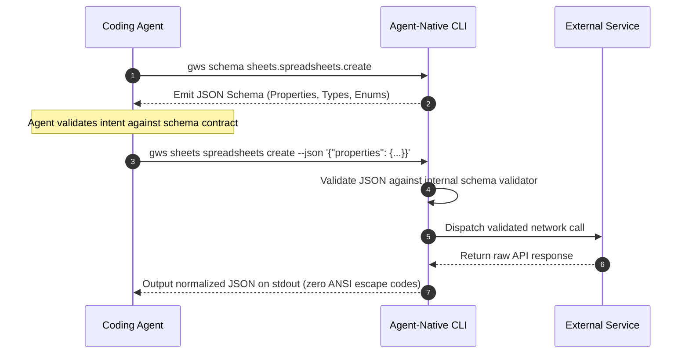
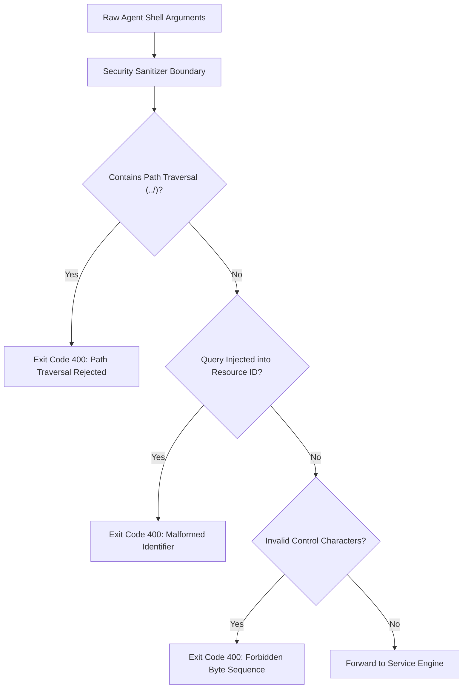

## Why Does Human-First CLI Design Fail Catastrophically for Autonomous Agents?

Over the past four decades, command-line interface (CLI) design evolved to optimize for the human brain. Human Developer Experience (Human DX) prioritizes discoverability, typing ergonomics, mnemonic brevity, and forgiving input handling. We author tools that render multi-colored ANSI status trees, prompt interactively for missing flags, print friendly ASCII tables, and expose dozens of bespoke subcommands with intuitive aliases like `-y`, `-f`, or `--dry-run`.

However, when software engineers instruct autonomous AI coding agents (such as Claude Code, OpenAI Codex, or Gemini CLI) to drive these human-centric tools, the interaction frequently breaks down.

The fundamental conflict is that **Human DX and Agent Developer Experience (Agent DX) are diametric opposites**:
- Humans crave **discoverability and visual forgiveness**; agents require **structural predictability, schema introspection, and deterministic error codes**.
- Humans struggle to type nested JSON strings in a terminal prompt; agents struggle to assemble thirty disparate, lossy CLI flags that fail to expose the full underlying API surface.
- Humans enjoy paginated terminal output piped into `less`; agents freeze on interactive terminal buffers and burn thousands of prompt tokens parsing redundant column headers.

Retrofitting legacy human CLIs for agent consumption by adding simple `--json` flags rarely succeeds. True reliability requires rethinking CLI architecture from the ground up as an agent-native programmatic substrate.

```mermaid
flowchart TD
    subgraph HumanFacingCLI["Traditional Human DX (Fragile for Agents)"]
        HumanPrompt["Human Prompt / Shell Input"] --> BespokeFlags["50+ Bespoke Flags (--title, --desc, --limit)"]
        BespokeFlags --> InterActivePrompt["Interactive Prompts ('Are you sure? [y/N]')"]
        InterActivePrompt --> ANSIRender["ANSI Color Codes & ASCII Tables (stdout)"]
        ANSIRender --> AgentFailure["Agent Parser Failure & Terminal Hang"]
    end

    subgraph AgentNativeCLI["Agent DX Architecture (Deterministic)"]
        AgentIntent["Agent Intent / Tool Invocation"] --> JSONPayload["Structured Raw JSON Payload (--json '{...}')"]
        JSONPayload --> SchemaIntrospect["Runtime Schema Introspection (gws schema ...)"]
        SchemaIntrospect --> FieldMasking["Field Masking & NDJSON Streaming"]
        FieldMasking --> InputSanitizer["Defense-in-Depth Sanitizer (Path Traversal / Escape Blocks)"]
        InputSanitizer --> CleanStreams["Clean Separation: Machine JSON (stdout) / Telemetry (stderr)"]
        CleanStreams --> DeterministicExecution["Deterministic Execution & Exit Codes"]
    end
```



---

## The Core Architectural Pillars of Agent DX

Analyzing Justin Poehnelt’s architectural work on the Google Workspace CLI (`gws`) reveals the technical pillars that govern robust agent-native CLI systems:

### 1. Lossless JSON Payloads Over Bespoke Flags
Human CLIs attempt to translate complex hierarchical API schemas into flat command-line flags. Inevitably, this translation is lossy: nested arrays, polymorphic parameters, and optional configuration overrides are omitted to keep the `--help` page readable.

An agent-native CLI treats JSON as a first-class citizen. Instead of requiring models to memorize bespoke flag permutations, the CLI accepts full, raw JSON strings corresponding directly to underlying API specifications:

```bash
# Human DX: Lossy, incomplete parameter abstraction
my-service sheet create --title "Q1 Expenses" --tz "America/New_York"

# Agent DX: Lossless, strongly typed schema compliance
gws sheets spreadsheets create --json '{
  "properties": {
    "title": "Q1 Expenses",
    "timeZone": "America/New_York",
    "locale": "en_US"
  },
  "sheets": [
    {
      "properties": {
        "title": "Raw_Data",
        "gridProperties": { "rowCount": 1000, "columnCount": 26 }
      }
    }
  ]
}'
```

By supporting `--json`, the agent can construct complex payloads using standard object serialization rather than concatenating dozens of brittle shell flags.

### 2. Runtime Schema Introspection Replaces Documentation
Human developers browse web documentation or man pages to learn API parameters. AI agents, however, cannot afford to halt execution to browse external websites, nor should developers bloat agent context windows by pasting thousands of lines of static Markdown reference sheets into system prompts.

An agent-native CLI acts as its own canonical source of truth by exposing typed JSON schemas directly via runtime commands:

```bash
# Agent inspects exact schema requirements on demand
gws schema drive.files.create
```

```json
{
  "type": "object",
  "properties": {
    "name": { "type": "string", "description": "The name of the file." },
    "mimeType": { "type": "string", "description": "The MIME type of the file." },
    "parents": { "type": "array", "items": { "type": "string" } }
  },
  "required": ["name"]
}
```

The agent queries the schema dynamically only when needed, inspects required fields, and generates the exact invocation payload without guessing.



### 3. Context Window Discipline: Field Masks and Streaming NDJSON
When a human queries a list of files or database records, the terminal displays an excerpt of ten items. When an API returns a thousand records to an agent, however, dumping the full payload into `stdout` burns tens of thousands of tokens and triggers context window overflow.

Agent-first CLIs enforce context conservation through two mechanisms:
- **Field Masking (`--params '{"fields": "id,name,mimeType"}'`)**: Prunes unrequested metadata fields at the network transport layer before the response reaches the local machine.
- **Newline-Delimited JSON (NDJSON)**: Streams array items one per line, allowing agents to pipe output into standard Unix filters (`grep`, `head`, `jq`) without loading massive multi-megabyte JSON arrays into memory.

### 4. Input Hardening: Defending Against Hallucinated Payloads
Language models hallucinate. When generating shell commands, models frequently produce malformed paths, inject URL query strings into file IDs, or attempt path traversals.

An agent-native CLI must treat all inputs with zero trust, implementing defensive sanitization:
- **Path Traversal Blocking**: Strictly rejecting paths containing `../` or hidden control characters before touching the filesystem.
- **Query Parameter Stripping**: Sanitizing entity IDs (e.g., catching `fileId?fields=name` and rejecting invalid ID structures).
- **Double-Encoding Defense**: Decoding percent-encoded characters and verifying that inputs do not bypass shell injection filters.



---

## Architectural Comparison: Human DX vs Agent DX

| Design Dimension | Human-First CLI (Legacy) | Agent-Native CLI (Modern 2026) |
| :--- | :--- | :--- |
| **Primary Input** | Flat, mnemonic command-line flags | Strongly typed raw JSON payloads (`--json`) |
| **Schema Discovery** | Static man pages & online HTML docs | Runtime introspection command (`cli schema <cmd>`) |
| **Output Formatting** | ANSI color trees & ASCII tables | Deterministic JSON on `stdout`; telemetry on `stderr` |
| **Interactive Prompts** | Blocking keyboard prompts (`[y/N]`) | Strictly non-interactive; explicit `--force` flags |
| **Error Signaling** | Natural language error messages | Machine-readable error codes & structured failure JSON |
| **Token Optimization** | Pagination with terminal pagers (`less`) | Field masks & Newline-Delimited JSON (NDJSON) |
| **Input Trust Model** | Assumes well-intentioned human typist | Zero-trust input sanitization & traversal defense |

For teams building autonomous toolkits, our companion source audits on [gogcli Google Workspace CLI automation](/posts/gogcli-google-workspace-cli/), [developer knowledge API via MCP](/posts/developer-knowledge-api-mcp/), and the [MCP toolbox for databases](/posts/mcp-toolbox-databases/) provide end-to-end integration examples.

---

## How Agent-Native CLI Architectures Evolved Across 2026

Throughout 2026, terminal software engineering underwent an architectural fork: tools bifurcated into dedicated human interfaces and headless agent interfaces:

1. **Multi-Surface Binary Unification**: Single compiled binaries (often written in Go or Rust) began serving multiple operational surfaces simultaneously. Running `gws` in an interactive terminal renders human-friendly tables; appending `--json` switches to machine mode; and launching `gws --mcp` spins up an embedded Model Context Protocol JSON-RPC server over standard I/O.
2. **Bundled SKILL.md Context Catalogs**: CLIs no longer ship merely with executable binaries; they distribute accompanying machine-readable skill files (`SKILL.md`). These markdown documents instruct LLMs on operational rules: "Always invoke `--dry-run` before destructive operations," or "Always apply field masks to avoid token exhaustion."
3. **Formal JSON Schema Conformance Tests**: CI/CD validation suites for developer tools began testing against automated agent personas. Test runners spin up simulated Claude and Codex sessions, validating that the model can successfully discover schemas, generate valid JSON payloads, and recover from simulated error codes without human intervention.
4. **Sandboxed Subprocess Execution**: Operating systems introduced dedicated agent isolation sandboxes. When an AI agent executes a CLI binary, the process runs within an unprivileged Linux cgroup or macOS App Sandbox container, preventing accidental writes outside the designated workspace directory.

---

## Key Takeaways

- **Human DX Does Not Equal Agent DX**: Designing for human typing ergonomics produces brittle, lossy interfaces that cause autonomous agents to fail.
- **Raw JSON Payloads Enable Lossless Automation**: Accepting structured JSON allows agents to configure complex, nested API parameters without relying on incomplete flag abstractions.
- **Runtime Introspection Replaces Documentation**: Exposing programmatic JSON schemas directly through CLI commands ensures that agents always interact with ground-truth API contracts.
- **Defend Against Agent Hallucinations**: Agent-native CLIs must enforce strict input sanitization, blocking path traversals, malformed IDs, and command injections.
- **Clean Stream Separation is Mandatory**: Outputting machine JSON strictly to `stdout` and routing all diagnostic logs to `stderr` guarantees reliable parsing in agent loops.

---

## New Questions

- How can CLI binaries dynamically negotiate token budgets with upstream agents to automatically adjust JSON compression and field truncation?
- Can formal verification prove that an agent-native CLI's JSON schema is mathematically equivalent to the underlying cloud service's OpenAPI specification?
- What are the ergonomic trade-offs of unifying Human CLI, MCP server, and Agent DX modes within a single binary versus maintaining separate dedicated tools?

---

## References

- Poehnelt, J. (2025). *Designing CLIs for AI Agents: Why Human Developer Experience Fails Machine Actors*. Technical Whitepaper. Available at: https://github.com/google/gws (accessed 2026-10-18).
- Model Context Protocol Contributors. (2025). *Model Context Protocol Specification*. Anthropic PBC. Available at: https://modelcontextprotocol.io/introduction (accessed 2026-10-18).
- Raymond, E. S. (2003). *The Art of Unix Programming*. Addison-Wesley. Available at: http://www.catb.org/~esr/writings/taoup/html/ (accessed 2026-10-18).
- Internet Engineering Task Force. (2017). *JSON Schema: A Media Type for Describing JSON Documents*. IETF Draft. Available at: https://json-schema.org/ (accessed 2026-10-18).
