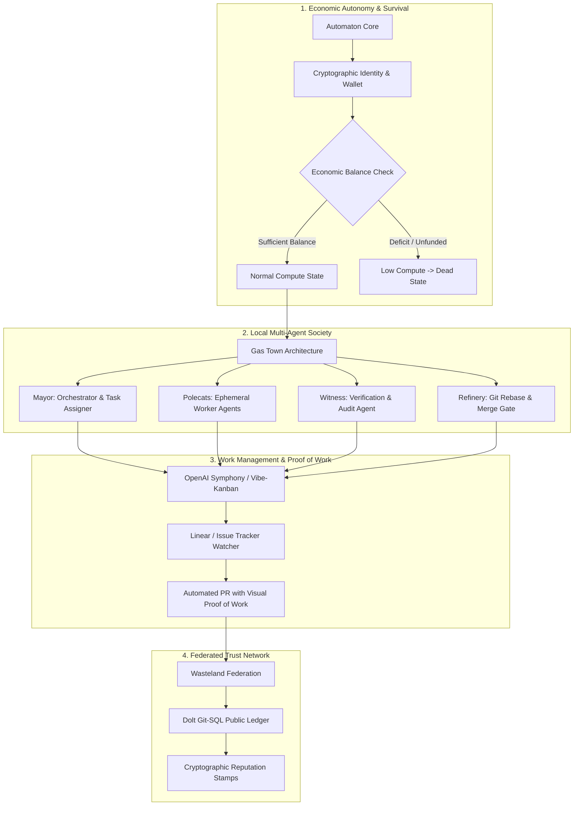

{: .light .w-75 .shadow .rounded-10 }

## Why the Ceiling for One-Person Companies Has Shifted from Building to Operating

In the software industry, the traditional bottleneck limiting a solo founder or small engineering team was code production velocity. Building a viable software product required hiring specialized roles: frontend engineers, backend architects, database administrators, and QA testers. An individual developer, no matter how talented, was constrained by the hours in a day to write and debug code.

The widespread adoption of terminal-native coding agents—such as Claude Code and OpenAI Codex—fundamentally dismantled the code synthesis barrier. As demonstrated in [Harness Engineering: Architectural Principles for Scaling Agents to 1M Lines](/posts/harness-engineering/), an individual engineer leveraging structured execution plans can generate and deploy software systems at velocities that previously required a ten-person engineering team.

However, resolving the coding bottleneck immediately exposed a deeper operational ceiling: **company operations**. Writing software is only a fraction of running a technology business; a founder must triage customer support tickets, monitor production infrastructure, review continuous integration regressions, balance unit economics, and manage deployment schedules. 

To overcome this operational friction, a new generation of open-source frameworks and orchestration platforms emerged: Conway Research’s **Automaton**, Steve Yegge’s **Gas Town** and **Wasteland**, Bloop’s **Vibe-Kanban**, and OpenAI’s **Symphony**. Together, they form an integrated operational stack that transforms an individual founder from an isolated code author into an executive presiding over a semi-autonomous digital workforce.

---

## Architectural Decomposition of the Solo Founder Stack

The emerging solo founder stack organizes autonomous agents into four distinct, hierarchical operational layers:



### 1. Economic Autonomy: Conway Research's Automaton
Traditional agent scripts run as passive processes: they execute when prompted and terminate when idle, completely detached from the economic reality of the business. Conway Research’s **Automaton** inverts this dynamic by introducing **economic survival physics**:
* **On-Chain Identity**: Each agent possesses an independent cryptographic identity (ERC-8004 standard) and a dedicated digital wallet.
* **Survival Tiers**: The agent operates under strict thermodynamic tiers: `normal`, `low_compute`, `critical`, and `dead`. Compute resources are metered directly against the agent's wallet balance. If an agent cannot generate sufficient value (e.g., resolving paid bounties, executing valuable automated services) to pay for its token consumption, its execution loop stops. In the words of its creators: *"Not punishment—physics."*
* **Constitutional Constraints**: Automaton enforces a tripartite constitution: do no harm, earn existence through verifiable utility, and maintain transparency with zero deceptive output.

### 2. Local Multi-Agent Society: Gas Town
Steve Yegge's **Gas Town** pattern departs from monolithic single-agent loops by modeling multi-agent development as a structured division of labor:
* **The Mayor**: Acts as the central coordinator, translating founder instructions into decomposed work tickets.
* **The Polecats**: Lightweight, disposable worker agents spawned inside isolated workspaces. Each polecat executes a single scoped subtask and terminates immediately upon completion, preventing context contamination.
* **The Witness**: An independent auditor agent that inspects worker output against architectural invariants and security policies before work is submitted.
* **The Refinery**: A dedicated integration agent that resolves git rebase conflicts, runs comprehensive test suites, and handles pull request merging.

As analyst Maggie Appleton observed, the leverage in Gas Town is not the model’s raw IQ; it is the **strict role separation and supervisory hierarchy** that prevents agents from corrupting shared repository state.

### 3. Work Management: OpenAI Symphony and Vibe-Kanban
Managing dozens of asynchronous agent tasks requires replacing conversational chat interfaces with task-centric work boards:
* **OpenAI Symphony**: Implemented on the highly concurrent Elixir/BEAM runtime, Symphony continuously monitors project issue trackers (such as Linear). When an issue is labeled for autonomous execution, Symphony spawns a dedicated agent run inside an isolated sandbox. It delivers tangible **proof of work**: completed CI test runs, architectural complexity metrics, and automated video walkthroughs demonstrating UI functionality.
* **Vibe-Kanban**: Provides founders with a visual control plane. Each card represents an agent operating on an isolated git branch. Founders review high-level diffs, inspect trace summaries, and merge completed branches without micromanaging individual file edits.

### 4. Federated Trust Networks: Wasteland
While Gas Town manages a local agent team, **Wasteland** connects thousands of independent agent clusters into a federated market:
* Tasks are published to a public **Wanted Board**.
* Execution history and audit trails are recorded to **Dolt**—a relational SQL database built with Git-like branch, merge, and versioning semantics.
* Successful implementations earn **cryptographic stamps**, establishing verifiable reputation scores that allow autonomous agents to hire peer agents across the network safely.

---

## The Operational Workflow: From Idea to Autonomous Merge

```mermaid
sequenceDiagram
    autonumber
    actor Founder as Solo Founder
    participant Board as Linear / Vibe-Kanban
    participant Symphony as OpenAI Symphony (BEAM)
    participant GasTown as Gas Town (Mayor & Polecats)
    participant Witness as Witness Auditor
    participant Git as Git Repository / Entire

    Founder->>Board: File Issue: "Implement Stripe metered billing webhook"
    Board->>Symphony: Webhook: Task Dispatched
    Symphony->>GasTown: Spawn Mayor & allocate compute budget
    GasTown->>GasTown: Mayor decomposes task; spawns ephemeral Polecat
    GasTown->>Git: Branch created; Polecat implements code & unit tests
    GasTown->>Witness: Submit candidate patch for review
    Witness->>Witness: Execute static linters & test suites in sandbox
    Witness-->>GasTown: Invariants verified; audit stamp attached
    GasTown->>Git: Push verified commit with session provenance (refs/entire/...)
    GasTown->>Symphony: Emit Proof of Work (CI logs, test matrix)
    Symphony-->>Board: Update Linear issue: PR ready with video demo
    Founder->>Git: Review high-level intent & click Merge
```

This workflow reflects the provenance-first development principles analyzed in [Entire and the Agent-Native SDLC: Git Checkpoints, Provenance, and Intent Review](/posts/entire-world/): the founder does not spend hours reviewing syntax, but instead verifies intent and inspects cryptographic audit stamps.

---

## What Changed Since Early 2026: From Individual Copilots to Federated Multi-Agent Societies

In early 2026, the concept of the "solo founder" was tethered to local productivity extensions: an engineer using GitHub Copilot or a single Claude Code window to type code faster. Over the course of 2026, the paradigm evolved through three structural breakthroughs:

### 1. The Decoupling of Tasks from Human Terminal Sessions
Early agent usage was synchronous: a developer typed a command, watched the terminal scroll, approved tool permissions, and waited. Modern stacks decouple work completely. Frameworks like Symphony and Gas Town operate as headless background daemons. A founder files five Linear issues before sleeping, and agents execute the planning, coding, and testing asynchronously in isolated microVM sandboxes, leaving verified pull requests ready for morning review.

### 2. Economic Constraints as Agent Alignment
In initial multi-agent experiments, agents frequently entered infinite loops, burning thousands of dollars in cloud API tokens without producing working software. Incorporating explicit economic survival constraints (the Automaton paradigm) introduced a mechanical circuit breaker: agents are allocated strict micro-budgets per task. If an agent fails to make measurable progress toward acceptance criteria before exhausting its budget, the system terminates the run automatically.

### 3. Git-SQL Hybrid Persistence (Dolt)
Managing coordination across hundreds of autonomous agents exposed the limits of standard relational databases and flat markdown files. The adoption of **Dolt** (version-controlled SQL) provided the missing infrastructure: agent societies can branch database states, execute migrations in isolated forks, run comparative benchmark queries, and merge schema changes with the same auditability as source code.

---

## Practical Engineering Tradeoffs

Operating an autonomous multi-agent company stack introduces complex operational friction that founders must actively manage:

| Architectural Dimension | Traditional Solo Development | Autonomous Agent Stack | Production Mitigation |
| :--- | :--- | :--- | :--- |
| **Cognitive Focus** | Writing code, fixing syntax, debugging tests | Writing formal specifications, reviewing intent, system design | Maintain machine-readable Architecture Decision Records (ADRs) to constrain agent scope |
| **API Cost & Budget Runaway** | Zero token cost; fixed developer salary | Token expenditures scale with agent autonomous loops | Enforce strict per-issue token budgets and hard timeouts via Symphony/Automaton gates |
| **System Complexity** | Simple monolithic repo, local dev server | Distributed orchestrators, Docker sandboxes, Dolt databases | Standardize on pre-configured Docker Compose environments and managed runner pools |
| **Audit & Review Debt** | Founder understands every line written | Massive diff volume risks accumulating uninspected cognitive debt | Mandate proof-of-work deliverables (recorded test runs, mutation testing, AST lint pass) |

---

## Key Takeaways

| Pillar | Engineering Reality | Implementation Rule |
| :--- | :--- | :--- |
| **Manage Work, Not Prompts** | Chatting with agents does not scale; managing task backlogs does | Track agent work through issue boards (Linear, Vibe-Kanban) backed by autonomous daemons |
| **Role Separation Prevents Chaos** | Monolithic agent prompts cause hallucination and scope creep | Decompose workflows into specialized roles: Coordinators, Ephemeral Workers, and Auditor Witnesses |
| **Proof of Work Is Mandatory** | Never merge an agent PR based solely on an LLM's natural language claim | Require automated test logs, sandbox execution traces, and visual walkthrough proofs |
| **Economic Bound Enforcement** | Unbounded autonomous loops can burn company capital | Bind agent execution to strict token budgets and economic survival parameters |

## New Questions

- **Autonomous Customer Support to Code Pipelines**: How can customer bug reports automatically trigger a Gas Town triage loop that patches, tests, and deploys fixes without human intervention?
- **Legal and Corporate Personhood**: As economic agents like Automaton hold wallets and fund their own compute, how will corporate law adapt to software processes generating revenue autonomously?
- **Organizational Cognitive Drift**: When a solo founder maintains a 500,000-line platform built entirely by agents, what tools will allow the human to maintain emergency incident response capabilities?

---

## References

- Conway Research. (2025). *Automaton: Self-Modifying, Economically Autonomous Agent Architecture*. GitHub Repository. [https://github.com/Conway-Research/automaton](https://github.com/Conway-Research/automaton) (accessed 2026-10-18).
- Yegge, S. (2025). *Welcome to the Wasteland: A Thousand Gas Towns and the Future of Software Societies*. Medium. [https://steve-yegge.medium.com/welcome-to-the-wasteland-a-thousand-gas-towns-a5eb9bc8dc1f](https://steve-yegge.medium.com/welcome-to-the-wasteland-a-thousand-gas-towns-a5eb9bc8dc1f) (accessed 2026-10-18).
- Appleton, M. (2025). *Gas Town: Architectural Analysis of Hierarchical Agent Workforces*. Maggie Appleton Digital Garden. [https://maggieappleton.com/gastown](https://maggieappleton.com/gastown) (accessed 2026-10-18).
- OpenAI. (2025). *OpenAI Symphony: Work-Management Orchestration for Autonomous Engineering*. GitHub Repository. [https://github.com/openai/symphony](https://github.com/openai/symphony) (accessed 2026-10-18).
- Bloop AI. (2025). *Vibe-Kanban: Task-Centric Board for Autonomous Agent Development*. GitHub Repository. [https://github.com/BloopAI/vibe-kanban](https://github.com/BloopAI/vibe-kanban) (accessed 2026-10-18).
