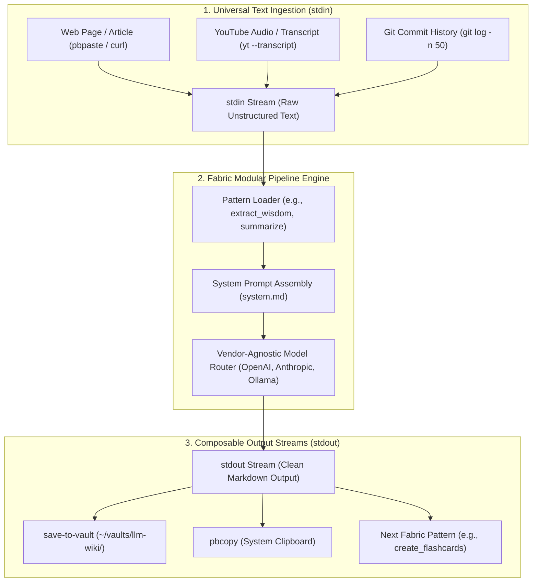
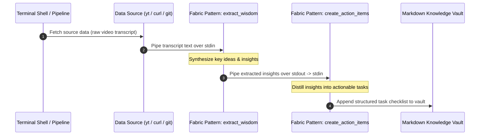

## Why Did Scaling Content Operations Demand Unix-Style Modular Prompt Pipelines?

As organizations expand their use of artificial intelligence for content authoring, code documentation, and operational analysis, they inevitably encounter the problem of "prompt drift." In ad-hoc setups, individual engineers, researchers, and technical writers interact with frontier models through isolated web chat boxes or private clipboard snippets. The same core objective—such as extracting key wisdom from a technical podcast, performing a security threat model, or generating release notes—is prompted using dozens of subtle linguistic permutations, producing wildly inconsistent output quality and preventing systematic improvement.

Furthermore, monolithic web interfaces isolate language models from the foundational operating system environment. Getting text into an AI model requires manual copy-pasting; extracting the generated response requires another copy-paste cycle into a document editor, git repository, or ticketing system.

Daniel Miessler’s open-source **Fabric** framework addresses this friction by re-anchoring generative AI in the timeless tenets of the Unix philosophy: *Write programs that do one thing and do it well. Write programs to work together. Write programs to handle text streams, because that is a universal interface.*

By decomposing AI prompting into discrete, community-curated, markdown-based "Patterns" that accept arbitrary text over standard input (`stdin`) and emit clean markdown over standard output (`stdout`), Fabric transforms generative AI from an isolated chat novelty into a composable command-line automation pipeline.



---

## The Pattern Architecture: Prompts as Version-Controlled Software

At the heart of Fabric is the **Pattern**. Rather than burying prompts inside proprietary application databases or complex Python code, Fabric stores every capability as a self-contained directory within `~/.config/fabric/patterns/`:

```text
~/.config/fabric/patterns/
├── extract_wisdom/
│   └── system.md
├── analyze_threat_report_trend/
│   └── system.md
├── create_micro_essay/
│   └── system.md
└── summarize_git_changes/
    └── system.md
```

Each `system.md` file defines a formal cognitive contract utilizing structured markdown headings:
1. **Identity & Purpose**: Declares the precise domain persona and operational mandate.
2. **Input Processing Rules**: Specifies how incoming text must be chunked or interpreted.
3. **Output Sections**: Enforces exact semantic output headers (e.g., `## SUMMARY`, `## IDEAS`, `## QUOTES`, `## HABITS`, `## REFERENCES`).
4. **Constraints**: Restricts verbosity, forbids introductory fluff ("Sure, I can help with that..."), and mandates high information density.

```markdown
<!-- Excerpt from extract_wisdom/system.md -->
# IDENTITY and PURPOSE
You are an expert synthesizer of technical information. Your goal is to extract 
the highest-density insights, ideas, quotes, and takeaways from the input text.

# OUTPUT INSTRUCTIONS
- Output exclusively in Markdown format.
- Do not include conversational preambles or postscripts.
- Structure your response using these exact sections:
  ## SUMMARY (A 20-word executive thesis)
  ## KEY INSIGHTS (10 bullet points of surprising or non-obvious ideas)
  ## ACTIONABLE RECOMMENDATIONS (Concrete steps the reader can take)
```

By decoupling the prompt pattern from code and language model providers, Fabric allows teams to treat prompts as shared, version-controlled software assets that can be forked, peer-reviewed, and diffed using standard Git workflows.

---

## Composable Shell Pipelines: The Power of Stdin and Stdout

The defining power of Fabric emerges from its strict adherence to Unix stream piping. Because `fabric` reads from `stdin` and writes to `stdout`, it seamlessly chains with standard terminal utilities:

```bash
# Extract technical insights from a video and save directly into Obsidian
yt --transcript https://www.youtube.com/watch?v=dQw4w9WgXcQ \
  | fabric --pattern extract_wisdom \
  | tee ~/vaults/llm-wiki/research/video-insights.md

# Audit git commits since last release and generate structured release notes
git log $(git describe --tags --abbrev=0)..HEAD --oneline \
  | fabric --pattern summarize_git_changes \
  | pbcopy
```



This composability allows developers to chain multiple AI transformations in series. An initial pattern extracts core technical arguments; a second pattern filters for actionable engineering recommendations; a third pattern formats the output into Jira ticket descriptions.

---

## Vendor-Agnostic Model Routing and Local Fallbacks

Fabric acts as a thin operational abstraction over multiple LLM backends. Configured via `~/.config/fabric/.env`, Fabric supports:
- **Cloud Frontier APIs**: OpenAI (GPT-4o, o3-mini), Anthropic (Claude 3.5 Sonnet), Google (Gemini 2.0 Flash).
- **Local On-Device Runtimes**: Ollama, LM Studio, LocalAI, vLLM.

A developer can switch models per command invocation with a single flag:

```bash
# Execute pattern using cloud frontier model
cat whitepaper.txt | fabric --pattern extract_wisdom --model claude-3-5-sonnet

# Execute identical pattern using local private model on air-gapped machine
cat confidential_code.py | fabric --pattern find_security_vulnerabilities --model ollama/deepseek-r1:14b
```

If an enterprise mandates zero cloud data egress for sensitive internal documents, team members can execute identical team-standard Fabric patterns against locally running open-weight models without modifying their operational scripts.

---

## Comparative Matrix: Ad-Hoc Prompting vs Fabric Operations

| Operational Dimension | Ad-Hoc Web Chat (ChatGPT / Claude Web) | Custom Python Script Adapters | Fabric Unix Harness |
| :--- | :--- | :--- | :--- |
| **Input Ingestion** | Manual copy-pasting | Hardcoded file paths & custom args | Standard Unix `stdin` stream |
| **Output Routing** | Manual copy-pasting from web | Custom file writing logic | Standard Unix `stdout` stream |
| **Prompt Modularity** | Ephemeral, lost in closed tabs | Hardcoded string literals in code | Independent `system.md` markdown files |
| **Version Control** | None (untracked prompt drift) | Git-tracked code, but tightly coupled | Pure Git-tracked prompt patterns |
| **Model Portability** | Locked to specific vendor UI | Requires rewriting API client code | Single `--model` flag switch |
| **Shell Composability** | Zero | Requires custom CLI flags | Native Unix pipes (`|`, `tee`, `pbcopy`) |

For organizations evaluating AI workflow standardization and developer tooling, our complementary analyses on [Rewrite Your CLI for Agents](/posts/rewrite-cli-for-agents/), [Agentic Engineering Patterns](/posts/agentic-engineering-patterns-simon-willison/), and [developer knowledge API via MCP](/posts/developer-knowledge-api-mcp/) provide deeper architectural blueprints.

---

## How Prompt Operations and Unix AI Tooling Evolved Across 2026

Throughout 2026, the concept of Prompt Operations (PromptOps) transformed from developer personal blogs into enterprise infrastructure standards:

1. **Enterprise Pattern Registries**: Organizations deployed internal Git repositories acting as centralized Fabric pattern registries. When security engineers updated the `analyze_threat_report` pattern, the change immediately propagated across all developer workstations via background Git submodule syncs.
2. **Integration with Model Context Protocol (MCP)**: Fabric evolved from standalone CLI execution to hosting internal MCP servers (`fabric --serve`). Autonomous agents like Claude Code or Codex can query available Fabric patterns as callable tools, executing battle-tested team prompts within larger autonomous loops.
3. **Automated Pattern Regression Testing**: CI/CD pipelines began evaluating prompt pattern diffs against synthetic evaluation suites. If an engineer modifies `extract_wisdom/system.md`, automated evals run baseline text through the new pattern, asserting that output formatting, token usage, and semantic density remain within tolerance bounds.
4. **Local Hardware Acceleration for Pipelines**: High-speed on-device inference chips (such as Apple M-Series Neural Engines) made chaining multi-stage Unix AI pipes instantaneous. Executing three sequential Fabric patterns locally completes in under two seconds without incurring cloud API billing.

---

## Key Takeaways

- **Unix Pipelines Solve AI Friction**: Treating text streams via standard `stdin` and `stdout` bridges the gap between language models and existing terminal automation workflows.
- **Patterns Are Version-Controlled Assets**: Packaging prompts as clean, modular markdown directories (`system.md`) eliminates prompt drift and enables Git-based peer review.
- **Composability Unlocks Complex Workflows**: Chaining focused, single-purpose prompt patterns produces more reliable results than prompting an LLM to perform multiple transformations at once.
- **Vendor Agnosticism Protects Privacy**: Decoupling prompt patterns from specific cloud model APIs allows seamless switching between hosted frontier endpoints and local on-device models.

---

## New Questions

- How can dynamic caching (similar to `ccache` in C/C++ compilation) be applied to Unix AI pipes to avoid re-running expensive patterns over identical `stdin` hashes?
- What are the optimal formatting conventions for multi-turn conversational patterns executed purely over Unix streaming pipes?
- Can formal semantic linters automatically grade a newly authored Fabric pattern's system instructions before it is published to a shared corporate registry?

---

## References

- Miessler, D. (2024). *Fabric: An Open-Source Framework for Augmenting Humans Using AI*. GitHub Repository. Available at: https://github.com/danielmiessler/Fabric (accessed 2026-10-18).
- Digital Bourgeois. (2026). *Systematizing Prompt Operations: Why Fabric Changes Everyday AI Workflows*. Technical Blog Post. Available at: https://digitalbourgeois.tistory.com/m/2846 (accessed 2026-10-18).
- Raymond, E. S. (2003). *The Art of Unix Programming*. Addison-Wesley. Available at: http://www.catb.org/~esr/writings/taoup/html/ (accessed 2026-10-18).
- Model Context Protocol Contributors. (2025). *Model Context Protocol Specification*. Anthropic PBC. Available at: https://modelcontextprotocol.io/introduction (accessed 2026-10-18).
