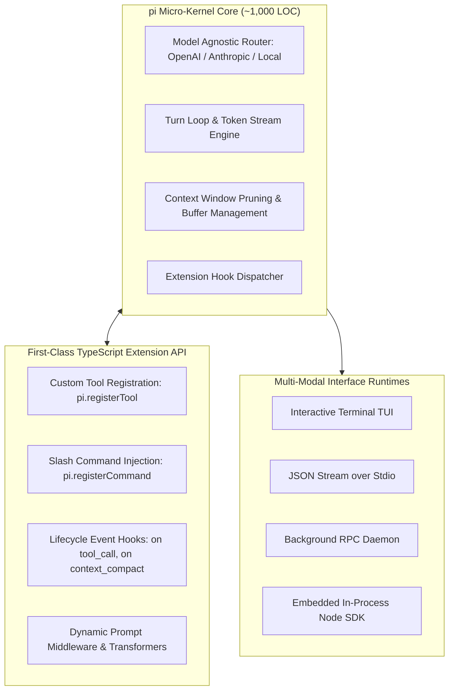
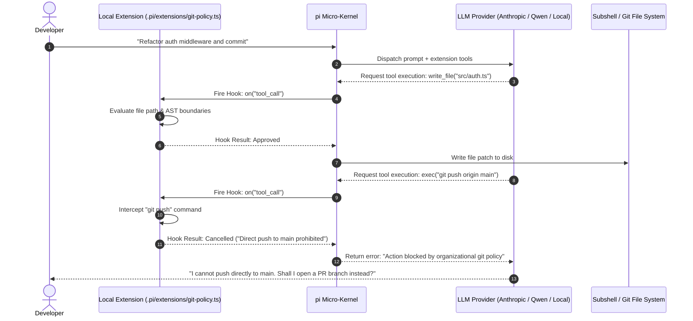

## Why Monolithic Feature-Heavy Coding Agents Repeatedly Fail Team Adoption

When engineering teams evaluate autonomous coding agents, procurement discussions routinely fixate on feature checklists: Does the agent have built-in Jira integration? Does it bundle an internal browser scraper? Does it support seventy proprietary cloud model endpoints?

Yet in production software organizations, adoption rarely fails because an agent lacks a secondary feature. Rather, teams reject commercial agents because **monolithic, opinionated harnesses cannot be adapted to the team's local development rhythm**. A team maintaining an internal Monorepo with proprietary Bazel build rules, custom git pre-commit hooks, and strict air-gapped security boundaries cannot wait six months for an upstream vendor to support their specific subshell invocation pattern. When an agent behaves as an opaque, closed black box, engineers spend more time fighting the tool's unalterable defaults than writing code.

This structural tension motivated Mario Zechner (creator of libGDX) to build **pi** (`badlogic/pi-mono`), complemented by architectural analysis from Armin Ronacher (creator of Flask and Sentry, writing in *"Pi: A Minimal Coding Agent"*). 

The guiding thesis of `pi` is radical in its restraint: **the agent runtime should be an ultra-minimal micro-kernel, with all domain-specific behavior, tool routing, permission governance, and UI rendering implemented as first-class, hot-reloadable TypeScript extensions**.

---

## The Micro-Kernel Architecture of pi

Rather than shipping a bloated, all-in-one binary with hundreds of built-in assumptions, `pi` strips the core runtime down to an essential ReAct scheduling loop:



### 1. The Extension API Contract
In `pi`, extensions are not treated as secondary sandbox plugins with restricted access; they are the primary implementation surface. A single TypeScript file dropped into `.pi/extensions/` can intercept model queries, alter system prompts, register custom command-line tools, and enforce organizational security invariants:

```typescript
// Example: Canonical pi Extension Contract (.pi/extensions/security-gate.ts)
import { ExtensionAPI } from "@badlogic/pi-core";

export default function (pi: ExtensionAPI) {
  // 1. Register custom domain-specific tools
  pi.registerTool({
    name: "run_bazel_test",
    description: "Execute scoped Bazel test targets with test log parsing",
    parameters: {
      type: "object",
      properties: {
        target: { type: "string", description: "Bazel target path (e.g. //src/...)" }
      },
      required: ["target"]
    },
    execute: async ({ target }, ctx) => {
      const output = await ctx.exec(`bazel test ${target}`);
      return { exitCode: output.exitCode, logs: output.stdout };
    }
  });

  // 2. Intercept and gate mutating tool executions
  pi.on("tool_call", async (event, ctx) => {
    if (event.toolName === "edit_file" && event.args.path.endsWith(".env")) {
      ctx.ui.warn("Blocked attempt to edit environment secrets file.");
      return { cancel: true, reason: "Security Policy: .env is protected" };
    }
  });

  // 3. Inject custom slash commands
  pi.registerCommand("status", {
    description: "Display active memory usage and token consumption",
    handler: async (args, ctx) => {
      ctx.ui.print(`Current Session Tokens: ${ctx.session.tokenCount}`);
    }
  });
}
```

### 2. Multi-Interface Runtime Decoupling
Most agent tools tightly couple their business logic to an interactive Terminal UI (TUI). `pi` decouples execution into four swappable runtime modes:
* **Interactive TUI**: Developer terminal with syntax-highlighted diffs, token meters, and command history.
* **Print JSON Mode**: Single-shot script invocation that emits structured JSON to stdout, ideal for git commit hooks and CI/CD pipelines.
* **RPC Daemon**: Headless server mode communicating over Unix domain sockets or JSON-RPC, enabling IDE extensions or mobile chat bridges.
* **Embedded SDK**: Direct programmatic embedding within Node.js and TypeScript backends.

---

## Architectural Analysis: Armin Ronacher on Programmable Agent Workflows

In his architectural review of `pi`, Armin Ronacher highlights a critical insight regarding the economics of AI development tools: **"Pi is interesting because workflow limits are treated as extension opportunities, rather than product bugs."**




### The Craftsman's Principle: "A Tool Should Be Made, Not Merely Adopted"
This philosophy echoes Korean software architect Jonghak Seo’s reflections on developer tooling: when developers treat tools as immutable black boxes, they become subservient to the tool’s arbitrary ergonomics. Conversely, when the tool is an extensible substrate, the developer operates as a software craftsman—shaping the tool’s commands, shortcuts, and verification gates to compound personal productivity over time.


### Hot Reloading (`/reload`) as a Development Multiplier
Iterating on traditional agent plugins requires restarting the session, re-authenticating, re-reading the workspace tree, and re-establishing prompt context. In `pi`, extensions support **hot module reloading**:
* When an engineer edits `.pi/extensions/my-tool.ts`, issuing `/reload` in the active session unlinks the old module, compiles the new TypeScript file in memory, and re-binds lifecycle listeners instantly without clearing the active conversation history or context window.

---

## Comparing the Three Major Terminal Agent Philosophies

The developer landscape has fractured into three fundamentally different perspectives on terminal agent design:

| Architectural Dimension | Monolithic Commercial (e.g. Cursor Agent / Copilot CLI) | Opinionated Terminal Harness (e.g. Claude Code) | Extensible Micro-Kernel (pi) |
| :--- | :--- | :--- | :--- |
| **Codebase Footprint** | Massive closed-source binaries, embedded Electron/LSP | Proprietary Node runtime, tightly coupled to Claude models | Tiny (~1,000 LOC), open-source TypeScript core |
| **Model Independence** | Locked to vendor cloud or approved model list | Optimized for Claude 3.7 / Opus 4.6 | Arbitrary model provider via standardized adapter interface |
| **Custom Extensibility** | Limited to vendor plugin marketplace and webhooks | Hierarchical `CLAUDE.md` and standard MCP servers | Direct TypeScript extension API + lifecycle event hooks |
| **Custom Tool Overhead** | Complex RPC or out-of-process HTTP service required | Must deploy a standalone Model Context Protocol server | 10 lines of in-process TypeScript code |
| **Execution Boundaries** | Cloud-governed permission policies | Unix process checks and `/undo` checkpoints | Fully programmable user-defined lifecycle gates |

As analyzed in [CLI Harness Coding Agents](/posts/cli-harness-coding-agents/) and [How Claude Code Works](/posts/how-claude-code-works/), while systems like Claude Code provide unmatched out-of-the-box reasoning depth, `pi` demonstrates that an open, hackable micro-kernel provides superior long-term survivability for teams with bespoke engineering environments.

---

## What Changed Since Early 2026: The Revolt Against Monolithic Closed-Box Agents

In early 2026, the tech industry assumed that agent development would consolidate around two or three massive commercial IDE platforms. By mid-2026, a visible counter-reaction developed across senior engineering circles, driven by three systemic frustrations:

### 1. Inability to Inspect and Patch Context Poisoning
Commercial agents often inject unconfigurable hidden prompts (formatting instructions, safety boilerplate, vendor branding) that consume thousands of tokens and occasionally conflict with developer instructions. Micro-kernel runtimes like `pi` expose the raw context window directly: developers inspect every system prompt byte and can write custom context compaction algorithms (`on("context_compact")`) tailored to their exact language syntax.

### 2. Micro-Extension Architecture Replacing Heavy MCP Servers
While the Model Context Protocol (MCP) standardized tool connectivity across vendors (as examined in [Awesome Claude Skills](/posts/awesome-claude-skills/)), launching a separate Docker container or Python subprocess just to expose a single helper function adds unnecessary operational friction. `pi` proved that **in-process TypeScript extensions** provide zero-latency tool dispatch while still supporting MCP bridges when external connectivity is required.

### 3. The Shift to Bespoke Local Workflows
Senior developers realized that their competitive advantage lies in their unique workflow: custom tmux layouts, custom linting pipelines, proprietary error tracing, and internal ticket formatting. Rather than forcing human developers to adapt to a standardized vendor workflow, the tool adapts to the human.

---

## Practical Engineering Decision Checklist

When evaluating whether to adopt a minimal micro-kernel agent like `pi` versus a feature-complete commercial alternative:

| Architectural Requirement | Choose Claude Code / Commercial Agent | Choose pi Micro-Kernel |
| :--- | :--- | :--- |
| **Time-to-First-Task** | Immediate (<2 minutes install and go) | Requires writing initial configuration and tool bindings |
| **Proprietary Tooling & Runtimes** | Difficult; requires writing out-of-process MCP daemons | Trivial; write an in-process TypeScript extension |
| **Multi-Model Fallbacks** | Vendor-locked or limited provider switching | Native; swap from Claude to Qwen to local Ollama in one line |
| **Security Auditing & Governance** | Trust vendor's permission prompt heuristics | Enforce deterministic program logic in `tool_call` hooks |
| **Team Maintenance Overhead** | Zero maintenance (handled by vendor) | Team must maintain its own extension scripts |

---

## Key Takeaways

| Principle | Architectural Reality | Actionable Guidance |
| :--- | :--- | :--- |
| **Micro-Kernel Core** | Monolithic agents accumulate technical debt and unalterable defaults | Build upon minimal execution loops that treat workflow constraints as extension points |
| **In-Process Extensibility** | Interposing on agent lifecycle events must be lightweight and instant | Leverage in-process TypeScript hooks (`registerTool`, `tool_call`) rather than heavy RPC layers |
| **Workflow Ownership** | The greatest leverage in agentic programming is adapting the tool to the team | Build custom extensions that reflect your team’s build systems, git policies, and review gates |
| **Hot Reload Velocity** | Restarting sessions destroys mental focus and context state | Require hot-reloading (`/reload`) to iterate on agent capabilities without dropping active conversation history |

## New Questions

- **Shared Extension Registries**: How will open-source ecosystems curate and audit community-contributed TypeScript extensions to prevent malicious code execution during `/reload`?
- **Cross-Harness Extension Transpilation**: Can a standardized intermediate representation allow extensions written for `pi` to export automatically as Claude Code skills or Google ADK tools?
- **Deterministic Sandboxing for In-Process Extensions**: If extensions execute within the agent's main Node.js thread, what lightweight V8 isolate boundaries can prevent buggy extensions from crashing long-running agent sessions?

---

## References

- Zechner, M. (2025). *pi: A Minimal, Extensible Terminal Coding Agent*. GitHub Repository. [https://github.com/badlogic/pi-mono](https://github.com/badlogic/pi-mono) (accessed 2026-10-18).
- Zechner, M. (2025). *pi.dev: The Hackable Coding Harness*. Official Documentation. [https://shittycodingagent.ai/](https://shittycodingagent.ai/) (accessed 2026-10-18).
- Ronacher, A. (2026). *Pi: A Minimal Coding Agent*. Armin Ronacher's Weblog. [https://lucumr.pocoo.org/2026/1/31/pi/](https://lucumr.pocoo.org/2026/1/31/pi/) (accessed 2026-10-18).
- Seo, J. (2026). *A Craftsman Makes Their Own Tools: Reflections on Agentic Workflow Adaptability*. Jonghak Seo Tech Notes. [https://jonghakseo.github.io/posts/craftsman-makes-tools/](https://jonghakseo.github.io/posts/craftsman-makes-tools/) (accessed 2026-10-18).
