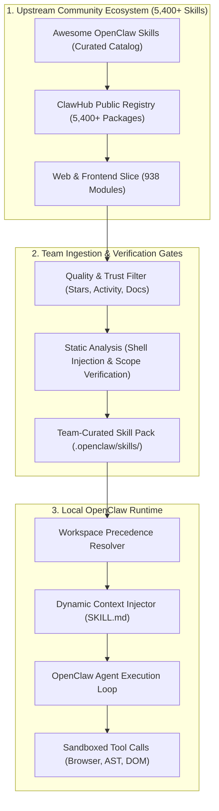
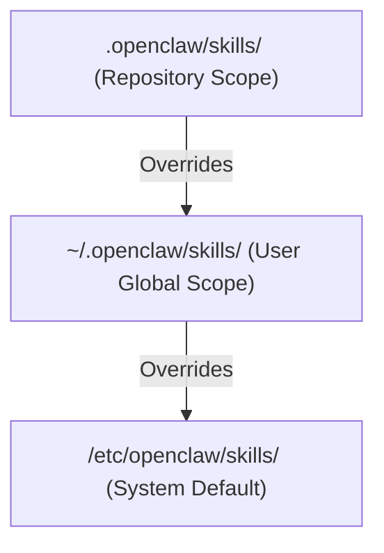
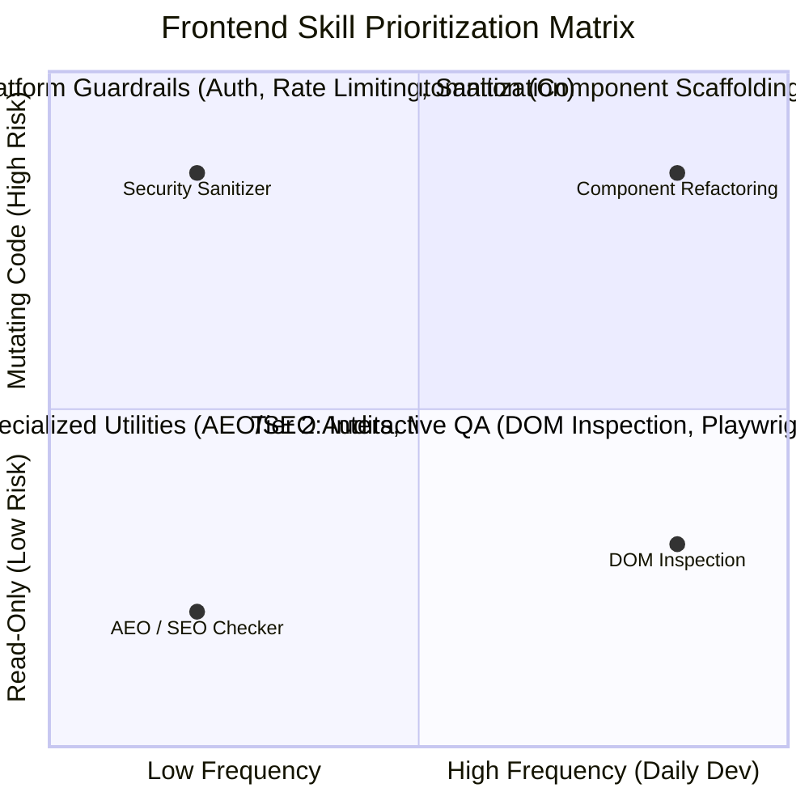
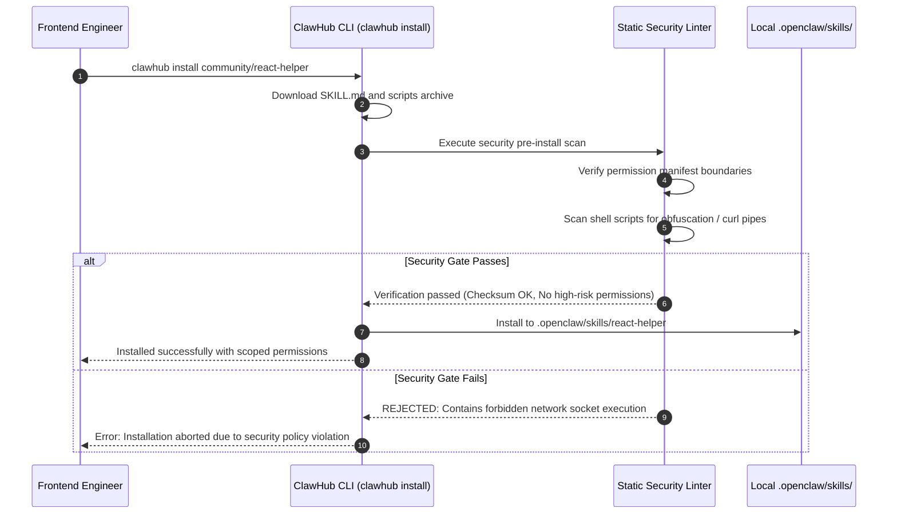

## How Can Engineering Teams Navigate Five Thousand Agent Skills Without Paralysis?

In the early stages of adopting AI agent platforms, developer teams worry primarily about model capability: Can the model write CSS? Can it diagnose an asynchronous React race condition? As ecosystems mature, however, the central challenge shifts from model intelligence to plugin ecosystem management.

OpenClaw exemplifies this transition. As an open-source, local-first autonomous assistant runtime, OpenClaw decouples core agent execution from functional capabilities through modular plugins known as "Skills." By early 2026, the community catalog tracked over 5,400 specialized skills across GitHub and ClawHub registries, with the Web & Frontend Development category alone exceeding 930 discrete modules.

When faced with a catalog of this magnitude, development teams encounter decision paralysis. Installing hundreds of unvetted skills bloats agent system prompts, increases token consumption, creates namespace collisions, and introduces severe supply-chain security risks.

Auditing OpenClaw's skill architecture reveals how package managers (ClawHub), scoped permission boundaries, and team-curated skill registries allow frontend and full-stack teams to leverage ecosystem scale safely.



---

## Deconstructing the Anatomy of an OpenClaw Skill

An OpenClaw skill is not a heavyweight Python package or an opaque binary blob. Adhering to open standards, each skill is packaged as an independent directory containing a declarative markdown specification (`SKILL.md`) and optional executable scripts:

```text
skills/web-frontend/react-tailwind-audit/
├── SKILL.md                 # Primary instruction, rules, and parameter contract
├── scripts/
│   └── analyze-bundle.js    # Local executable helper script
└── references/
    └── tailwind-rules.json  # Reference constraints and token maps
```

### The Standardized `SKILL.md` Specification Contract
The `SKILL.md` file serves as the operational contract ingested into the agent context window when the skill is invoked:

```markdown
---
name: react-tailwind-audit
description: "Audits React components for CSS specificity collisions and unused Tailwind utility classes."
version: 1.2.0
author: "volt-frontend-team"
license: MIT
permissions:
  filesystem: ["read", "write:src/components/**"]
  shell: ["npx tailwindcss --content ..."]
  network: false
---

# Operational Directives
When invoked on a React component:
1. Parse the JSX AST to extract all `className` attributes.
2. Execute `node scripts/analyze-bundle.js` against the target component path.
3. Identify redundant utility overrides (e.g., conflicting padding declarations).
4. Output a structured JSON diff of proposed refactoring replacements.
```

### Key Architectural Characteristics
1. **Zero-Overhead Dormancy**: Skills do not run persistent background daemons by default. Their instructions are indexed as lightweight summaries; full `SKILL.md` directives are loaded into prompt context only when triggered by relevant developer intents.
2. **Explicit Permission Manifests**: Front-matter declarations restrict filesystem write paths, shell execution privileges, and outbound network access, ensuring that an untrusted community plugin cannot exfiltrate environment variables.
3. **Workspace Precedence Hierarchy**: OpenClaw resolves skills hierarchically:
   $$\text{Active Skill} = \text{Workspace Local} \succ \text{User Global} \succ \text{System Default}$$
   This allows individual repositories to override community defaults with internal team standards.



---

## The Frontend Skill Taxonomy: Navigating 900+ Modules

To extract practical utility from the 938 web and frontend skills without cluttering agent context, engineering organizations categorize tools into four operational tiers:



### 1. Tier 1: Core Component Authoring & Refactoring
- **Purpose**: Rapid scaffolding, AST manipulation, and CSS utility optimization.
- **Representative Modules**: `react-scaffold`, `tailwind-optimizer`, `ast-rename`.
- **Governance**: High-frequency use; requires workspace-level pinning and git worktree isolation.

### 2. Tier 2: Interactive QA & Rendered Verification
- **Purpose**: Automated headless browser testing, visual regression capture, and accessibility checks.
- **Representative Modules**: `playwright-harness`, `axe-a11y-auditor`, `storybook-runner`.
- **Governance**: Invoked primarily in verification gates before pull request creation.

### 3. Tier 3: Security & Operational Guardrails
- **Purpose**: Input sanitization, CORS header verification, token leak prevention.
- **Representative Modules**: `agent-rate-limiter`, `prompt-shield`, `auth-flow-validator`.
- **Governance**: Enforced globally across all agent turns; cannot be disabled by subagents.

### 4. Tier 4: Search & Discovery (AEO/SEO)
- **Purpose**: Artificial Intelligence Engine Optimization (AEO), sitemap indexing, metadata validation.
- **Representative Modules**: `aeo-schema-generator`, `open-graph-validator`.
- **Governance**: Triggered on-demand during content publishing workflows.

---

## Supply-Chain Security: Auditing Community Skills

With over 5,400 community-contributed skills in public indexes, unverified installation represents an acute attack vector. A malicious skill can register innocent-looking keywords while executing destructive shell commands or exfiltrating credentials.



### Production Security Checklist for Team Adoption:
1. **Never Install Blindly via Prompt**: Prohibit agents from autonomously downloading and executing unvetted skills from public URLs during an active session.
2. **Enforce Readonly by Default**: Skills should not possess write permissions to configuration files (`.env`, `package.json`, `.git/`) unless explicitly granted by human reviewers.
3. **Commit Curated Skills to Version Control**: Rather than relying on dynamic runtime network fetches, commit vetted `SKILL.md` definitions directly into the project repository (`.openclaw/skills/`).

---

## Comparative Matrix: OpenClaw Skills vs Alternate Plugin Formats

| Capability Dimension | OpenClaw SKILL.md Ecosystem | Model Context Protocol (MCP) Tools | LangChain Python Tools |
| :--- | :--- | :--- | :--- |
| **Specification Format** | Markdown (`SKILL.md`) with YAML front matter | JSON-RPC 2.0 schema over stdio/HTTP | Python classes inheriting `BaseTool` |
| **Catalog Scale** | 5,400+ community modules | Rapidly expanding official registry | Thousands of Python pip packages |
| **Execution Model** | Text instructions + Optional shell scripts | Dedicated long-running server daemons | In-process Python function calls |
| **Memory Overhead** | Zero when dormant (text file on disk) | Process memory per active daemon | In-memory Python runtime footprint |
| **Language Portability** | Language-agnostic (Bash, Node, Python) | Language-agnostic via JSON-RPC | Python-only |
| **Governance Scoping** | Built-in YAML permission manifests | Client-side capability negotiation | Custom code guardrails required |

For developers building distributed agent infrastructure, our complementary source audits on [OpenClaw old Android phone deployment](/posts/openclaw-old-android-phone/), [Clawhost OpenClaw one-click hosting](/posts/clawhost-openclaw-one-click/), and the [Agentic Engineering 9 skills](/posts/agentic-engineering-9-skills/) provide end-to-end implementation blueprints.

---

## How Agent Skill Catalogs and Registries Evolved Across 2026

Throughout 2026, the agent tooling landscape shifted from uncurated "awesome list" repositories to enterprise-grade package registries:

1. **Deterministic Skill Package Managers**: Tools like `clawhub` and `k-skill` introduced semantic versioning, lockfiles (`skills.lock`), and cryptographic checksum verification, preventing malicious authors from mutating published skill definitions.
2. **Dynamic Context-Aware Tool Selection**: When an agent runtime has access to thousands of skills, sending all skill definitions in the system prompt is impossible. Modern harnesses use vector embeddings to perform runtime semantic routing, selecting the top-5 most relevant skills dynamically based on developer query intent.
3. **Automated Sandbox Virtualization**: When skills invoke external shell scripts, execution takes place inside ephemeral WebAssembly (WASM) or container sandboxes, ensuring that scripts cannot touch local user directories or environment variables.
4. **Skill-to-MCP Adapters**: Ecosystem fragmentation was resolved through universal bridges. OpenClaw introduced native adapters that automatically expose local `SKILL.md` collections as standard Model Context Protocol (MCP) server endpoints for external agents like Claude Code or Codex.

---

## Key Takeaways

- **Scale Demands Curation**: Having 5,400 available skills is meaningless without a disciplined, use-case-driven curation filter.
- **Standardized Formats Ensure Longevity**: Packaging skills as plain Markdown files (`SKILL.md`) guarantees human inspectability, zero memory overhead when dormant, and seamless git versioning.
- **Permissions Must Be Explicit**: Never trust community skills with unbounded filesystem or network access; enforce strict YAML permission boundaries.
- **Repository-Level Precedence Protects Consistency**: Checking curated skills into `.openclaw/skills/` within the repository ensures that all team members and CI pipelines operate against identical agent tooling contracts.

---

## New Questions

- How can automated benchmarking suites measure whether adding a new skill improves or degrades an agent's overall task completion rate?
- What are the legal and copyright implications of agents executing community-authored skills that generate code derived from proprietary libraries?
- Can semantic vector indexes resolve ambiguous skill triggers when two installed plugins claim identical keywords (e.g., two competing CSS optimizers)?

---

## References

- OpenClaw Core Team. (2026). *OpenClaw: Extensible Local-First Autonomous Agent Architecture*. GitHub Repository. Available at: https://github.com/openclaw/openclaw (accessed 2026-10-18).
- VoltAgent Contributors. (2026). *Awesome OpenClaw Skills: Curated Directory of 5,000+ Agent Extensions*. GitHub Repository. Available at: https://github.com/VoltAgent/awesome-openclaw-skills (accessed 2026-10-18).
- Digital Bourgeois. (2026). *The OpenClaw Skill Explosion: Architecture, Discovery, and Operational Strategy*. Technical Blog Post. Available at: https://digitalbourgeois.tistory.com/m/2878 (accessed 2026-10-18).
- Model Context Protocol Contributors. (2025). *Model Context Protocol Specification*. Anthropic PBC. Available at: https://modelcontextprotocol.io/introduction (accessed 2026-10-18).
