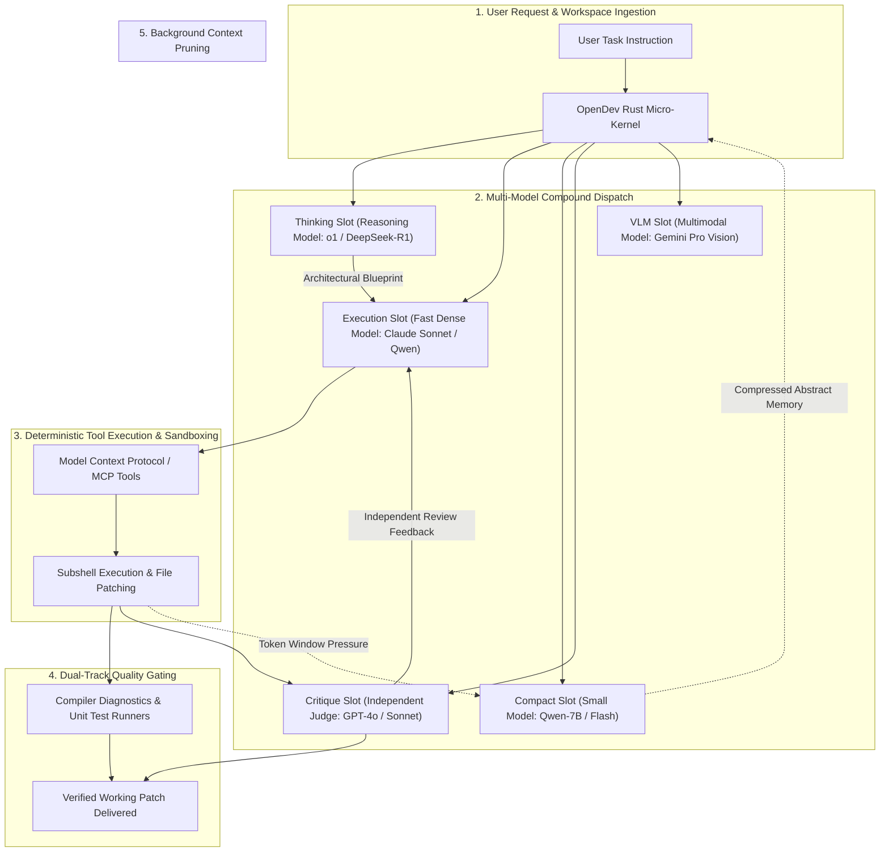
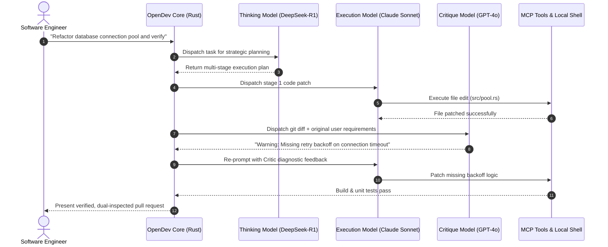

## Why Monolithic Single-Model Coding Agents Are Economically and Architecturally Flawed

In the initial generation of autonomous coding agents, runtime design adhered to an implicit assumption of model uniformity: developers configured a single global LLM endpoint—whether Claude 3.5 Sonnet, GPT-4o, or DeepSeek-V3—and routed every phase of the engineering lifecycle through that identical model. 

Under real production workloads, this monolithic architecture introduces severe economic and performance pathologies:
1. **Cost Inefficiency**: Routing a trivial regex check or git log formatting task through a flagship frontier reasoning model burns expensive tokens on problems that require minimal cognitive reasoning.
2. **Author-Bias in Verification**: When the exact same model that authored a code patch is subsequently prompted to verify its own logic, it exhibits persistent blind spots, repeatedly rubber-stamping its own unstated assumptions and hallucinations.
3. **Latency and Token Bottlenecks**: High-parameter reasoning models exhibit substantial time-to-first-token (TTFT) latency, making simple interactive file searches feel sluggish and unresponsive.
4. **Context Window Contamination**: Utilizing expensive reasoning tokens for mundane history compaction and summarization degrades the attention budget available for deep algorithmic synthesis.

As articulated in Matei Zaharia and the Berkeley AI Research group's seminal paper on **Compound AI Systems**, state-of-the-art AI applications are rarely monolithic models; they are systems composed of multiple interacting components, specialized models, and deterministic verification gates. 

**OpenDev** (`opendev-to/opendev`) translates the Compound AI paradigm into a high-performance, terminal-native coding agent built in **Rust**. By decoupling the agent harness into five distinct functional workflow slots—each bound to a specialized model optimized for cost, latency, or reasoning depth—OpenDev provides a blueprint for scalable, economic agent engineering.

---

## The Five-Slot Compound Architecture of OpenDev

Rather than forcing every interaction through a single prompt loop, OpenDev partitions agent operations into five specialized roles:



### 1. The Five Functional Workflow Slots
Each slot in OpenDev represents a specialized cognitive responsibility with distinct latency, reasoning, and context requirements:

| Workflow Slot | Primary Operational Responsibility | Model Selection Criteria | Typical Model Allocation |
| :--- | :--- | :--- | :--- |
| **`Thinking`** | Strategic planning, mathematical analysis, multi-file dependency mapping | Maximum reasoning depth, internal CoT capabilities, tolerant of higher latency | OpenAI o1/o3, DeepSeek-R1 |
| **`Execution`** | Concrete code synthesis, syntax editing, shell command invocation | Fast code generation, strict JSON/tool schema adherence, low streaming latency | Claude 3.7 Sonnet, Qwen 2.5 Coder |
| **`Compact`** | Context history pruning, token summarization, abstract state retention | High summarization density, low cost per token, fast token throughput | Qwen 2.5 7B, Gemini Flash |
| **`Critique`** | Independent code review, security boundary verification, linter checks | Independent model family to eliminate author-bias, strict rubric adherence | GPT-4o (if Sonnet executed) or vice-versa |
| **`VLM`** | Inspecting UI render regressions, Figma designs, architectural diagrams | High visual resolution understanding, spatial bounding box detection | Gemini 1.5/2.5 Pro Vision |

```yaml
# Conceptual OpenDev Configuration (~/.opendev/settings.json)
workflows:
  thinking:
    provider: "deepseek"
    model: "deepseek-reasoner"
    temperature: 0.0
  execution:
    provider: "anthropic"
    model: "claude-3-7-sonnet"
    streaming: true
  compact:
    provider: "ollama"
    model: "qwen2.5:7b-instruct"
    max_tokens: 1024
  critique:
    provider: "openai"
    model: "gpt-4o"
    prompt_rubric: "strict_security_and_mutation"
  vlm:
    provider: "google"
    model: "gemini-2.5-flash"
```



---

## Systems Architecture: Why OpenDev Built in Rust

While Python is the language of machine learning research, writing interactive CLI developer tools in Python introduces significant operational overhead: slow startup times, environment dependency hell (virtualenvs, conflicting pip packages), high idle memory footprints, and single-threaded concurrency bottlenecks.

OpenDev avoids these issues by implementing its runtime entirely in **Rust**:
* **Instant Startup (<20ms)**: Developers running terminal commands expect instantaneous feedback; compiled Rust binaries boot without virtual environment initialization delays.
* **Low Memory Footprint**: Where an Electron- or Python-based agent easily consumes 500MB–1.5GB of RAM while idling, OpenDev maintains an idle memory footprint under 30MB, fitting comfortably alongside intensive compiler and game engine processes.
* **Asynchronous Tokio Runtime**: Manages concurrent streaming connections across multiple cloud LLM APIs, local Ollama endpoints, and stdio Model Context Protocol (MCP) servers simultaneously without thread starvation, echoing the systems engineering principles detailed in [Combining Rust and Python for High-Performance AI Systems](/posts/combining-rust-and-python-for-high-performance-ai-systems/).
* **Dual Interface Runtimes**: Features a rich terminal user interface (TUI) for local keyboard-centric workflows, alongside a lightweight embedded web dashboard for remote execution monitoring from mobile browsers.

---

## Eliminating Author-Bias: The Multi-Model Verification Gate

A major failure mode in autonomous coding is **author self-confirmation bias**:
When a single model generates code with an algorithmic flaw (e.g., an off-by-one error or an overlooked concurrency race condition) and is immediately asked *"Please review this code for errors"*, the model’s internal attention distribution heavily weights its own generated tokens. In up to 40% of cases, it rationalizes its initial error rather than identifying the defect.

OpenDev eliminates this epistemic blind spot by enforcing **cross-model critique**:
* If `Execution` is bound to Anthropic's Claude, `Critique` is bound to OpenAI's GPT or an open-weight reasoning model.
* Because the critique model was trained on different pre-training corpora with different loss landscapes, it evaluates the git diff without the generative biases of the author model.
* This automated producer-critic separation enforces the verification discipline analyzed in [Harness Engineering: Architectural Principles for Scaling Agents to 1M Lines](/posts/harness-engineering/) and [The Agent SDK Landscape: Comparing Orchestration Runtimes and Harness Primitives](/posts/agent-sdk-landscape/).

---

## What Changed Since Early 2026: The Shift from Monolithic Monomodel Agents to Heterogeneous Ensembles

When OpenDev first appeared in early 2026, the dominant industry pattern was "one model to rule them all." Developers bought a single API key and routed every interaction through that endpoint. Across 2026, the architecture of agentic engineering matured through three major shifts:

### 1. Economic Specialization and Token Budgeting
Enterprise engineering leadership realized that burning $0.05 per thousand tokens on routine tasks (generating commit messages, inspecting git status, summarizing file trees) was financially irresponsible at team scale. Compound architectures like OpenDev cut operational API costs by 60–75% by offloading high-volume background tasks to ultra-cheap local or flash models, reserving premium reasoning models solely for architecture and critique.

### 2. Standardization of Model Context Protocol (MCP) as the Shared Muscle
Early multi-model attempts struggled because different foundation model providers enforced incompatible function-calling schemas. The universal adoption of Anthropic’s **Model Context Protocol (MCP)** provided the common lingua franca. In OpenDev, whether a tool call originates from Claude, Qwen, or a local fine-tuned model, it serializes through standardized MCP JSON-RPC protocols, preventing tool fragmentation.

### 3. Remote-First Autonomous Daemons
The developer interface transitioned from active chat pair-programming to asynchronous background daemons. OpenDev’s headless server mode allows developers to trigger multi-hour refactoring jobs, disconnect their laptops, and inspect live progress via mobile web dashboards, merging verified code only after independent critique gates pass.

---

## Practical Engineering Tradeoffs

Deploying a multi-model compound agent introduces operational complexity that teams must evaluate:

| Architectural Dimension | Monolithic Agent (Single Model) | Compound Agent (OpenDev Multi-Model) | Engineering Mitigation |
| :--- | :--- | :--- | :--- |
| **Configuration Complexity** | Trivial (One API key, one model name) | Complex (Configuring 5 model endpoints and fallback policies) | Provide sensible defaults out-of-the-box (e.g. Claude + Qwen Flash) with single-command overrides |
| **API Key Management & Rate Limits** | Single provider account and quota | Requires credentials across multiple vendors (Anthropic, OpenAI, DeepSeek, Google) | Integrate with unified local proxy routers (such as LiteLLM or OpenRouter) to consolidate billing |
| **Inter-Model Schema Incompatibility** | Low (Model understands its own prompt formatting) | Moderate (One model’s markdown output may confuse a secondary parser) | Enforce strict Pydantic/Rust schema validation between workflow slot transitions |
| **Cold-Start Latency** | Uniform latency across all turns | Variable latency depending on whether a turn routes to `Thinking` vs `Execution` | Stream visual status indicators in the TUI showing which model slot is currently computing |

---

## Key Takeaways

| Principle | Architectural Reality | Actionable Team Guidance |
| :--- | :--- | :--- |
| **The Compound Imperative** | No single foundation model is simultaneously optimal for cost, speed, vision, and reasoning | Structure agent harnesses with explicit functional workflow slots rather than a single global model |
| **Eliminate Author-Bias** | A model will repeatedly overlook its own algorithmic hallucinations | Bind the `Critique` slot to a model from an independent model family than the `Execution` slot |
| **Systems-Level Efficiency** | Interpreted Python CLI wrappers waste CPU, memory, and startup latency | Build agent harnesses on compiled, zero-overhead runtimes like Rust with native async concurrency |
| **Economize Context Pruning** | Never burn expensive reasoning tokens to compress past conversation history | Offload background history compaction (`Compact` slot) to lightweight, fast local models |

## New Questions

- **Dynamic Auto-Routing**: How can agent harnesses dynamically predict the required reasoning depth of an incoming prompt to route between `Execution` and `Thinking` slots without manual user configuration?
- **Distributed Micro-Critiques**: Can critique workflows be parallelized across an ensemble of three diverse verifier models to achieve majority-voting consensus on high-risk database migrations?
- **Local-Only Compound Stacks**: Can an entire 5-slot compound architecture be executed fully air-gapped on a single multi-GPU workstation using quantized open-weight models without cloud dependencies?

---

## References

- OpenDev Team. (2025). *OpenDev: The Open-Source Compound AI Coding Agent Built in Rust*. GitHub Repository. [https://github.com/opendev-to/opendev](https://github.com/opendev-to/opendev) (accessed 2026-10-18).
- Zaharia, M., et al. (2024). *The Shift from Models to Compound AI Systems*. Berkeley Artificial Intelligence Research (BAIR) Blog. [https://bair.berkeley.edu/blog/2024/02/18/compound-ai-systems/](https://bair.berkeley.edu/blog/2024/02/18/compound-ai-systems/) (accessed 2026-10-18).
- PyTorch Korea Community. (2025). *OpenDev: Architecture Breakdown of Multi-Model Coding Agents*. PyTorch Korea Discuss. [https://discuss.pytorch.kr/t/opendev-llm-ai/9227](https://discuss.pytorch.kr/t/opendev-llm-ai/9227) (accessed 2026-10-18).
- Anthropic. (2024). *Model Context Protocol: Standardizing Tool and Resource Connectivity for AI Agents*. [https://modelcontextprotocol.io/](https://modelcontextprotocol.io/) (accessed 2026-10-18).
