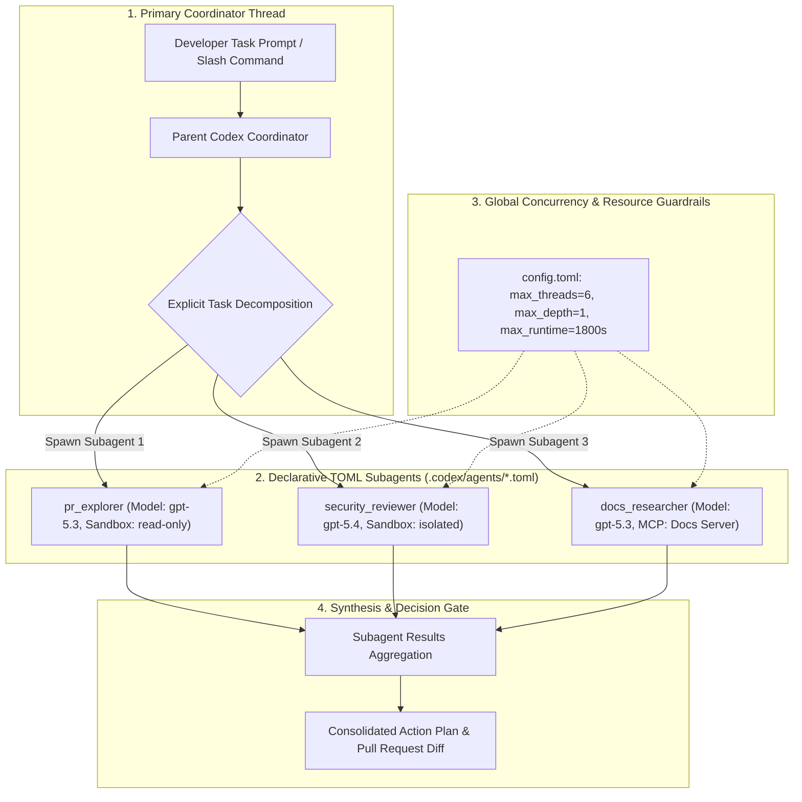

## Why Monolithic Single-Agent Contexts Degrade on Complex Engineering Tasks

When autonomous coding agents tackle substantial engineering initiatives—such as refactoring an authentication subsystem, upgrading database drivers across microservices, or conducting a comprehensive security audit of a pull request—developers routinely observe a phenomenon known as **context saturation**.

In a single-agent architecture, the model must maintain disparate cognitive objectives within a single conversational context window:
1. Synthesizing clean code implementation.
2. Auditing cryptographic security invariants.
3. Writing unit, integration, and mutation tests.
4. Verifying API documentation and schema versions.
5. Tracking historical git commit messages and review comments.

As tool call results, stack traces, and large file buffers accumulate, the model's effective attention degrades. Subtler security vulnerabilities are overlooked because the context is dominated by formatting diffs; test suites become tautological because the model tests only its own newly generated assumptions.

To solve this, OpenAI introduced **Codex Subagents**. Rather than attempting to force every engineering responsibility into a single, overloaded thread, Codex provides an explicit multi-agent coordination architecture: complex problems are decomposed into **specialized subagents**, each governed by its own system prompt, reasoning model tier, sandbox permission mode, and dedicated Model Context Protocol (MCP) tool bindings.

---

## The Four Architectural Primitives of Codex Subagents

The Codex subagent subsystem is built upon four decoupled mechanical primitives:



### 1. Declarative TOML Configuration (`.codex/agents/*.toml`)
Subagents are not defined through ad-hoc runtime prompting; they are declared as version-controlled configuration files residing inside the repository at `.codex/agents/*.toml` or globally at `~/.codex/agents/*.toml`:

```toml
# ~/.codex/agents/security_reviewer.toml
name = "security_reviewer"
description = "Audits pull requests for SQL injection, auth flaws, and secret leaks."
developer_instructions = """
You are an adversarial security auditor.
Analyze the target diff specifically for:
1. Unsanitized user inputs reaching database execution calls.
2. Insecure deserialization and missing CSRF tokens.
3. Accidental logging of authorization headers or environment secrets.
Provide concrete reproduction proof for every finding. Do not write code patches.
"""
model = "gpt-5.4"
model_reasoning_effort = "high"
sandbox_mode = "read-only"
```

```toml
# ~/.codex/agents/docs_researcher.toml
name = "docs_researcher"
description = "Verifies third-party library versions and API deprecation notices."
developer_instructions = """
Query the attached documentation MCP server to verify that proposed methods
exist in the pinned library version. Return concise citations with line numbers.
"""
model = "gpt-5.3-codex-spark"
model_reasoning_effort = "medium"
sandbox_mode = "read-only"

[mcp_servers]
official_docs = "https://developers.openai.com/mcp"
```

### 2. Fine-Grained Sandbox Permission Isolation
In a multi-agent system, giving every subagent unrestricted write access to the host shell invites race conditions and unrecoverable state corruption. 
Codex enforces strict **sandbox boundaries**:
* **`read-only`**: Used for exploration, documentation lookup, and code review agents. The agent can traverse directories and grep files, but mutating tools (`write_file`, mutating shell commands) are disabled at the runtime kernel level.
* **`isolated`**: The agent executes within an ephemeral, sandboxed container or temporary git worktree. Mutations do not touch the user's primary working tree until explicitly validated.
* **`workspace`**: The standard parent working directory, reserved for the primary `worker` subagent executing verified patches.

### 3. Concurrency Bounds and Circuit Breakers
To prevent recursive agent proliferation and runaway API bills, global guardrails are enforced in `.codex/config.toml`:

```toml
# ~/.codex/config.toml
[agents]
max_threads = 6
max_depth = 1
job_max_runtime_seconds = 1800
```
* **`max_threads`**: Caps concurrent worker threads to six, preventing CPU starvation and API rate limit throttling.
* **`max_depth = 1`**: Prevents nested delegation loops where subagents spawn child subagents indefinitely.
* **`job_max_runtime_seconds`**: Imposes a hard 30-minute timeout; hanging subagents are killed automatically.

### 4. Interactive Thread Steering (`/agent`)
Developers maintain real-time oversight of active subagent swarms through the interactive CLI command `/agent`. If two review agents finish while a third exploration agent is stuck reading an irrelevant binary directory, the developer can pause, redirect, or terminate individual threads without aborting the parent session.

```mermaid
sequenceDiagram
    autonumber
    actor Dev as Developer
    participant Parent as Codex Coordinator
    participant Exp as pr_explorer (Read-Only)
    participant Sec as security_reviewer (Read-Only)
    participant Work as code_worker (Workspace)

    Dev->>Parent: "Review and fix potential race conditions in connection pool"
    Parent->>Exp: Spawn pr_explorer: Map connection pool call sites
    Parent->>Sec: Spawn security_reviewer: Audit mutex & lock ordering
    Exp-->>Parent: Emit symbol map & affected files
    Sec-->>Parent: Emit finding: Potential deadlock in pool_reconnect()
    Parent->>Work: Spawn code_worker: Apply minimal patch with tests
    Work->>Work: Edit src/pool.rs & run local test suite
    Work-->>Parent: Tests pass; commit ready
    Parent-->>Dev: Present unified review matrix + verified diff
```

---

## Production Multi-Agent Team Patterns

By combining specialized TOML definitions, engineering teams assemble predictable multi-agent workflows:

### 1. The Pull Request Review Squad
Rather than asking a single assistant to review an entire pull request, the coordinator spawns three parallel subagents:
* **`pr_explorer`**: Maps modified symbols, checks downstream callers, and generates the call graph.
* **`security_reviewer`**: Audits input sanitation, authentication gates, and secret exposure.
* **`docs_researcher`**: Validates framework-specific API constraints against live documentation MCP servers.
The coordinator aggregates these parallel findings into an actionable, categorized risk matrix with zero context cross-contamination.

### 2. Batch Audits via CSV Scheduling (`spawn_agents_on_csv`)
For enterprise modernization initiatives—such as migrating 200 microservice repositories to a new internal API version—Codex supports batching:
```bash
# Developer schedules a structured batch audit across target repositories
codex spawn_agents_on_csv --input services.csv --agent security_reviewer \
  --template "Review {repo_url} owned by {team_owner}. Output JSON risk report."
```
Each row in the CSV is allocated an independent, isolated subagent job, producing machine-readable audit artifacts across large corporate codebases without human manual effort.

---

## Comparing Multi-Agent Implementations: Codex vs. Claude Code vs. Google ADK

Multi-agent coordination is now the standard architecture across frontier coding harnesses, but execution primitives differ significantly:

| Architectural Dimension | OpenAI Codex Subagents | Claude Code Agent Teams | Google Agent Development Kit (ADK) |
| :--- | :--- | :--- | :--- |
| **Agent Configuration** | Declarative TOML (`.codex/agents/*.toml`) | Markdown-driven rules (`.claude/skills/`, `AGENTS.md`) | Code-first Python classes (`LlmAgent`, `Coordinator`) |
| **Model Heterogeneity** | Configurable per subagent (`model = "gpt-5.4"`) | Typically homogeneous model family (Claude Opus/Sonnet) | Model-agnostic via LiteLLM / Vertex drivers |
| **Sandbox Enforcement** | Explicit TOML flag (`sandbox_mode = "read-only"`) | Unix subshell permissions and `/undo` checkpoints | Isolated container runtime (`CodeExecutor`) |
| **Tool Protocol** | In-process tools + Model Context Protocol (MCP) | Model Context Protocol (MCP) + Unix CLI tools | Managed enterprise tool registry + MCP |
| **Inter-Agent Communication** | Hub-and-Spoke (Coordinator aggregates child returns) | Peer-to-peer delegation with shared task locks | Directed hierarchy trees with explicit handoff functions |

As explored in our deep dives into [Claude Opus 4.6 Agent Teams](/posts/claude-opus-46-agent-teams/) and [The Agent SDK Landscape: Comparing Orchestration Runtimes and Harness Primitives](/posts/agent-sdk-landscape/), whether using declarative TOML or programmatic Python, the design discipline remains constant: **constrain worker scope, enforce explicit sandboxes, and verify outcomes deterministically**.

---

## What Changed Since Early 2026: From Monolithic Context Windows to Explicit Multi-Agent Swarms

When developers first experimented with autonomous coding agents in early 2026, the prevailing strategy was pushing foundation model providers to expand context windows to 2M–10M tokens. Over the course of 2026, engineering teams realized that larger context windows do not solve attention dilution:

### 1. The Realization of Attention Dilution
Feeding 500,000 tokens of codebase history into a single model turn inevitably degrades reasoning precision. Research demonstrated that dividing an initiative across three specialized 30,000-token subagents yields a 45% higher defect detection rate on complex pull requests compared to running a single 100,000-token prompt session.

### 2. Standardization of Model Context Protocol (MCP) Across Subagents
In early implementations, subagents lacked the ability to connect to external systems without bespoke API wrappers. In 2026, subagents mount specialized **Model Context Protocol (MCP)** servers independently: an exploratory subagent mounts an indexed vector code search server, while an infrastructure subagent mounts a live Kubernetes cluster telemetry server.

### 3. Token Economics and Cost Control
Running a flagship frontier reasoning model (such as `gpt-5.4` or `o3`) across every simple directory listing rapidly inflates token budgets. Codex subagents allow developers to assign high-reasoning models solely to security and architectural review roles, while assigning low-cost, high-speed models (`gpt-5.3-codex-spark`) to routine exploration and formatting tasks.

---

## Practical Engineering Tradeoffs

Deploying multi-agent teams involves critical operational trade-offs that engineering teams must navigate:

| Architectural Consideration | Single-Agent Baseline | Codex Subagent Squad | Production Mitigation Strategy |
| :--- | :--- | :--- | :--- |
| **Token Consumption** | Low (Single execution thread) | High (Parallel fan-out burns 2x–4x tokens) | Cap `max_threads = 3` for routine work; reserve larger squads for high-stakes release PRs |
| **Coordination Latency** | Sequential turnaround | Fan-out latency bound by the slowest subagent | Set per-subagent timeouts and execute non-dependent reviews concurrently |
| **State Corruption Risk** | Low (Single writer) | High (Multiple agents writing to disk concurrently) | Enforce `read-only` sandboxes on all exploration and reviewer subagents |
| **Configuration Overhead** | Zero (Default CLI behavior) | Moderate (Managing `.codex/agents/*.toml`) | Commit standard agent templates directly to repository root in version control |

---

## Key Takeaways

| Pillar | Engineering Reality | Production Implementation Rule |
| :--- | :--- | :--- |
| **Decomposition Over Context Size** | Overloaded prompts breed hallucinations and missed edge cases | Split complex PR reviews and refactors into specialized subagents with dedicated objectives |
| **Sandbox Isolation by Default** | Never grant mutating disk access to exploratory or review agents | Enforce `sandbox_mode = "read-only"` on all investigation subagents |
| **Guardrails Prevent Runaway Cost** | Unbounded multi-agent fan-out can burn enterprise API budgets | Set hard concurrency limits in `config.toml` (`max_threads`, `max_depth`, `job_max_runtime_seconds`) |
| **Heterogeneous Model Allocation** | Matching the model tier to task complexity optimizes both cost and speed | Assign high-reasoning models to security and verification; use fast models for codebase exploration |

## New Questions

- **Dynamic Subagent Synthesis**: Can the primary coordinator dynamically write, test, and discard temporary TOML agent definitions based on the unique error signatures of an incoming bug report?
- **Subagent-to-Subagent Conflict Resolution**: When two specialized subagents emit contradictory architectural recommendations, what deterministic arbitration algorithms will resolve the impasse without human cognitive intervention?
- **Cross-Vendor Subagent Swarms**: Will open standards allow an OpenAI Codex coordinator to delegate subtasks to a Claude Code worker and a Google ADK verifier within the same local session?

---

## References

- OpenAI. (2025). *OpenAI Codex Subagents Documentation: Architecture, Configuration, and Workflows*. OpenAI Developer Platform. [https://developers.openai.com/codex/subagents/](https://developers.openai.com/codex/subagents/) (accessed 2026-10-18).
- OpenAI. (2025). *Harness Engineering: Building a 1M-Line Production Application with Autonomous Agents*. OpenAI Research. [https://openai.com/index/harness-engineering/](https://openai.com/index/harness-engineering/) (accessed 2026-10-18).
- Hada News. (2025). *OpenAI Codex Subagents Architecture Digest and Multi-Agent Patterns*. GeekNews / Hada News. [https://news.hada.io/topic?id=27566](https://news.hada.io/topic?id=27566) (accessed 2026-10-18).
- Anthropic. (2024). *Model Context Protocol: Standardizing Tool and Resource Connectivity for AI Agents*. [https://modelcontextprotocol.io/](https://modelcontextprotocol.io/) (accessed 2026-10-18).
