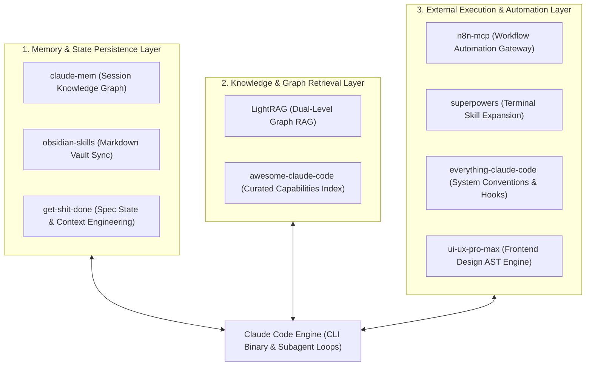
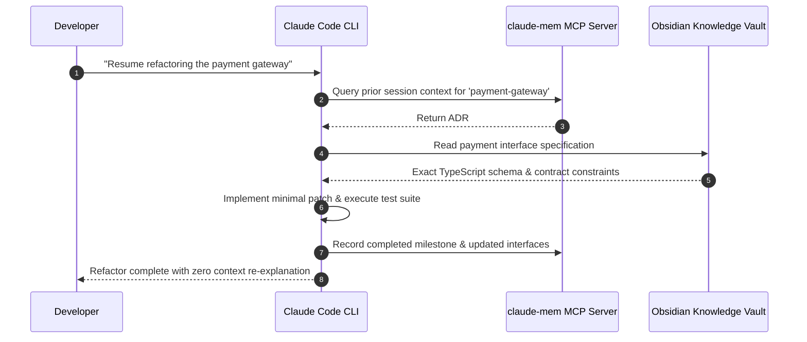
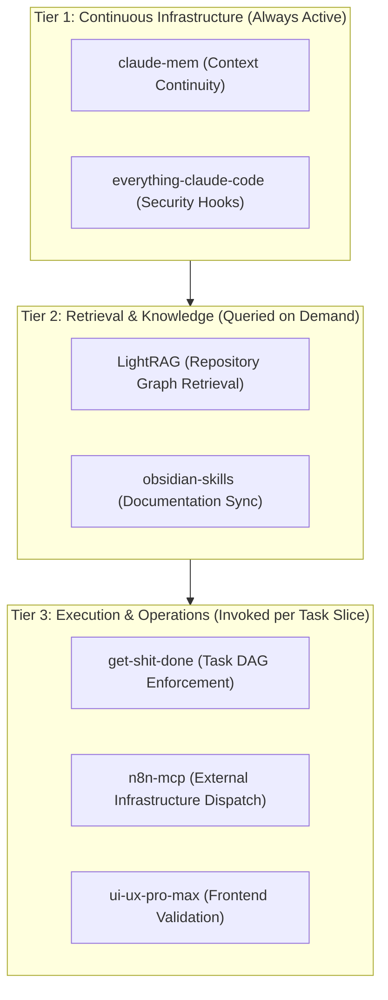

## Why Does Production Claude Code Development Require a Multi-Layered Harness Stack?

When developers first adopt Anthropic's Claude Code CLI, they are often captivated by its raw execution power in isolated tasks. Prompting the agent to inspect a failing test, edit a TypeScript interface, or refactor a database migration feels remarkably direct compared to web-based chat interfaces. However, as teams attempt to scale Claude Code across enterprise monorepos and multi-week delivery milestones, unassisted CLI execution encounters severe systemic limits.

Without external scaffolding, Claude Code suffers from four structural constraints:
1. **Context Eviction & Amnesia**: Starting a fresh session wipes previous architectural decisions, forcing developers to re-explain domain models repeatedly.
2. **Execution Isolation**: The native CLI operates within local shell environments but lacks native bridges to organizational workflows (such as Jira tickets, Slack channels, or CI/CD pipelines).
3. **Retrieval Blindness**: In multi-gigabyte repositories, relying solely on `ripgrep` or file dumps causes prompt token bloat and misses distant semantic relationships.
4. **Unconstrained Drift**: Without formal task specifications and verification boundaries, autonomous agents author unneeded abstractions and drift from user intent.

In 2026, high-velocity engineering organizations overcome these limits by layering specialized open-source repositories on top of the native Claude Code runtime. Rather than treating Claude Code as a standalone assistant, they deploy it within a cohesive harness stack spanning memory persistence, retrieval-augmented generation (RAG), external workflow automation, and spec-driven execution.

---

## Deconstructing the Nine Essential Repositories

The open-source ecosystem surrounding Claude Code has crystallized into nine pivotal repositories that solve critical operational bottlenecks:

### 1. Memory and Context Persistence
- **`claude-mem` (thedotmack/claude-mem)**: Implements persistent cross-session memory for Claude Code. By extracting entity-relationship graphs from completed sessions and persisting them into local SQLite/Markdown stores, `claude-mem` injects relevant historical decisions into future session preambles, eliminating repetitive onboarding context.
- **`obsidian-skills` (kepano/obsidian-skills)**: Authored by Obsidian founder Stéphane Angoulvant (kepano), this toolkit integrates Claude Code directly with local Obsidian Markdown vaults. Agents read Architecture Decision Records (ADRs), update daily developer notes, and query vault wikilinks to ensure technical decisions are documented in durable team knowledge bases.
- **`get-shit-done` (gsd-build/get-shit-done)**: A disciplined meta-prompting and context-engineering harness designed for complex code migrations. GSD enforces strict task boundaries, generates intermediate plan state files, and requires agents to prove test coverage before reporting task completion.

### 2. Grounded Knowledge Retrieval
- **`LightRAG` (HKUDS/LightRAG)**: A graph-based retrieval-augmented generation engine that outperforms flat vector chunking in large repositories. LightRAG constructs dual-level knowledge graphs combining low-level entity relations with high-level topical themes, allowing Claude Code to answer questions spanning complex multi-service call hierarchies with minimal token overhead.
- **`awesome-claude-code` (hesreallyhim/awesome-claude-code)**: The canonical community index tracking verified MCP servers, permission hooks, role definitions, and workflow scripts. Acts as the primary discovery layer for newly published agent capabilities.

### 3. Workflow Automation and Operational Execution
- **`n8n-mcp` (czlonkowski/n8n-mcp)**: Bridges Claude Code with self-hosted n8n automation instances via the Model Context Protocol. Through `n8n-mcp`, Claude Code triggers multi-node production webhooks, queries enterprise databases, posts updates to Slack, and orchestrates deployment pipelines without requiring custom API integration glue code.
- **`everything-claude-code` (affaan-m/everything-claude-code)**: A comprehensive collection of production-tested `CLAUDE.md` rule sets, shell permission hooks, and security guardrails. Establishes defensive boundary layers that prevent Claude Code from executing destructive terminal commands (`git reset --hard`, accidental credential exposure).
- **`superpowers` (obra/superpowers)**: An extensible suite of terminal productivity utilities that augment Claude Code with rich system introspection, process monitoring, and multi-file diff visualization tools.
- **`ui-ux-pro-max` (ganavisk/nextlevelbuilder-ui-ux-pro-max-skill-Public)**: A specialized frontend design and AST generation harness that enforces design system standards, component accessibility (WCAG), and responsive layout constraints during autonomous UI authoring.

---

## Architectural Synthesis: Layering the Repositories for Production Delivery

Deploying all nine tools simultaneously without architectural discipline can overwhelm an agent's context window. Leading teams organize these tools into a structured, three-tiered operational hierarchy:

### The Recommended Starter Bundle
For engineering teams establishing their first production Claude Code harness:
1. **Immediate Setup**: Deploy `everything-claude-code` to establish security hooks and baseline `CLAUDE.md` conventions.
2. **Add Memory**: Install `claude-mem` to prevent session amnesia across multi-day feature development.
3. **Connect Automation**: Configure `n8n-mcp` to allow agents to interact with external issue trackers and staging environments.
4. **Integrate Retrieval**: Index large reference documentation using `LightRAG` to ground prompts with verified facts.

---

## Comparative Matrix: Ad-Hoc Usage vs Layered Repository Harness

| Workflow Dimension | Raw Standalone Claude Code | Layered Repository Harness Stack |
| :--- | :--- | :--- |
| **Session Memory** | 100% Ephemeral (Lost on exit) | Compounding entity graph persisted locally via `claude-mem` |
| **Security & Guardrails** | Interactive manual prompts per command | Deterministic hook interceptors via `everything-claude-code` |
| **Codebase Search** | Unstructured `grep` / file dumping | Dual-level entity graph retrieval via `LightRAG` |
| **External Systems** | Isolated to local terminal shell | Multi-system orchestration via `n8n-mcp` |
| **Documentation Sync** | Forgotten or post-hoc authoring | Real-time Architecture Decision Record sync via `obsidian-skills` |
| **Task Predictability** | Prone to unconstrained scope drift | Spec-driven boundary enforcement via `get-shit-done` |

For engineering teams designing scalable agent workflows, our related source audits on [Oh-My-Codex multi-agent orchestration](/posts/oh-my-codex-agents/), [Agentation and Readout for Claude Code](/posts/agentation-readout-claude-codex/), and the [Agentic Engineering 9 skills](/posts/agentic-engineering-9-skills/) provide complementary architectural frameworks.

---

## How Claude Code Community Frameworks Evolved Across 2026

Throughout 2026, the community ecosystem surrounding Claude Code underwent rapid industrialization:

1. **Convergence on the Model Context Protocol (MCP)**: Custom proprietary shell wrappers were replaced by standardized MCP servers. Repositories like `n8n-mcp` and `claude-mem` expose tools as typed JSON-RPC endpoints that interoperate seamlessly across Claude Code, Codex, and Gemini CLI runtimes.
2. **Defensive PreToolUse and PostToolUse Hooks**: Security matured from optional checklists into programmatic enforcement. Frameworks like `everything-claude-code` leverage Claude Code's native hook lifecycle to intercept shell calls, blocking unauthorized file writes or network egress attempts before execution.
3. **Graph-Augmented Code Search**: Linear grep search was replaced by localized Graph RAG engines. Developers run lightweight embedded graph databases that index symbol call chains and class hierarchies, providing high-precision context in fractions of a second.
4. **Shared Team Skill Registries**: Development organizations moved away from individual developer prompt snippets. Repositories act as centralized, version-controlled skill hubs where team-approved testing, refactoring, and security rules are distributed automatically to all engineering workstations.

---

## Key Takeaways

- **Scaffolding Multiplies Agent Capability**: Raw language models are powerful, but their enterprise utility is governed by the memory, retrieval, and automation harnesses that surround them.
- **Persistent Memory Eliminates Onboarding Friction**: Capturing session context into structured graph databases prevents developers from wasting hours re-explaining architecture.
- **MCP Unlocks Enterprise Automation**: Bridging the terminal agent with workflow engines like n8n turns Claude Code into an operational control plane.
- **Security Hooks Are Mandatory**: Autonomous coding in production repositories requires defensive hook interceptors to prevent destructive file edits and credential leaks.

---

## New Questions

- How can cross-session memory systems dynamically invalidate outdated architectural knowledge when a codebase undergoes massive breaking refactors?
- What are the networking and latency overheads of chaining multiple local MCP servers during rapid interactive coding loops?
- Can community-authored prompt and skill repositories be automatically scanned for subtle prompt-injection vulnerabilities before being imported into private team environments?

---

## References

- Anthropic. (2025). *Claude Code: The Autonomous Agentic CLI for Software Engineering*. Technical Documentation. Available at: https://docs.anthropic.com/en/docs/agents-and-tools/claude-code (accessed 2026-10-18).
- Mack, T. (2025). *claude-mem: Persistent Memory and Context Retention for Claude Code*. GitHub Repository. Available at: https://github.com/thedotmack/claude-mem (accessed 2026-10-18).
- Guo, Z., et al. (2024). *LightRAG: Simple and Fast Retrieval-Augmented Generation with Dual-Level Knowledge Graphs*. arXiv preprint arXiv:2410.05779. Available at: https://arxiv.org/abs/2410.05779 (accessed 2026-10-18).
- Model Context Protocol Contributors. (2025). *Model Context Protocol Specification*. Anthropic PBC. Available at: https://modelcontextprotocol.io/introduction (accessed 2026-10-18).
