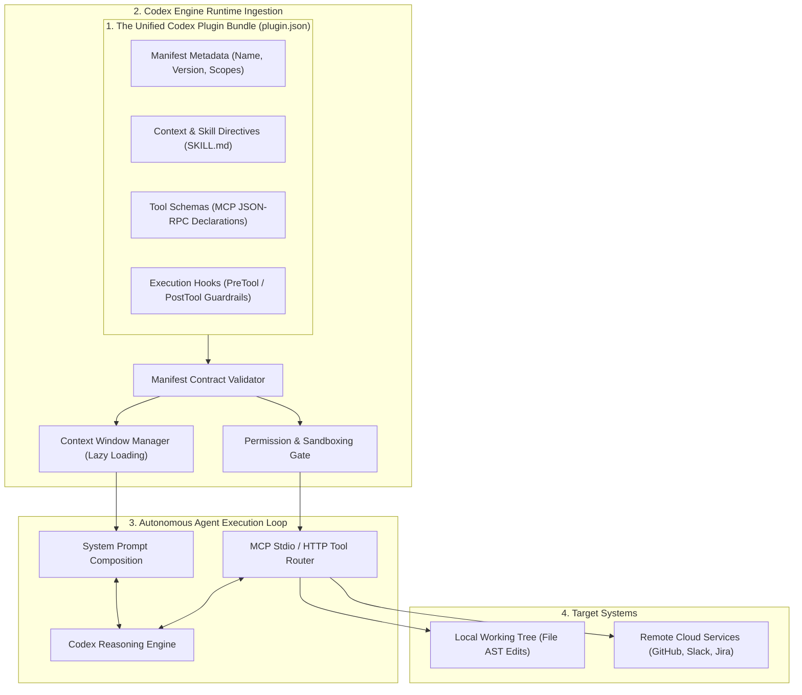
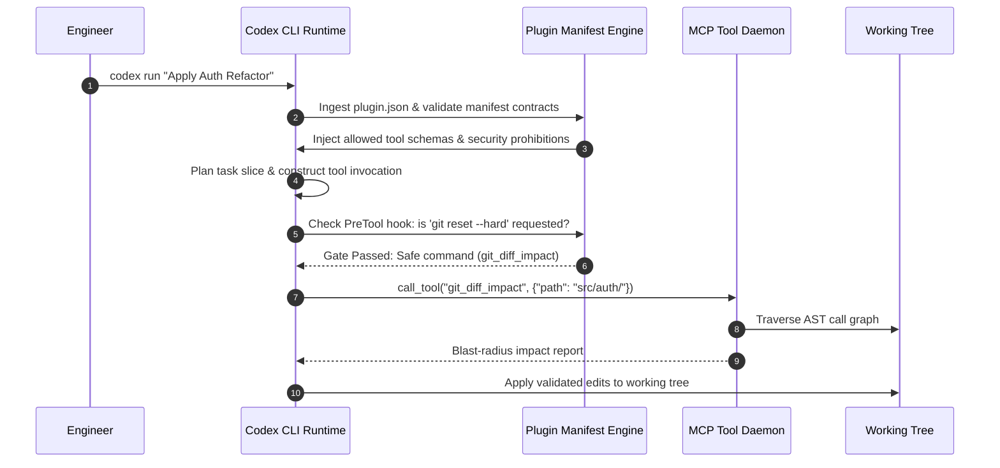
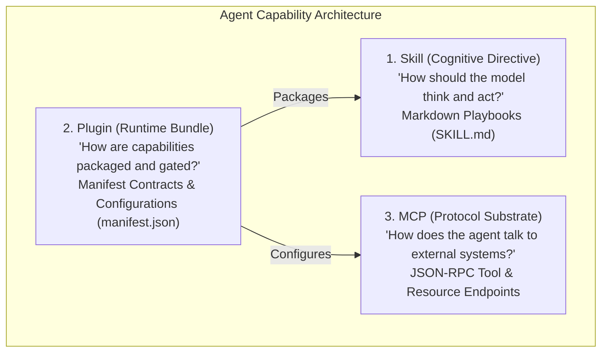

## Why Are Codex Plugins Runtime Execution Bundles Rather Than Mere App Connectors?

In early conversational AI tools, the mental model for an "extension" or "plugin" was borrowed from consumer web browsers: a simple toggle that connected an assistant to an external service like GitHub, Google Drive, or Notion. Under this simplistic view, a plugin was merely an API key connector that allowed an LLM to query third-party endpoints.

When deployed in production software engineering workflows, however, treating plugins as simple API connectors fails completely. An autonomous agent operating in a terminal environment does not just query remote APIs; it executes shell scripts, enforces security constraints, modifies file ASTs, consults architecture decision records, and follows multi-step verification playbooks. If an agent loads an external tool without accompanying behavioral rules, execution contracts, and failure-recovery protocols, it frequently misuses parameters, hallucinates schema definitions, and executes destructive uncommitted changes.

As explored in Seowoo Han’s architecture analysis, OpenAI Codex plugins represent a fundamentally different design paradigm: **a plugin is a unified runtime capability bundle**. Rather than implementing isolated business logic, a Codex plugin bundles user-facing manifests, operational skill directives, connector surfaces, and Model Context Protocol (MCP) tool schemas into a single version-controlled package that shapes model cognition and tool execution at runtime.



---

## Deconstructing the Codex Plugin Architecture

A production-grade Codex plugin is packaged as a structured directory comprising four interdependent layers:

```text
my-codex-plugin/
├── .codex-plugin/
│   └── manifest.json        # Canonical runtime declaration contract
├── skills/
│   └── code-review.md       # Operational directives and behavioral guardrails
├── mcp/
│   └── server.json          # MCP tool endpoint declarations (stdio / HTTP)
└── hooks/
    └── pre-execution.sh     # Defensive shell execution interceptors
```

### 1. The Manifest Contract (`manifest.json`)
The manifest does not contain operational logic; instead, it establishes the architectural contracts that govern how the plugin interacts with the Codex runtime:

```json
{
  "schema_version": "1.0",
  "name": "enterprise-git-flow",
  "version": "2.4.0",
  "description": "Enforces conventional commits, branch safety, and automated PR auditing.",
  "contracts": {
    "context": {
      "required_skills": ["skills/code-review.md"],
      "eager_load": false
    },
    "tools": {
      "mcp_server": "mcp/server.json",
      "allowed_tools": ["git_diff_impact", "commit_conventional_patch"]
    },
    "security": {
      "sandbox": "read-write-workspace",
      "prohibited_commands": ["git push --force", "git reset --hard"],
      "network_egress": ["api.github.com"]
    }
  }
}
```



---

## The Four Core Operational Contracts

To prevent plugins from failing in production environments, Codex plugin architecture enforces four strict operational contracts:

### 1. The Context Contract
The context contract specifies *what the model must know before taking action*. In complex enterprise repositories, loading every API document into the initial prompt window exhausts token limits. The context contract defines lazy-loading triggers: general guidelines are summarized in high-density headings, while deep reference tables and domain schemas are fetched into memory only when specific tasks are initiated.

### 2. The Tool Contract
The tool contract standardizes *how tools are exposed and validated*. By adhering to the Model Context Protocol (MCP), plugins declare their capabilities as JSON-RPC 2.0 schemas. Parameters are strongly typed with explicit type validation (using JSON Schema), ensuring that agents cannot invoke tools with missing or malformed arguments.

### 3. The Execution Contract
The execution contract defines *what actions may occur autonomously versus what requires human confirmation*. Read-only diagnostic queries (`git status`, `npm test`, `cargo check`) are flagged for auto-execution, allowing the agent to loop rapidly during implementation. Destructive or mutating operations (`rm -rf`, `docker system prune`, remote branch deletion) trigger mandatory human approval prompts.

### 4. The Observability and Ops Contract
The ops contract mandates *how failures and telemetry are handled*. When a tool call returns an error, the plugin specifies retry bounds, exponential backoff policies, and structured error reporting. Instead of crashing the session, errors are normalized into diagnostic feedback that the model uses to correct its next attempt.

---

## Skill vs Plugin vs MCP: The Tri-Partite Model

Confusion often arises between skills, plugins, and MCP servers. Understanding their distinct architectural roles clarifies modern agent design:



| Layer | Primary Role | Core Artifact | Key Question Answered |
| :--- | :--- | :--- | :--- |
| **Skill** | Cognitive playbook | `SKILL.md` markdown file | *“What rules and steps must the model follow to perform this specific task consistently?”* |
| **Plugin** | Runtime capability bundle | `manifest.json` & directory | *“How do we package context, permission scopes, hooks, and tools into a versioned unit?”* |
| **MCP Server** | Protocol communication bus | Stdio / HTTP JSON-RPC daemon | *“How does the agent invoke external system tools and query data safely across networks?”* |

For engineering teams evaluating multi-agent orchestration and CLI tooling, our companion source audits on [Oh-My-Codex multi-agent orchestration](/posts/oh-my-codex-agents/), [Rewrite Your CLI for Agents](/posts/rewrite-cli-for-agents/), and [Agentic Engineering Patterns](/posts/agentic-engineering-patterns-simon-willison/) provide practical operational context.

---

## How Agent Plugin Bundles Evolved Across 2026

Throughout 2026, agent plugin systems transitioned from simple API catalogs into sophisticated, sandboxed software modules:

1. **Deterministic Bundle Lockfiles**: Similar to `package-lock.json` in Node.js or `Cargo.lock` in Rust, agent runtimes introduced `plugin.lock`. Lockfiles record exact cryptographic hashes of all bundled `SKILL.md` directives and MCP server binaries, preventing unauthorized upstream prompt mutations from altering production agent behavior.
2. **Ephemeral WebAssembly (WASM) Sandboxing**: To protect developer workstations from supply-chain attacks, plugin tool binaries execute within isolated WebAssembly sandboxes (such as WASI-NN runtimes). Plugins cannot access arbitrary filesystem directories or network sockets unless explicitly declared in the manifest.
3. **Cross-Runtime Manifest Interoperability**: While early plugins were locked to OpenAI Codex, industry standardization converged on open runtime bundle specifications. A single manifest contract operates across OpenAI Codex, Anthropic Claude Code, and Google Gemini CLI without code refactoring.
4. **Dynamic Context-Aware Capability Pruning**: Modern harnesses analyze the user's prompt intent at session initialization. If an engineer is working purely on CSS styling, backend database plugins and deployment tools are completely pruned from the model's active context, keeping prompt token overhead minimal and eliminating tool selection collisions.

---

## Key Takeaways

- **Plugins Are Packaging Layers, Not Just APIs**: A plugin is an architectural bundle uniting cognitive skills, tool protocols, security guardrails, and telemetry contracts.
- **Manifests Define Behavioral Boundaries**: The manifest contract dictates permission scopes and command allowlists, preventing agents from executing destructive operations.
- **The Tri-Partite Model Clears Confusion**: Skills dictate cognitive procedures, MCP defines protocol interfaces, and plugins bundle them into version-controlled deliverables.
- **Contract-First Design Prevents Drift**: Defining explicit context, tool, and execution contracts turns unpredictable conversational agents into reliable, production-ready developer tools.

---

## New Questions

- How can conflicting tool schemas be reconciled when two independent plugins expose tools with identical functional semantics?
- What are the performance overheads of verifying cryptographic lockfiles and manifest signatures on every agent turn?
- Can formal verification prove that a plugin's declared security sandbox cannot be bypassed through multi-turn prompt injection?

---

## References

- Han, S. (2026). *How Plugins Actually Work in OpenAI Codex: From App Connectors to Runtime Execution Bundles*. LinkedIn Engineering Pulse. Available at: https://kr.linkedin.com/pulse/codex-plugin-architecture (accessed 2026-10-18).
- OpenAI. (2025). *OpenAI Codex: Extensions, Plugins, and Custom Environments*. Technical Documentation. Available at: https://platform.openai.com/docs/guides/code-generation (accessed 2026-10-18).
- Model Context Protocol Contributors. (2025). *Model Context Protocol Specification*. Anthropic PBC. Available at: https://modelcontextprotocol.io/introduction (accessed 2026-10-18).
- Anthropic. (2025). *Claude Code Architecture and Extension Ecosystem*. Technical Report. Available at: https://docs.anthropic.com/en/docs/agents-and-tools/claude-code (accessed 2026-10-18).
