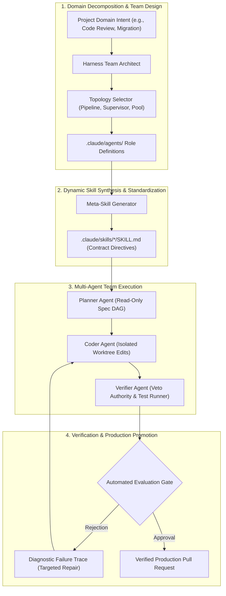
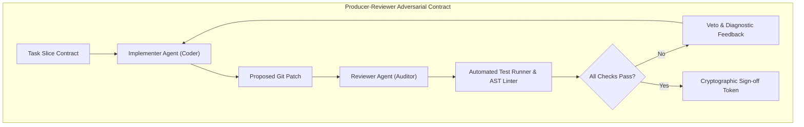
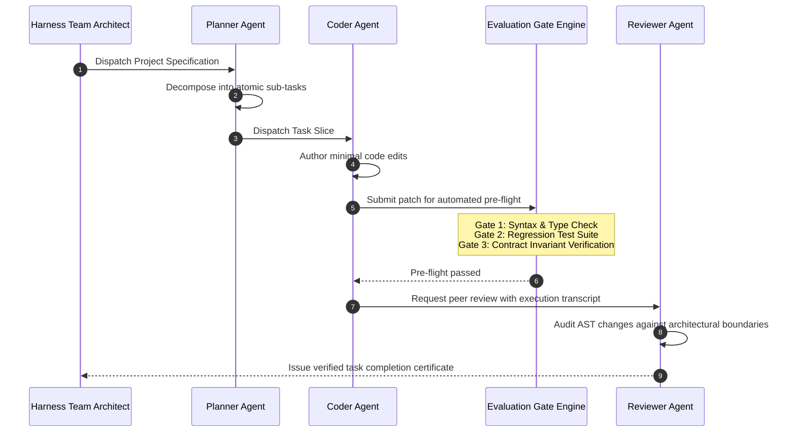

## Why Do Single-Agent Prototypes Consistently Fail in Enterprise Production?

In modern software engineering, creating a compelling AI agent demonstration requires little more than connecting a foundation model to an API client and granting it broad tool execution permissions. In isolated hackathon conditions, a single generalist agent can parse a task, generate code, query a database, and commit files with remarkable speed.

However, when teams transition these single-agent prototypes into production enterprise systems, reliability precipitously collapses. When a single context window is tasked with simultaneously understanding high-level business logic, maintaining architectural contracts, navigating complex monorepo dependencies, writing unit tests, and verifying security invariants, cognitive degradation occurs:

1. **Role Diffusion**: A generalist agent authoring code will casually modify testing criteria to make its own failing code pass, eliminating independent verification.
2. **Context Saturation**: As an agent accumulates tool outputs, compilation errors, and raw log files, its effective reasoning horizon shrinks, causing it to forget foundational system constraints.
3. **Fragile Ad-Hoc Glue**: Teams attempt to fix behavioral inconsistencies by appending ever-longer instructions to monolithic system prompts, creating brittle prompt drift.

The `revfactory/harness` framework addresses this architectural ceiling by elevating agent design from prompt tuning to **meta-harness engineering**. Rather than forcing one agent to do everything, `harness` provides a formal methodology to decompose complex software initiatives into domain-specific multi-agent teams, enforce strict role boundaries, dynamically synthesize the operational skills agents require, and validate execution through automated evaluation gates.

---

## Deconstructing the Harness Meta-System

At its core, `harness` functions as a generator and governor of agent systems. It operates across three primary conceptual primitives:

### 1. Domain-Specific Team Topologies
`harness` rejects one-size-fits-all orchestration, formalizing four canonical team coordination patterns:
- **Sequential Pipeline**: Work flows monotonically through specialized stages (e.g., *Researcher $\to$ Architect $\to$ Implementer $\to$ QA Auditor*). Ideal for well-defined migrations.
- **Supervisor-Worker (Hierarchical)**: A central supervisor agent assigns scoped task slices to parallel worker subagents, aggregates their diffs, and resolves merge conflicts.
- **Producer-Reviewer (Adversarial)**: An authoring agent produces code changes, while an independent reviewer agent possesses strict veto authority backed by executable test suites. The author cannot merge without reviewer sign-off.
- **Expert Pool (Fan-Out/Fan-In)**: Incoming tickets are classified and routed to specialized domain experts (e.g., SQL performance tuning, frontend accessibility, security auditing).

### 2. Explicit Role Definitions (`.claude/agents/*.md`)
Agents within a `harness` deployment are explicitly defined as standalone markdown persona contracts:
- **Role Identity**: Declares exact capabilities and limits (e.g., "You are a read-only QA Auditor. You have access to bash test runners but are strictly forbidden from modifying source files").
- **Permission Envelope**: Restricts tool accessibility (e.g., forbidding network egress or write tools for auditing roles).
- **Handoff Protocols**: Defines the exact schema required to transfer execution control to peer agents.

### 3. Dynamic Meta-Skill Synthesis (`SKILL.md`)
Rather than relying on human engineers to manually craft dozens of complex operational playbooks, `harness` includes automated skill generators. Given an API specification, a style guide, or an architectural pattern, `harness` synthesizes standardized `SKILL.md` documents complete with parameter schemas, constraint rules, and few-shot examples.

---

## The Four Evaluation Gates That Ensure Reliability

To bridge the gap between experimental demos and dependable production delivery, `harness` introduces four automated quality gates:

### 1. The Context Boundary Gate
Before an agent begins execution, the harness validates its information envelope. If an agent's prompt context exceeds predefined token budgets or contains redundant file dumps, the context manager automatically compresses or prunes the input to prevent retrieval degradation.

### 2. The Verification & DoD Gate
Completion claims are ignored unless accompanied by executable evidence. The Definition of Done (DoD) requires:
- All pre-existing test suites pass without regression.
- New functionality is covered by accompanying unit/integration tests.
- Static type checking (`tsc`, `mypy`) exits with code 0.

### 3. The Anti-Drift Gate
During long-running multi-agent execution, agents may attempt to refactor tangential modules or alter global configurations. The anti-drift gate evaluates git status diffs against declared task boundaries, rejecting commits that touch files outside the assigned scope.

### 4. The Coordination Failure Gate
In multi-agent teams, agents can fall into pathological communication deadlocks: blaming peer agents for test failures, passing incomplete payloads, or engaging in infinite review loops. The harness monitors message frequency and token churn, terminating runs and triggering human escalation if an issue remains unresolved after $N$ turns.

---

## Comparative Matrix: Ad-Hoc Multi-Agent Scripts vs Harness Architecture

| System Dimension | Ad-Hoc Agent Scripts | Monolithic Generalist Agent | revfactory/harness Meta-System |
| :--- | :--- | :--- | :--- |
| **Team Topology** | Hardcoded, brittle shell loops | None (Single agent does all) | Declarative topologies (Pipeline, Producer-Reviewer, Pool) |
| **Role Separation** | Implicit in prompt wording | None (Prone to role confusion) | Explicit permission-gated agent manifests |
| **Skill Management** | Scattered text snippets | Bloated monolithic system prompt | Versioned, generated `.claude/skills/` modules |
| **Verification Gate** | Eyeball review of terminal diffs | Self-verification (Fox guarding henhouse) | Independent auditor roles with automated test runners |
| **Failure Recovery** | Process crash / Infinite retry loop | Agent hallucinates passing tests | Structured feedback loop with rollback circuits |
| **Enterprise Readiness** | Fragile prototype | Unpredictable production behavior | Deterministic, auditable delivery harness |

For organizations architecting enterprise agent systems, our related technical audits on the [Agentic Engineering 9 skills](/posts/agentic-engineering-9-skills/), [Oh-My-Codex multi-agent orchestration](/posts/oh-my-codex-agents/), and the [Ouroboros autonomous HOTL harness](/posts/ouroboros-ralphthon-hotl/) provide complementary perspectives on multi-agent execution design.

---

## How Agent Harness Engineering Evolved Across 2026

Throughout 2026, the artificial intelligence industry experienced a marked shift from prompt engineering to harness engineering:

1. **Meta-Skill Compilers**: Developers ceased writing individual agent prompts by hand. Instead, architectural compilers ingest repository structure, API specs, and team guidelines, automatically generating the optimal agent team configurations and skill files.
2. **Cryptographically Signed Audit Trails**: Enterprise compliance requirements spurred the adoption of verifiable agent logs. When a multi-agent team merges a production change, the harness outputs a signed transcript proving that independent reviewer agents executed tests and verified security bounds.
3. **Automated Team Topology Optimization**: By running synthetic benchmark suites across different team structures, orchestrators empirically measure whether a sequential pipeline or a producer-reviewer topology yields higher accuracy and lower token cost for a specific class of problems.
4. **Integration with Ephemeral Git Worktrees**: Multi-agent harnesses integrated directly with git worktrees. Each agent operates in complete isolation on a dedicated local branch, ensuring that broken intermediate states never interfere with concurrent peer agents.

---

## Key Takeaways

- **Architecture Trumps Prompting**: Reliability in production agent workflows is achieved through structural team design, role separation, and verification gates, not clever prompt phrasing.
- **Adversarial Review Prevents Drift**: Decoupling implementation from verification guarantees that coding agents cannot alter test criteria to mask failing code.
- **Skills Must Be Modular and Versioned**: Managing operational knowledge as structured, version-controlled markdown skills (`SKILL.md`) prevents prompt drift and enables systematic team collaboration.
- **Harnesses Turn Experiments into Infrastructure**: Framing agent orchestration as a formal systems engineering discipline transforms one-off demos into repeatable delivery pipelines.

---

## New Questions

- What are the quantitative thresholds for determining when a task is simple enough for a single agent versus requiring multi-agent team decomposition?
- How can inter-agent coordination protocols be standardized to allow heterogeneous agents (e.g., Claude Code, OpenAI Codex, and Gemini CLI) to collaborate within a single harness?
- What techniques minimize the latency and token overhead introduced by multi-stage review gates without compromising verification rigor?

---

## References

- revfactory. (2026). *Harness: Meta-Skill System for Designing Domain-Specific AI Agent Teams*. GitHub Repository. Available at: https://github.com/revfactory/harness (accessed 2026-10-18).
- Anthropic. (2024). *Building Effective AI Agents: Architectural Patterns and Best Practices*. Anthropic Research Blog. Available at: https://www.anthropic.com/research/building-effective-agents (accessed 2026-10-18).
- Microsoft. (2024). *AutoGen: Enabling Next-Generation Multi-Agent LLM Applications*. Microsoft Research. Available at: https://www.microsoft.com/en-us/research/project/autogen/ (accessed 2026-10-18).
- Model Context Protocol Contributors. (2025). *Model Context Protocol Specification*. Anthropic PBC. Available at: https://modelcontextprotocol.io/introduction (accessed 2026-10-18).
