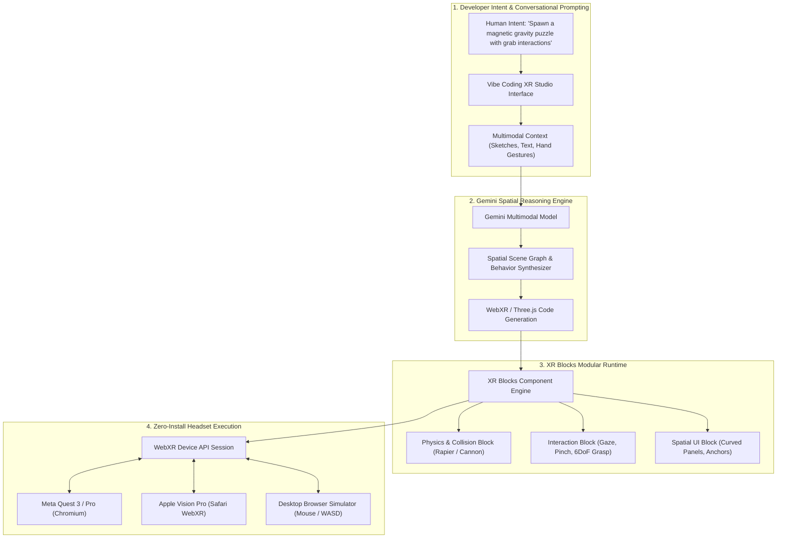
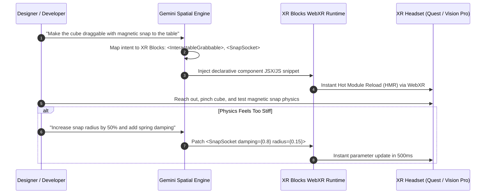

## Why Did Spatial Computing Demand Intent-to-Spatial Compilation Over Manual 3D Setup?

Over the past decade, Extended Reality (XR)—spanning Virtual Reality (VR), Augmented Reality (AR), and Mixed Reality (MR)—has remained one of the most cost-prohibitive categories of software to prototype. While web and mobile developers can test a novel user experience within hours using lightweight frameworks like React or Tailwind, building even a trivial spatial prototype has traditionally required configuring heavyweight game engines (Unity or Unreal), setting up native hardware SDKs (OpenXR, Meta Quest, Apple visionOS), writing complex 3D linear algebra routines, rigging spatial coordinate transforms, and configuring real-time physics engines.

As a consequence of this high setup friction, countless promising spatial interaction concepts died before being validated. Product designers, researchers, and game developers could not justify spending three weeks of specialized engineering labor merely to test whether a spatial physics interaction felt natural to human hands.

Google Research’s **Vibe Coding XR** initiative was developed to dismantle this setup barrier. By pairing Google’s multimodal foundation models (Gemini 2.0 / 2.5) with an open-source, modular WebXR framework named **XR Blocks**, Vibe Coding XR enables developers to build, test, and iterate on interactive 3D spatial experiences entirely through conversational natural language prompts and instant browser reloading.



---

## The Dual-Pillar Architecture: Gemini and XR Blocks

Vibe Coding XR succeeds because it avoids the primary failure mode of naive AI coding: expecting a raw language model to author thousands of lines of low-level 3D math and graphics rendering boilerplate from scratch. Instead, the architecture couples high-level intent compilation with a highly structured, reusable component framework.

### 1. Gemini as Intent-to-Spatial Compiler
Frontier models like Gemini possess rich spatial reasoning capabilities trained across multimodal datasets: video physics, 3D mesh representations, CAD drawings, and WebGL codebases. In Vibe Coding XR, Gemini acts as a high-level spatial compiler. When a developer types:
> *"Create a floating workbench where picking up a blue orb increases room gravity, and placing it into a pedestal activates a glowing solar system hologram."*

Gemini does not author raw WebGL shaders. Instead, it translates this natural language narrative into a declarative scene graph composed of typed XR Blocks primitives, connecting event handlers to pre-built spatial behaviors.

### 2. XR Blocks: The Composable WebXR Building Blocks
XR Blocks is an open-source, modular component library built on top of WebXR, Three.js, and modern physics runtimes (such as Rapier.js). It provides bulletproof, pre-tested abstractions for the hardest aspects of spatial development:

- **6DoF Controller & Hand Tracking**: Standardized input abstraction handling pinch gestures, controller triggers, palm tracking, and raycast pointing across diverse headsets.
- **Physics & Snapping Primitives**: Rigid-body physics, magnetic socket snapping, gravitational attractors, and constraint joints.
- **Spatial UI & Text**: High-resolution text rendering using Signed Distance Field (SDF) fonts and curved interactive surface meshes.
- **Audio & Haptic Feedback**: Spatialized WebAudio nodes that position sound effects dynamically in 3D coordinate space relative to the listener's head.



---

## Technical Comparison: Traditional XR Prototyping vs Vibe Coding XR

Examining the operational metrics between traditional game engine prototyping and Vibe Coding XR illustrates why lightweight WebXR stacks are reshaping spatial research.

| Development Dimension | Traditional Game Engine (Unity / Unreal) | Raw WebGL / Three.js Scripting | Vibe Coding XR (Gemini + XR Blocks) |
| :--- | :--- | :--- | :--- |
| **Prototyping Cycle Time** | 3 to 14 days per concept | 1 to 3 days per concept | 5 to 15 minutes per concept |
| **Tooling & Setup** | 30GB+ engine download, native SDKs, USB debugging | Node.js, Webpack, manual math routines | Zero-install browser URL (WebXR compliant) |
| **Cross-Device Testing** | Recompile APK / Xcode build per device | Instant browser refresh | Instant browser refresh across Quest & Vision Pro |
| **Interaction Abstraction** | Engine-specific physics & XR interaction toolkits | Custom raycasting and quaternion math | Modular pre-built XR Blocks components |
| **Target Audience** | Specialized 3D/C# graphics engineers | Experienced web frontend engineers | Cross-functional designers, PMs, and researchers |
| **Iteration Velocity** | Minutes to hours per build iteration | Seconds per code edit | Real-time conversational parameter tuning |

For teams building interactive and visual agent systems, our companion technical analyses on [Agentation and Readout for UI grounding](/posts/agentation-readout-claude-codex/), [UI-TARS desktop visual agent](/posts/ui-tars-desktop/), and [learning to develop games with AI](/posts/learn-to-develop-game/) provide complementary perspectives on human-agent interaction design.

---

## Architectural Breakdown: A Declarative XR Block Specification

A sample component generated by Gemini demonstrates the clarity and compactness of the XR Blocks architecture:

```javascript
// Declarative Spatial Scene Generated by Gemini via XR Blocks
import { Scene, World, SpatialObject, Physics, SnapSocket, Grabbable } from 'xr-blocks';

export function GravityLab() {
  return (
    <World gravity={[0, -9.81, 0]}>
      {/* Interactive Table Surface */}
      <SpatialObject position={[0, 0.8, -1.0]} geometry="box" dimensions={[1.2, 0.05, 0.8]}>
        <Physics type="static" />
        
        {/* Magnetic Snap Socket */}
        <SnapSocket 
          id="socket-gravity-core"
          position={[0, 0.05, 0]}
          snapRadius={0.15}
          onSnap={(entity) => console.log('Core engaged:', entity.id)}
        />
      </SpatialObject>

      {/* Physics-Enabled Grabbable Orb */}
      <SpatialObject position={[0.2, 0.9, -0.9]} geometry="sphere" dimensions={[0.08]}>
        <Physics type="dynamic" mass={1.2} />
        <Grabbable 
          snapToHand={true}
          hapticFeedback={{ intensity: 0.6, duration: 40 }}
          highlightOnHover={true}
        />
      </SpatialObject>
    </World>
  );
}
```

By abstracting hand tracking, physics engine collision meshes, and WebXR render loops behind declarative JSX components, Gemini can manipulate complex spatial relationships with high syntactic reliability and zero hallucinated math bugs.

---

## How Spatial Computing Prototyping Evolved Across 2026

Throughout 2026, spatial computing prototyping underwent a dramatic democratization:

1. **WebXR as the Universal Prototyping Bedrock**: Rather than authoring native binaries for visionOS, Meta Horizon OS, and Android XR independently, spatial teams standardized on WebXR for Phase 1 concept validation. If an interaction feels compelling in WebXR, it receives production funding for native porting; if it fails, it is discarded with minimal sunk cost.
2. **Multimodal Spatial Copilots**: Developers no longer describe spatial coordinates using text numbers alone. In 2026, developers wear headsets while prompting the model verbally, pointing to physical desks and gesturing in space: *"Put a control panel right where I am pointing, angled 15 degrees toward my eyes."*
3. **Automated Ergonomic and Accessibility Auditing**: Prototyping runtimes incorporate automated biomechanical checks. If a generated UI panel requires repetitive shoulder flexion or places buttons outside the optimal comfort zone of human arm reach, the runtime issues immediate visual ergonomic warnings.
4. **Instant Photorealistic Gaussian Splat Integration**: Modern XR Blocks runtimes allow developers to drag-and-drop 3D Gaussian Splats of real-world environments directly into the scene, testing digital interactive mechanics inside high-fidelity digital twins of factories, offices, and living rooms in seconds.

---

## Key Takeaways

- **Cheap Prototyping Unlocks Innovation**: Reducing the cost of testing spatial concepts from weeks to minutes allows cross-functional teams to explore radical interaction ideas that would otherwise be abandoned.
- **Structure Enables AI Generation**: Generative models cannot reliably build complex 3D experiences from raw math; coupling language models with structured component libraries (XR Blocks) guarantees stability and high fidelity.
- **WebXR Eliminates Friction**: Bypassing engine compilation and app-store sideloading through instant browser execution provides the tightest possible feedback loop for spatial design.
- **Ergonomics Trumps Visuals**: The true test of an XR prototype is physical feel—haptic response, grab snapping, and comfort—which can only be validated through real-time interactive testing in headsets.

---

## New Questions

- How can multimodal foundation models ingest real-time spatial video feeds from headset passthrough cameras to ground generative 3D objects against physical room clutter?
- What are the performance boundaries of WebGL/WebGPU physics engines when running complex interactive particle simulations inside battery-constrained standalone headsets?
- Can natural-language spatial prototyping tools export production-grade native assets (C# Unity prefabs or C++ Unreal blueprints) directly from validated WebXR scenes?

---

## References

- Google Research. (2025). *Vibe Coding XR: Accelerating AI-Assisted XR Prototyping with XR Blocks and Gemini*. Google Research Blog. Available at: https://research.google/blog/vibe-coding-xr-accelerating-ai-xr-prototyping-with-xr-blocks-and-gemini/ (accessed 2026-10-18).
- W3C Immersive Web Working Group. (2024). *WebXR Device API Specification*. World Wide Web Consortium. Available at: https://www.w3.org/TR/webxr/ (accessed 2026-10-18).
- Digital Bourgeois. (2026). *Vibe Coding XR: How Gemini and WebXR Transform Spatial Computing Prototyping*. Technical Review. Available at: https://digitalbourgeois.tistory.com/m/2931 (accessed 2026-10-18).
- Cabello, R., & Three.js Authors. (2025). *Three.js: JavaScript 3D Library*. Available at: https://threejs.org/ (accessed 2026-10-18).
