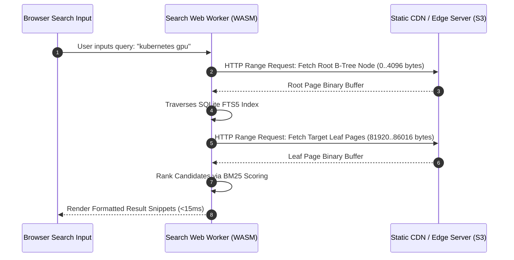

## Why Do Monolithic Client Search Bundles Cripple Technical Sites?

Static site generators (such as Jekyll, Hugo, Astro, and Starlight) represent the industry standard for publishing technical documentation, open-source AI project wikis, and engineering blogs. For modest repositories containing dozens of pages, standard client-side search implementations rely on a monolithic JSON blob (e.g., `search.json` or `lunr.json`). During site build, every Markdown document is stripped of HTML tags, tokenized, and serialized into a single aggregate file. When a user clicks the search bar, client browsers download this entire file, parse the JSON tree into JavaScript heap memory, and execute string matching or inverted index lookups in memory.

As technical publications and AI documentation repositories scale past several hundred articles, this monolithic architecture collapses under the weight of its own payload. A repository containing 300 deep technical analyses produces a `search.json` file exceeding 15 megabytes uncompressed. On mobile devices or constrained network connections, downloading and parsing a 15 MB JSON file consumes significant cellular bandwidth, causes browser thread jank, and severely degrades Core Web Vitals—specifically Largest Contentful Paint (LCP) and Interaction to Next Paint (INP).

Modern client-side search architectures have replaced monolithic file downloads with decentralized, chunked retrieval engines: compiled WebAssembly databases (SQLite-WASM, DuckDB-WASM) and statically partitioned inverted indexes (such as Pagefind).


## Deconstructing Modern Client-Side Indexing Engines

Eliminating client-side search bottlenecks requires analyzing how specialized file formats, virtual file systems, and WebAssembly execution pipelines structure textual data.

### 1. Static Sharded Inverted Indexes: The Pagefind Architecture

Pagefind fundamentally reimagines static search by treating the search index as a sharded, cacheable static asset hierarchy rather than an in-memory database:
- **Build-Time Content Chunking**: Rather than outputting a single index file, Pagefind parses rendered HTML files post-build. It extracts semantic text elements (`<article>`, `<main>`), strips boilerplate navigation headers, and calculates word frequencies across documents.
- **Lexicographical Hash Sharding**: Inverted index postings are partitioned into distinct microscopic binary files based on word prefix hashes. For example, queries starting with "tra" load only the specific binary chunk covering that prefix (`fragment_tra.pf_fragment`, typically 20–40 KB) via HTTP range requests or direct chunk URLs.
- **Zero-Dependency Web Worker Execution**: The search engine runs entirely inside a dedicated Web Worker. All token matching, BM25 scoring, and snippet highlighting execute off the main browser thread, ensuring 60 FPS UI responsiveness and optimal Interaction to Next Paint (INP) scores.

### 2. Embedded Relational Engines: Official SQLite via WebAssembly (WASM)

For technical documentation systems requiring complex relational filtering (e.g., filtering posts by author, publication year, category, and multiple tags simultaneously), flat inverted indices lack expressiveness.

The SQLite project provides an official WebAssembly compilation with Origin Private File System (OPFS) support:
- **FTS5 Full-Text Search**: SQLite's built-in FTS5 extension supports Porter stemmers, token offsets, BM25 relevance ranking, and prefix matching directly inside the browser.
- **Memory-Mapped Binary DB Loading**: Instead of transferring raw JSON, the build process compiles articles and metadata into a highly optimized, indexed SQLite database file (`knowledge_base.db`). The client downloads this database file (which achieves up to 70% compression compared to equivalent JSON structures due to columnar binary packing).
- **HTTP Range Request Querying**: Using virtual file systems like `sql.js-httpvfs`, the browser issues HTTP Range requests to read specific B-tree pages directly from the static web server without downloading the full SQLite database file, directly mirroring [open-source data engineering lakehouse paradigms](/posts/explore-the-landscape-of-open-source-data-engineering/).



### 3. Client-Side Vector and Semantic Search: Web-Native Embeddings

In 2026 technical documentation systems, exact keyword matching is frequently augmented with semantic retrieval. Users searching for "container orchestrator memory leak" expect to find articles discussing Kubernetes OOMKilled events even if the word "leak" never appears in the text.

Client-side semantic search integrates:
- **Quantized Embedding Models**: Embedding models (such as BGE-micro or MiniLM-L6) quantized to 8-bit or 4-bit ONNX runtimes execute directly within the browser using WebGPU or WebAssembly SIMD acceleration.
- **In-Browser Approximate Nearest Neighbor (ANN)**: Lightweight vector search libraries (such as Orama or Voy) maintain HNSW or flat cosine index arrays in memory, allowing users to execute sub-30ms semantic vector queries completely offline, as explored in [minimal local AI agent runtimes](/posts/build-your-own-ai-assistant-minimal-openclaw/).

| Architecture | Query Engine | Memory Footprint | Network Transfer | Ideal Use Case |
| :--- | :--- | :--- | :--- | :--- |
| **Monolithic JSON** | Custom JS loops / Lunr | High (>60 MB heap) | Massive (100% of index downloaded) | Small sites (<50 pages) |
| **Sharded Inverted (Pagefind)** | WebAssembly / Rust | Extremely Low (<5 MB) | Microscopic (20–50 KB per query) | Technical documentation & blogs |
| **SQLite-WASM (FTS5 + VFS)** | SQLite C Engine (WASM) | Moderate (10–20 MB) | B-tree page range reads (10–100 KB) | Relational knowledge bases with multi-facet filters |
| **Client-Side Vector (WebGPU)** | ONNX Runtime Web | Moderate to High (30–60 MB) | Model binary (25 MB once, then cached) | Semantic search & offline documentation hubs |

## How Client-Side Search Evolved Across 2026

Throughout 2026, client-side data engineering transformed static websites into edge-executable applications:

1. **Native WebGPU Acceleration for Vector Embedding**: The stabilization of WebGPU across all major browser engines enabled client-side embedding generation. Modern static sites compute dense vector embeddings of user queries locally on client GPU hardware in under 5ms, eliminating the need to transmit private search queries to external third-party API providers.
2. **Standardization of Origin Private File System (OPFS)**: With OPFS becoming universal, browsers can persist multi-gigabyte analytical databases locally with near-native disk I/O performance. Documentation platforms cache full offline technical repositories, allowing developers to query complete API specs while entirely disconnected from the internet.
3. **Rust-Powered Static Indexers**: Site generation tools discarded heavy Node.js search parsers. Modern index builders written in Rust compile tens of thousands of markdown files into binary search shards in seconds, integrating cleanly into CI/CD build steps without the event loop contention analyzed in [asynchronous systems engineering](/posts/async-code-performance-issues-solutions/).
4. **AdSense and Monetization Harmony**: Rather than intrusive full-page script injections that degrade Core Web Vitals, modern publishers adopt privacy-preserving, static ad integrations. Fast-loading, highly structured content achieves higher organic search rankings and higher advertiser CPMs through demonstrated domain authority.

## Implementation: Statically Compiling Markdown into an SQLite FTS5 Database

The following Python script demonstrates how static site pipelines can compile Markdown files into an optimized, strongly-typed SQLite FTS5 database suitable for client-side WASM querying:

```python
"""
build_sqlite_search.py - Compiles Markdown documentation into an SQLite FTS5 database.
"""

import os
import sqlite3
import re
from typing import List, Dict, Any


def strip_markdown(text: str) -> str:
    """Removes Markdown syntax, code blocks, and HTML tags for indexing."""
    # Remove code blocks
    clean = re.sub(r"```[\s\S]*?```", "", text)
    # Remove inline code
    clean = re.sub(r"`.*?`", "", clean)
    # Remove HTML tags
    clean = re.sub(r"<[^>]+>", "", clean)
    # Remove Markdown links [text](url) -> text
    clean = re.sub(r"\[([^\]]+)\]\([^)]+\)", r"\1", clean)
    # Remove markdown headers and emphasis
    clean = re.sub(r"[#*_~`>-]", " ", clean)
    # Normalize whitespace
    return re.sub(r"\s+", " ", clean).strip()


def compile_search_database(posts_data: List[Dict[str, Any]], output_db_path: str = "search_index.db") -> None:
    """
    Creates an SQLite database equipped with an FTS5 full-text search virtual table.
    """
    if os.path.exists(output_db_path):
        os.remove(output_db_path)

    conn = sqlite3.connect(output_db_path)
    cursor = conn.cursor()

    # Enable write-ahead logging and optimal page size for range querying
    cursor.execute("PRAGMA page_size = 4096;")

    # 1. Structured metadata table
    cursor.execute("""
        CREATE TABLE documents (
            id INTEGER PRIMARY KEY AUTOINCREMENT,
            slug TEXT UNIQUE NOT NULL,
            title TEXT NOT NULL,
            category TEXT NOT NULL,
            date TEXT NOT NULL
        );
    """)

    # 2. Virtual Full-Text Search (FTS5) table with BM25 ranking support
    cursor.execute("""
        CREATE VIRTUAL TABLE fts_documents USING fts5(
            title,
            body,
            content='documents',
            content_rowid='id',
            tokenize='porter unicode61'
        );
    """)

    # Populate tables
    for post in posts_data:
        cursor.execute(
            "INSERT INTO documents (slug, title, category, date) VALUES (?, ?, ?, ?);",
            (post["slug"], post["title"], post["category"], post["date"])
        )
        row_id = cursor.lastrowid
        cleaned_body = strip_markdown(post["raw_content"])
        cursor.execute(
            "INSERT INTO fts_documents (rowid, title, body) VALUES (?, ?, ?);",
            (row_id, post["title"], cleaned_body)
        )

    # Optimize and compact the FTS5 B-tree index
    cursor.execute("INSERT INTO fts_documents(fts_documents) VALUES('optimize');")
    cursor.execute("VACUUM;")
    conn.commit()
    conn.close()
    print(f"Successfully compiled search index into: {output_db_path}")


if __name__ == "__main__":
    sample_posts = [
        {
            "slug": "/posts/what-is-kubernetes/",
            "title": "What is Kubernetes: GPU Scheduling and Architecture",
            "category": "AI/Tooling",
            "date": "2024-08-04",
            "raw_content": "Kubernetes GPU scheduling requires the NVIDIA GPU Operator and MIG to partition H100 resources."
        },
        {
            "slug": "/posts/explore-the-landscape-of-open-source-data-engineering/",
            "title": "Open-Source Data Engineering Architecture for Modern AI Systems",
            "category": "AI/Tooling",
            "date": "2024-08-12",
            "raw_content": "Apache Iceberg provides ACID transactions on cloud object storage with Apache Arrow zero-copy IPC."
        }
    ]

    compile_search_database(sample_posts, "dist_search.db")
```

Compiling static content into compact, structured binary databases guarantees sub-10ms search latencies, protects client memory budgets, and preserves Core Web Vitals across low-bandwidth environments.

## Key Takeaways

- **Monolithic Search Blobs Degrade Performance**: Loading multi-megabyte `search.json` files on the client causes memory bloat, network latency spikes, and severe Interaction to Next Paint (INP) degradation.
- **Sharded Inverted Indices Eliminate Latency**: Tools like Pagefind chunk indices into microscopic hash-based binary fragments, transferring only 20–50 KB per user query.
- **SQLite-WASM Enables Complex Relational Filtering**: Compiling documentation into an SQLite FTS5 database enables expressiveness (multi-tag, date, category facets) with Porter stemming and BM25 ranking.
- **Web Workers Protect Main Thread Responsiveness**: Decoupling search querying from the UI thread ensures 60 FPS scrolling and instantaneous user keystroke feedback.
- **WebGPU and Edge Embeddings Power Semantic Discovery**: Modern client-side documentation platforms execute quantized embedding models locally, delivering hybrid semantic search completely offline.

## New Questions

- How do HTTP/3 and multiplexed QUIC streams alter the optimal chunk size for static inverted index shards?
- What are the memory leak risks of long-running SQLite-WASM instances inside single-page web applications (SPAs)?
- Can client-side vector indices like HNSW be dynamically patched via static Delta updates without re-downloading complete graph layers?
- Under what content scale (number of documents and token volume) does SQLite-WASM with HTTP Range requests outperform Pagefind static binary shards?

## References

- Google Chrome Team. (2024). *Web Vitals: Essential Metrics for a Healthy Site*. Google Developers. URL: [https://web.dev/vitals/](https://web.dev/vitals/) (accessed 2026-10-18).
- Pagefind Team. (2024). *Pagefind: Fully Static Search for Low-Bandwidth Web Architectures*. CloudCannon Open Source. URL: [https://pagefind.app/](https://pagefind.app/) (accessed 2026-10-18).
- Raasveldt, M., & Mühleisen, H. (2019). *DuckDB: An Embeddable Analytical Database*. Proceedings of the 2019 International Conference on Management of Data (SIGMOD '19). URL: [https://doi.org/10.1145/3299869.3320212](https://doi.org/10.1145/3299869.3320212) (accessed 2026-10-18).
- SQLite Development Team. (2024). *SQLite Wasm: Official WebAssembly Builds of SQLite3*. SQLite Consortium. URL: [https://sqlite.org/wasm/doc/trunk/index.md](https://sqlite.org/wasm/doc/trunk/index.md) (accessed 2026-10-18).