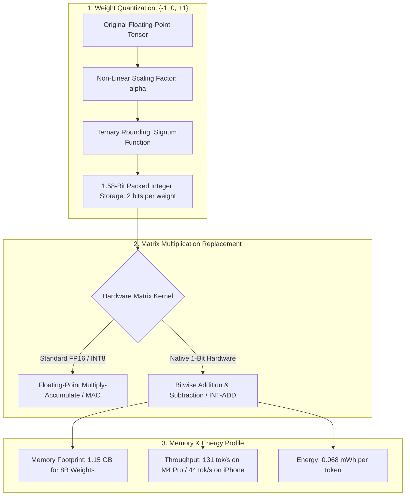
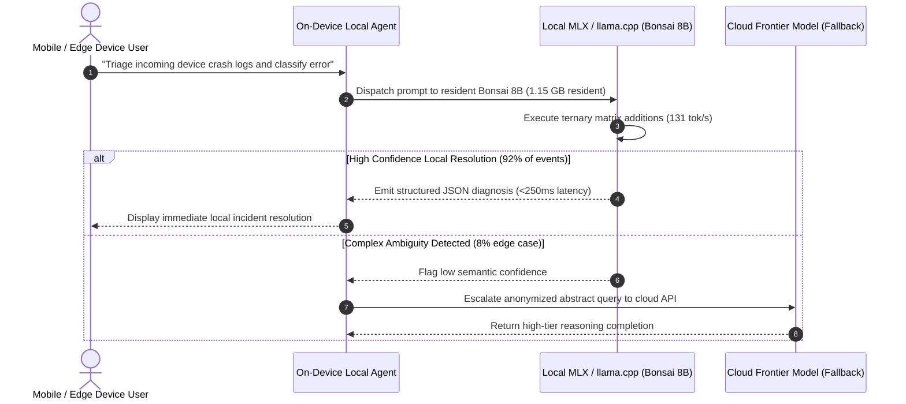

## Why Extreme Low-Bit Weight Quantization Determines the Future of On-Device Agents

For the past several years, the prevailing consensus across machine learning engineering dictated that intelligence scaling required parameter expansion. Pushing state-of-the-art benchmarks on code generation, scientific reasoning, and autonomous multi-turn planning required deploying models spanning hundreds of billions of parameters across massive GPU datacenter clusters.

While centralized cloud models excel at heavy batch synthesis, they introduce prohibitive operational constraints for consumer and edge applications:
1. **Bandwidth and Latency Inelasticity**: In real-time robotics, embedded vision, and interactive developer tooling, waiting hundreds of milliseconds for a cloud round-trip introduces unacceptable latency jitter.
2. **Privacy and Air-Gapped Governance**: Regulated industries—ranging from clinical healthcare devices to classified defense systems—strictly prohibit streaming proprietary user data to third-party cloud APIs.
3. **Thermal and Energy Ceilings**: Running full-precision 16-bit floating-point (FP16) or even standard 8-bit quantized models on mobile devices rapidly drains battery reserves and triggers thermal throttling.

Standard post-training quantization techniques (such as 4-bit AWQ or GPTQ) achieved substantial memory savings, but models continued to degrade sharply when compressed below 3 bits. 

**PrismML** challenged this paradigm with the release of the **1-bit Bonsai** family. Rather than treating quantization as an aggressive post-hoc lossy compression step, Bonsai demonstrates an end-to-end native 1-bit architecture. By shrinking an 8-billion parameter model to just **1.15 GB of memory** while sustaining generation throughputs of over 130 tokens per second on consumer silicon, PrismML proves that on-device language models can achieve practical production utility.

---

## The Architectural Foundation of True 1-Bit Computation

Many historical "low-bit" models were architectural compromises: they quantized feed-forward network weights to 2 bits while retaining token embeddings, attention projection matrices, and language model heads in full FP16 precision. These "escape hatches" preserved benchmark scores but sacrificed memory density and hardware acceleration advantages.

In contrast, PrismML’s **1-bit Bonsai 8B** is an end-to-end 1-bit network:



### 1. The Ternary BitNet Paradigm
Bonsai builds upon the theoretical foundations established by Microsoft Research's BitNet b1.58 architecture. Weights are constrained strictly to the ternary set:

$$\mathbf{W} \in \{-1, 0, +1\}^{d_{\text{in}} \times d_{\text{out}}}$$

Because weights are strictly ternary, matrix multiplication during the linear projection layers $\mathbf{Y} = \mathbf{X}\mathbf{W}$ eliminates the need for expensive floating-point multiplication (MAC) units. Instead, matrix products collapse into **simple additions and subtractions** scaled by a single layer-level scaling factor $\alpha$:

$$\mathbf{Y} = \alpha \sum (\pm \mathbf{X})$$

On current consumer hardware (such as Apple Silicon M-series or NVIDIA Ada Lovelace architectures), these integer additions drastically reduce memory bus traffic. On future dedicated 1-bit ASIC hardware, replacing multiplier silicon with adder trees promises orders-of-magnitude energy efficiency improvements.

---

## Intelligence Density: The Metrics That Matter for Edge Systems

PrismML introduces **Intelligence Density** as the core operational metric replacing raw parameter volume:

$$\text{Intelligence Density} = \frac{-\ln(\text{Average Error Rate})}{\text{Model Size in Gigabytes}}$$

This metric captures the real-world trade-off of edge engineering: how much reliable reasoning capability can an application deliver per gigabyte of memory consumed?

| Model | Parameter Class | Disk / VRAM Footprint | Intelligence Density | M4 Pro Throughput | Mobile Battery Consumption |
| :--- | :--- | :--- | :--- | :--- | :--- |
| **Standard 16-Bit Base (e.g. LLaMA 3 8B)** | 8 Billion | ~16.0 GB | 0.08 / GB | ~28 tok/s | ~0.35 mWh/tok |
| **Standard 4-Bit Quantized (Q4_K_M)** | 8 Billion | ~4.9 GB | 0.28 / GB | ~65 tok/s | ~0.18 mWh/tok |
| **Qwen3.5-35B-A3B (MoE)** | 35B (3B active) | ~22.0 GB | 0.42 / GB | ~45 tok/s | ~0.24 mWh/tok |
| **PrismML 1-bit Bonsai 8B** | 8 Billion | **1.15 GB** | **1.06 / GB** | **131 tok/s** | **0.074 mWh/tok** |
| **PrismML 1-bit Bonsai 4B** | 4 Billion | **0.57 GB** | **1.18 / GB** | **132 tok/s** | **0.052 mWh/tok** |
| **PrismML 1-bit Bonsai 1.7B** | 1.7 Billion | **0.24 GB** | **1.22 / GB** | **210 tok/s** | **0.038 mWh/tok** |

### Analyzing the Throughput Advantage
In a continuous agent execution loop, generation latency dictates task completion speed. In a simulated batch workload evaluating 50 support tickets (summarizing issues, parsing JSON fields, and suggesting routing priority):
* An unquantized 16-bit 8B model completed only **6 tickets** before hitting thermal throttling on mobile silicon.
* **1-bit Bonsai 8B** processed all **50 tickets** continuously, sustaining 44 tokens per second on an iPhone 17 Pro Max while consuming a fraction of the battery budget.



---

## Practical Deployment: Local Inference with MLX and llama.cpp

Bonsai models integrate directly into standard local inference runtimes:
* **Apple Silicon (MLX)**: Executes via Apple's unified memory architecture, leveraging the Neural Engine and Metal Performance Shaders for zero-overhead unified memory access.
* **NVIDIA GPUs (`llama.cpp` CUDA)**: Executes via custom integer addition kernels, packing four 2-bit weights into a single byte.

```python
# Conceptual Local Client Pattern with Bonsai on llama-server
import json
import urllib.request

def analyze_device_telemetry(log_text: str) -> dict:
    url = "http://127.0.0.1:8080/v1/chat/completions"
    payload = {
        "model": "bonsai-8b",
        "messages": [
            {
                "role": "system",
                "content": "You are a local edge diagnostic agent. Analyze the log and output JSON with keys: severity, root_cause, action."
            },
            {
                "role": "user",
                "content": f"Analyze telemetry payload:\n{log_text}"
            }
        ],
        "temperature": 0.1,
        "max_tokens": 256,
        "response_format": {"type": "json_object"}
    }
    
    req = urllib.request.Request(
        url,
        data=json.dumps(payload).encode("utf-8"),
        headers={"Content-Type": "application/json"}
    )
    with urllib.request.urlopen(req) as response:
        result = json.loads(response.read().decode("utf-8"))
        return json.loads(result["choices"][0]["message"]["content"])
```

As demonstrated in [Combining Rust and Python for High-Performance AI Systems](/posts/combining-rust-and-python-for-high-performance-ai-systems/), keeping the model resident in local RAM eliminates HTTP network latency entirely, transforming language models into predictable, deterministic systems components.

---

## What Changed Since Early 2026: The Transition from Post-Training Pruning to Native 1-Bit Pre-Training

When low-bit quantization first emerged in early 2026, developers treated it with deep skepticism. Post-training quantization (PTQ) algorithms took pre-trained FP16 models and rounded weights to 2 bits, frequently causing catastrophic perplexity spikes, repetitive token loops, and corrupted function calling. Over the course of 2026, the edge AI paradigm advanced across three core dimensions:

### 1. Native Quantization-Aware Pre-Training (QAT)
Bonsai is not a standard model compressed after the fact. It is trained from step zero using **quantization-aware pre-training**:
* Forward passes simulate ternary rounding, while backward passes compute gradients over high-precision latent weights using straight-through estimators (STE).
* The model learns representations specifically optimized for ternary coordinates, eliminating the post-training accuracy drop that plagued earlier 2-bit experiments.

### 2. Micro-Harness Deployment on Embedded Edge Silicon
Rather than attempting to run a 70B parameter model over cellular networks, edge applications now deploy **tiered hierarchical architectures**:
* A compact 1.7B or 4B Bonsai model resides permanently in mobile RAM, handling perception, sensor filtering, and basic command routing at hundreds of tokens per second.
* If a task exceeds local reasoning bounds, the local agent prepares an abstract execution ticket for cloud processing, as detailed in [Qwen3.5-Medium Architecture: MoE Routing, 1M Context, and Sonnet-Class Local Inference](/posts/qwen35-medium-sonnet-performance/).

### 3. Energy-Budgeted Agent Operations
Enterprise devices (such as smart glasses, warehouse handheld scanners, and autonomous drones) operate under strict milliampere-hour battery budgets. In 2026, model evaluation criteria shifted from raw benchmark leaderboards to **energy-per-resolved-task**. Bonsai's 0.068 mWh/token efficiency allows mobile devices to maintain always-on background agent monitors without noticeable battery degradation.

---

## Practical Engineering Tradeoffs

Deploying 1-bit models in production requires recognizing their architectural boundaries:

| Dimension | 16-Bit / 4-Bit Frontier Model | 1-Bit Bonsai 8B Model | Engineering Mitigation |
| :--- | :--- | :--- | :--- |
| **Mathematical Derivation & Proofs** | High (Deep symbolic reasoning) | Moderate (Prone to numerical rounding errors in multi-step algebra) | Offload complex mathematical verification to symbolic solvers or cloud APIs |
| **Memory Footprint** | 5GB–16GB VRAM | **1.15 GB VRAM** (Fits comfortably in low-tier consumer RAM) | Ideal for always-on background daemons and resident mobile agents |
| **Cold-Start Startup Time** | 3–10 seconds to load weights from disk | **< 300ms** to load 1.15 GB from modern NVMe/UFS storage | Spin up ephemeral instances on demand without pre-warming container pools |
| **Long-Tail Semantic Nuance** | Exceptional (Rich vocabulary nuance) | Good (Occasional stylistic flattening in long narrative prose) | Constrain output via strict JSON schemas and system prompts |

---

## Key Takeaways

| Pillar | Architectural Reality | Production Rule |
| :--- | :--- | :--- |
| **Native Ternary Design** | Post-training compression degrades accuracy; native 1-bit pre-training preserves it | Choose models trained natively with quantization-aware training (QAT) rather than extreme post-hoc pruning |
| **Intelligence Density** | Parameter count is vanity; useful accuracy per gigabyte is reality | Optimize edge deployments around Intelligence Density ($-\ln(\text{error}) / \text{GB}$) rather than raw parameter volume |
| **Energy As Infrastructure** | Always-on agents are limited by milliwatts, not token pricing | Deploy 1-bit models for continuous mobile, robotics, and edge telemetry monitoring |
| **Multiplication Replacement** | Ternary weights eliminate floating-point multiplications in favor of integer additions | Prepare infrastructure for custom integer addition inference kernels to maximize throughput |

## New Questions

- **ASIC Silicon Acceleration**: When dedicated 1-bit hardware chips (without floating-point multipliers) reach production, what orders-of-magnitude energy efficiency gains will be unlocked?
- **1-Bit Mixture-of-Experts**: Can sparse MoE gating be combined with ternary weights to build a 100B-parameter model that fits entirely within 12GB of consumer VRAM?
- **Continual Edge On-Device Learning**: Can ternary weights be fine-tuned directly on mobile devices using low-overhead integer gradient approximations without thermal throttling?

---

## References

- PrismML Team. (2025). *1-Bit Bonsai Architecture: Extreme Quantization and Intelligence Density for On-Device AI*. PrismML Research. [https://prismml.com/news/bonsai-8b](https://prismml.com/news/bonsai-8b) (accessed 2026-10-18).
- PrismML. (2025). *PrismML Official Platform and On-Device Deployment Documentation*. [https://prismml.com/](https://prismml.com/) (accessed 2026-10-18).
- Wang, H., Ma, S., Dong, L., et al. (2024). *The Era of 1-bit LLMs: All Large Language Models are in 1.58 Bits*. Microsoft Research. arXiv:2402.17764 [cs.CL]. [https://arxiv.org/abs/2402.17764](https://arxiv.org/abs/2402.17764) (accessed 2026-10-18).
- Digital Bourgeois. (2025). *PrismML 1-Bit Bonsai Technical Overview and On-Device Benchmark Analysis*. [https://digitalbourgeois.tistory.com/m/2949](https://digitalbourgeois.tistory.com/m/2949) (accessed 2026-10-18).
