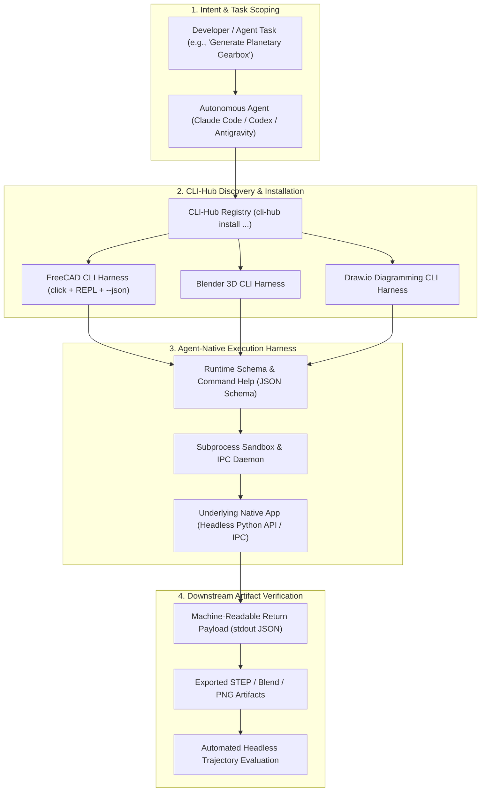
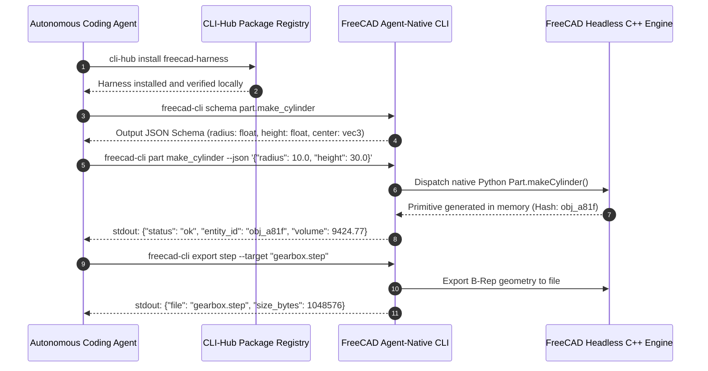

## Why Does Agent Reliability Depend on Interface Design Rather Than Model Parameter Scale?

In artificial intelligence research, the conventional strategy for overcoming agent failure modes has long been parameter scaling: when an agent fails to manipulate a 3D CAD model, misconfigures a video editing timeline, or corrupts a database schema, the standard industry response is to train a larger foundation model with trillions of parameters.

However, empirical evaluation across production repositories reveals that model scale is rarely the primary bottleneck. When autonomous agents operate complex graphical user interface (GUI) applications—such as Blender, FreeCAD, Draw.io, or audio sequencers—they fail primarily because of **interface opacity**. Forcing an LLM to interact with visual canvas software through coordinate-clicking computer vision models (pixel-based GUI grounding) introduces massive latency, high token consumption, and unpredictable spatial drift. An agent attempting to draw a precise parametric gear in CAD by clicking screen coordinates will casually miss vertices by two pixels, causing downstream boolean operations to fail.

The University of Hong Kong Data Science Lab (HKUDS) introduced **CLI-Anything** to resolve this interface mismatch. Built on the thesis that *"Tomorrow’s users are not only humans, but also agents,"* CLI-Anything reframes desktop software control into a deterministic, agent-native command-line interface problem. By wrapping complex desktop applications into structured, inspectable, and sandboxed CLI harnesses accompanied by a package distribution hub (`CLI-Hub`), CLI-Anything transforms complex creative applications into reliable, headless execution substrates.

---

## Deconstructing the CLI-Anything System Topology

CLI-Anything is not a collection of ad-hoc bash scripts. It is a formal, seven-phase engineering methodology and runtime package ecosystem designed to make arbitrary software controllable by autonomous agents:

### 1. The Seven-Phase Harness Synthesis Pipeline
When wrapping legacy software (whether open-source CAD packages or proprietary game engines), CLI-Anything applies a rigorous 7-phase generation pipeline:
1. **API & Interface Discovery**: Dissects the target application's public Python API, C++ bindings, or CLI endpoints.
2. **Contract Normalization**: Normalizes inputs into strongly typed schemas using Python's `click` framework with explicit `--json` support.
3. **Execution Sandboxing**: Wraps execution within headless virtual framebuffers (e.g., `Xvfb`) or headless rendering pipelines to guarantee zero GUI window dependencies.
4. **Stateful REPL Integration**: Provides an interactive read-eval-print loop (REPL) mode, allowing agents to maintain warm application memory contexts without incurring restart penalties per invocation.
5. **Defensive Input Hardening**: Sanitizes file paths, prevents shell escaping, and validates parameter types against strict schemas.
6. **Automated Test Generation**: Synthesizes end-to-end regression test suites (over 2,400+ verified test cases across the catalog).
7. **Package Publishing**: Packages the harness for one-command distribution via `cli-hub`.

---

## Why Agent-Native CLIs Outperform Multimodal Screen Clicking

The primary advantage of agent-native CLI harnesses over visual computer-use models lies in arithmetic precision, execution latency, and deterministic verification:

| Capability Dimension | Multimodal GUI Clicking (Computer-Use VLM) | CLI-Anything (Agent-Native Harness) |
| :--- | :--- | :--- |
| **Input Precision** | Inexact pixel coordinates ($\pm 5$px error rate) | Exact mathematical values (Double-precision float) |
| **Execution Latency** | 2,000 ms to 5,000 ms per mouse action | 20 ms to 50 ms per CLI subcommand |
| **Token Consumption** | 1,500+ tokens per screenshot image | ~80 tokens per structured JSON invocation |
| **Error Feedback** | Visual inspection failure (requires VLM gaze) | Machine-readable JSON error with exit codes |
| **Headless Scalability** | Requires active display server & GPU render | Runs entirely headless in CI/CD containers |
| **Repeatability** | Nondeterministic (breaks on screen DPI changes) | 100% Deterministic (scriptable & reproducible) |

### Real-World Artifact Generation Across Domains
CLI-Anything demonstrates that agentic workflows succeed when evaluated on real-world engineering artifacts rather than conversational chat benchmarks:
- **CAD & Mechanical Engineering**: Generates complete, parametric 3D CAD assemblies in FreeCAD, verifying physical volume, center of mass, and export integrity (`.step`).
- **3D Scene Design & Shading**: Operates Blender headlessly, constructing procedural lighting rigs, material shader nodes, and animated camera trajectories.
- **System Architecture Diagrams**: Translates natural language network topologies into pixel-perfect Draw.io diagrams without broken connector lines.
- **Media Operations**: Drives video captioning and audio alignment tools headlessly without manual timeline scrubbing.

---

## Architectural Comparison: CLI-Anything vs Related Agent Harnesses

| Architectural Dimension | CLI-Anything (HKUDS) | gogcli (Google Workspace) | Standard MCP Server Daemon |
| :--- | :--- | :--- | :--- |
| **Scope** | Creative & desktop apps (CAD, Blender, Draw.io) | Cloud productivity suite (Docs, Gmail, Drive) | General API integration protocol |
| **Execution Model** | Standalone Click CLI binary + REPL mode | Standalone compiled Go binary | Long-running JSON-RPC stdio daemon |
| **Distribution** | Dedicated package manager (`CLI-Hub`) | Single binary release / Homebrew | Distributed manual Node/Python configs |
| **Output Format** | Standardized JSON on `stdout`; telemetry on `stderr` | Standardized JSON (`--json`) | Structured JSON-RPC responses |
| **Discovery Mechanism** | Meta-skill package discovery (`cli-hub search`) | Pre-configured command lists | MCP `list_tools` capability handshake |

For teams building production agent infrastructure, our companion source audits on [Rewrite Your CLI for Agents](/posts/rewrite-cli-for-agents/), [gogcli Google Workspace CLI automation](/posts/gogcli-google-workspace-cli/), and the [Agentic Engineering 9 skills](/posts/agentic-engineering-9-skills/) explore complementary interface patterns.

---

## How Agent-Native Application Harnesses Evolved Across 2026

Throughout 2026, the interaction between generative AI and complex software applications underwent a structural transformation:

1. **The Demise of Naive GUI Clicking**: Industry practitioners recognized that visual computer-use models are a stopgap measure for legacy software that lacks APIs. For professional software with programmable interfaces, developers universally prefer headless CLI wrappers that guarantee zero-error execution.
2. **Standardization of Agent-Native Hubs**: Rather than manually cloning GitHub repositories and installing bespoke Python dependencies, agents utilize standardized package managers like `cli-hub`. An agent dynamically searches, installs, and validates a tool harness during an active session in under ten seconds.
3. **Dual-Mode REPL Architectures**: To eliminate the latency of cold-starting heavy desktop runtimes (like Blender or CAD engines) on every single tool call, agent harnesses maintain persistent background IPC sockets. The agent communicates with a warm application daemon in milliseconds.
4. **Pre-Commit Artifact Certification**: Automated CI/CD pipelines require agents to attach machine-generated artifact verification proofs. A pull request modifying a 3D model must include a cryptographically signed rendering and bounding-box validation certificate emitted by the headless CLI harness.

---

## Key Takeaways

- **Interface Quality Over Model Scale**: Providing agents with deterministic, machine-legible CLI interfaces yields higher task success than upgrading to trillion-parameter foundation models.
- **Pixel-Clicking Is an Anti-Pattern for CAD**: Engineering and creative applications require exact mathematical inputs that visual computer-use models cannot reliably deliver.
- **Package Management Unlocks Autonomy**: Platforms like `CLI-Hub` allow agents to discover, install, and introspect tool capabilities dynamically without developer intervention.
- **Artifacts Prove Completion**: The ultimate measure of agentic capability is shipping verified, production-grade physical and digital artifacts, not passing conversational synthetic benchmarks.

---

## New Questions

- How can legacy proprietary applications lacking public APIs be transformed into agent-native CLIs without fragile reverse-engineering?
- What are the concurrency limits of running multiple parallel headless CAD instances within a single multi-agent development container?
- Can reinforcement learning agents automatically discover the optimal CLI subcommand sequence to synthesize complex 3D meshes with minimal operations?

---

## References

- HKUDS Research Team. (2025). *CLI-Anything: Making Software Agent-Native Through Structured Command-Line Harnesses*. GitHub Repository. Available at: https://github.com/HKUDS/CLI-Anything (accessed 2026-10-18).
- Model Context Protocol Contributors. (2025). *Model Context Protocol Specification*. Anthropic PBC. Available at: https://modelcontextprotocol.io/introduction (accessed 2026-10-18).
- FreeCAD Community. (2024). *FreeCAD: An Open-Source Parametric 3D CAD Modeler*. Available at: https://www.freecad.org/ (accessed 2026-10-18).
- Blender Foundation. (2025). *Blender: Open Source 3D Creation Suite Python API*. Available at: https://docs.blender.org/api/current/ (accessed 2026-10-18).
