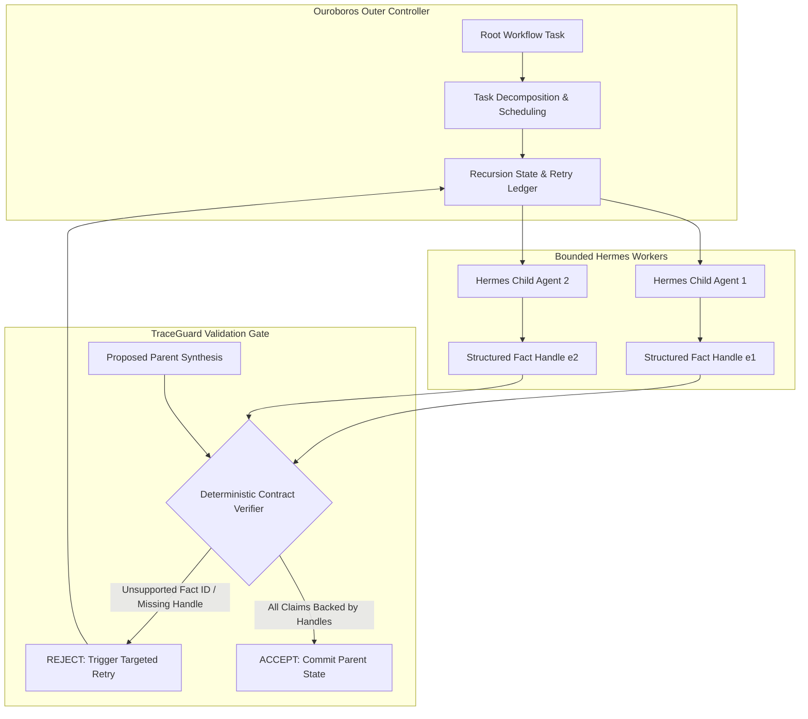

## Does Recursion Compound Agent Intelligence or Call Stack Hallucinations?

As language model applications shifted from single-turn retrieval to autonomous multi-agent systems, recursive task decomposition became a ubiquitous design motif. Frameworks routinely boast the ability to break complex workflows into nested sub-tasks, spin up child agent instances, and recursively synthesize high-level conclusions. Yet in production environments, unconstrained recursion frequently degrades system reliability. Instead of compounding reasoning capability, deep recursive call stacks compound stochastic drift: parent nodes accept summarized hallucinated facts from intermediate children, amplify speculative leaps, and deliver confidently fabricated syntheses.

This failure mode highlights a fundamental systems question: does recursive decomposition inherently improve problem-solving fidelity, or does it merely provide a deeper call stack in which hallucinations can metastasize?

An examination of the open-source project [Q00/rlm-forge](https://github.com/Q00/rlm-forge) provides an instructive engineering answer. Rather than introducing a speculative model architecture or claiming inflated benchmark gains, RLM-FORGE lifts the concept of Recursive Language Models (RLMs) into a disciplined runtime harness. The project demonstrates that recursion is only operationally viable when intermediate outputs are bound to deterministic evidence contracts. Through the decoupling of recursion control, inner worker execution, and automated evidence validation, RLM-FORGE establishes an architecture where parent synthesis is barred from committing claims that lack verifiable evidence handles.



---

## Deconstructing the RLM-FORGE Architecture: Ouroboros, Hermes, and TraceGuard

RLM-FORGE establishes a clear separation of concerns across three decoupled components: an outer recursion controller, an inner execution runtime, and a deterministic policy verification engine.

### 1. Ouroboros: The Outer Recursion Controller
In naive recursive scripts, an LLM prompt directly invokes another LLM prompt, conflating state management with generation. RLM-FORGE decouples this through **Ouroboros**, a dedicated outer controller responsible for:
- **Scheduling and Fan-Out:** Managing recursion depth, breadth limits, and concurrent sub-task dispatching.
- **State Persistence and Replay:** Recording execution trajectories into immutable event logs, allowing offline replay and failure post-mortems without live model invocations.
- **Bounded Retry Loops:** Handling localized failure states without unwinding or restarting the entire root task.

### 2. Hermes Agent: The Bounded Inner Execution Runtime
Rather than deploying unconstrained conversational models, the execution nodes run on **Hermes Agent** (Nous Research). Hermes operates within strict runtime boundaries:
- **Scoped Tool Boundaries:** Each worker is restricted to explicit tool definitions and sandbox namespaces.
- **Contract-Conforming Payloads:** Instead of emitting free-form markdown, child agents emit typed evidence structures pairing specific extracted facts with precise raw text offsets or retrieved document hashes.
- **Stateless Execution:** Individual worker invocations remain ephemeral, preventing runaway memory contamination across sibling tasks.

### 3. TraceGuard: Deterministic Evidence Contracts
The foundational engineering contribution of RLM-FORGE is **TraceGuard**. Situated directly between the child execution workers and the parent synthesis step, TraceGuard is a deterministic policy engine that inspects every assertion in the proposed parent summary against registered evidence handles. If a parent attempts to introduce an external ungrounded assertion or cites a chunk without an explicit fact binding, TraceGuard rejects the execution step deterministically before state mutation occurs.

---

## TraceGuard in Action: Deterministic Evidence Gating Over Stochastic Self-Correction

A common pitfall in modern agent engineering is relying on "LLM-as-a-judge" self-reflection loops. When a model reviews its own recursive outputs, it exhibits cognitive bias, frequently ratifying its own hallucinations or generating sycophantic confirmations. TraceGuard replaces stochastic reflection with a deterministic, rule-based verification contract.

TraceGuard evaluates outputs against strict failure modes:

| Validation Rule | Trigger Condition | Enforcement Action |
|:---|:---|:---|
| `SAFE_SYNTHESIS` | All factual assertions link to valid, verified child fact handles. | **ACCEPT**: State committed to parent ledger. |
| `UNSUPPORTED_FACT_ID` | Parent summary asserts a claim with an unknown or mutated fact ID. | **REJECT**: Abort commit, isolate failing node, request re-extraction. |
| `CHUNK_HANDLE_WITHOUT_FACT` | Parent cites a source document chunk without binding a specific verified fact token. | **REJECT**: Flag as loose citation, trigger deterministic validation failure. |
| `OMITTED_FACT_GUARD` | Source contains explicit negations (e.g., "Feature X is not supported") that parent elides. | **REJECT**: Require explicit inclusion of guarded boundary constraints. |

Consider a concrete representation of TraceGuard's evidence verification payload:

```json
{
  "parent_task_id": "eval-longctx-084",
  "proposed_synthesis": {
    "summary": "System achieves sub-millisecond dispatch by caching AST indices across invocation cycles.",
    "claims": [
      {
        "claim_text": "sub-millisecond dispatch",
        "evidence_handle": "fact://worker-02/timing-metric-402"
      },
      {
        "claim_text": "caching AST indices across invocation cycles",
        "evidence_handle": "fact://worker-01/ast-cache-spec-109"
      }
    ]
  },
  "traceguard_verdict": {
    "status": "ACCEPTED",
    "verified_handles": 2,
    "unsupported_claims": 0,
    "rejection_code": null
  }
}
```

If a parent synthesis introduces an ungrounded optimization claim that lacks a registered `evidence_handle`, TraceGuard halts the pipeline immediately with an `UNSUPPORTED_FACT_ID` exception. This converts hallucination prevention from an after-the-fact post-processing heuristic into an active runtime precondition.

---

## The Contract Ablation Signal: Zero Unsupported Claims Under Enforced Contracts

The core technical validity of RLM-FORGE is demonstrated in its contract ablation benchmarks, which isolate the causal impact of TraceGuard's deterministic gating:

```
Contract Ablation: Unsupported Claim Rate
───────────────────────────────────────────────────────────
hermes_rlm_evidence_gated : [░░░░░░░░░░░░░░░░░░░░] 0.0000 (0% unsupported)
hermes_rlm_without_gate   : [████████████████████] 1.0000 (100% unsupported)
───────────────────────────────────────────────────────────
```

When recursive task decomposition is executed without TraceGuard (`hermes_rlm_without_gate`), the system exhibits an unsupported claim rate of **1.0000** (100%), meaning every generated parent synthesis incorporates unverified or drifting claims. Under identical recursive decomposition with TraceGuard enabled (`hermes_rlm_evidence_gated`), the unsupported claim rate drops to **0.0000**.

### The Headline Fixture Tie: Why Honest Scorer Calibration Matters
In benchmark engineering, teams often succumb to metric inflation by tuning scorers to reward superficial verbosity. In early RLM-FORGE testing, initial metrics suggested a `+0.20` quality improvement for the recursive pipeline over a vanilla single-call baseline. 

However, rigorous scrutiny revealed a scorer defect: guarded assertions (such as explicitly reporting that "LC-005 and LC-006 cannot be claimed from available data") were being misclassified as omitted-fact failures. Upon calibrating the evaluation harness with a claim-aware scorer:
- **Vanilla Single Call Quality:** `1.00`
- **Recursive RLM Path Quality:** `1.00`
- **Delta:** `+0.00`

Rather than obfuscating this tie, the RLM-FORGE maintainers documented it transparently. The technical takeaway is significant: **the architectural value of recursive language models is not magical capability emergence on simple fixtures, but rigorous runtime control, failure isolation, and auditable verification on complex documents.**

---

## Cross-Runtime Portability: From Hermes to Claude Code and Codex CLI

A key requirement for modern agent runtime infrastructure is provider independence. If an evidence-gating harness is coupled to model-specific fine-tuning or proprietary token formats, its utility across enterprise systems is severely constrained.

RLM-FORGE demonstrates a portable contract interface that achieved a 24/24 pass rate across three distinct runtime environments:

1. **Hermes + GLM:** Open-weights execution pairing Nous Research's Hermes Agent with GLM inference engines, proving that local and cost-effective models can maintain zero unsupported claims when backed by strict harness validation.
2. **Claude Code (Anthropic Opus):** Validating that high-reasoning proprietary frontier models conform to TraceGuard structured tool calling without schema divergence.
3. **Codex CLI (OpenAI GPT-5.5 Alias):** Demonstrating execution portability across developer-oriented CLI agent environments utilizing sandboxed bash runtimes.

This cross-runtime resilience establishes that evidence contracts function as an application-level abstraction layer, agnostic to the underlying token distribution of any single LLM provider.

---

## How Recursive Agent Architectures Evolved Across 2026

The trajectory of recursive agent architectures throughout 2026 mirrors the broader maturation of autonomous AI engineering, shifting from prompt-based hype to rigorous systems discipline:

1. **The Unconstrained Recursion Era (Early 2026):** Early frameworks relied on recursive prompts that spawned arbitrary child subagents. As explored in our analysis of [Stop Generating, Start Thinking: The Architecture of Reasoning AI](/posts/stop-generating-start-thinking/), unconstrained generation produced compounding cognitive debt and catastrophic cascade failures.
2. **The Verifier-First Shift (Mid 2026):** In response to cascading hallucinations, production architectures introduced static test gates and compiler-style verification. Our review of [Harness Engineering: Building Autonomous Systems with Codex and PLANS.md](/posts/harness-engineering/) demonstrated that externalizing memory into auditable state files was necessary to prevent agent amnesia.
3. **Compound Routing and Evidence Contracts (Late 2026):** Modern runtime harnesses, such as the multi-role orchestration analyzed in [Compound Agents and Cross-Model Verification: Lessons from OpenDev](/posts/opendev-compound-agents/), integrate explicit cross-model critique and deterministic runtime policy engines like TraceGuard. Factual assertions are no longer assumed valid based on model confidence; they require cryptographic or structural provenance before parent synthesis can proceed.

```
2026 Architectural Progression:
Prompt Recursion ────> Verifier Harnesses ────> Evidence-Gated Contracts
(Unbounded Drift)     (Test-Gated Sandbox)    (Zero-Hallucination Invariants)
```

---

## Key Takeaways

- **Recursion Without Contracts Amplifies Hallucination:** Recursive task decomposition without deterministic verification yields a 100% unsupported claim rate in ablation studies, as stochastic drift compounds across call stack levels.
- **Decouple Orchestration from Verification:** RLM-FORGE isolates recursion control (Ouroboros), worker execution (Hermes), and policy validation (TraceGuard), preventing single points of failure.
- **Deterministic Gates Beat LLM Self-Judges:** TraceGuard enforces explicit fact handles (`unsupported_fact_id`, `chunk_handle_without_fact`) at parent synthesis time, eliminating sycophantic confirmation loops.
- **Scorer Honesty Over Inflated Deltas:** Transparent reporting of the headline fixture tie (`+0.00` delta) highlights that the primary benefit of recursive runtimes is operational safety and fault tolerance, not synthetic quality gains.
- **Provider-Agnostic Portability:** Standardized JSON evidence structures allow the same evidence contract to operate identically across Hermes, Claude Code, and OpenAI Codex CLI runtimes.

---

## New Questions

1. **Latency Overhead in Deep Trees:** How does the round-trip latency of multi-level TraceGuard contract validation scale when task decomposition trees exceed four levels of recursion?
2. **Dynamic Handle Granularity:** What is the optimal balance between token-level fact handles (which dramatically increase context overhead) and document-level chunks (which risk loose citation failures)?
3. **Automated Evidence Repair:** Can TraceGuard rejections automatically generate targeted delta-prompts for child workers to repair missing evidence handles without rerunning entire parent sub-trees?

---

## References

- [Q00/rlm-forge: Runtime-Lifted Recursive Language Model Primitives](https://github.com/Q00/rlm-forge) (accessed 2026-10-18)
- [RLM-FORGE Architecture and TraceGuard Specification](https://github.com/Q00/rlm-forge/blob/master/docs/architecture.md) (accessed 2026-10-18)
- [RLM-FORGE Contract Ablation and Unsupported Claim Benchmark](https://github.com/Q00/rlm-forge/blob/master/experiments/unsupported-claim-rate-benchmark.md) (accessed 2026-10-18)
- [Nous Research: Hermes Agent Runtime and Tool Calling Architecture](https://github.com/NousResearch/hermes-agent) (accessed 2026-10-18)
- [RLM-FORGE Claim-Aware Omitted-Fact Scorer Suite](https://github.com/Q00/rlm-forge/blob/master/experiments/claim-aware-omitted-fact-suite.md) (accessed 2026-10-18)
