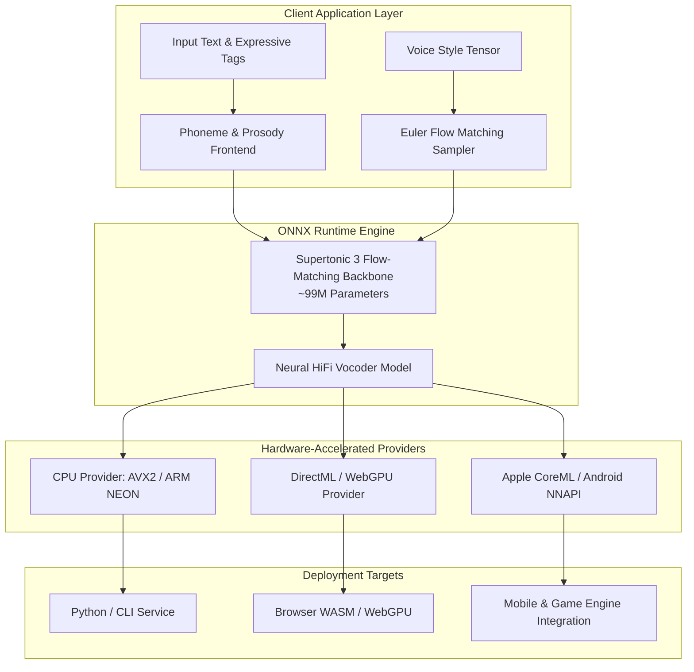

## Can Voice Synthesis Become a Purely Local Runtime Primitive?

In interactive client engineering—spanning game engines, mobile companions, accessibility tooling, and autonomous desktop agents—speech synthesis has historically occupied an uncomfortable architectural niche. While frontier cloud Text-to-Speech (TTS) APIs generate remarkable voice realism, their operational trade-offs create substantial friction. Cloud speech introduces network round-trip latency (frequently 300ms to 1,200ms), variable per-character billing costs, strict data privacy exposure, and total failure when offline. For gaming non-player characters (NPCs) or responsive local agent harnesses, relying on remote HTTP audio streams introduces unacceptable jitter and architectural fragility.

Conversely, legacy on-device TTS systems often required multi-gigabyte memory footprints or produced mechanical, low-fidelity audio. The core systems question is clear: can a modern generative acoustic model achieve studio-grade quality, expressive prosody, and broad multilingual coverage within a memory footprint compact enough to execute locally on consumer CPUs, mobile chipsets, and browser tabs?

An investigation of **Supertonic 3**, an open-weights speech generation architecture developed by **Supertone AI** (a subsidiary of HYBE), reveals how treating the Open Neural Network Exchange (ONNX) as the canonical deployment contract resolves this tension. By pairing a 99-million-parameter acoustic backbone with optimized ONNX execution providers, Supertonic 3 transforms neural voice synthesis from an expensive cloud service into an embedded, zero-dependency client primitive.



---

## The Supertonic 3 Architecture: 99M Parameters and Multilingual Flow Matching

Supertonic 3 deviates significantly from traditional autoregressive audio tokenizers that chain heavy discrete audio codes together. Instead, Supertonic adopts a continuous flow-matching architecture optimized for single-pass parallel inference.

The core architecture incorporates several key innovations:

1. **Compact 99M Parameter Footprint:** By constraining model weights to approximately 99 million parameters, the uncompressed model requires less than 400 MB of RAM, shrinking to under 150 MB when quantized to 8-bit or 4-bit integer representations.
2. **Length-Aware Rotary Position Embedding (LARoPE):** As detailed in recent research (arXiv:2509.11084), standard rotary embeddings degrade when synthesizing long phoneme sequences. Supertonic implements LARoPE, maintaining temporal consistency across multi-sentence paragraphs without pitch drift or rhythmic collapse.
3. **Self-Purifying Flow Matching:** Flow matching models frequently suffer from training noise caused by noisy dataset alignments. Supertonic leverages self-purification mechanisms (arXiv:2509.19091) to distill cleaner vector fields, enabling high-fidelity audio reconstruction in as few as 4 to 8 Euler sampling steps.
4. **Studio-Grade Acoustic Output:** The neural vocoder outputs 44.1kHz, 16-bit uncompressed PCM audio, avoiding the muffled 16kHz or 24kHz downsampling typical of lightweight edge models.
5. **Inline Prosody Tags:** Rather than requiring external reference audio tensors or complex phoneme pitch curves, the frontend natively parses inline conversational markers such as `<laugh>`, `<breath>`, and `<sigh>`, allowing declarative prosodic control directly from prompt text.

---

## ONNX Runtime as the Universal Cross-Platform Contract

The defining systems choice of Supertonic is its rejection of framework lock-in. Rather than distributing raw PyTorch checkpoints accompanied by fragile CUDA environment requirements, Supertone AI publishes the acoustic backbone and vocoder as standard ONNX model graphs.

Using ONNX as the deployment contract delivers three distinct engineering advantages:

- **Ecosystem Portability:** A single set of `.onnx` model binaries executes across Python, Node.js, C++, C#, Go, Rust, Swift, and Flutter without runtime modification.
- **Hardware Acceleration Without Driver Hell:** ONNX Runtime abstracts execution providers. On Apple Silicon, inference routes to CoreML; on Windows workstations, it targets DirectML or TensorRT; on Linux servers, it leverages AVX-512; and on mobile or browser environments, it compiles to WebAssembly (WASM) and WebGPU.
- **Strict Interface Boundaries:** The model inputs (text phoneme ids, style tensors, total sampling steps) and outputs (audio waveform buffers, generation duration) are frozen into a deterministic computational graph, eliminating version incompatibilities across client applications.

---

## Empirical Benchmarks: Accuracy, Size, and Runtime Footprint

The engineering viability of an on-device TTS system depends on balancing linguistic accuracy against computational overhead. Public evaluations from the PyTorch Korea community and Supertone benchmarks highlight this trade-off across three critical dimensions.

### 1. Reading Accuracy: Multilingual WER and CER
Compact TTS engines frequently fail on complex phonetic pronunciations, especially in Asian and agglutinative languages.

{: .light .w-75 .shadow .rounded-10 }

Supertonic 3 was evaluated across 31 languages—including Korean, Japanese, English, German, French, Spanish, Hindi, and Vietnamese. Across standard reading benchmarks, its Character Error Rate (CER) and Word Error Rate (WER) compete directly with multi-billion parameter autoregressive voice models, demonstrating that self-purified flow matching preserves pronunciation clarity even at edge scale.

### 2. Model Size Comparison
Deploying AI models inside consumer applications requires strict package budgeting. A 2 GB model download creates severe drop-off in user onboarding.

{: .light .w-75 .shadow .rounded-10 }

At approximately 99 million parameters, Supertonic 3 is an order of magnitude smaller than competing open models such as Fish Speech or Chatterbox. This parameter density makes bundle inclusion feasible for desktop installers, mobile game packages, and browser memory caches.

### 3. Execution Footprint and Real-Time Factor (RTF)
In interactive environments, Real-Time Factor (the ratio of inference time to audio duration) must remain substantially below 1.0.

{: .light .w-75 .shadow .rounded-10 }

On standard consumer x86_64 CPUs without dedicated GPU acceleration, Supertonic 3 achieves an RTF between 0.05 and 0.15 (generating 10 seconds of studio audio in less than 1.5 seconds). This performance profile allows background thread generation during live gameplay without dropping frame rates or overheating mobile thermal budgets.

---

## Integration Patterns: Embedded SDKs, Browser WebGPU, and Local Audio Serving

Supertonic 3 provides multiple integration patterns tailored to different product surfaces.

### 1. Embedded Python SDK
For backend pipelines and local scripting, the packaged `supertonic` library abstracts the underlying ONNX session management:

```python
from supertonic import TTS

# Initialize local session with automatic model loading
tts = TTS(auto_download=True)
style = tts.get_voice_style(voice_name="M1")

# Synthesize expressive audio via 8 Euler flow-matching steps
text = "Supertonic provides <breath> deterministic on-device speech synthesis."
wav, duration = tts.synthesize(
    text=text,
    lang="en",
    voice_style=style,
    total_steps=8,
    speed=1.0,
)

tts.save_audio(wav, "output.wav")
print(f"Synthesized {duration[0]:.2f}s audio at 44.1kHz")
```

Representative source implementations are available in the project repository:
- [Python ONNX sample implementation](/assets/code/posts/2026-05-18-supertonic/example_onnx.py)
- [Node.js ONNX runtime script](/assets/code/posts/2026-05-18-supertonic/example_onnx.js)
- [Browser WebGPU/WASM entrypoint](/assets/code/posts/2026-05-18-supertonic/web_main.js)

### 2. The Local Service Pattern: Drop-in OpenAI Compatibility
One of the most consequential additions to the Supertonic ecosystem is `supertonic serve`. By executing:

```bash
pip install 'supertonic[serve]'
supertonic serve --host 127.0.0.1 --port 7788
```

The process exposes an OpenAI-compatible `/v1/audio/speech` endpoint alongside native `/v1/tts` routes. 

For engineers building agent harnesses, this pattern is transformative. Local agent runtimes—such as those discussed in our analysis of [Harness Engineering: Building Autonomous Systems with Codex and PLANS.md](/posts/harness-engineering/)—can generate spoken voice outputs simply by redirecting their HTTP client base URL to `http://127.0.0.1:7788/v1`, eliminating cloud API dependencies without rewriting application client logic.

---

## How Edge Audio and On-Device Voice Runtimes Evolved Across 2026

The emergence of lightweight on-device speech models in 2026 reflects a broader architectural recalibration across the AI industry:

1. **The Cloud Monopoly Phase (Early 2026):** Production voice applications were almost universally tethered to proprietary APIs (ElevenLabs, OpenAI Audio, Deepgram). While quality was pristine, developers struggled with mounting API costs, rate limits, and latency spikes exceeding 1,000ms.
2. **Quantization and Extreme Edge Compression (Mid 2026):** As model quantization evolved—from the ternary weight representations analyzed in [PrismML 1-bit Bonsai: Extreme Low-Bit Quantization for Practical On-Device AI](/posts/prismml-1-bit-bonsai-on-device-ai/) to highly optimized Rust kernels demonstrated in [EdgeQuake: High-Performance Graph RAG in Rust](/posts/edgequake-graph-rag-rust/)—the feasibility of running multi-modal reasoning on local workstations became undeniable.
3. **Contract-Driven On-Device Systems (Late 2026):** Supertonic 3 exemplifies the modern consensus: high-fidelity generative AI no longer requires warehouse-scale GPUs. By adopting ONNX as an interoperable contract and pairing flow matching with compact parameter counts, speech synthesis has transitioned into an embeddable, predictable client-side capability.

---

## Key Takeaways

- **ONNX as the Universal Contract:** Encapsulating neural TTS in ONNX models decouples machine learning inference from application code, enabling native execution across Python, Node.js, WebGPU, and mobile devices without PyTorch runtime overhead.
- **99M Parameters Delivers Production Quality:** Through length-aware rotary embeddings (LARoPE) and self-purifying flow matching, Supertonic 3 achieves competitive WER/CER across 31 languages within a sub-400MB memory footprint.
- **Real-Time CPU Viability:** Achieving a 0.05–0.15 Real-Time Factor on standard CPUs enables responsive voice generation in local games, kiosks, and desktop apps without GPU hardware requirements.
- **OpenAI-Compatible Local Serving:** The `supertonic serve` daemon enables agent systems to swap cloud speech endpoints for local execution via a single base URL change.
- **Native Expressive Controls:** Declarative inline tags (`<laugh>`, `<breath>`, `<sigh>`) allow granular prosody control directly within prompt text, bypassing complex reference audio pipelines.

---

## New Questions

1. **Streaming Audio Chunk Latency:** Can the flow-matching sampler be restructured into a streaming causal pipeline to reduce Time-To-First-Audio (TTFA) below 50ms for live conversational agents?
2. **WebGPU Memory Eviction in Browsers:** How reliably do consumer browsers manage ONNX model tensor memory during extended sessions without memory leakage or tab crashes?
3. **Zero-Shot Voice Cloning on Edge Hardware:** What is the minimal parameter addition required to enable high-fidelity zero-shot voice cloning locally without bloating the 99M parameter budget?

---

## References

- [PyTorch Korea: Supertonic ONNX TTS Architecture Discussion](https://discuss.pytorch.kr/t/supertonic-onnx-tts-feat-supertone-ai/10247) (accessed 2026-10-18)
- [Supertone AI: Supertonic Official Repository](https://github.com/supertone-inc/supertonic) (accessed 2026-10-18)
- [Supertone AI: Supertonic Python SDK Documentation](https://supertone-inc.github.io/supertonic-py/) (accessed 2026-10-18)
- [Supertone AI: Supertonic 3 Model Card on Hugging Face](https://huggingface.co/Supertone/supertonic-3) (accessed 2026-10-18)
- [Kim et al.: SupertonicTTS - Efficient On-Device Neural Speech Synthesis](https://arxiv.org/abs/2503.23108) (accessed 2026-10-18)
- [Park et al.: Length-Aware Rotary Position Embedding for Speech Synthesis](https://arxiv.org/abs/2509.11084) (accessed 2026-10-18)
- [Lee et al.: Training Flow Matching Models with Reliable Labels via Self-Purification](https://arxiv.org/abs/2509.19091) (accessed 2026-10-18)
