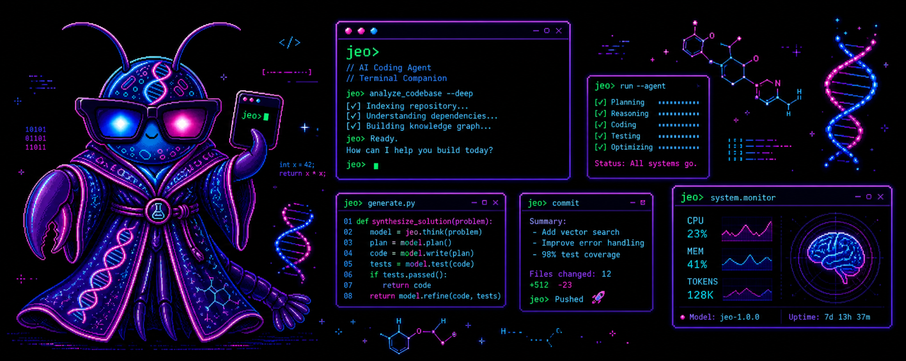
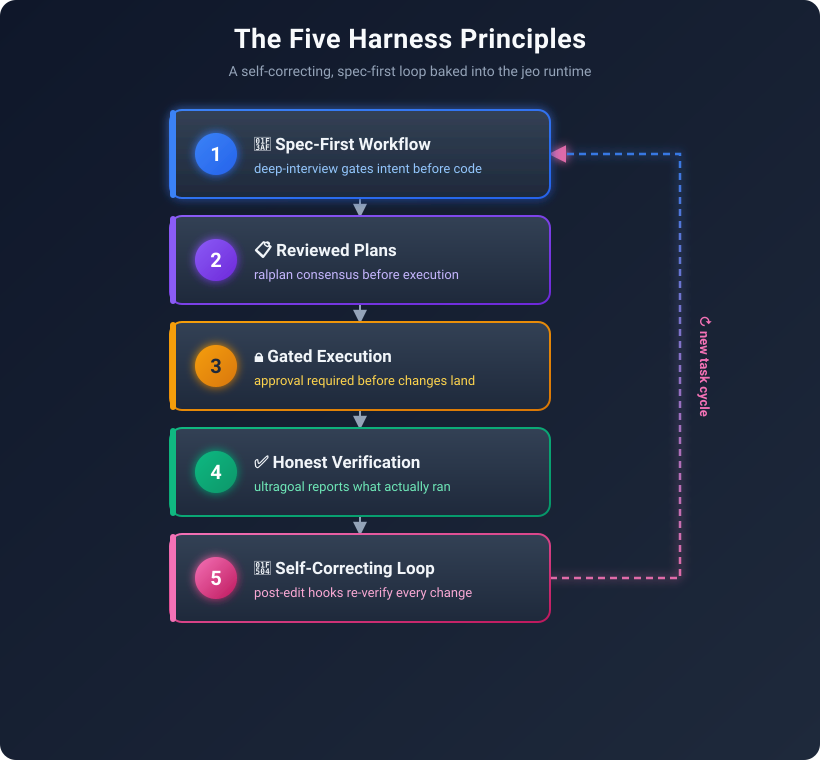
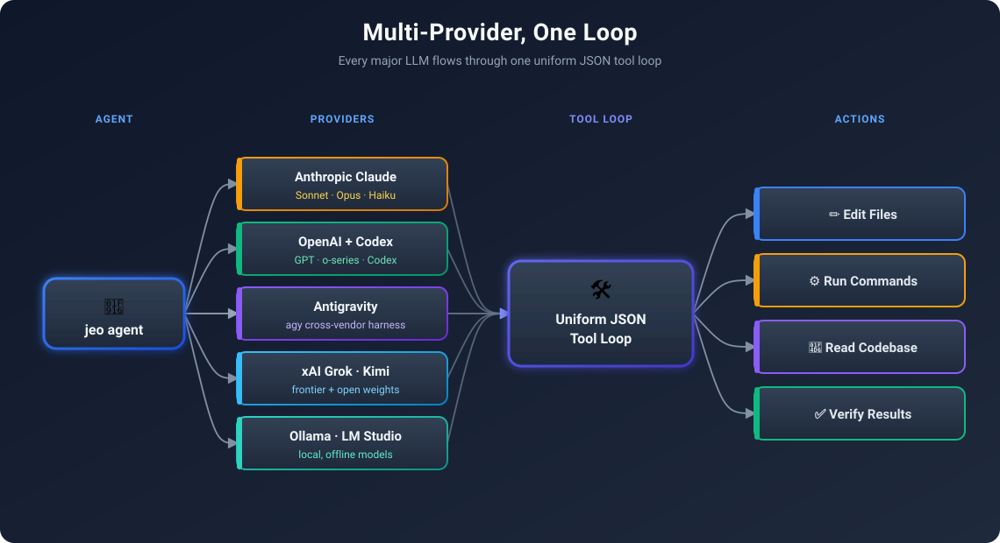
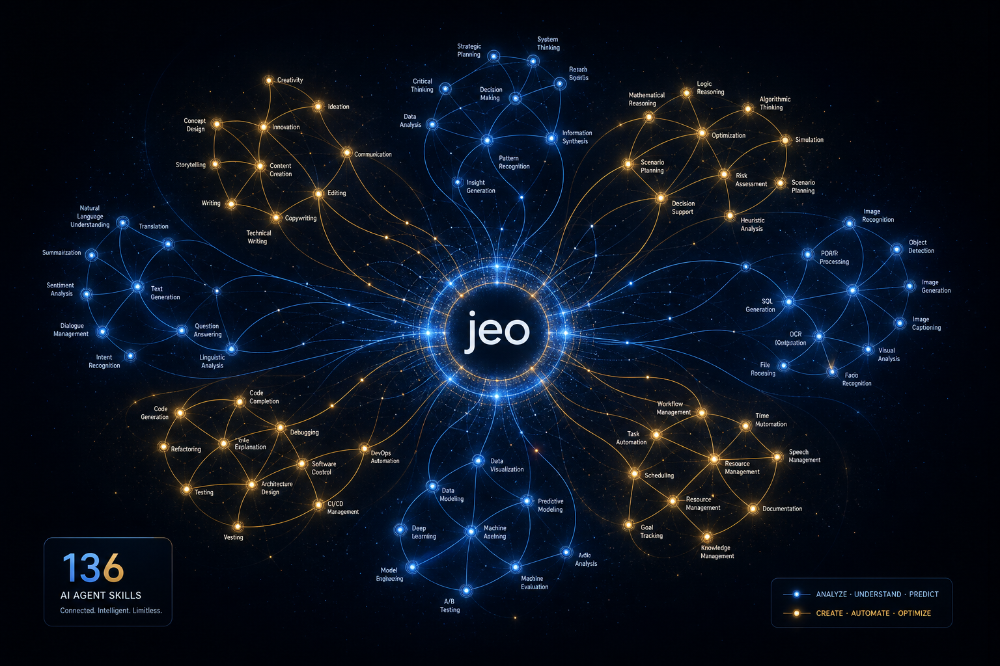
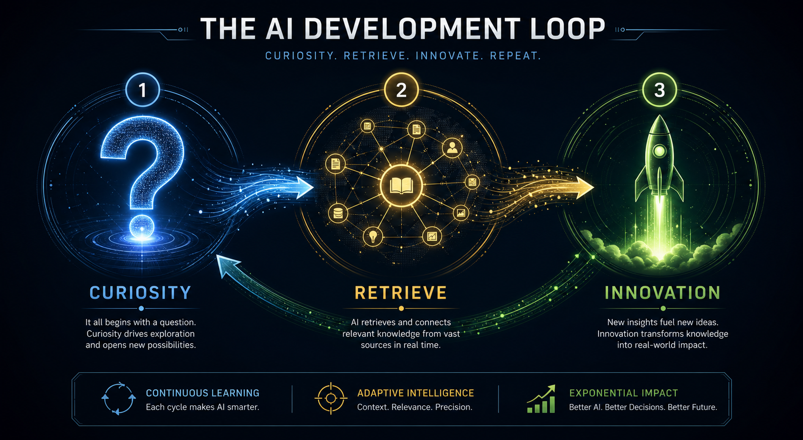
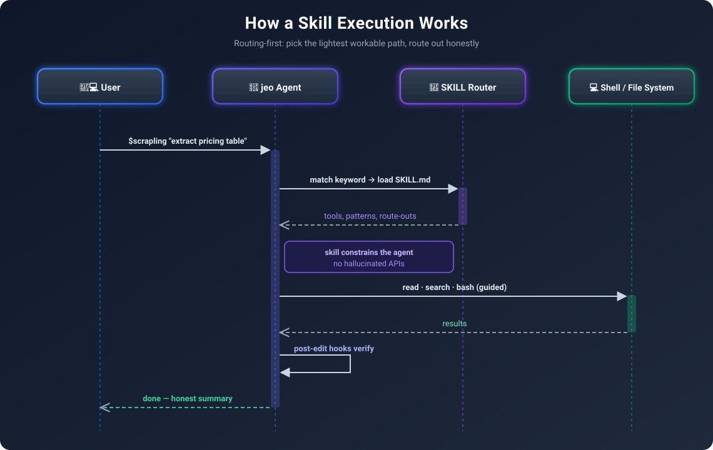

## What If Your Coding Agent Came with Its Own Skill Tree?

My interest is in the **harness**: the scaffolding, approval boundaries and feedback loops around a coding agent. This article describes that design direction, not a controlled comparison of developer productivity.

That question stuck with me: **What if the harness itself was the product?**

Enter **[jeo-code](https://github.com/akillness/jeo-code)** — and its companion **[jeo-skills](https://github.com/akillness/jeo-skills)**.

I maintain the linked jeo-code and jeo-skills projects. This is an affiliated overview, not an independent product review. The catalog and core workflow notes below were updated on 2026-11-02; historical scenarios remain illustrations, not verified runs.

> **Curiosity:** Can reusable skills and explicit approval gates make repeated engineering tasks easier to inspect and reproduce?
{: .prompt-tip}

---

## Technical Analysis: What Is jeo-code?

{: .w-100 .shadow .rounded-10 }

**jeo-code** (`jeo` on the CLI) is a Bun-based local-first coding agent. Its [README at commit `9f8d7b6`](https://github.com/akillness/jeo-code/blob/9f8d7b6dc00a9a5664229099a86326aad6d12f40/README.md) describes a spec-first workflow, reviewed plans, a multi-provider loop, an inline TUI and content-anchored edits. It can read and edit files and run commands; effective permissions and verification depend on the environment and configuration.

The current implementation tracks mutation and verification ordering in its [agent engine](https://github.com/akillness/jeo-code/blob/9f8d7b6dc00a9a5664229099a86326aad6d12f40/src/agent/engine.ts). These signals are useful guards, not independent proof that a test covers the requirement or that the workspace cannot change later. The project README explicitly describes that boundary.

But the design philosophy is what sets it apart.

### The Five Harness Principles Baked In



| Principle | What It Means | Why It Matters |
|:----------|:--------------|:---------------|
| **Spec-First** | Requirements interview before execution | Make ambiguous requirements explicit |
| **Reviewed Plans** | A critic reviews the proposed plan | Keep a review decision available for inspection |
| **Gated Execution** | An approval step before execution | State who may authorize the work |
| **Honest Verification** | Completion claims checked against test output | Retain evidence, including failures |
| **Self-Correcting Loop** | Post-edit diagnostics returned to the agent | Make errors available for another iteration |

### Multi-Provider, One Loop



One agent loop supports multiple providers. Availability, authentication and input capabilities vary by provider; `/provider login <name>` is available in the interactive interface.

### The TUI That Doesn't Get in Your Way

```bash
jeo                                    # interactive agent in your repo
jeo "refactor auth module + run tests" # one-shot
jeo --tmux                             # isolated tmux session
jeo doctor                             # check config + model connection
```

| Action | Shortcut |
|--------|----------|
| Slash command palette | `/` + Tab |
| Run a skill workflow | `$<skill> [intent]` |
| Direct shell command | `!<command>` |
| Recall previous queries | `↑ / ↓` (persisted in `.jeo/input-history`) |
| Expand last response | `Ctrl+O` |
| Paste clipboard image | `Ctrl+V` |

---

## See It In Action

A promotional overview accompanies the workflow description. Treat it as an illustration, not a measurement of developer productivity:

<video src="/assets/img/jeo-code/jeo-code-promo.mp4" controls muted playsinline width="100%" style="border-radius:12px; box-shadow: 0 8px 32px rgba(0,0,0,0.4); margin: 1.5rem 0;"></video>

> Full demo and install guide → [docs/usage-guide.md](https://github.com/akillness/jeo-code/blob/main/docs/usage-guide.md)

And here is the **Remotion-animated promo** rendered as React code for this post — 4 scenes, 300 frames at 30fps, 1920×1080:

<video src="/assets/img/jeo-code/jeo-promo-remotion.mp4" controls muted playsinline width="100%" style="border-radius:12px; box-shadow: 0 8px 32px rgba(0,0,0,0.4); margin: 1.5rem 0;"></video>

> The Remotion source lives at [`tools/jeo-promo-video/src/JeoPromo.tsx`](https://github.com/akillness/akillness.github.io/blob/9abcb5d1c99b5471e1e676ec37d9a40bb15abcce/tools/jeo-promo-video/src/JeoPromo.tsx) in this blog's repo.

---

## Where It Gets Powerful: jeo-skills

{: .w-100 .shadow .rounded-10 }

The harness engine alone is powerful. With **[jeo-skills](https://github.com/akillness/jeo-skills)**, it becomes genuinely formidable.

> **[⭐ Star jeo-skills on GitHub →](https://github.com/akillness/jeo-skills)**

The catalog's [metadata at commit `f041a22`](https://github.com/akillness/jeo-skills/blob/f041a22a2486239b189a5425e6afc23b497a1914/.agent-skills/skills.json) lists 409 skills in ten categories. This is a snapshot, not a promise that the count remains fixed. Each skill has a `SKILL.md`; catalog metadata describes categories, bundles and relationships. The `jeo-skill` router searches the catalog and installs a selection; the host agent still decides when to load and execute instructions.

### Preview before installing

First inspect the [installer at commit `f041a22`](https://github.com/akillness/jeo-skills/blob/f041a22a2486239b189a5425e6afc23b497a1914/install.sh) and the [setup guide](https://github.com/akillness/jeo-skills/blob/f041a22a2486239b189a5425e6afc23b497a1914/README.md). The installer can fetch additional components, so review those dependencies and the current documentation before executing anything. Once the router is installed:

```bash
jeo-skill doctor
jeo-skill search "react performance"
jeo-skill install react-best-practices --global --dry-run
jeo-skill install react-best-practices --global --yes
```

The default installer installs the router, not the entire library. The setup guide also documents the guided full-catalog path, bundles and host-specific roots. Installing a skill does not install or run every external tool described by that skill.

---

## Key Takeaways: A Workflow That Can Be Evaluated

{: .w-100 .shadow .rounded-10 }

The real insight isn't "jeo runs your AI." The insight is **what changes about how you think when you have a trustworthy harness**.

### The Builder's Flywheel



### Use Cases

These are illustrative scenarios, not measured delivery reports. The questions, task split and time required depend on the repository, model and acceptance criteria.

<details markdown="1">
<summary style="font-size:20px; font-weight:bold; cursor:pointer;">🎮 Use Case 1: Game Feature Development</summary>

**Scenario:** Ship a new procedural level system for a mobile RPG.

```bash
jeo "design and implement a wave-function-collapse dungeon generator
     using existing TileMap class, integrate with GameManager, test on device spec"
```

**What happens:**

1. `deep-interview` asks 8 clarifying questions (tile types? seeding strategy? fallback for impossible states?)
2. `ralplan` generates a 3-phase blueprint, critic subagent signs off with `[OKAY]`
3. `jeo approve` gates until you read and confirm
4. `team` spawns executor subagents: one for WFC algorithm, one for GameManager integration, one for unit tests
5. Post-edit hook runs `tsc && jest --coverage`, errors fed back to the agent, fixed in-loop
6. `ultragoal` reviews the available evidence; a suite result is a global signal, not proof of every criterion.

**With `unity-gamedev-skill-pack`:** The instructions may help route the task to relevant Unity guidance. Check the actual output and sources; installation alone does not guarantee correct behavior.

</details>

<details markdown="1">
<summary style="font-size:20px; font-weight:bold; cursor:pointer;">🔬 Use Case 2: Research → Production Pipeline</summary>

**Scenario:** Implement a RAG-based player-support bot from a recent paper.

```bash
jeo "$deep-dive implement context-aware retrieval system from arxiv 2506.xxxxx
     for our player support knowledge base"
```

**What happens:**

1. `deep-dive` activates — traces causal hypotheses, crystallizes requirements
2. `llm-wiki` captures findings into `~/vaults/llm-wiki/` for durable memory
3. `graphify` builds a knowledge graph of the system architecture
4. `scrapling` fetches and parses the arxiv paper + related GitHub repos
5. `ralplan` blueprints the implementation with honest tradeoff tables
6. `team` builds the retrieval layer, embedding pipeline, and eval harness

**What to measure:** record research, implementation and review time for the same acceptance criteria. This scenario has no measured time-saving result.

</details>

<details markdown="1">
<summary style="font-size:20px; font-weight:bold; cursor:pointer;">🎬 Use Case 3: Marketing Content at Code Speed</summary>

**Scenario:** Generate a promotional video + blog post for a new AI feature launch.

```bash
jeo "create a Remotion promo video + blog post for our new matchmaking AI feature"
```

**What happens:**

1. `remotion-video-production` skill activates — plans scenes, animation budget, asset list
2. `god-tibo-imagen` generates missing hero images via Codex backend (no extra API key)
3. Remotion compositions rendered at 1920×1080 as MP4
4. Blog post authored with crisp SVG workflow diagrams, embedded video, GitHub links
5. `vercel-deploy` or Jekyll build deploys the post

This article includes diagrams and promotional media. Those artifacts do not establish that an agent completed the end-to-end scenario above.

</details>

### What the Workflow Should Make Explicit

These are evaluation questions, not a claim that other coding agents lack the same capabilities.

| Design concern | Question to check on a real task |
|:---------------|:--------------------------------|
| Requirements | Were the acceptance criteria written before execution? |
| Approval | Did the executed steps stay within the approved scope? |
| Verification | Can each completion claim be traced to actual test output? |
| Recovery | Can a fresh session recover the relevant state and evidence? |
| Provider choice | Does the selected provider support the tools and inputs required? |
| Skill fit | Did the selected procedure help this task, or cause rework? |

---

## Architecture Deep Dive

The catalog supplies instructions; the host agent decides how and when to load them and which tools it can run.

### How a Skill Execution Works



Every skill is **routing-first**: picks the *lightest workable path*, routes out honestly if scope is exceeded. No over-promising. No silent failures.

---

## Installation & Quick Start

### Install with Bun

Install Bun 1.3.14 or later using the [official instructions](https://bun.sh/docs/installation), then:

```bash
# Install jeo-code globally
bun install -g jeo-code

# Verify
jeo --version
```

### Other installation options

Check the [current install instructions](https://github.com/akillness/jeo-code/blob/9f8d7b6dc00a9a5664229099a86326aad6d12f40/README.md#install) for supported runtimes and distribution changes. The documented requirement is Bun 1.3.14 or later; do not assume a Node-only installation is supported.

### Connect Your LLM Provider (required)

Run `jeo doctor` to inspect configuration and connection status. Use `jeo setup` for provider setup; the interactive TUI also provides `/provider login <name>`. Provider support and authentication requirements vary; consult the current guide for the provider you intend to use.

### Select skills instead of assuming a full install

Use the router preview above to check the exact selection and destination. For a guided full-catalog installation, ask an agent to read the [setup prompt](https://github.com/akillness/jeo-skills/blob/f041a22a2486239b189a5425e6afc23b497a1914/setup-all-skills-prompt.md); the default router installer is not the same operation. jeo and jeopi can discover the shared `~/.agents/skills` root. Placement alone does not prove that a host loaded or followed a skill.

Run `jeo` for an interactive session and use `$<skill> [intent]` within it. Consult the current host documentation for available commands and permissions.


---

## How to Measure the Difference

No controlled productivity benchmark is supplied in this article. The earlier setup-time and speed rankings have been withdrawn. A useful comparison would run the same tasks under the same model, budget and acceptance tests, both with and without the skill layer.

| Metric | Definition | Evidence to retain |
|:-------|:-----------|:-------------------|
| Setup effort | Active time required before the first valid run | Setup log and environment versions |
| Completion time | Wall-clock time and human intervention time | Timestamped run record |
| Correctness | The same acceptance tests for every approach | Full test results, including failures |
| Rework | Corrections needed after the first proposed completion | Review findings and patches |
| Cost | Provider usage plus review effort | Usage records and stated accounting method |
| Repeatability | Variation across repeated fresh runs | Per-run results, not only the best run |

A workflow may help one task and hurt another. Until those measurements exist, a productivity multiplier is unknown.

---

## Engineering Judgments, Not Performance Results

My experience in production game AI suggests three design priorities. These are engineering judgments, not measured outcomes from using jeo-code:

**1. Gates make checks explicit.** A mechanical completion gate can catch some missing or stale verification signals. It cannot establish that a test is relevant, trustworthy, or sufficient for every acceptance criterion.

**2. Skills encode institutional knowledge.** Each skill in jeo-skills is a distilled answer to "what does an expert do when they encounter this?" Agents with skills don't reinvent — they apply. The difference is the same as a junior developer Googling vs a senior who already knows the answer.

**3. Reuse needs evaluation.** A reusable workflow can reduce repeated setup, but stale or poorly matched instructions can also create rework. Test that trade-off on the tasks you actually repeat rather than assuming a gain.

### New Questions This Raises

- Can we auto-generate new skills by having jeo observe expert developers in real sessions?
- What does a "skill marketplace" look like — where game studios share domain-specific harnesses?
- How do we benchmark skill quality? Is `ultragoal` the right metric, or do we need skill-specific eval harnesses?

---

## Star the Projects

Both repos are open source and actively maintained:

<div style="display:flex; gap:1.5rem; flex-wrap:wrap; margin:1.5rem 0;">
  <a href="https://github.com/akillness/jeo-code" target="_blank" style="flex:1; min-width:280px; display:block; background:linear-gradient(135deg,#1e3a5f,#0a0a14); border:2px solid #3b82f6; border-radius:16px; padding:1.5rem; text-decoration:none;">
    <div style="font-family:monospace; font-size:1.3rem; font-weight:900; color:#60a5fa; margin-bottom:0.5rem;">⭐ akillness/jeo-code</div>
    <div style="color:#cbd5e1; font-size:0.95rem;">Bun-based AI coding agent · spec-first · real gates · honest verification</div>
    <div style="color:#f59e0b; font-size:0.85rem; margin-top:0.5rem; font-family:monospace;">bun install -g jeo-code</div>
  </a>
  <a href="https://github.com/akillness/jeo-skills" target="_blank" style="flex:1; min-width:280px; display:block; background:linear-gradient(135deg,#1a3a2f,#0a0a14); border:2px solid #10b981; border-radius:16px; padding:1.5rem; text-decoration:none;">
    <div style="font-family:monospace; font-size:1.3rem; font-weight:900; color:#34d399; margin-bottom:0.5rem;">🚀 akillness/jeo-skills</div>
    <div style="color:#cbd5e1; font-size:0.95rem;">Categorized skill catalog · SKILL.md format · shared and host-specific roots</div>
    <div style="color:#f59e0b; font-size:0.85rem; margin-top:0.5rem; font-family:monospace;">npx skills add https://github.com/akillness/jeo-skills --skill &lt;name&gt;</div>
  </a>
</div>

---

## Meet the jeo Character

<div style="display:flex; align-items:center; gap:2rem; flex-wrap:wrap; margin:1.5rem 0;">
  
  <div>
    <p>The jeo mascot is the embodiment of the harness philosophy — methodical, precise, and always honest about what it knows. When jeo says <code>[OKAY]</code>, it means it.</p>
    <p>Built with Bun. This overview presents a multi-provider loop extended through the jeo-skills catalog.</p>
    <p><strong>The workflow is a design proposal, not a measured productivity guarantee.</strong></p>
  </div>
</div>

---

## References

**Projects:**
- [jeo-code — GitHub Repository](https://github.com/akillness/jeo-code)
- [jeo-skills — GitHub Repository](https://github.com/akillness/jeo-skills)
- [jeo-code Usage Guide](https://github.com/akillness/jeo-code/blob/main/docs/usage-guide.md)
- [jeo-skills CHANGELOG](https://github.com/akillness/jeo-skills/blob/main/CHANGELOG.md)

**Tools Used in This Post:**
- [Remotion v4](https://remotion.dev) — code-first video production from React components
- [god-tibo-imagen](https://github.com/NomaDamas/god-tibo-imagen) — AI image generation via Codex backend
- [Scrapling](https://github.com/D4Vinci/Scrapling) — adaptive web scraping (used to fetch jeo-code repo data)
- [Bun runtime](https://bun.sh) — fast JavaScript/TypeScript runtime
